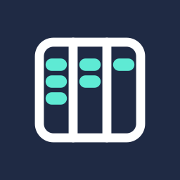
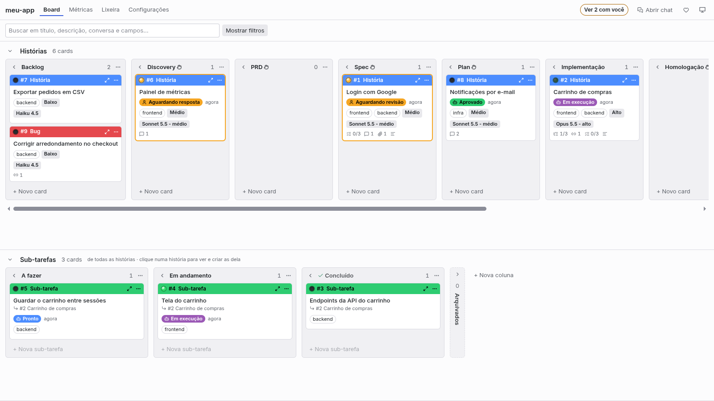
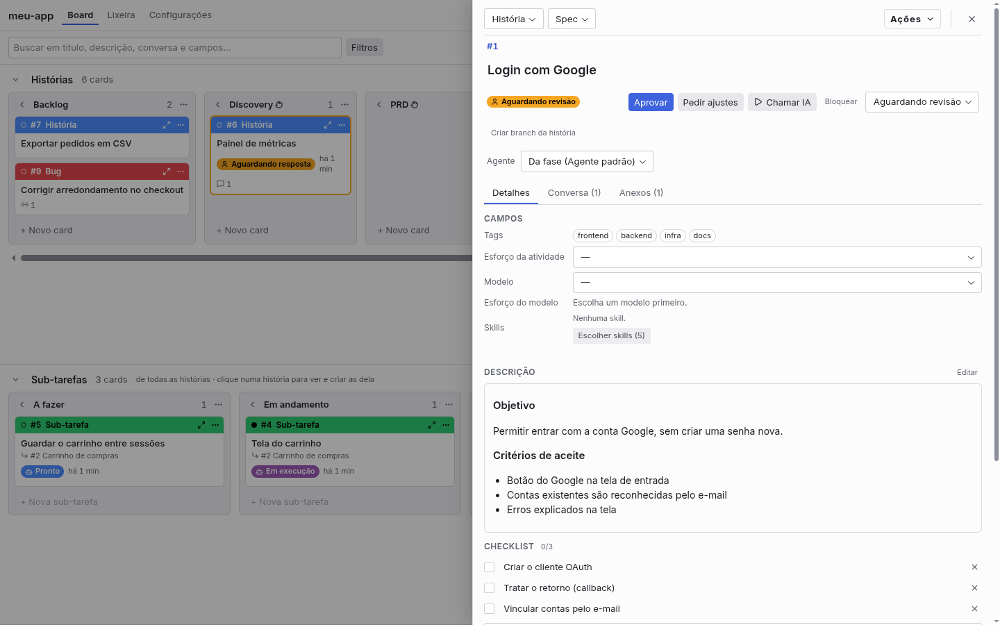
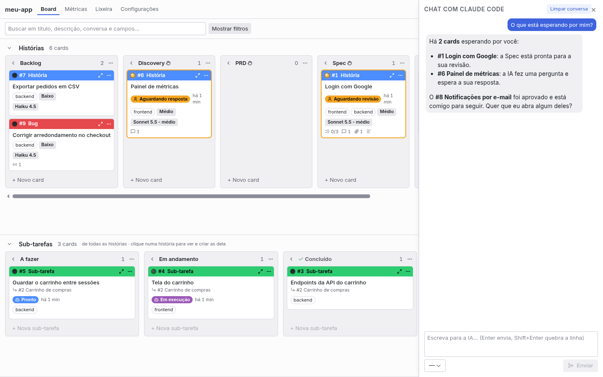
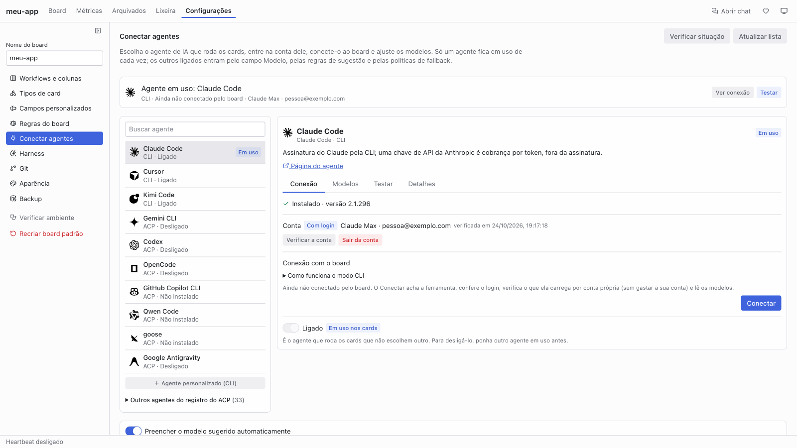

🇧🇷 Português · [🇺🇸 English](README_EN.md)



# Faz AI Kanban

> ⚠️ **O Faz AI está em fase alpha.**
>
> O projeto é novo e muda rápido: quase toda semana sai uma versão, e nem tudo foi testado em todas
> as ferramentas de IA e sistemas operacionais. Erros e comportamentos inesperados podem acontecer,
> e telas, comandos e o formato do board ainda podem mudar de uma versão para outra.
>
> Use à vontade, mas com esse cuidado em mente: revise o que a IA fizer antes de aprovar e não
> dependa do board como único registro de algo importante. Se algo quebrar ou parecer estranho,
> [conte numa issue](https://github.com/euclidesgc/faz-ai/issues): é assim que ele sai do alpha.

> **Obrigado a quem está baixando e testando.**
>
> Publiquei a extensão no marketplace do Cursor e fui dormir. Quando acordei para instalá-la na
> minha máquina de trabalho, ela já tinha 160 downloads. Eu não esperava isso, e fiquei muito feliz.
>
> A cada pessoa que instalou, abriu o board e deu uma chance a um projeto que acabou de nascer:
> muito obrigado. É por vocês que ele continua.
>
> O Faz AI é **totalmente gratuito e open source** (licença MIT), e contribuições são bem-vindas:
> conte o que funcionou e o que não funcionou, [abra uma issue](https://github.com/euclidesgc/faz-ai/issues)
> ou [mande um pull request](https://github.com/euclidesgc/faz-ai/pulls).
>
> Euclides G Catunda

> **Gostou? Ajude o Faz AI a crescer.**
>
> Um projeto novo melhora com o retorno de quem usa. Se ele já te poupou tempo, estes gestos de um
> minuto fazem muita diferença:
>
> - ⭐ **Dê uma estrela** no [repositório do GitHub](https://github.com/euclidesgc/faz-ai): é o que
>   mais ajuda outras pessoas a encontrarem o projeto.
> - 💬 **Avalie a extensão** na loja onde você a instalou, com estrelas e, se puder, duas linhas
>   sobre o que achou: [VS Code Marketplace](https://marketplace.visualstudio.com/items?itemName=euclidesgc.faz-ai&ssr=false#review-details)
>   ou [Open VSX](https://open-vsx.org/extension/euclidesgc/faz-ai/reviews) (a loja do Cursor).
> - 🐞 **Encontrou um bug?** [Abra uma issue](https://github.com/euclidesgc/faz-ai/issues/new?template=bug.yml)
>   dizendo o que você fez, o que esperava e o que aconteceu. A versão da extensão e o editor que
>   você usa ajudam bastante.
> - 💡 **Tem uma ideia ou sugestão?** [Conte numa issue](https://github.com/euclidesgc/faz-ai/issues/new?template=sugestao.yml):
>   fluxos que faltam, telas confusas e integrações que você gostaria de ver.
>
> Antes de abrir, vale uma olhada nas [issues já abertas](https://github.com/euclidesgc/faz-ai/issues):
> às vezes a ideia já existe, e um 👍 nela ajuda a decidir a ordem do que vem a seguir.

Um board kanban dentro do editor (VS Code e Cursor), feito para conduzir Spec-Driven Development
(SDD) junto com uma IA. Você organiza o trabalho em histórias e sub-tarefas; a IA lê o board, produz
os artefatos de cada fase e move os cards conforme avança.



## Primeiros passos

Em cinco minutos você tem uma tarefa andando no board, com a IA trabalhando nela.

1. **Instale e abra.** Instale **Faz AI Kanban** no VS Code ou no Cursor (pelo marketplace da
   própria ferramenta), abra a pasta do seu projeto e clique no ícone **Faz AI** na barra lateral.
   Cada pasta tem o seu board, já com as fases do fluxo.
2. **Conecte a IA ao board.** Em **Configurações → Harness**, escolha a ferramenta do projeto
   (Claude Code, Cursor ou Kimi Code). Na aba **Projeto**, clique em **Instalar (padrão da ferramenta)** no
   grupo **Servidores MCP** e de novo no grupo **Skills**, para a skill do fluxo, que ensina a IA a
   conduzir as fases.
   Os artefatos do board (regras, skills, agentes e servidores MCP) são mantidos na aba **Artefatos do
   board** do Harness: criados ali ou importados de uma pasta, de uma ferramenta instalada ou de um
   arquivo exportado, com cópia e confirmação antes de substituir.
3. **Crie a tarefa.** Na coluna **Backlog**, clique em **+ Novo card**, escreva o título (por
   exemplo, "Login com Google") e dê Enter. Duplo clique abre o card: descreva o que você quer, em
   Markdown, e, se quiser, escolha o modelo da IA e as skills que ela deve ler.
4. **Deixe a IA começar.** Arraste o card para **Discovery** e clique em **Trabalhar na fase** no card. A IA
   lê o card pelo board, analisa o problema e conversa com você na aba **Conversa**. Quando termina,
   o status muda para **Aguardando revisão**: é a sua vez. O mesmo acontece quando a IA deixa
   algo dependendo de você (uma decisão, um ponto em aberto): a pendência aparece na conversa como
   **Travado em mim** e o card fica com você. O que depende de uma resposta sua vai também na seção
   **Perguntas para você** do documento da fase, com as alternativas, a recomendação da IA e o espaço
   `R. >` para você responder.
5. **Revise e siga.** Leia o documento da fase, responda ou clique em **Aprovar** (ou **Pedir
   ajustes**). Com a aprovação, a história avança na hora para **PRD**, **Spec**, **Plan** e
   **Implementação**, sempre com a IA produzindo e você aprovando. As sub-tarefas da implementação
   nascem no workflow de baixo e a IA as conclui uma a uma.

Para o dia a dia: o contador **N com você** no topo mostra o que espera por você, o **Chat** deixa
você pedir à IA, em linguagem natural, para criar e mover cards, e o **heartbeat** pode chamar a IA
sozinho quando há pendência com ela.

### Por que isso poupa contexto

A IA gasta contexto com o que carrega em toda sessão. O board existe para ela carregar só o
necessário, na hora certa:

- **Cada card é uma sessão nova e curta.** Em vez de uma conversa longa que acumula tudo, a IA abre o
  card pelo board (`get_card`), faz aquele trabalho e para. O histórico fica no card, e não na janela
  de contexto.
- **Contexto vazio por padrão.** Toda execução pelo board começa sem nenhuma regra, skill, agente,
  hook ou plugin da sua máquina ou do projeto: só entra o que você marcou em **Harness**. No
  Claude Code isso é imposto por parâmetro (`--setting-sources ""`, `--disable-slash-commands` e um
  arquivo de servidores MCP só com o do board); nas outras ferramentas, o que a linha de comando
  aceita (ver a tabela de [Agentes](#agentes)).
- **Artefatos enviados ao board, não descobertos.** Rules, skills e servidores MCP entram no board
  num modo: **Sempre** (entra em toda execução, pelo caminho) ou **Pelo card** (vira opção dos campos
  Rules, Skills e MCPs do card, e o planejamento ou o Refinar com IA o indica quando a tarefa pede).
  Regras entram **desligadas**, para revisão. O que não está no board não existe para a execução.
- **Agentes com o mínimo.** Um agente libera só os servidores MCP e as ferramentas de que precisa,
  carrega as skills dele e tem instruções curtas; o resto fica de fora.
- **Documentos como anexos.** PRD, Spec e Plan ficam anexados à história; a IA os lê quando o card
  precisa, em vez de recebê-los colados em cada mensagem.
- **Anexos em Markdown abrem formatados.** Um `.md`/`.markdown` abre como uma página, com títulos,
  listas, tabelas e blocos de código formatados; um seletor **Formatado**/**Código** mostra o texto
  cru quando é preciso. Editar, Salvar e Copiar conteúdo continuam operando sobre o Markdown.
- **Modelo certo para cada tarefa.** Regras de sugestão e o modelo por card ou por agente evitam usar
  o modelo mais caro onde o mais leve basta.

A economia de contexto de skills sob demanda é documentada no Claude Code e no Cursor; nas outras
ferramentas, a documentação diz só que a IA deixa de invocar a skill sozinha. O board não promete
um percentual: ele mostra, no inventário, o que está sendo carregado.

## Para que serve

- **Planejar em fases.** As colunas das histórias são as fases do fluxo: Backlog, Discovery, PRD,
  Spec, Plan, Implementação, Revisão, Homologação, Concluído e Cancelado. Cada história se desdobra em
  sub-tarefas, que têm um fluxo próprio (A fazer, Em andamento, Concluído).
- **Dizer à IA o que fazer em cada fase.** Cada coluna tem uma instrução para a IA e, se a fase
  gera um documento (Discovery, PRD, Spec, Plan), o modelo desse documento. No Discovery a IA
  analisa o problema e conversa com você antes de qualquer requisito; na Homologação a história só
  é concluída com a sua aprovação. O Discovery registra um **Mapa do código** (arquivos, funções,
  padrões e testes), a Spec o completa, e PRD, Spec e Plan partem dele e leem só o que falta; cada
  sub-tarefa do Plan traz na descrição os arquivos que vai tocar.
- **Trabalhar com a IA no mesmo quadro.** A extensão expõe o board por MCP. Claude Code,
  Cursor ou outro cliente MCP podem consultar e editar tudo o que a interface permite, e
  as mudanças aparecem no board na hora.
- **Saber com quem está cada card.** Todo card em que a IA atua tem um status (Pronto, Em execução,
  Aguardando resposta, Aguardando revisão, Aprovado, Bloqueado) que mostra se a pendência está com
  você ou com a IA.
- **Revisar antes de a IA avançar.** Nas colunas que exigem aprovação (Discovery, PRD, Spec, Plan
  e Homologação, por padrão), a IA termina o trabalho, pede a revisão e para. Ela só move o card depois que você aprova.
- **Ver o que espera por você.** O filtro "Com você", o contador no ícone da barra lateral e um
  aviso do editor mostram quando a IA pede revisão, faz uma pergunta ou trava num impedimento. A IA,
  por sua vez, pergunta ao board o que está com ela.
- **Dizer à IA como executar cada card.** Cada card pode indicar o modelo, o nível de esforço e as
  skills obrigatórias. O modelo pode ser sugerido por regras a partir do tamanho da tarefa.
- **Decidir antes o que a IA usa.** Um agente define as skills, os servidores MCP, as ferramentas e o
  modelo de cada fase ou card, em vez de a ferramenta descobrir sozinha durante a conversa. Toda
  execução pelo board roda através de um agente.
- **Ver e configurar o harness inteiro.** Para cada ferramenta de IA instalada, o board mostra o
  que ela carrega (instruções, skills, subagentes, comandos, hooks, servidores MCP, plugins e
  configurações), separado entre o projeto, a sua pasta de usuário e os plugins.

## Como usar

1. Abra uma pasta no editor e clique no ícone **Faz AI** na barra lateral. Cada pasta tem o seu board.
2. Crie histórias com **+ Novo card** e arraste-as entre as colunas. Ao arrastar, os outros cards se
   afastam com uma animação suave e um espaço tracejado mostra onde o card vai ficar; ao soltar, ele
   assenta direto no lugar, sem piscar. Clicar numa história mostra só as sub-tarefas dela; duplo
   clique abre o detalhe.
3. No detalhe do card ficam o status, a descrição em Markdown, os campos, o checklist, as
   sub-tarefas, a conversa e os anexos. A conversa é o lugar em que você e a IA falam sobre o card.
   Os documentos das fases (PRD, Spec, Plan…) são construídos nas sub-tarefas, mas ficam anexados à
   história; nas sub-tarefas eles aparecem como links.
4. Busque por texto ou pelo ID (`#12`). A seção **Filtros** da barra lateral filtra por tipo,
   campos, datas e relacionamentos.
5. Cards podem ser arquivados (menu de ações do card → **Arquivar**) ou enviados para a
   **Lixeira**, de onde podem ser restaurados. Os arquivados saem das linhas do board e ficam na aba
   **Arquivados** (entre Métricas e Lixeira), que preserva o histórico: uma linha por workflow, na
   ordem do board, do mais recente ao mais antigo. **Restaurar** devolve o card ao fim da primeira
   coluna do workflow dele (Backlog / A fazer no board padrão), inativo. Restaurar uma história traz
   também todas as sub-tarefas arquivadas dela e desliga o modo autônomo; restaurar uma sub-tarefa
   cuja história está arquivada pede confirmação e restaura a história inteira (uma sub-tarefa de
   história ativa volta sozinha, sem confirmação).

Nada acontece em silêncio: toda ação que vai ao board espera a confirmação e mostra que está
trabalhando. Uma barra fina no topo acende enquanto qualquer pedido está em andamento; o card que
está sendo movido, arquivado, mudando de status ou de título esmaece e ganha um spinner na faixa
(no board e no card aberto); o botão clicado (criar card, enviar mensagem, aprovar, restaurar…) e a
linha afetada (item de checklist, vínculo, campo) mostram a espera no lugar; e o que troca o board
inteiro (recriar, importar um backup, esvaziar a lixeira) fica atrás de um véu. Um campo de texto só
limpa quando o host confirma: se a ação falhar, o aviso aparece e o que você escreveu fica.



Por padrão, uma história não é concluída nem avança de fase enquanto tiver sub-tarefas em aberto
daquela fase. Essas regras podem ser desligadas nas configurações. A fase da sub-tarefa é o campo
**Fase**, que a IA preenche ao criá-la: no card aberto ele aparece só para leitura e não vira padrão
do tipo de card.

No topo do board, **N com você** mostra quantos cards esperam revisão, resposta ou desbloqueio (um
clique filtra só eles), e um indicador aparece enquanto a IA trabalha em algum card.

Cada card tem uma barra na cor do tipo, com o ID, o tipo e os botões de abrir e de ações. Abaixo
vêm o título (inteiro no tooltip, se não couber), o status com um ícone de com quem está a
pendência (robô para a IA, pessoa para você) e há quanto tempo ele está assim, os campos, o modelo
de IA (ex.: "Sonnet 5.5 - baixo") e, no rodapé, os contadores, a branch e o PR. Cards com
pendência sua ganham a borda na cor do status, e o LED da barra diz o estado do card de relance: verde piscando devagar enquanto a IA trabalha nele (na história, também quando ela trabalha numa sub-tarefa), amarelo quando ele espera por você, vermelho quando está bloqueado e apagado quando não há nada acontecendo. Na história, a lista de sub-tarefas mostra o mesmo LED em cada uma: verde piscando em execução, vermelho bloqueada, amarelo esperando a pessoa e apagado parada.

**Cards colapsados.** Você pode colapsar cards para enxergar mais linhas de uma coluna na mesma tela. Um card colapsado mantém a faixa colorida do tipo (com o LED da IA, o número, o tipo e os botões) e mostra o título em até duas linhas, escondendo o resto; a borda de status continua (se o card espera por você), para você varrer o board de relance e saber o que precisa de atenção. O colapso pode ser aplicado em quatro escopos: um card isolado (botão no próprio card), todos os cards de uma coluna (item no menu de ações da coluna), todos os cards do board (botão na barra de filtros) ou só os cards selecionados (botão na barra de seleção múltipla). O estado fica lembrado entre sessões.

**Selecionar todos de uma coluna.** A caixa no início do cabeçalho de uma coluna de histórias, na mesma linha das caixas dos cards (ou **Selecionar todos**, no menu ⋯), marca as histórias visíveis da coluna (o filtro ativo vale); marcada de novo, limpa a seleção. Numa coluna sem cards, a caixa fica oculta, mas o espaço dela continua reservado. Com a seleção feita, o mesmo menu oferece **Arquivar selecionados**, **Mover selecionados para...**, **Concluir selecionados** e **Mandar selecionados para a lixeira**, cada uma com uma confirmação só para o lote; **Limpar seleção** desmarca tudo. A seleção vale para uma coluna por vez: marcar um card de outra coluna substitui a seleção. Na ação em lote, uma história com sub-tarefa em aberto não é concluída (as outras seguem), e mover para uma coluna de cancelamento cancela as sub-tarefas em aberto.

**Ações sobre a seleção.** A barra de seleção múltipla (dois ou mais cards) e o menu ⋯ da coluna oferecem as mesmas ações: **Aprovar**, **Bloquear**, **Desbloquear**, **Trabalhar na fase**, **Refinar com IA**, **Parar a IA**, modo autônomo, colapsar/expandir, arquivar, mover, concluir e lixeira. As ações indisponíveis continuam visíveis e desabilitadas, sem mostrar o motivo; no menu, isso também vale sem seleção. Cada ação atinge só os cards elegíveis e visíveis. Aprovar vale para quem aguarda revisão e usa o avanço automático da aprovação individual; bloquear pede um motivo obrigatório, registrado na conversa de cada card; desbloquear devolve os bloqueados para **Pronto**. Trabalhar e refinar respeitam as vagas de execução em paralelo: quem já está em execução ou não cabe no limite fica de fora. **Parar a IA** interrompe só execuções iniciadas pelo board.


### Vínculos entre cards

Além das sub-tarefas, qualquer card pode ser vinculado a outro, de qualquer workflow, em **Vínculos**
no card aberto (como em Kanbanize ou Businessmap): **pai**, **filho** ou **relativo**. Busque o
outro card pelo número ou título e escolha o tipo do vínculo. O rodapé do card no board mostra o
vínculo e, se há filhos, quantos já estão encerrados. O vínculo repetido e o que fecharia um ciclo
(o pai já ser filho do card) são recusados.

Um pai vinculado segue a regra de Configurações → Regras: quando o último filho em aberto entra numa
coluna de conclusão, o board pergunta (ou move sozinho, conforme a regra) se o pai também vai para a
conclusão. A IA usa as ferramentas `link_cards` e `unlink_cards`, e o `get_card` devolve os
vínculos.

A seção **Vínculos** também mostra, só para exibição, a relação de sub-tarefa: numa sub-tarefa, um
grupo "Pai" com a história; numa história, a contagem de sub-tarefas com um atalho até a seção
**Sub-tarefas**. Essa relação é somente leitura (sem botão de remover) e não entra na regra de
conclusão acima, que continua valendo só para o vínculo manual de pai/filho.

#### Dependência e sub-tarefas em paralelo

Um card pode **depender** de outro: em **Vínculos**, escolha "precisa terminar antes deste card" (o
outro é pré-requisito) ou "só começa depois deste card". O card aberto mostra os grupos **Depende
de** (com quantas dependências ainda estão em aberto) e **Libera**. O board recusa ciclo de
dependência.

A IA usa isso para acelerar a Implementação. No Plan ela declara a ordem entre as sub-tarefas
(`create_card` com `depends_on`, ou `link_cards` com `depends_on`): uma depende da outra quando usa o
que ela produz ou quando as duas alteram os mesmos arquivos. Na Implementação, o `get_card` da
história devolve em `subtasksNow` o que pode rodar agora (e em `subtasksNowNote`, como conduzir a
rodada), e a IA delega **as sub-tarefas sem
dependência pendente a subagentes simultâneos**, cada um com o modelo do seu card; ao fim da rodada
ela verifica o conjunto, faz o commit e parte para a rodada seguinte. `start_work` recusa a
sub-tarefa que ainda espera outra. Sem dependências declaradas, todas as sub-tarefas em aberto são
consideradas independentes. Depende de a ferramenta de IA ter subagentes (o Claude Code tem); sem
eles, a execução segue uma por vez, na ordem das dependências. Projetos que já tinham a skill do
fluxo instalada continuam com o texto antigo dela (o board não sobrescreve uma skill que você pode
ter ajustado): apague-a e instale de novo em Configurações para receber a instrução nova.

### Board no navegador, fora do editor

O board não depende da janela do editor:

- **Abrir no navegador** (no topo do board, ou o comando **Faz AI: Abrir board no navegador**)
  abre o mesmo board numa aba do navegador. O editor continua aberto e é ele que guarda o board;
  as duas telas ficam sincronizadas.
- **Sem o editor**: rode `~/.faz-ai/bin/faz-ai` na pasta do projeto (ou `faz-ai <pasta>`). O
  comando serve o board no navegador, com o servidor MCP, a execução da IA e o heartbeat, e fica
  rodando até você encerrar com Ctrl+C. O atalho é criado pela extensão e usa os mesmos dados dela;
  precisa do Node.js no PATH. Para chamar só `faz-ai`, ponha `~/.faz-ai/bin` no PATH.
  `faz-ai --help` lista as opções (`--port`, `--data`, `--no-open`).

A página só responde em `127.0.0.1` e exige o segredo que vem no link aberto pelo editor ou pelo
terminal (ele fica guardado num cookie, então o endereço pode ir para os favoritos). O tema
"Sistema" acompanha o claro ou escuro do VS Code no editor e o do sistema operacional no navegador,
sempre com as cores do próprio board. No navegador, os filtros abrem na própria barra do board. Um
board é servido por um lugar de cada vez: com o editor aberto na pasta, use **Abrir no navegador**;
o `faz-ai` do terminal avisa e não inicia.

## Usando com IA

1. Em Configurações → **Harness**, escolha a ferramenta do projeto (Claude Code, Cursor ou
   Kimi Code).
2. Na aba **Projeto**, no grupo **Servidores MCP**, clique em **Instalar (padrão da ferramenta)**. O board registra o servidor `faz-ai` no arquivo
   global que a ferramenta lê. Isso também acontece sozinho, em silêncio, ao abrir a pasta (e a cada
   versão nova da extensão), sempre no escopo do usuário; só uma falha gera aviso.
3. No grupo **Skills** da mesma aba, clique em **Instalar (padrão da ferramenta)** para a
   skill do fluxo (`faz-ai-fluxo`): ela ensina a IA a conduzir os cards pelas fases, gerar os
   documentos, pedir revisão e retomar pendências. O botão instala também as skills por assunto
   (harness do card, pasta de trabalho e PR, rodadas, revisão e homologação, modo autônomo). Podem ser editadas.

**Só no global.** O servidor e a skill do fluxo ficam na configuração global da ferramenta, e nada
disso entra na pasta do projeto (que pode ser compartilhada com quem não tem a extensão):

| Item | Onde grava |
|---|---|
| Servidor MCP | `~/.claude.json` (por `claude mcp add-json --scope user`) e `~/.kimi-code/mcp.json` |
| Skill do fluxo | `~/.claude/skills`, `~/.cursor/skills`, `~/.kimi-code/skills` |

Quem quiser uma cópia da skill no projeto usa **Copiar para o projeto** no Harness. Ao atualizar a
extensão, o board refaz o registro global nas ferramentas em que ele já estava.

O registro global não fixa a pasta do projeto: o Claude Code informa a pasta pela variável
`CLAUDE_PROJECT_DIR`, e a ponte do board acha o board subindo a partir da pasta em que a ferramenta
foi aberta.

**No Cursor não há o que instalar.** O global do Cursor é um processo só para todas as janelas e não
sabe qual board atender, então o board grava sozinho o `.cursor/mcp.json` do projeto (fora do git,
pelo `.git/info/exclude`) assim que a pasta abre no Cursor. Na primeira vez em cada projeto, a faixa
pede para **recarregar a janela** (o Cursor só lê os servidores do projeto ao abrir a janela) e depois
para **ligar o `faz-ai`** em Cursor Settings → MCP (o Cursor deixa desligado todo servidor novo do
projeto). Substituir uma skill do fluxo que já existe no destino pede confirmação (o que foi
ajustado nela se perde). O comando **Faz AI: Instalar o MCP do board (global)** da paleta faz a
instalação na ferramenta do projeto. Um registro de projeto antigo (`.mcp.json`,
`.kimi-code/mcp.json`) vale sobre o global e não é migrado: tire o `faz-ai` desse arquivo à mão, ou rode o
comando de instalação de novo.
4. Abra uma sessão nova da ferramenta na pasta do projeto e peça, por exemplo, "liste os cards do
   board", "pegue a história #1 e escreva o PRD" ou "veja o que está pendente no board e dê andamento".

Enquanto faltar alguma coisa para o board trabalhar, a aba **Configurações** e o botão **Verificar
ambiente** ganham um ícone de atenção. O hint dele resume o que falta, com o nome de cada item, e a
explicação com a ação de cada um fica no Diagnóstico do ambiente. No painel de chat, que não tem as
Configurações, fica uma faixa com os mesmos itens. O board confere o Node.js (o servidor do board
roda com ele) e **cada perfil de CLI ligado**: se a linha de comando existe, se está logada (no
Cursor por `cursor-agent status`, no Claude Code por `claude auth status`, no Kimi Code pela pasta de
credenciais dele, e nos perfis personalizados pelo comando de status que o perfil informa) e se o
perfil não espera revisão. O perfil importado que ainda não foi revisado não roda nenhum comando.

O aviso só **bloqueia** o board (ícone vermelho, botões de IA desligados, heartbeat e modo autônomo
parados) quando **nenhum** perfil ligado está disponível. Um perfil com problema, enquanto outro está
pronto, vira só um aviso dele, com o link para o bloco dele no Diagnóstico: com o Claude Code
instalado e logado e o Cursor ausente, o board trabalha e o Cursor aparece como não encontrado. Os
perfis desligados e os pendentes de revisão nunca geram aviso. O ícone some sozinho quando o último
item é resolvido. A conferência roda ao abrir o board, quando a ferramenta ou a permissão mudam, a
cada 5 minutos e em **Verificar de novo**, que relê também o PATH do terminal (um node instalado com
o board aberto é encontrado sem recarregar a janela) e diz quando nada mudou. Ao lado, no editor,
**Recarregar a janela** reinicia a extensão: é o que faz valer uma extensão recém-atualizada. Com a IA
trabalhando em algum card, pergunta antes, porque a execução para.

**Mudança de comportamento.** O Diagnóstico e o aviso do topo deixam de cobrar o MCP do board
registrado na ferramenta, a skill do fluxo instalada nela, o nível de permissão no arquivo dela e o
MCP do Code Review Graph: o board entrega o contexto às execuções, e isso não depende mais de a
ferramenta estar configurada. Saem também os botões que resolviam esses itens (**Instalar o MCP do
board**, **Corrigir o registro**, **Corrigir o caminho**, **Instalar a skill**, **Liberar as
ferramentas do board**, **Abrir MCPs do Cursor**). Enquanto a linha de comando do perfil padrão falta
ou está sem login, os botões de IA do card ficam desligados, com o motivo na dica.

**Login vencido: aviso e retomada sozinha.** Quando o motivo do aviso é login (faltando ou vencido no
meio de uma execução), o perfil ganha o aviso "sem login" e, nos perfis prontos, o botão **Abrir no
terminal** ao lado do comando para copiar: o board abre um terminal do editor e roda o comando ali,
mas o login em si é sempre feito por você. Antes de cada chamada da IA (o botão do card, o heartbeat
e o modo autônomo) o board confere o login de novo; se ele venceu, a execução nem começa. Quando o
login vence no meio de uma execução, a primeira falha que bater um padrão conhecido ("OAuth session
expired", "not logged in", "401" etc.) não bloqueia o card: ele volta ao status que tinha, com um
comentário curto, e o heartbeat e o modo autônomo não tentam de novo sozinhos enquanto o login do
perfil padrão estiver vencido. A fila volta a andar sozinha quando o login é confirmado de novo (pela
conferência periódica, em até 10 segundos) ou, quando a conferência não sabe dizer, na primeira
execução manual que der certo. O Diagnóstico mostra o mesmo aviso na linha **Login** do perfil.

**Diagnóstico do ambiente.** Na primeira abertura do board na máquina, abre sozinha uma lista com
tudo de que o board precisa e o que ele aproveita. Depois, ela abre pelo botão **Verificar
ambiente**, nas Configurações (com o ícone de atenção quando falta algo). Cada item tem
um ícone de pronto ou de falta, e o que depende de outro item aparece dentro dele (o login dentro da
linha de comando, o grafo dentro do Code Review Graph). Passe o mouse sobre um item para ver como o
board o usa.

- **Necessários:** o Node.js 22 ou mais novo.
- **Perfis de CLI:** um bloco por perfil ligado, com o padrão primeiro, e o grupo **Desligados**, fechado,
  com os desligados e os pendentes de revisão. Cada bloco mostra a **situação** (Ligado, Desligado ou
  Pendente de revisão), a **linha de comando** (o caminho e a versão encontrados, ou "não encontrada"
  com a instalação: o instalador oficial dos perfis prontos, o link que o perfil informa, ou "Este
  perfil não informou como instalar"), o **login** (conectado, desconectado ou "não conferido" quando
  o perfil não tem comando de status), as **credenciais** (só o nome da referência e se está preenchida
  ou ausente, nunca o valor) e a **última verificação real**. Hoje o board ainda não grava essa
  verificação: o bloco diz "Não validado: este perfil ainda não foi testado" como informação, sem selo
  de verificado, e isso não impede o perfil de ser usado. O link do aviso do topo abre o Diagnóstico já
  no bloco do perfil.
- **Banco de artefatos** (antes "definição do harness"): recomendação, não bloqueio. O board trabalha
  sem ele, só sem o ganho de economia e precisão. Aponta, um filho por falta, o que falta: nenhuma
  skill, agente ou servidor MCP em modo Pelo card (use "Indicar artefatos"), nenhum agente do board,
  regras enviadas e ainda desligadas e artefato que sumiu da origem. Não depende de ferramenta nenhuma.
  O mesmo aparece no aviso do topo como linha discreta de recomendação, com o atalho para o Harness.
- **Recomendados:** o Git e um repositório na pasta, o GitHub CLI e o login dele (para o merge
  automático e o acompanhamento dos PRs) e o [Code Review Graph](https://github.com/tirth8205/code-review-graph),
  um grafo do código que a IA consulta em vez de ler arquivos inteiros, com o grafo do projeto e a busca
  semântica. Enquanto falta, o Code Review Graph aparece dentro do
  [uv](https://docs.astral.sh/uv/), na ordem de instalar: o uv instala o Code Review Graph
  (`uv tool install code-review-graph`) e baixa um Python 3.10 ou mais novo só para ele, se faltar.

O board não instala nada de terceiros. Cada programa traz, entre parênteses, o site oficial onde você
encontra como instalar e, enquanto falta, o comando de instalação oficial para copiar, só os neutros,
que valem em qualquer distribuição: `curl` no Linux e no macOS, PowerShell no Windows (o Node.js pelo
`nvm`; no Windows, pelo `winget`). O Git e o GitHub CLI não têm um instalador assim e trazem o comando
do sistema: `xcode-select --install` e `brew install gh` no macOS, `apt`, `dnf` ou `pacman` no Linux
(com o `sudo apt update` antes, que uma máquina nova precisa) e `winget` no Windows; numa
distribuição desconhecida, fica só o site. Os logins e as ações na pasta do projeto (`git init`, `gh auth login`, `code-review-graph build`,
`code-review-graph embed --provider local`) também trazem o comando com botão de copiar. O Diagnóstico só confere e orienta: os únicos botões levam ao Harness e
ao terminal do login.

O chat do editor inicia o MCP do board com o PATH de quando o editor abriu: um Node instalado depois
(pelo `nvm`, por exemplo) não está nele até o editor fechar e abrir de novo. Por isso, quando o Node
aparece, o board grava o caminho completo do comando nos registros do `faz-ai` e do
`code-review-graph` que o editor não acha. O caminho é descoberto na hora, na máquina onde a extensão
roda, e o arquivo fica fora do git (`.git/info/exclude`). Se o arquivo de MCPs do projeto estiver
versionado, o board não grava nele.

Fluxo sugerido: a IA lê a história e a instrução da fase, cria uma sub-tarefa para construir o
documento da fase, anexa o documento à história e pede a revisão pela conversa do card. Você
responde no próprio card:

- **Aprovar** leva o card para a próxima coluna na hora (o status recomeça lá, Pronto para a IA).
  Só fica Aprovado, para a IA mover, quando o board não pode: a aprovação que faz o merge automático
  conclui o card depois do merge, e a conclusão recusada por sub-tarefa em aberto deixa o aviso na
  conversa.
- **Pedir ajustes** devolve o card para a IA com o seu texto na conversa.
- Se a IA fizer uma pergunta, o card fica Aguardando resposta; ao responder na conversa, ele volta
  para a IA.
- **Bloquear** registra um impedimento, com o motivo.

### O que cada fase entrega

As instruções e os modelos de documento do board padrão pedem, em cada fase, o que deixa a revisão
do código rápida depois:

- **Spec com o desenho do programa.** Além da arquitetura, a Spec traz os tipos e as assinaturas
  novos ou alterados, o arquivo de cada um e quem chama quem no caminho principal, com o fluxo da
  funcionalidade em diagramas Mermaid. As alternativas descartadas vêm com o motivo de cada uma.
- **Plan com partes fáceis de revisar.** Cada passo é uma parte inteligível da entrega e diz como
  verificá-la (teste, typecheck, comando ou tela); recortar por camada vale, desde que cada parte seja
  verificável. O plano estima as linhas de código da entrega: acima de umas 400, a IA deixa na
  história a primeira parte e cria as seguintes como **histórias derivadas**, em ordem (`create_card`
  com `derived_from` apontando para a parte anterior). A branch de cada derivada parte da branch da
  parte anterior e o pull request dela é empilhado sobre o dela; o card mostra **Derivada de #N**. Se a
  parte anterior ainda não tem branch, a derivada espera por ela antes de criar a sua.
- **Revisão antes do pull request.** Depois da Implementação, a coluna **Revisão** roda as checagens
  do projeto (typecheck, lint, testes e build, como o projeto os define) e revisa o diff da história
  com um olhar independente: delega ao agente `revisor-de-codigo`, numa sessão nova, quando ele está
  entre os agentes do board. Além dos defeitos, a revisão procura o código que só passa no teste
  (teste novo que já passava antes da mudança, teste alterado junto com o código que ele cobre,
  try/catch que engole erro, cast forçado, acoplamento novo). O que tem diretriz clara é corrigido na
  hora; o que é ambíguo ou muda o comportamento combinado vira pergunta para você, e a IA para. A
  coluna não pede aprovação: o resultado fica na conversa e entra no **Como revisar** do PR.
- **Pull request que explica a entrega.** Na Homologação, o corpo do PR traz o **Objetivo**, **O que
  foi feito**, **Como revisar** (por onde começar a ler, a ordem dos commits e o tamanho do diff), as
  **Decisões** (por que o caminho escolhido, as alternativas descartadas e os desvios do plano) e o
  roteiro **Como testar**.

**Caminho curto para histórias pequenas.** Crie a história direto na coluna em que ela deve começar
(o **+** no topo de cada coluna) ou arraste-a para lá, por exemplo para o Plan. A IA começa dali: sem
os documentos das fases anteriores, trabalha a partir da descrição, da conversa e do código, e o
`get_card` diz quais documentos não existem para ela não os criar nem bloquear por falta deles. Na
Implementação, uma história sem sub-tarefas ganha uma a partir da descrição.

Boards criados antes recebem os textos novos pelo **Atualizar board** (Configurações), só nas colunas
que ainda têm o texto padrão anterior: o que você personalizou fica como está. A skill do fluxo
instalada não muda sozinha; reinstale-a (substituindo) para ela ensinar o mesmo.

### Chat com a IA



Para dar ordens ao board em linguagem natural, use o **Chat**: na barra lateral do editor, a seção
**Chat com a IA** (abaixo de Board e Filtros); no navegador, o botão **Chat** do topo, que abre um
painel à direita. Escreva, por exemplo, "crie uma história Login com Google e três sub-tarefas" ou
"o que está esperando por mim?". A IA do projeto responde e age pelas ferramentas do board: cria,
move e vincula cards, e consulta o que há nele. Abaixo do campo você escolhe o **modelo e o esforço**
das próximas mensagens (a escolha fica lembrada). Enter envia, Shift+Enter quebra a linha, **Parar**
interrompe e **Limpar** apaga a conversa. O histórico fica guardado por projeto.

O chat usa a mesma execução em segundo plano dos cards, então vale o limite de Configurações →
Harness → "O que a IA pode fazer" (por padrão, só o board) e o tempo limite de lá.

### Trabalhar na fase e Refinar com IA

O card tem dois botões que chamam a ferramenta do projeto em segundo plano. Não é um chat ao vivo:
a resposta chega como mensagem na conversa quando a execução termina, e enquanto isso o card fica
"Em execução" (com um botão **Parar**). Os botões mostram um hint explicativo (com negrito e tópicos)
ao passar o mouse ou focar com o teclado; o hint abre por hover e por foco de teclado, fecha com Esc,
e continua visível mesmo quando o botão está bloqueado.

- **Trabalhar na fase** faz o trabalho da coluna em que o card está, o mesmo que o heartbeat faria:
  em Discovery analisa o problema, em PRD escreve o PRD, em Implementação escreve o código (se a
  permissão deixar). Lê a conversa e responde a ela, e termina passando a vez: pede revisão, faz
  uma pergunta, bloqueia ou move o card. Se Tags, Esforço da atividade, Modelo e Skills estiverem
  todos vazios, ela os preenche antes. Fica no cabeçalho do card e na conversa (com texto escrito,
  **Enviar e trabalhar na fase** manda a mensagem antes).
- **Refinar com IA** só deixa o card claro e completo para quem vai trabalhar nele: reescreve
  título e descrição (sem inventar requisito; o que estiver ambíguo vira uma lista "Dúvidas em
  aberto"), revisa Tags, Esforço da atividade, Modelo e Skills mesmo que já tenham valor e
  acrescenta ao checklist os passos que faltam. Não trabalha a fase, não cria sub-tarefas, não move
  o card e não mexe em arquivos: roda só com o board. Antes de reescrever a descrição, grava o texto
  anterior, sem alteração, como anexo da história (`descricao-anterior-AAAA-MM-DD-HHMM.md`, sem
  virar artefato); a conversa não recebe o texto, só o nome do anexo. No fim, resume na conversa o
  que mudou (citando o anexo, se reescreveu a descrição) e o card volta ao status que tinha, também
  quando a execução falha:
  a falha fica na conversa, sem bloquear o card. Um refino não conta como execução sem progresso
  para o modo autônomo.

Imagens coladas na mensagem ou na descrição do card viram anexos dele e a IA as recebe.

- **Resumir a conversa**, na aba Conversa, aparece a partir de 2 mensagens: lê a conversa inteira e
  grava um resumo (Decisões, Observações, Pendências) como uma mensagem nova da IA (`kind:
  "summary"`), sem apagar nada automaticamente, sem trabalhar a fase, mover o card ou mudar o
  status — roda só com o board, sempre na faixa de modelo "Alto" (independente do Esforço do card).
  O resumo **desativa** as mensagens anteriores: a IA passa a receber a conversa a partir do último
  resumo (`comments` do `get_card`), o resumo ganha destaque na tela e as mensagens anteriores ficam
  esmaecidas. Você revisa o resumo como revisa qualquer mensagem: concorda deixando como está ou
  edita o texto. Qualquer mensagem pode ser apagada por você; logo abaixo do resumo, o botão
  **Apagar mensagens resumidas** apaga, com confirmação, todas as anteriores a ele; resumir de novo
  cria um registro novo, sem substituir o anterior. O [heartbeat](#heartbeat) resume sozinho a
  conversa que cresceu. Está disponível também como ferramenta MCP (`generate_summary`), com o
  mesmo resultado.
- O que a IA pode fazer nessas execuções se define em Configurações → Harness → **Execução
  pela conversa**: só o board (padrão), board e arquivos do projeto, ou sem restrições. O nível em
  uso aparece ao lado do botão, com um atalho para mudar. A IA é avisada do limite: se o trabalho
  pedir mais do que o nível permite, ela bloqueia o card dizendo qual opção escolher.
- O Cursor aceita os três níveis: em "só o board" e "board e arquivos" a sessão dele recebe só as ferramentas do nível
  (leitura e MCP; leitura, MCP e edição), sem terminal.
- A ferramenta precisa estar instalada e autenticada. A CLI não precisa estar no PATH: o board a
  procura também nas pastas de instalação usuais e dentro das extensões do editor (quem só usa a
  extensão do Claude Code já tem o executável). A do Cursor é a `cursor-agent` (o
  instalador de `curl https://cursor.com/install -fsS | bash` cria também o atalho `agent`); entre na
  conta uma vez com `cursor-agent login`.
- Com o Claude Code, o servidor do board vai na linha de comando de cada execução: não depende de
  instalar o MCP nem da aprovação do `.mcp.json`. Com o Cursor, o board usa o registro global do
  `~/.cursor/mcp.json` quando ele leva a este board; sem ele (ou numa worktree fora da pasta do
  projeto), grava o servidor no `.cursor/mcp.json` antes de rodar (e põe o arquivo no
  `.git/info/exclude` quando o cria). Nas outras ferramentas, instale antes.
- Quando a história tem pasta de trabalho própria (worktree), a ferramenta recebe essa pasta junto
  com a do projeto, inclusive o Cursor.
- Parar e o tempo limite encerram a ferramenta e tudo o que ela iniciou (servidores MCP, testes,
  comandos). O Claude Code não roda "sem restrições" como root (contêineres, WSL como root): o
  board avisa. Sem Node.js no PATH, o servidor do board roda com o runtime do próprio editor.
- Se a execução falhar ou passar do tempo limite, o card fica Bloqueado com o motivo e o fim da
  saída da ferramenta. O log completo está no painel **Saída → Faz AI** (ou no terminal do `faz-ai`).

### Contexto estimado de cada card

No rodapé de cada card do board, um anel discreto mostra quanto da janela de contexto a execução do
card ocupa antes de a IA começar, com o total ao lado (por exemplo, `5,8 mil`). O clique abre o
detalhe, no formato da janela de contexto do Claude Code: o total sobre a janela do modelo do card,
uma barra por grupo e cada item, com quanto ocupa.

- **Servidores MCP.** No Claude Code, a sessão começa só com os nomes das ferramentas e as instruções
  de cada servidor (cortadas em 2.048 caracteres); as definições completas carregam quando a IA
  procura a ferramenta e aparecem à parte, como **sob demanda**, fora do total. O board mede o próprio
  servidor; os servidores que o agente libera aparecem como **não medido**, porque o board não os
  abre.
- **Agentes.** As instruções do agente da sessão e, numa história no Claude Code, o nome e a descrição
  de cada subagente (as instruções de um subagente vão para o contexto dele, não para o da sessão).
- **Rules e Skills.** As que estão no board em modo **Sempre** e as indicadas no card ou no agente,
  pelo tamanho do arquivo que a sessão lê.
- **Card.** Título e descrição, checklist, conversa, instruções e modelo da fase, e os documentos das
  fases.

É uma estimativa pelo tamanho do texto (cerca de 4 caracteres por token), feita para comparar escolhas
e achar o que pesa antes de rodar: desmarcar uma skill, tirá-la do card ou trocar o agente muda o
número na hora. A estimativa acompanha o card: numa coluna em que a IA atua, ela diz a fase e soma as
instruções dela, e a conversa e os documentos entram conforme crescem. Apagar mensagens diminui só as
próximas execuções; o que já foi gasto não volta. Ao abrir, o detalhe relê do disco os arquivos do
harness: se algo mudou desde a última leitura (uma skill global editada fora do board, por exemplo),
ele avisa e já mostra os números novos; o botão **Reler arquivos** faz o mesmo a pedido. Ficam fora da
conta o prompt e as ferramentas nativas da própria ferramenta de IA. A
janela vem do modelo do card (ou do agente): 1M no Fable 5.1, no Opus 5.5 e no Sonnet 5.5, e 200 mil
no Haiku 4.5. Sem modelo, ou com um modelo de janela desconhecida (como os do Cursor), o anel mostra
só o total. No Cursor, que não impõe o contexto vazio, o que a ferramenta carrega por conta própria
também fica de fora, e as definições das ferramentas MCP contam inteiras. O que a execução gastou de
fato aparece depois, no consumo de cada execução.

O bloco **Contexto da execução**, em **Consumo → Próxima execução**, mostra agente, candidatos à
delegação nativa, rules, skills e servidores MCP com todas as origens: card, agente, fase, história,
padrão ou modo Sempre. Um arquivo selecionado por várias origens aparece uma vez por identidade
(a da cópia do board, quando disponível). O bloco também aparece nos editores de agentes, com o
rascunho e os itens Sempre, sem incorporar seleções de um card.

A prévia usa o manifesto atual e não inicia uma execução nem chama IA. Ela distingue restrições
impostas pelo executor de orientações no prompt, aponta parágrafos idênticos nas instruções dos
agentes e informa que não compara o conteúdo de rules e skills. Tamanhos desconhecidos continuam
não medidos; a estimativa inicial não prevê o consumo total de uma tarefa. Essa entrega torna o
comportamento atual visível; configurações por ação e novos limites de autorização ainda não estão
ativos.

A persistência já separa contratos de contexto **versão 1** dos campos legados, com revisões e
seleções por ação e ID de fase. Herança e seleção vazia são valores distintos. Os contratos novos
são rascunhos e ainda não governam o runtime. A prévia identifica esse modo
legado. A migração para o schema 35 mantém os campos originais; sua leitura de compatibilidade
identifica skills dos agentes como essenciais e skills dos cards como selecionadas, inclusive
referências ausentes. MCPs legados não viram autorizações do contrato novo. Exportar e importar
preserva os rascunhos e suas versões, sem incluir definições MCP nesses contratos; a exportação contém somente referências locais das configurações MCP, sem seus valores.

Ao editar um subagente já salvo na biblioteca, **Editar contrato de contexto (rascunho)** abre o contrato v1: papel, instruções, skills essenciais, skills sugeridas, MCPs permitidos e restrições de ferramentas. O contrato tem salvamento próprio, sem IA e com revisão otimista; não copia automaticamente autorizações legadas. A prévia mostra essenciais e itens Sempre, mantém opcionais inativos e explica recursos ausentes ou MCPs incompatíveis. Referências ausentes permanecem revisáveis.

O protocolo host–webview e o MCP `preview_context_draft` oferecem a prévia dos rascunhos salvos: resolvem herança, origens e incompatibilidades sem inferência e retornam metadados dos artefatos. A admissão por capacidades de #729 continua pendente; a prévia não autoriza execução.

A aba **Plano de execução** permite revisar agente, modelo, skills adicionais, MCPs ativos, anexos de entrada e resultado esperado por ação. Histórias incluem linhas por fase aberta; tarefas têm quatro ações independentes (trabalho, refino, resumo e conflito). Em **Configurações → Harness → Ferramenta**, os padrões do board e dos workflows usam o mesmo editor, incluindo conversa e assistentes sem card. As origens e incompatibilidades ficam na prévia. O catálogo mostra descrições curtas, sem abrir os corpos dos especialistas.

As alterações ficam em rascunho até **Comparar alterações** e **Aplicar rascunhos revisados**, com diferenças, justificativa e estimativa da parcela conhecida do contexto. Copiar entre atividades também exige comparação. Critérios e dependências referenciam o card original. O schema 37 guarda justificativas; o host salva o lote em uma transação e recusa revisões atrasadas sem gravar parcialmente. Falhas preservam os rascunhos, que também sobrevivem à troca de abas do card. Essa configuração prepara o plano; a execução continua legada até a ativação da E5.

O transporte que precisa de MCP por arquivo (Cursor e Kimi) usa um empréstimo coordenado pelo caminho real. O diário protegido em `~/.faz-ai/mcp-leases` precede a alteração; tentativas de formato reutilizam a mesma posse. Ao terminar com confirmação, o arquivo volta ao estado anterior, preservando servidores acrescentados pela pessoa. Alterações conflitantes da entrada `faz-ai` ou JSON inválido não são sobrescritos. Sem confirmação do fim da árvore de processos, o empréstimo fica retido e uma nova execução no mesmo arquivo é recusada. O launcher recebe o comando da CLI somente depois de sua identidade ser gravada no diário. Na abertura, um dono comprovadamente morto permite recuperar preparações sem comando liberado e grupos registrados cujo término foi confirmado. Diários antigos ou ambíguos permanecem retidos. O Windows ainda não tem confirmação de árvore nesse transporte; esse caso exige reconciliação. Isso não comprova isolamento da CLI nem conclui #729.

No host, runner e chat publicam os arquivos selecionados da biblioteca em `run-artifacts/<boardId>/<runId>`, com revisão e SHA-256. Prompts e diretórios extras passam a usar essa cópia. Atualizar ou apagar o artefato ou seu cache não regrava o snapshot; uma falha de materialização obrigatória impede o processo. O schema 38 acrescenta revisões monotônicas aos artefatos. Snapshots publicados são preservados, inclusive em runs inconclusivos; ainda não há coleta automática. Isso congela os arquivos referenciados pelo prompt; sessões MCP controladas também usam a cópia, conforme descrito abaixo. Fontes externas legadas e a resolução v1 completa ainda não foram ativadas na E5.

A fundação local da orquestração usa `ai_work` e `ai_work_attempts` (schema 39), com posse por unidade, gerações, hash do token, identidade do processo e contagem de mutações. Essas tabelas não são exportadas; importar não cria posses e é recusado enquanto houver trabalho local em execução ou reconciliação. O flush do banco sincroniza o arquivo antes da troca atômica e o diretório nos sistemas POSIX. Uma trava por pasta real, compartilhada entre processos, só libera um escritor depois da confirmação do grupo; adotar uma reserva de um host morto não a libera automaticamente. Regras puras calculam rodadas, reconciliação e limites solicitados/efetivos. A ligação aos gatilhos continua pendente; esta base não altera quem executa as sub-tarefas nem comprova isolamento de uma CLI.

Execuções controladas agora têm identidade MCP por tentativa: o host injeta `FAZAI_RUN_TOKEN` apenas no ambiente da ponte, que envia um prefácio consumido pelo transporte antes do protocolo MCP. Cada chamada valida dono, geração e revogação; mutações recebem o run autenticado e são contadas. `get_skill`, `get_agent`, `get_board_artifact` e `read_rule_file` usam o snapshot capturado, e o encaminhamento externo fixa os servidores selecionados e suas operações. Sessões externas continuam disponíveis, mas não assumem um card reservado pelo board. O runner aceita identidade e orientação do orquestrador, sem concluir a unidade apenas por código zero. Essa API ainda não está ligada aos gatilhos: a ativação automática, a persistência anterior à liberação da CLI e #824/#825 continuam pendentes.

O gateway também aceita um registro assíncrono de identidade (`beforeStart`): o launcher aguarda sua conclusão antes de receber o comando. Falha, cancelamento ou revogação durante a espera impedem liberação tardia. O transporte medido preserva a identidade e a confirmação de término para a reconciliação. O Orchestrator descrito abaixo já liga esse ponto ao flush e à posse da pasta por um UnitStarter injetado; os gatilhos de produção continuam pendentes.

O `Orchestrator` já oferece `drive`, continuação de rodadas, reconciliação na abertura, varredura e cancelamento, com um `UnitStarter` injetado. Ele sincroniza a preparação e a identidade antes de liberar a CLI, confirma o grupo de processos e grava o resultado antes de liberar a trava. A referência à pasta permanece persistida até a liberação física ser confirmada, inclusive após queda nesse intervalo; a importação também respeita essa reserva. Testes com processos Node, ponte MCP e banco em disco cobrem três filhas em sequência, fechamento único, trabalho parcial, cancelamento com descendente e reinício real do controlador. A criação no host e a ligação aos gatilhos continuam pendentes, assim como os ciclos de devolução humana e a associação estável da Fase. Isso ainda não ativa o plano v1 nem valida CLIs reais de IA.

A base de admissão v1 no gateway distingue conversa, artefatos, permissões, MCP e delegação e exige recibos locais vinculados à configuração atual. A decisão fica no histórico (schema 36), sem virar autorização ao exportar/importar. Lista vazia significa nenhuma ferramenta; o mapeamento estrito do Claude usa ferramentas e operações MCP exatas, sem pular permissões. Essa base ainda aguarda o verificador das CLIs reais e a ativação nas ações da E5: a execução atual continua legada e nenhum executor recebe verificação automaticamente.

### Aba Consumo do card

O card aberto tem a aba **Consumo**, que junta as duas contas:

- **Próxima execução**: a mesma estimativa do anel do board, com a fase, o modelo e o detalhe por
  grupo.
- **Gasto até agora**: o que a ferramenta mediu no fim de cada execução do card, uma linha por fase
  (Discovery, PRD, Spec…), com execuções, tempo, tokens de entrada, de saída, de leitura e de escrita
  de cache, e o total. Numa história, as execuções das sub-tarefas entram numa linha à parte e no
  total. A fase é a coluna em que o card estava quando a execução rodou.

O gasto é histórico e só cresce: apagar mensagens da conversa, desmarcar uma skill ou trocar o agente
diminui as próximas execuções (a estimativa), nunca o que já foi gasto. Uma execução sem medição conta
nas execuções e aparece como **não medido**, nunca como zero; uma execução em andamento entra quando
termina, e a aba se atualiza sozinha. As execuções de meses que passaram da retenção do detalhe ficam
só nos totais mensais do board e a aba avisa até quando. Como no resto do board, o consumo é em
tokens, sem custo em dólar.

### Consumo e inventário de cada execução

Cada vez que a IA roda (pela conversa, pelo heartbeat ou pelo modo autônomo), o board registra no
banco o que a execução consumiu: tokens de entrada, de saída, de leitura de cache e de criação de
cache, o número de turnos e o id da sessão da ferramenta. Registra também o
**inventário** do que a IA usou: ferramentas nativas, ferramentas de MCP (com o servidor de cada
uma), subagentes e skills, com a contagem de chamadas.

- **O consumo é medido em tokens; o board não mostra custo em dólar.** As duas ferramentas informam
  os tokens: no Claude Code, entrada, saída, leitura e criação de cache, por modelo, com os subagentes;
  no Cursor, os mesmos quatro contadores. Só o Claude Code informa também o custo em dólar, e o Cursor
  não; um total em dólar que cobrisse só parte das execuções confundiria mais do que ajudaria, e uma
  tabela de preços envelheceria a cada mudança de tarifa. Por isso, por enquanto, o board mostra só
  tokens. O valor em dólar que o Claude Code informa continua gravado no banco, para poder voltar
  depois sem perder o histórico. Onde aparecer "não medido" é isso, falta de medição, e nunca
  consumo zero.
- **Toda execução passa por uma única porta.** O executor de cards (manual, heartbeat e modo
  autônomo) e o chat do board chamam a IA pelo mesmo ponto do código (`AiGateway`), que abre a linha
  no log antes de rodar, fecha com o desfecho e grava o consumo. Cada ferramenta tem um provider
  próprio, que monta o comando e lê a saída. Uma terceira forma de chamar a IA não existe sem passar
  por ali, e um teste falha se algum arquivo tentar. O que fica de fora do registro, por natureza, é
  o que você roda direto no terminal ou no chat da própria ferramenta, sem o board.
- **No canal de log** (**Saída → Faz AI**), a saída da ferramenta aparece em linhas legíveis, e no fim
  de cada execução vem uma linha de resumo com entrada, saída, leitura e criação de cache e turnos,
  por exemplo `Consumo: 1.250 entrada · 3.400 saída · 52.000 leitura de cache · 9.100 criação de
  cache · 8 turnos`. Os turnos ficam de fora quando a ferramenta não os informa.
- **A execução que cai antes do primeiro evento não é repetida.** O board pede a saída estruturada à
  ferramenta e só repete a chamada em modo texto, uma vez e com as mesmas restrições, quando a
  ferramenta recusa um desses argumentos antes de começar (versão antiga da CLI). Qualquer outra
  falha antes do primeiro evento (rede, cota, login, queda, saída truncada) termina como falha, com o
  consumo "não medido": a ferramenta pode ter alterado arquivos ou mexido no board antes de cair, e
  repetir duplicaria o efeito e o consumo. O card bloqueado e o erro do chat avisam que a execução não
  foi repetida, e a linha "Chamando…" do canal diz a tentativa e o id da execução.
- **Perguntas no chat do board** também entram no registro, sem card associado.
- **O detalhe de cada execução é guardado por uma janela que você configura**, de 1 a 24 meses (o
  mês corrente mais os anteriores). O padrão é 6 meses. Depois da janela o detalhe é descartado, mas
  os **totais por mês nunca expiram**. Antes o prazo era 12 meses; o padrão menor mantém o arquivo do
  banco dentro do limite de tamanho. Onde ajustar, e o que acontece ao baixar a janela, está em
  **Painel de métricas**, logo abaixo.

### Painel de métricas

O botão **Métricas**, o quarto da navegação do topo (Board, Métricas, Lixeira, Configurações), mostra
o que o board registrou sobre o trabalho e o uso da IA. Funciona no editor e também no board aberto
pelo navegador.

- **Filtros.** O período pode ser Hoje, 7 dias, 30 dias, Este mês, Últimos 12 meses, Tudo ou um
  Intervalo livre (data inicial e final). O filtro **Workflow** restringe os números a um workflow, e
  **Limpar filtros** volta ao padrão. Abaixo dos controles o painel escreve o período consultado.
- **Quatro totais.** Atividades concluídas (cards que chegaram a uma coluna de conclusão), execuções
  de IA, tokens e tempo de IA. O **tempo de IA é a soma da duração de cada execução**:
  execuções simultâneas somam, então o total pode passar do tempo decorrido no relógio. O que não
  foi medido aparece como "não medido", nunca como 0, e quando só parte das execuções foi medida o
  aviso diz quantas ficaram de fora.
- **Tokens por mês.** Gráfico de barras com os tokens de cada mês.
  O mês em andamento aparece com hachura, porque ainda não terminou; um mês sem nenhum dado é um
  espaço marcado "sem dado", não uma barra de altura zero. Abaixo do gráfico fica uma tabela com os
  mesmos números e uma coluna de observação (parcial, sem dado, só total mensal).
- **Onde o consumo aconteceu.** O consumo do período repartido por **fase, tipo de card, modelo,
  ferramenta de IA, esforço ou perfil** (seletor **Recortar por**), em barras horizontais na medida
  escolhida em **Medida da barra**: tokens, execuções ou tempo de IA. Ao lado fica a tabela com
  as três medidas. As categorias além do limite somam numa linha "outros". Alcança a série inteira
  do período, inclusive os meses já arquivados.
- **Quanto tempo o card fica na fase.** Uma linha por fase com as permanências, a mediana, a média,
  as desconhecidas e quantos cards estão nela agora. São permanências, não cards: um card que volta
  para a fase conta duas vezes. É tempo de relógio, diferente do tempo de IA do corte por fase.
- **Lead time.** Da criação do card até a **primeira** conclusão, dos cards concluídos no período: a
  mediana em destaque, a média, quantos entraram na conta, quantos ficaram desconhecidos e a lista por
  card, ordenável. Desconhecido é o card cuja data de criação não está no detalhe guardado (o mês foi
  descartado ou o card é anterior ao log); a data não é estimada.
- **Retrabalho.** O sinal de qualidade que o consumo e o tempo não mostram: quantas revisões a IA pediu
  em cada fase, quantas a pessoa aprovou **de primeira** (a primeira resposta a um card naquela fase
  foi a aprovação) e quantas voltaram com **pedido de ajuste**, também pelo modelo da execução que pediu
  a revisão, e quantas histórias concluídas no período já têm um **Bug vinculado**. Só conta a resposta
  de uma pessoa: a aprovação automática do modo autônomo não é revisão.
- **Fases mais caras e Cards mais caros.** Dois rankings lado a lado, em tabelas que você ordena por
  tokens, execuções ou tempo de IA clicando no cabeçalho (ou com Enter/Espaço). O padrão são os
  tokens quando o período tem tokens medidos e o tempo de IA quando não tem, e a tela escreve o
  critério em vigor. As fases alcançam a série inteira; os cards, só o detalhe guardado, e cada bloco avisa
  isso.
- **O que a IA usou.** Ferramentas, ferramentas de MCP (com o servidor em coluna própria), subagentes
  e skills, com o número de execuções e de usos. "Ainda não medido" (nenhuma execução gravou
  inventário) é diferente de "nenhum registro no período".
- **Tokens.** Os tokens contam em todas as execuções medidas, do Claude Code e do Cursor, e o aviso
  diz quantas ficaram sem medição. Antes de o board medir consumo, tokens e inventário aparecem
  como "não medido" e quase todo lead time como desconhecido: é o
  comportamento esperado, não falha.
- **Detalhe guardado.** Mostra a janela de retenção do detalhe das execuções e quanto espaço ela
  ocupa. Dá para configurá-la de 1 a 24 meses (padrão 6). Aumentar grava na hora. **Baixar pede
  confirmação**, que diz quantos meses perdem o detalhe, e o descarte só acontece na próxima abertura
  do board. Os totais por mês continuam. O campo grava ao pressionar Enter ou ao sair dele. Os tempos
  e o inventário leem só o detalhe guardado: um mês descartado sai desses blocos.
- **Avisos de honestidade**, sempre junto do número: desde quando o log do board existe (antes disso
  não há dado, o número não está pequeno); o aviso de que o período pedido foi cortado no início do
  log; e os meses que só têm o total mensal (entram na série, mas sem corte por dimensão nem detalhe
  por card). Com um workflow filtrado, um mês consolidado antes de o log guardar o workflow fica de
  fora dos números, e o aviso diz isso.

### Métricas de uso com get_metrics

Durante a conversa de um card, a IA pode consultar estatísticas agregadas do histórico do board — uso,
duração e tokens das execuções — sem precisar abrir nenhum painel. Chame a ferramenta `get_metrics` em
linguagem natural: "quanto tempo de IA o card #72 consumiu?", "qual tipo de card consome mais este
mês?", "qual agente foi usado mais?". A ferramenta responde em uma tabela compacta, otimizada para
economizar tokens.

- A agregação pode agrupar por fase (`phase`), tipo de card (`card_type`), ferramenta de IA
  (`tool`), modelo (`model`), esforço (`effort`), perfil (`profile`), card (`card`), agente (`agent`),
  skill (`skill`), ferramenta usada (`used_tool`), ferramenta de MCP (`mcp_tool`) ou comando de Bash (`bash_command`). Omita para obter
  apenas o total do período.
- `tool` e `used_tool` não são a mesma coisa: `tool` é a ferramenta de IA que rodou (claude, cursor);
  `used_tool` e `mcp_tool` são o que a execução usou (Read, Bash, `get_card`). Em `mcp_tool` o
  servidor vem numa coluna própria, ou "servidor não registrado" quando o nome não o trouxe. `bash_command` é o comando-base de cada chamada
  de Bash, sem argumentos (`npm test`, `git status`, `cat`), só do Claude Code.
- Filtros de período (data inicial e final, em `AAAA-MM-DD`), card (ex. `72` ou `#72`), e dimensões
  (ex. fase, modelo, tipo de card).
- Nas dimensões **agent**, **skill**, **used_tool**, **mcp_tool** e **bash_command** a tabela mostra só a contagem de
  execuções e de usos (sem tokens, que não é possível repartir entre componentes de uma
  execução). `effort` e `profile` têm tokens.
- Tokens contam em toda execução medida, do Claude Code e do Cursor. A tabela não traz custo em dólar.
- Os tempos do painel (permanência por fase e lead time) não estão no `get_metrics`. O retrabalho está:
  com `rework: true` (e, se quiser, `start_date` e `end_date`), a resposta traz as revisões, as
  aprovações de primeira e os pedidos de ajuste por fase e por modelo, e as histórias concluídas com bug
  vinculado.
- Valores não medidos aparecem como "-" (nunca 0).
- Sempre informa desde quando o histórico do board existe e quais períodos têm apenas totais mensais
  (sem detalhe por execução). Períodos fora da janela de retenção (6 meses por padrão) não têm detalhe e só agregam os
  totais já consolidados.

### Branch e pasta de trabalho por história

Cada história trabalha numa branch própria, criada pelo board (ex.: `feature/12-login-com-google`).
Por padrão ela vem com uma worktree: uma pasta de trabalho separada, ao lado do projeto, onde a IA
altera o código sem tocar na sua pasta nem nas suas alterações em andamento. As sub-tarefas fazem
commits na branch da história.

- A branch é criada quando a IA começa a implementação (ela chama `prepare_workspace`) ou pelo
  botão **Criar branch da história** no card.
- O card mostra a branch e abre a pasta de trabalho numa janela nova.
- O modo (worktree, branch na própria pasta ou desligado), o padrão do nome da branch, a pasta das
  worktrees, **tocar histórias em paralelo** e o merge automático do PR ao aprovar a homologação
  ficam no Settings do editor, em **Faz AI › Git** (ver [Configurações no Settings do
  editor](#configurações-no-settings-do-editor)); no navegador seguem na aba Git e no bloco de
  paralelo do Harness, como antes.
- Cada worktree é uma cópia de trabalho: as dependências precisam ser instaladas nela.

#### Gitflow

As branches seguem o gitflow, ligado por padrão (`fazai.git.gitflow`). O tipo do card define o tipo
da branch, e cada tipo sai de um lugar e volta para outro:

| Branch | Gerada por | Parte de | O PR vai para |
| --- | --- | --- | --- |
| principal (`main`, `master`...) | — | — | — |
| `develop` | — | a principal | — |
| `feature/` | História e Débito técnico | `develop` | `develop` |
| `bugfix/` | Retrabalho | `develop` | `develop` |
| `hotfix/` | Bug | a principal | a principal |
| `release/` | nenhum tipo de card (só o prefixo) | `develop` | a principal |

- A **branch principal é detectada sozinha**, sem rede: o HEAD do `origin`; senão `main` ou `master`;
  senão a branch atual. A seção do gitflow na aba Git mostra qual foi e por quê.
- Se a `develop` não existe, o board a cria a partir da principal e a envia ao `origin`; se não
  conseguir enviar, avisa na conversa da história com o comando para fazer à mão. Ele não a cria
  quando o `git fetch` falhou (ela pode já existir no `origin`) nem quando a principal saiu da branch
  atual: recusa e diz o que fazer (verificar a rede, ou rodar `git remote set-head origin -a`).
- Antes de criar a branch, o board roda `git fetch origin` (até 20 s, sem pedir senha) e parte de
  `origin/<base>`, sem upstream (`--no-track`). Sem `origin` ou com o fetch falhando, parte das refs
  locais e avisa na conversa.
- Uma branch apagada é recriada da base gravada; se essa base também sumiu (a história anterior da
  pilha já foi mesclada), volta da base do fluxo e a conversa avisa que o PR muda de destino.
- A IA lê a base do PR em `workspace.prBase` do `get_card` e abre o pull request com `--base`. Em
  histórias empilhadas (modo autônomo ou derivadas), a base é a branch da história anterior.
- Um defeito numa funcionalidade que ainda só está na `develop` é **Retrabalho**, não Bug. O tipo de
  branch de cada tipo de card se escolhe na aba Git.
- O nome da branch usa `{fluxo}` (o prefixo do tipo: `feature/`, `bugfix/`, `hotfix/`). O padrão
  antigo `{tipo}/{numero}-{titulo}` é convertido para `{fluxo}{numero}-{titulo}` ao ler a configuração.

Opções em **Faz AI › Git**, no Settings do editor:

| Opção | Padrão | O que faz |
| --- | --- | --- |
| `fazai.git.gitflow` | ligado | Desligado, toda branch parte da principal e `{fluxo}` vira `<tipo>/`. |
| `fazai.git.mainBranch` | vazio | Branch principal fixa; vazio detecta (HEAD do `origin`, `main` ou `master`). |
| `fazai.git.developBranch` | `develop` | Branch de integração. |
| `fazai.git.featurePrefix` | `feature/` | Prefixo das branches de feature. |
| `fazai.git.bugfixPrefix` | `bugfix/` | Prefixo das branches de bugfix. |
| `fazai.git.hotfixPrefix` | `hotfix/` | Prefixo das branches de hotfix. |
| `fazai.git.releasePrefix` | `release/` | Só informativo: nenhum tipo de card gera release. |

Prefixo ou nome vazio, ou que o git não aceita, volta ao padrão. Branches e worktrees que sobram
depois da história são tratadas em [Branches e worktrees órfãs](#branches-e-worktrees-órfãs).

##### Renomear a principal ou a `develop` no `origin`

Mudar `fazai.git.mainBranch` ou `fazai.git.developBranch` para um nome que ainda não existe, com a
branch antiga existindo, abre um aviso no editor (a mudança também vale no `origin`, e o board não a
faz sozinho). As opções são **Renomear** e **Desfazer**; fechar a caixa mantém o pedido e a pergunta
volta ao reabrir o board.

- **Renomear** age nesta ordem: a branch no GitHub pelo `gh` (`gh api .../branches/<antiga>/rename`);
  `git fetch --prune`; `git branch -m` no clone (inclusive a que está numa worktree); o upstream
  (`origin/<nova>`); e, só na principal, o `origin/HEAD`. O GitHub redireciona os PRs abertos e leva a
  branch padrão para o nome novo (conforme a documentação da API, não testado com conta real).
- **Sem `gh`, fora do GitHub ou sem permissão**: nada é executado. O aviso mostra os comandos prontos
  para este clone e para os outros, com **Copiar comandos**.
- **Falha no meio**: a mensagem diz o que já mudou e o que falta. Cada passo confere o estado antes de
  agir, então repetir é seguro. O remoto vem primeiro: se ele falha, nada local muda.
- **Desfazer** devolve o nome anterior à configuração e não toca o repositório.
- **Recusado** enquanto a IA executa uma história (a mensagem traz os números).
- **Não muda**: workflows de CI, regras de proteção, a branch padrão do GitHub (na `develop`) e os
  outros clones. A IA não renomeia branches: não há ferramenta nova no MCP.

No navegador (fora do editor) a pergunta é um diálogo do board, em qualquer tela: **Renomear** (foco
inicial), **Desfazer** e **Fechar** (ou Esc, que não envia nada e não volta na sessão). Depois de
Renomear, o diálogo mostra os passos feitos, o que falta, o erro e os comandos prontos, cada um com
**Copiar comando**; na falha parcial há **Renomear de novo**. Em **Configurações → Git** ficam os campos
**Branch principal** (vazio = detectada) e **Branch de integração**, que gravam ao sair do campo, com a
explicação do que a renomeação faz e do que não altera. No **Diagnóstico do ambiente**, o item
**Nome da branch principal/develop** (recomendação, não bloqueia) fica pendente enquanto houver pedido
à espera, com o comando do clone local e o botão **Abrir a tela Git**.

### Pull request e merge na Homologação

Na Homologação a IA escreve o roteiro **"Como testar"** (o que foi construído, os passos para
verificar com o resultado esperado e o que ficou de fora) na descrição da história, envia a branch,
abre o pull request com o mesmo roteiro no corpo, registra o endereço no card e pede a sua revisão.
O card mostra o link do PR.

O merge automático é opcional e começa desligado (Settings do editor, Faz AI › Git). Com ele ligado, quando você
aprova uma história que está na última coluna antes da conclusão:

1. o board faz o merge do PR pelo GitHub CLI (`gh`), no tipo configurado (squash, merge ou rebase);
2. só com o merge feito o card vai para Concluído, e a pasta de trabalho da história é removida;
3. se o merge falhar (conflito, checks obrigatórios, sem acesso), o card fica Bloqueado com o erro
   e continua na Homologação.

O merge não acontece se a história não tiver PR registrado ou ainda tiver sub-tarefas em aberto. Com
o merge automático desligado, aprovar leva o card para Concluído na hora (ou o deixa Aprovado, com o
aviso na conversa, se uma sub-tarefa em aberto impedir a conclusão).

### Conclusão da história no gitflow

Com o gitflow ligado, quando uma história é concluída com o PR mesclado, o board não deixa nada dela
para trás. Isso vale para o merge feito pelo board e para o merge
[detectado](#detecção-automática-de-merges). Em ordem:

1. remove a worktree (pasta de trabalho) da história;
2. apaga a branch local, mesmo quando o merge foi squash (o PR já confirmou o merge);
3. apaga a branch remota (`origin/<branch>`). Se o GitHub já a apagou, não é erro nem aviso;
4. atualiza a `develop` local **só por fast-forward**, sem trocar a branch da pasta do projeto e
   sem mexer nos arquivos dela.

O board só apaga a branch registrada no card e só depois do merge confirmado. Quando a limpeza não é
segura, ele **não apaga o que está em risco**, conclui o card do mesmo jeito e conta o motivo num
comentário na conversa, com o comando para você fazer à mão:

- a worktree tem mudanças não commitadas: nada é apagado (nem worktree, nem as branches), e o aviso
  traz o caminho e os arquivos pendentes;
- a branch local tem commits que não estão no PR: nada é apagado;
- a branch remota recebeu commits depois do PR: ela fica;
- a pasta do projeto está na branch da história: a branch local fica (o board nunca troca a branch da
  sua pasta) e a remota é apagada;
- a `develop` local tem commits que não estão no `origin`, ou está aberta em alguma pasta: ela não é
  atualizada;
- qualquer falha do `git` ou do `gh` (sem permissão de push, sem rede, sem o `gh`) também vira aviso.

Nenhuma falha da limpeza impede a conclusão do card. Com o gitflow desligado ("direto na principal")
nada muda: a conclusão só remove a worktree, como antes. Não há opção para desligar a limpeza à parte
do gitflow. Branches e worktrees que já sobraram de antes são tratadas em
[Branches e worktrees órfãs](#branches-e-worktrees-órfãs).

#### Pilha e hotfix

- **História empilhada.** Se outra história foi criada sobre a branch da que acabou de ser concluída,
  o board troca a base dela para a `develop` (e a base do PR dela também) **antes** de apagar a branch
  remota. Se a troca falhar, a remota fica e a conversa avisa.
- **Merge commit para a principal.** O PR que entra na branch principal (hotfix ou release) é mesclado
  com merge commit, seja qual for o tipo de merge configurado. O commit de merge das histórias fica
  assim na tag, e o arquivamento das histórias publicadas depende disso.
- **Depois de um hotfix.** O board abre e mescla um PR `main → develop`, também com merge commit, para
  a `develop` receber a correção. Nunca há push direto. Se houver conflito, o PR fica aberto e a
  conversa do card avisa para você resolver.

#### Branches e worktrees órfãs

Órfã é a branch ou a worktree que o board criou e cuja história já terminou (mesclada, concluída,
cancelada, arquivada ou na lixeira) ou nem existe mais no board. Nunca entram a branch principal, a
`develop`, as branches em uso fora da pasta das worktrees e as bases de histórias ainda ativas
(a pilha de PRs). O board mede o git na abertura e a cada rodada do heartbeat (depois de conferir os
merges) e dá um veredito a cada item:

- **Segura**: não há nada a perder (worktree sem arquivos alterados; branch sem commits só dela, ou
  já mesclada na base). O board a limpa sozinho: remove a worktree e apaga a branch **local** com
  `git branch -D`. A branch remota não é tocada por esta limpeza.
- **Precisa de decisão**: tem arquivos não commitados, commits que só existem nela, uma história que o
  board não conhece ou uma branch ainda em uso por uma worktree. Nada é apagado sozinho.

Em **Configurações → Git → Branches e worktrees órfãs** cada item mostra a história, a situação e o
veredito. **Limpar** remove um item; num item de decisão abre uma confirmação que diz quantos arquivos
e commits se perdem, e só depois de confirmar o board os remove (e confere de novo no disco, antes). **Limpar
todas as seguras** age sobre todas as seguras de uma vez; **Verificar de novo** refaz a medição.
Quando um item não pôde ser removido, a linha mostra "Não removido" com o motivo, e a próxima rodada
tenta de novo. Enquanto houver órfãs de decisão, o topo do board mostra o selo **N órfãs**, que abre
essa seção. Sem heartbeat ligado, o board mede só na abertura e no **Verificar de novo**.

### Registros de decisão

Com **Faz AI › Git › Registros de decisão** (`fazai.git.decisionRecords`) apontando para uma pasta
do repositório, como `docs/decisoes`, a Homologação grava ali, antes de abrir o pull request, o
registro de decisão da história: o contexto, a decisão, as alternativas descartadas (com o motivo de
cada uma), as consequências e os diagramas do desenho do programa, a partir da Spec aprovada. O
arquivo se chama `<número da história>-<título>.md`, vai num commit da branch da história e é citado
no corpo do PR. Assim a decisão fica no repositório, junto do código, e não só no banco do board. O
`get_card` traz o caminho em `phase.decisionRecord`. Vazio, o padrão, desliga.

### Detecção automática de merges

O board observa o pull request de cada história em aberto que tem um (em qualquer coluna, com ou sem
modo autônomo; só a bloqueada e a em execução ficam de fora) e detecta quando ele é mergeado,
concluindo a história automaticamente. Não há opção própria: a consulta acontece em cada rodada do
[heartbeat](#heartbeat), no mesmo intervalo, e também no **Rodar o heartbeat agora**. Com o heartbeat
desligado, ela só acontece quando você pede uma rodada. As consultas ao GitHub vão em paralelo, até
quatro ao mesmo tempo; a conclusão e a limpeza de cada história vão uma por vez, na ordem do board.
Quando o merge é detectado:

1. o board grava o commit do merge no card;
2. registra na conversa que a história foi concluída;
3. move o card para a coluna de conclusão à frente e remove a pasta de trabalho. Com o gitflow ligado, faz também o resto
   da [conclusão da história no gitflow](#conclusão-da-história-no-gitflow): apaga as branches e
   atualiza a `develop` local.

Se o pull request é fechado sem merge, o board registra um aviso na conversa uma única vez. Se está
aberto com conflito, o board avisa na conversa uma vez por conflito (o aviso cita o commit do PR) e,
na mesma rodada, chama a IA numa execução só para resolvê-lo, à frente da fila: ela atualiza a branch
por merge a partir da base do PR (sem rebase nem push forçado), resolve os conflitos, roda as
checagens, envia a branch e registra na conversa o que fez. Vale para qualquer história, inclusive as
autônomas e as já entregues, menos a bloqueada e a que espera a sua resposta. A execução usa o modelo
e a permissão da fase, segue os tetos das atividades com branch, aparece no card como "resolvendo
conflito" e, no fim, o card volta ao status que tinha. Se a IA não conseguir, ela bloqueia o card com
o motivo; se terminar e o PR continuar em conflito no mesmo commit, o board bloqueia o card e a
resolução fica com você (desbloquear dá à IA mais uma tentativa). O merge
continua sendo feito pela pessoa, manualmente ou pelo merge automático; o board só observa. Falhas
na consulta do estado do PR (sem rede, sem autenticação, sem o `gh` instalado) não bloqueiam nada
— o aviso aparece no log, e o board tenta de novo na próxima rodada.

Na mesma rodada, depois de olhar os pull requests, o board dá o último passo do ciclo: **quando a
versão que contém uma história concluída é publicada, ele registra na conversa qual versão a levou
(tag e link da release) e arquiva o card**. Assim a coluna Concluído fica só com o que está mergeado
e ainda não chegou a quem usa; o que já foi entregue vai para a aba Arquivados, de onde você pode
restaurar a história (com as sub-tarefas arquivadas dela) a qualquer momento. Não há o que ligar: o passo vem junto com a detecção de merges,
na mesma rodada do heartbeat.

Uma história conta como publicada quando existe uma tag que **contém** o commit do merge **e** que
tem uma **release publicada** no GitHub — é o que o `npm run release` deste projeto cria. Tag sem
release não vale, release em rascunho não vale, pré-lançamento vale. A versão registrada é a mais
antiga entre as que contêm o commit, pela data de publicação. O critério é conservador de propósito:
arquivar tarde se corrige na rodada seguinte, arquivar cedo esconde um card sem ninguém notar.

Tudo aqui é melhor esforço. Projeto sem releases, fora do GitHub ou numa máquina sem o `gh`
simplesmente não arquiva nada: nenhum card é bloqueado e o motivo aparece uma vez no log. O board
nunca publica versão — ele só lê o que você publicou — e histórias concluídas antes desta versão, que
não têm o commit do merge guardado, continuam sendo arquivadas por você, com um clique.

### Heartbeat

Com o heartbeat ligado (Configurações → Harness), o board chama a IA sozinho a cada
intervalo, enquanto o editor estiver aberto na pasta do projeto. O heartbeat em si não depende da IA:
é um relógio do board que, a cada rodada, primeiro arruma o board e depois decide o que a IA faz. Em
cada rodada ele:

- **devolve para a IA** os cards bloqueados por limite de uso da ferramenta (o limite renova sozinho),
  com um aviso na conversa, e **avisa uma vez** o card que está com você há dois dias ou mais;
- **confere os pull requests** de toda história que tem um ([detecção automática de merges](#detecção-automática-de-merges))
  e limpa as branches e worktrees que sobraram ([branches e worktrees órfãs](#branches-e-worktrees-órfãs));
- **sincroniza as branches locais** que o board conhece (a principal, a `develop` e a branch de cada
  história em aberto) com o origin, para a próxima tarefa partir da base mais recente e a IA encontrar a
  branch da história em dia. Só por **fast-forward**: a branch anda só quando está atrás do origin e não
  tem nenhum commit que o origin não tenha. Nada é mesclado com commit, reescrito nem forçado. Uma branch fica como
  está quando há uma execução da IA na história dela (ou na pasta em que ela está aberta), quando essa
  pasta tem alterações ou arquivos não rastreados, ou quando a branch está à frente do origin ou
  divergiu dele. Cada branch atualizada, e cada motivo de pulo (uma vez por motivo), aparece no log com o
  prefixo `Branches:`. As suas branches pessoais não são tocadas. Sem rede ou sem origin, a
  sincronização fica para a próxima rodada;
- **confere o conflito com a base antes do PR**: para cada história com branch e ainda sem pull
  request, pergunta ao git, só lendo (`git merge-tree`, git 2.38 ou mais novo; abaixo disso, a
  conferência é pulada com uma linha no log), se a branch conflita com a base atual no origin. Se
  conflita, avisa na conversa uma vez por commit da branch, com os arquivos, para a IA atualizar a
  branch e resolver antes de abrir o PR. Nada muda no card nem nas branches;
- **resume a conversa** das histórias com três ou mais mensagens desde o último resumo, ou duas que
  somem muito texto (ao menos uma da IA), antes de trabalhar a fase; a IA passa a receber só o resumo e o que vier depois dele;
- **refina os cards novos do Backlog** (**Refinar os cards novos do Backlog**, nas mesmas
  configurações; nasce ligado): a partir do título, a IA melhora a descrição, preenche modelo, skills,
  rules e checklist e deixa o card aguardando a sua revisão. Aprovar leva o card para a primeira fase;
- **trabalha nos cards prontos** e responde às mensagens pendentes, com uma execução por história. Um
  card aprovado vai para a próxima coluna em "Pronto" na hora, mas o trabalho da fase começa na rodada
  seguinte, se houver vaga (com o heartbeat desligado, aprovar chama a IA na hora). Ao terminar a fase,
  a IA deixa o card aguardando a sua revisão ou a sua resposta.


As atividades **sem branch** (refinar, resumir e as fases que só produzem documento, como Discovery,
PRD, Spec e Plan no board padrão; vale a coluna que tem artefato antes da fase de código) rodam ao
mesmo tempo em qualquer modo de workspace, até **Histórias ao mesmo tempo** (duas por padrão, até
seis), mesmo com **Tocar histórias em paralelo** desligado. As atividades **com branch**
(Implementação e Homologação) seguem o limite de antes: uma por vez fora do worktree. No modo
"Worktree por história", **Tocar histórias em paralelo** (Settings do editor, Faz AI › Git; nasce desligado) faz o heartbeat
tocar várias histórias com branch ao mesmo tempo, cada uma na sua pasta de trabalho, até o mesmo
**Histórias ao mesmo tempo**. Os dois tetos (texto e branch) contam separados; cada um conta toda
execução em andamento, inclusive as chamadas à mão. No modo autônomo (cujas histórias são
empilhadas), a ordem da fila vale para as histórias que precisam de branch; uma história em fase de
texto começa assim que há vaga, mesmo com a anterior ainda aberta. Fora do worktree, o
`prepare_workspace` chamado numa fase de texto enquanto outra história tem execução em andamento é
recusado (pasta em uso): a branch nasce na fase de código. Em permissão "Sem restrições" a IA ainda
pode trocar de branch à mão; a guarda cobre só o caminho do board. A descrição de cada chave de Git no
Settings explica o motivo em cada modo: com branch na própria pasta, duas histórias ao mesmo tempo
trocariam a branch uma debaixo da outra e misturariam alterações; com worktree elas ficam isoladas,
ao custo de mais uma cópia dos arquivos em disco por história (com as dependências instaladas em
cada uma) e de mais memória e processador enquanto várias sessões de IA, testes e builds rodam
juntos. No editor a aba Git e o bloco de paralelo do Harness viram um link para o Settings; no
navegador seguem como campos editáveis, como antes.

- A rodada tem uma ordem fixa: a arrumação (limite de uso, cards parados); um `git fetch` só; os pull
  requests (uma história mesclada perde a branch, então vem antes da sincronização); a sincronização
  das branches; as órfãs e as versões publicadas; e, por último, a fila da IA, que espera a
  sincronização terminar para partir das branches já atualizadas. O número de histórias da rodada sai
  na hora, mesmo assim. Essa manutenção (consultas ao GitHub e ao git, sem IA) roda em paralelo até
  **quatro** tarefas ao mesmo tempo. É um limite fixo e próprio do heartbeat, que não é o **Tocar
  histórias em paralelo** nem o **Histórias ao mesmo tempo**: esses continuam valendo só para as
  execuções da IA. Com duas janelas no mesmo board, só a dona faz a manutenção.
- Sem pendência com a IA, nada é executado, e o log (Saída → Faz AI) diz o motivo: login vencido, história em modo autônomo, execução em andamento, com a pessoa ou esperando outro card. Com pendência, o log diz quantas histórias estão com você e o que a IA vai fazer em cada uma (fase, refinar, resumir).
- A fila da rodada segue a ordem do board: os bugs primeiro; depois a história mais à direita (a
  mais adiantada termina antes de uma nova começar); na mesma coluna, de cima para baixo — o que
  decide é a posição do card, não o número dele nem o que já foi aprovado.
- Cards que estão com você (aguardando revisão ou resposta, bloqueados) não são tocados, a menos
  que você tenha deixado uma mensagem sem resposta na conversa.
- **Rodar o heartbeat agora** (nas configurações ou pelo comando **Faz AI: Rodar o heartbeat agora**) começa
  uma rodada na hora, mesmo com o heartbeat desligado. **Faz AI: Parar as execuções da IA e o modo autônomo**
  interrompe tudo.
- A barra de atividade no pé do board (visível em qualquer vista) mostra o que a IA está fazendo
  agora: com uma execução, "IA em #12 (Discovery, há 3 min)", com a referência do card clicável
  para abri-lo; com várias, "IA em N cards: #12 Discovery · #15 refinando · …" e a lista completa
  no tooltip. Sem nenhuma execução, mostra o motivo: a nota do autopiloto (por que a fila parou), o
  estado do heartbeat ("Heartbeat desligado", "Heartbeat parado: motivo", "Próxima rodada às
  HH:MM") ou, por fim, "IA parada".
- O **coração** no topo direito do board mostra o heartbeat: vermelho e batendo quando ele está
  rodando; cinza e parado quando está desligado ou não consegue rodar (sem ligação com o Faz AI ou
  sem a ferramenta). Clicar nele liga e desliga o heartbeat.
- As execuções usam a mesma permissão e o mesmo tempo limite do botão "Trabalhar na fase".

Quais colunas exigem aprovação, e em quais a IA atua, se define em Configurações → Workflows e
colunas. Você mesmo pode mover qualquer card sem aprovação.

### Modo autônomo (YOLO)

Uma **história** pode ser marcada como **YOLO**: no painel do card, ligue **Modo autônomo**, ou
clique no ícone do modo no rodapé do cartão, sem abrir o card (para várias de uma vez, marque as
histórias e use a barra de seleção). O board pede uma confirmação, porque o modo abre mão de toda
aprovação; marque **Não avisar novamente** no aviso para ligar direto nas próximas vezes. Desligar
uma história não pede confirmação. A partir daí a IA toca a
história sozinha, **sem pedir autorização nem confirmação para nada**:

- **Até onde**: o aviso de ligar traz o seletor **Até onde**, com as fases em que a IA atua a partir
  da coluna atual da história; o padrão é a última, a **Homologação (abre o pull request)**, que é o
  modo completo descrito abaixo. Escolha uma fase antes, como o Plan, e a IA segue sozinha até ela:
  faz o trabalho dessa fase, pede a sua revisão e o modo se desliga, com um aviso na conversa. Para
  ela seguir sozinha dali, ligue o modo de novo. Com o modo ligado, a barra do card mostra **Modo
  autônomo até [fase]**, e trocar a fase ali não pede confirmação. O seletor começa na última fase que
  você escolheu, e com **Não avisar novamente** marcado o modo liga direto até ela. Na barra de
  seleção, o seletor só oferece as fases que valem para todas as histórias marcadas. A IA lê o ponto de
  parada em `autonomousUntil` no `get_card`, e na fase de parada `phase.requiresApproval` vem
  verdadeiro.

- Do **Backlog** até a última coluna em que a IA atua (Homologação, no board padrão): ela faz o
  Discovery, o PRD, a Spec e o Plan, cria as sub-tarefas, implementa uma por uma, revisa e, nessa última
  coluna, abre o pull request, registra com `set_pull_request` e para ali — a história fica
  aguardando a sua revisão. As colunas que exigem aprovação deixam de segurar o card, e o pedido de
  revisão da IA vira aprovação na hora, com o resumo registrado na conversa. Nada segura a história
  antes da coluna escolhida: nem uma pendência (`request_review` com `pending`, que fica registrada
  na conversa e a IA é mandada decidir).
- **Sem perguntas**: a IA não usa `ask_question`; diante de uma dúvida ela decide e registra a
  decisão e o motivo na conversa. As perguntas do documento da fase continuam sendo escritas na
  seção **Perguntas para você**, com alternativas e recomendação, e a própria IA as responde no
  espaço `R. >`, marcando que foi decidido por ela no modo autônomo. Só um impedimento real (acesso,
  ambiente, falha que ela não resolve) bloqueia o card.
- **Conversa resumida entre as fases**: ao passar para outra coluna com três ou mais mensagens desde
  o último resumo (ou duas que somem muito texto; ao menos uma da IA), o autopiloto roda **Resumir a conversa** antes da fase nova:
  as mensagens anteriores ao resumo ficam na conversa, mas desativadas (a IA recebe só o resumo e o
  que vier depois), para o contexto de cada execução não carregar a conversa inteira. Um resumo por
  coluna; se a IA não gravar o resumo, a conversa fica e a fase segue.
- **Pelos padrões do projeto**: como ninguém revisa as decisões do meio do caminho, a IA segue os
  padrões e as regras de arquitetura do projeto (`CLAUDE.md`, `AGENTS.md`, `DESIGN.md` e o código
  parecido que já existe) e, entre os caminhos que os seguem, escolhe o menos complexo.
- **Sem merge**: a IA para na última coluna em que atua, com o pull request aberto; o merge e o
  avanço até Concluído continuam sendo seus. Concluído quer dizer mergeado.
- **Sem restrições**: nas execuções do modo, a IA roda com a permissão "Sem restrições" (altera
  arquivos e roda comandos), porque precisa de git e do `gh`. Ligar o modo é aceitar isso para a história.
- **Em fila e em pilha**: o **autopiloto** toca as histórias em modo autônomo uma de cada vez, na
  ordem do board — bugs na frente, depois a mais à direita, e na mesma coluna de cima para baixo —,
  corrigida pelas precedências: uma história que depende de outra da fila (vínculo **depende de**,
  inclusive por uma sub-tarefa) ou derivada dela vem depois, por mais acima que esteja no board. Com
  o modo ligado, cada história que espera a vez mostra no card o selo **Fila N** (1 = a próxima); o
  número some quando a IA começa nela, quando ela passa para você e quando ela é concluída, e pausar o
  modo apaga todos. O autopiloto segue para a próxima história da
  fila assim que a atual é entregue (parada na última coluna da IA, com o pull request registrado),
  sem esperar a sua revisão nem o intervalo do heartbeat. Nenhum impedimento segura a fila: uma
  história bloqueada, esperando a sua resposta, esperando outro card terminar (dependência) ou
  travada num ciclo (aberta, mas sem nada pendente com a IA) é pulada, e a vez passa para a próxima
  história da fila que puder avançar — rodar, ou mudar de coluna quando a IA não atua nela. Uma
  história que depende de outra continua esperando essa outra terminar, mesmo com histórias mais
  abaixo na fila passando na frente dela; ela volta a disputar a vez quando a dependência sai de
  aberto. Só quando nenhuma história da fila pode avançar o autopiloto mostra o aviso de
  impedimento, com a razão da primeira história parada. A branch de cada história parte da branch
  criada mais recentemente entre as outras histórias do modo autônomo ainda abertas — a mesma ordem em
  que a fila roda, mesmo depois de arrastar cards —, e o pull request é aberto com `--base` nela,
  formando uma pilha de PRs; sem nenhuma outra história aberta antes dela, a branch parte da principal.
  Uma história cuja anterior na pilha já teve o pull request mesclado também parte da principal, já que
  o código dela já está lá.
- **Dividir um pedido grande**: a IA pode criar as histórias seguintes a partir de uma história em
  modo autônomo (`create_card` com `autonomous_from`). Elas nascem em modo autônomo, entram na fila
  e ganham um vínculo **relativo** com a história de origem (pulado em silêncio se já existir
  qualquer vínculo entre as duas). Ela nunca liga o modo numa história que você não ligou.
- **Freios**: o autopiloto continua **uma história por vez**: a história destravada volta para a
  posição que ocupa no board e espera a que estiver em execução terminar. Uma execução que falha
  deixa o card Bloqueado, com o motivo, e o disjuntor bloqueia a história depois de 3 execuções
  seguidas sem avanço; bloquear uma história libera a fila para seguir com a próxima, em vez de
  travá-la — histórias que emperram podem gastar até 3 execuções cada, em todas da fila. Ao
  destravar o card, ele continua sozinho.

O **botão do modo autônomo** no topo do board existe sempre que há história em aberto e diz o que
o clique faz: **Ligar modo autônomo** (nenhuma história no modo: depois da confirmação com o "Até
onde", põe no modo todas as histórias ainda não concluídas — ou só as selecionadas, quando há
seleção —, que entram na fila e são tocadas cada uma na sua vez, respeitando os tetos de execuções em
paralelo), **Pausar modo autônomo** (aceso, com o autopiloto tocando; pausar interrompe a IA) ou
**Retomar modo autônomo** (apagado, pausado; com histórias em aberto ainda fora do modo, também as
põe no modo antes de retomar, com a mesma confirmação). Pelo editor: **Faz AI: Pausar o modo autônomo (YOLO)**, **Faz AI: Retomar o modo autônomo
(YOLO)** e **Faz AI: Parar as execuções da IA e o modo autônomo**. Ao abrir o editor, o autopiloto
liga sozinho quando há história pendente em modo autônomo, a não ser que você tenha pausado: a
pausa fica gravada no board (sobrevive a reabrir o editor), e "Retomar", ou ligar o modo numa
história, a limpa; fechar o editor não conta como pausa. Depois de uma falha ao iniciar a ferramenta
de IA, o autopiloto não religa sozinho até você retomar. Com o login da ferramenta vencido, o
autopiloto e o heartbeat esperam o login voltar, sem gastar execuções. O heartbeat não toca
histórias em modo autônomo; elas são do autopiloto.

**Card preso em "Em execução".** Um card só fica "Em execução" enquanto há uma sessão de IA nele.
Se a sessão que o marcou acabou sem passar a vez (a janela do editor fechou com a IA rodando, a
sessão da história terminou com uma sub-tarefa marcada por `start_work`, uma sessão fora do board
caiu), o board o devolve para Pronto: na abertura, os cards das execuções que a sessão anterior
deixou abertas (e as sub-tarefas deles); ao fim da sessão de uma história, as sub-tarefas dela; e, a
cada minuto, qualquer card "Em execução" sem execução do board há mais tempo que o limite de uma
execução (Configurações → Harness → tempo máximo), com a explicação na conversa.


### Agentes

Os subagentes são artefatos da **Biblioteca do board**, com instruções, descrição, modelo opcional,
categorias de ferramentas e dependências de skills e MCPs. Criar ou editar pelo Harness grava no
board e nas cópias de leitura, sem criar arquivos nas pastas das ferramentas. Agentes existentes
nessas pastas podem ser importados. Depois de copiado, o agente não depende do arquivo original: editar ou apagar o arquivo na pasta da ferramenta não muda o board. Agentes criados por versões anteriores em `~/.claude/agents` continuam ali, mas o board não grava mais nessa pasta; editar um deles na pasta da ferramenta não atualiza a cópia do board, e para atualizá-la basta remover o agente da biblioteca e enviá-lo de novo.

A execução escolhe o agente do card; na ausência dele, o agente da fase; depois, o padrão de
**Harness → Ferramenta e execução**. Sem agentes disponíveis, usa o agente embutido, sem
instruções adicionais. Remover um agente libera as seleções dos cards e fases que o utilizavam.
Os agentes de fábrica são criados em cada board, no banco; um que você apagou não volta, a menos que peça para recriá-los.

Na aba **Sub-agentes**, use **Criar**, **Assistente guiado** ou **Gerar com base no projeto**.
O formulário de criação e edição abre em um modal com fundo escurecido, separado da lista de agentes existentes. Clicar fora dele mantém o rascunho aberto; use Cancelar para sair.
O editor permite revisar as instruções, selecionar skills e MCPs da própria biblioteca e definir as
categorias Leitura, Edição, Comandos, Rede e Subagentes. Um modelo vazio segue o card ou a sessão;
um modelo de outra ferramenta não é imposto ao trocar o executor.

O board traduz categorias para ferramentas nativas quando há suporte documentado. As instruções
levam o escopo também, pois Cursor e parte das ferramentas do Kimi não oferecem restrição equivalente
por parâmetro. No Claude Code, o agente pode ser entregue inline com restrições de ferramentas e
modelo; nos demais executores, parte do perfil é orientação no prompt. A ponte MCP aplica o modo
Sempre/Pelo card/Desligado dos servidores da biblioteca independentemente do executor.

Pelo MCP, `get_board` lista os agentes disponíveis, `set_card_profile` escolhe o do card e
`get_board_artifact`/`save_board_artifact` leem e editam a biblioteca. As ferramentas
`create_agent`, `update_agent`, `get_agent` e `delete_agent` atuam nos agentes do board: não gravam em `~/.claude/agents` nem em `.cursor/agents`, `get_agent` lê a cópia do board, e `delete_agent` não apaga o arquivo original.

## Harness

O board gerencia uma **biblioteca particular**, independente da ferramenta de IA. Em
**Configurações → Harness**, a aba **Biblioteca do board** concentra o CRUD de **Regras**,
**Skills**, **Sub-agentes** e **MCPs**. **Ferramenta e execução** escolhe a IA, os modelos, as
permissões, o agente padrão e o heartbeat; também conecta a ferramenta ao servidor MCP do board.
Trocar de ferramenta preserva os artefatos e suas seleções.

Execuções usam só as cópias guardadas no banco do board. Um item marcado em **Configurações → Harness** que existe só na pasta da ferramenta, sem ter sido copiado, aparece como ausente e não entra nas execuções. Apagar ou mover o arquivo original depois da cópia não muda nada no board. Os servidores MCP de uma execução vêm só das definições guardadas no board; se um agente ou card citar um servidor que não está ali, a execução não começa, e o erro pede para enviá-lo ao board em **Configurações → Harness**.

Os avisos de cada tipo têm um botão com contorno, abaixo do texto e à direita, para fechar e não exibir mais. O ícone de informação permite exibir o aviso novamente.

**Importar artefatos** aceita um projeto ou uma coleção. Escolha a pasta pelo seletor
ou informe seu caminho no computador onde o board roda. A prévia mostra os quatro tipos, suas
quantidades e caixas de seleção; **Importar selecionados** copia cada item para sua aba. O board
reconhece formatos das ferramentas e coleções neutras: `AGENTS.md`, pastas `rules/`, `agents/` e
skills com `SKILL.md`, inclusive em subpastas; no Kimi Code, o `.kimi-code/AGENTS.md` do projeto também é lido. Arquivos `mcp.json` e `.mcp.json` usam `mcpServers`.
A prévia tem quatro abas, inclusive vazias, com filtro por nome ou descrição. Seleções são mantidas
ao trocar de aba e filtrar. Nomes repetidos do mesmo tipo são ignorados: os demais itens entram,
e o resumo agrupa os conflitos e oferece uma confirmação explícita para sobrescrevê-los.

Em **Skills**, selecione os itens individualmente ou todos os visíveis e aplique **Sempre**, **Pelo card** ou **Desligado** em massa. A seleção acompanha a busca; **Limpar seleção** a desfaz. **Excluir selecionadas** pede confirmação e preserva os arquivos de origem. Subagentes também permitem selecionar e excluir em massa ou manter disponíveis no board; MCPs permitem alterar o modo e excluir em massa. Skills, subagentes e MCPs não oferecem Atualizar da origem. O formulário de regras tem apenas Nome e Conteúdo.

Cada aba tem **Criar**, busca, quantidade e ações de **Editar**, mudar o modo de uso, atualizar da
origem e remover com confirmação. Regras, skills e subagentes também oferecem **Assistente guiado**
(etapas por seção, dicas, placeholders, exemplos editáveis e revisão antes de salvar) e **Gerar com base no projeto**
(a IA usa o perfil detectado do projeto e os artefatos existentes, grava na biblioteca e registra o
resultado na conversa do board). O assistente de regras propõe `AGENTS.md`, com projeto, mapa do código, comandos e validação, convenções, regras inegociáveis e limites; o de subagentes permite
escolher categorias de ferramentas, skills e MCPs da biblioteca. Os agentes são usados como perfis
pelo runner e como orientação de delegação nas conversas externas; o suporte nativo a subagentes
continua dependendo da ferramenta.

O editor de **Sub-agentes** separa Instruções, Modelo, Permissões, Skills, MCPs e Revisão. As instruções têm partes de responsabilidade, escopo, método e entrega, com exemplos e **Ajudar com IA** em cada parte. O modelo é escolhido no catálogo da ferramenta; vazio herda o do card ou sessão. Cada permissão tem uma explicação. Skills e MCPs exibem descrições, busca e **Indicar com IA**; **Selecionar indicadas** aplica as recomendações justificadas. **Revisar e salvar** pede uma análise da definição completa antes de gravar: é possível aplicar a melhoria do conteúdo ou salvar como está. Alterar a definição depois da revisão exige nova análise. Se a IA estiver indisponível, o rascunho é preservado e há uma escolha explícita de salvar sem revisão.

- **Sempre**: entra no contexto de toda execução do board.
- **Pelo card**: fica disponível no planejamento e nos campos Skills, Rules e MCPs; entra quando o
  card ou seu agente o escolhe.
- **Desligado**: permanece na biblioteca sem participar da execução. Regras novas entram assim,
  para revisão antes da ativação.

**Pasta da biblioteca** mostra o destino, por padrão
`~/faz-ai-library/<projeto>/`, fora do repositório. Bibliotecas existentes preservam seu destino.
O campo aceita outro nome e caminho; **Selecionar pasta** ajuda a escolher o local. **Abrir pasta** abre o gerenciador de
arquivos; **Salvar pasta** aceita uma pasta vazia, recria as cópias ali e preserva a pasta anterior.
Skills coladas com seus arquivos de apoio são reconhecidas ao voltar à tela ou usar **Atualizar
lista**. Os arquivos particulares e desconhecidos são preservados. Cada skill aceita 512 KB por
arquivo, 100 arquivos de apoio e 5 MB no total; omissões aparecem na lista. As skills particulares,
incluindo `board-harness/`, não são distribuídas com a extensão. Editar a biblioteca não altera a
origem; em Regras, **Atualizar da origem** substitui a cópia somente com confirmação.

**MCPs** exibem a descrição funcional cadastrada, com prioridade sobre comando ou URL. Ao importar, uma descrição presente na configuração é aproveitada; se faltar, use **Editar** para explicar a finalidade. A lista não conecta servidores automaticamente para descobrir descrições.

**MCPs** têm criação por formulário (`command` e `args` para stdio, URL para HTTP) e **Editar JSON
diretamente**, inclusive uma definição envolvida por `mcpServers`. A definição inteira, incluindo comando, argumentos, URL, `env` e `headers`, fica cifrada no cofre local do host; banco, exportação, interface e APIs recebem somente referência e estado. O editor permite alterar a descrição sem ler valores salvos; **Substituir a configuração salva** exige uma definição nova. MCPs importados ficam pendentes e não executam até essa revisão humana, mesmo quando a referência existe nesta máquina. A ponte do MCP **faz-ai** oferece `list_board_mcp_tools` e
`call_board_mcp_tool`: qualquer cliente MCP conectado ao board pode descobrir os schemas e chamar
as ferramentas dos servidores cadastrados, sem copiar suas configurações para cada ferramenta.
Servidores desligados são recusados; no modo Pelo card, a chamada deve informar um card que o
selecione, diretamente ou por seu agente. A ponte suporta stdio, Streamable HTTP e SSE explícito,
com credenciais estáticas; não conduz login OAuth. Nesta versão encaminha ferramentas, não recursos
ou prompts MCP, e abre/fecha uma conexão a cada operação.

O schema 40 migra configurações MCP da biblioteca somente após confirmar o segredo no disco. O cofre `.credentials`, ao lado dos bancos, guarda chave e arquivos cifrados com permissões locais restritas; não acompanha a exportação. A proteção não substitui o isolamento do sistema operacional para processos do mesmo usuário. Perfis de CLI e os caminhos legados de arquivos nativos ainda precisam da revisão completa de #728.

As ferramentas MCP `get_project_profile`, `get_board_artifact` e `save_board_artifact` permitem aos
assistentes trabalhar na biblioteca. As APIs antigas de arquivos por ferramenta permanecem por
compatibilidade, mas os agentes criados ou editados pelo board ficam no banco; hooks, comandos e configurações nativas continuam sob gerenciamento da ferramenta.

## Configurações



| Seção | O que ajusta |
| --- | --- |
| Workflows e colunas | Quantos workflows quiser (cards independentes ou sub-tarefas), com nome editável e posição que você muda arrastando; **Nova coluna** em cada um; nomes, ordem (arrastando) e significado das colunas; em quais a IA atua e quais exigem aprovação; a fase de cada coluna (instrução para a IA e modelo do documento). Abrir e fechar workflows e colunas é feito no próprio board e fica lembrado |
| Tipos de card | História, Bug, Sub-tarefa…, com cor e valores padrão de campos por tipo |
| Campos personalizados | Os campos que você cria (texto, seleção, data, link…) e onde aparecem; opções de seleção que são tecnologias (Flutter, React, Python…) ganham o logo. Os campos do board (Fase, Tags, Modelo, Skills, Rules, MCPs e Esforço da atividade) ficam fora: as regras, a triagem e a IA dependem deles, então não se apagam nem se renomeiam, e um campo novo não usa o nome deles. No card aberto, os personalizados ficam na seção própria |
| Regras do board | Bloqueios de conclusão e de avanço de fase, confirmações, preenchimento do modelo sugerido |
| Harness | Biblioteca única de regras, skills, subagentes e MCPs, com importação por tipo, CRUD e assistentes; ferramenta, permissão, agente padrão e heartbeat (ver [Harness](#harness) e [Agentes](#agentes)) |
| Modelos de IA | Modelos e níveis de esforço da ferramenta; regras que sugerem o modelo de cada card |
| Git | Fica só na aba Git do modo navegador; no editor, aponta para o Settings (Faz AI › Git) |
| Aparência | **Idioma** (automático, Português (Brasil) ou English; fica no Settings do editor junto com tema, fonte e tamanho); status (nome e cor, na aba Fluxos; aqui só no modo navegador) |
| Backup | No editor, exportar e importar pela paleta de comandos (`fazai.exportBoard`, `fazai.importBoard`); no modo navegador, pela aba Configurações (ver [Backup do board](#backup-do-board)) |

### Configurações no Settings do editor

Em `Ctrl+,` (Settings do VS Code ou do Cursor), buscar **Faz AI** mostra a categoria do Faz AI, com
quatro seções, nesta ordem:

| Seção | O que tem hoje |
| --- | --- |
| Instalação | Um texto curto e o link **Abrir o Diagnóstico do ambiente**, que abre o board na tela do Diagnóstico |
| Aparência | **Idioma** (`fazai.appearance.language`), **Tema** (`fazai.appearance.theme`), **Fonte** (`fazai.appearance.font`) e **Tamanho** (`fazai.appearance.fontSize`), todos com escopo Usuário — valem em todos os projetos desta pessoa. Status (rótulo e cor de cada status) continuam no board, agora na aba Fluxos |
| Git | As oito chaves `fazai.git.*`, todas com escopo **Recurso** (o valor do Usuário é o padrão de todos os projetos; Workspace ou Folder sobrescreve só no projeto ou na pasta): `fazai.git.mode` (onde a IA mexe no código: `worktree`, `branch` ou `off`), `fazai.git.branchPattern` (padrão do nome da branch), `fazai.git.worktreeDir` (pasta das worktrees), `fazai.git.parallel` e `fazai.git.parallelStories` ("Tocar histórias em paralelo", de 2 a 6; o teto de "Histórias ao mesmo tempo" vale também, em qualquer modo, para as fases só de texto), `fazai.git.autoMerge` e `fazai.git.mergeMethod` (merge automático do PR e o tipo: squash, merge ou rebase) e `fazai.git.decisionRecords` (a pasta dos [registros de decisão](#registros-de-decisão); vazio = desligado). No editor, a aba Git e o bloco de paralelo do Harness viram link para estas chaves; no navegador seguem como campos editáveis |
| Backup | Dois links de ação: **Exportar o board agora** e **Importar um board**, que disparam os comandos da paleta |

Três comandos novos na paleta (`Ctrl+Shift+P`): **Faz AI: Abrir o Diagnóstico do ambiente**,
**Faz AI: Abrir as configurações do Faz AI no Settings** (o Settings já filtrado no Faz AI) e
**Faz AI: Abrir as configurações do board** (a tela de Configurações do board). Em Configurações do
board, o botão **Abrir no Settings do editor** faz o caminho de volta; no modo navegador
(`faz-ai` no terminal) ele não aparece, porque não há editor.

Quem manda: dentro do editor, o Settings é a fonte e o banco do board (SQLite) é a cópia, mantida
igual a cada mudança, para o modo navegador e o servidor MCP continuarem enxergando o mesmo valor;
fora do editor, o SQLite é a única fonte, e uma gravação feita por ali (pelo MCP ou pelo navegador)
é levada ao Settings do Usuário quando o editor está aberto. Nas quatro chaves de Aparência
(idioma, tema, fonte, tamanho): na primeira abertura de um board, se o Settings do editor ainda não
tem valor explícito e o board tem um valor não-padrão, ele é copiado para o Settings (e passa a valer
em todos os projetos); se o Settings já tem um valor explícito, ele vence e o board adota aquele
valor. Com múltiplos boards diferentes abertos pela primeira vez após uma atualização, o valor do
primeiro board a abrir é o que passa para o Settings, e os demais boards subsequentes herdam esse
valor — até a pessoa alterar o Settings, momento em que todos veem o novo valor.

Sobre os modelos: **Detectar modelos** lê a lista da ferramenta (no Cursor, dos modelos da sua conta, pelo comando `cursor-agent models`, lido ao abrir o board
com a CLI autenticada, e a primeira lista lida substitui a embutida uma vez só; no Claude Code, uma lista embutida que pode ser editada). No Cursor, a lista traz uma linha por nível de cada modelo
(`claude-opus-5-5-low`, `-medium`, `-high`…); o board junta as variantes num modelo com os níveis
dele. As versões rápidas (`-fast`, respondem mais depressa e cobram mais pelos mesmos tokens) ficam
de fora até você ligar **Incluir os modos rápidos** no cartão do Cursor: aí cada uma entra como um
modelo à parte ("Claude Opus 5.5 1M Fast"), só para os modelos que estão no
catálogo; desligar a chave as tira do catálogo.
Pelo MCP, é a regra `includeFastModels` do `update_rules`. No plano gratuito do Cursor só o **Auto** roda: os outros
modelos são recusados antes de começar (o card bloqueado explica como escolher Auto), e por isso
as regras de sugestão do Cursor começam todas em Auto. As regras de sugestão combinam
condições com E e OU, por exemplo `Esforço da atividade = Alto E Tags = backend`. O resultado é
sempre uma sugestão: no card, o modelo e o esforço podem ser trocados a qualquer momento.

A base dos **perfis de CLI** usa o schema 42: três perfis prontos, cópias e personalizados com identidades próprias e capacidades inicialmente desconhecidas. Comandos, argumentos e variáveis são guardados no cofre local já usado pelos MCPs; o estado público contém referências e disponibilidade, sem valores salvos. A importação desativa os perfis e exige revisão; revisar os prontos não os liga automaticamente. Cópias têm referência própria, permanecem pendentes/desativadas e não herdam provas de isolamento. Domínio, persistência e IDs de perfis estão disponíveis: o padrão só aceita perfis ligados/revisados e o catálogo das cópias vem da base. Rótulos mantêm nome/identidade do perfil; perfis genéricos não recebem pastas nativas. O host bloqueia perfis importados/desativados antes de preparar arquivos. Os três providers prontos mantêm o comportamento anterior; os adaptadores de cópias/personalizados já montam os comandos no transporte comum, mas sua ativação depende de contrato e admissão por capacidades em cada ação. Cópias exigem evidência própria ligada à configuração; genéricos sem tradução verificada continuam bloqueados. As telas de gestão e os preparadores de execução ainda aguardam integração. As sondas por perfil já usam comandos revisados sem shell e não rodam para importações pendentes ou credenciais ausentes. Personalizados procuram somente no PATH/caminho absoluto e não exigem registro MCP nativo; sem `statusArgs`, o login permanece desconhecido sem cobrança de autenticação. Versão/login não comprovam isolamento ou capacidades. Links de instalação são metadados públicos revisados; URLs com credenciais, parâmetros ou fragmentos não são divulgadas.

A base das novas **políticas de execução e fallback** já separa definição versionada, revisão humana local e histórico (schema 41). O resolvedor não troca uma escolha explícita inválida por um padrão nem redireciona um prefixo para o perfil-cópia padrão. O avaliador e a simulação usam a mesma função, com recusas explicadas, destinos ordenados, limites acumulados e exigência de reconciliação quando há trabalho parcial ou desconhecido. Políticas importadas permanecem pendentes de revisão; snapshots anteriores não mudam com a edição. Em **Configurações → Harness → Ferramenta e execução → Gerenciar políticas**, o editor manual permite condições, destinos ordenados, limites, duplicação, remoção e histórico paginado. A comparação integral precede a confirmação de revisão humana; salvar como pendente não autoriza execução. Conflitos de versão preservam o rascunho e permitem recarregar a base antes de revisar novamente. O simulador do host usa o mesmo avaliador, sem IA, e identifica credenciais/admissão como hipóteses do cenário. Mudanças nas políticas salvas ou no contexto invalidam o resultado exibido. Esta base ainda não está ligada ao runner, chat ou assistentes: a descrição abaixo é do modelo reserva legado, que será migrado para proposta desativada na etapa de integração.

Cada regra pode ter um **modelo reserva** (opcional). Quando a execução de um card falha porque o modelo principal esgotou o limite de uso do plano, e esse modelo veio de uma regra com reserva configurada, o sistema repete automaticamente a execução com o modelo reserva, uma única vez. Se o reserva também falhar ou não estiver configurado, o card é bloqueado como hoje. A troca automática aparece como um comentário na conversa do card ("O `<modelo principal>` esgotou o limite; a execução segue com `<modelo reserva>`"), e o campo Modelo do card continua mostrando o modelo principal — a próxima execução tenta o principal de novo.

**Avisos de dependência entre configurações e links cruzados.** Várias opções de Configurações só fazem efeito por causa de outra. O board mostra uma linha discreta sob as opções dependentes (por exemplo, "Depende de **uma regra de sugestão de modelo** (agora: nenhuma)" abaixo de "Preencher o modelo sugerido automaticamente", ou "Depende de **agentes marcados como disponíveis**" abaixo de "Agente padrão"); a opção fica desabilitada quando a dependência não está satisfeita. Os links permitem navegar: clique em um para ir até a seção correspondente do board, que rola e destaca por 2 segundos, ou clique em um link do Settings para abrir o board na seção certa. No modo navegador, os links para o Settings aparecem só como texto. **"Preencher o modelo sugerido automaticamente"** saiu de Regras e foi para Modelos, onde faz mais sentido — um aviso simples em Regras indica a mudança de lugar. O campo Intervalo do heartbeat fica desabilitado quando o heartbeat está desligado, sem um componente de dependência adicional. Cabeçalhos novos em Modelos, Agentes, Rules e Skills mostram "Mostrando os X do [ferramenta] · trocar ferramenta", permitindo mudar a ferramenta de qualquer uma dessas telas do board.

Quando uma versão nova da extensão muda o board padrão, o board pergunta se você quer atualizá-lo
(ou use **Faz AI: Atualizar board para o padrão atual**). A atualização só acrescenta o que falta:
nenhum card sai do lugar e o que você personalizou é mantido. Uma cópia do banco é gravada antes.

## Onde ficam os dados

O board e os anexos ficam no armazenamento da extensão, fora do repositório. Cada pasta tem o seu
arquivo de banco (`boards/<chave da pasta>.db`), então janelas em projetos diferentes não
interferem uma na outra. Na primeira vez, o board parte de uma cópia do banco único das versões
anteriores (`fazai.db`), que fica intacto. Regras e skills são arquivos da pasta do projeto e
entram no git normalmente. Agentes, skills, regras e definições MCP ficam guardados no banco do board (as credenciais das definições MCP ficam no cofre local); a pasta da biblioteca guarda uma cópia legível, e cada execução grava um snapshot próprio em `run-artifacts/`. Evite abrir a mesma pasta em duas janelas do editor ao mesmo tempo: a
última a salvar vence (a extensão avisa quando isso acontece).

**Atualizar a extensão atualiza o banco.** Ao abrir o board, a extensão aplica sozinha, em ordem,
as mudanças de formato que faltam no banco, cada uma numa transação: se uma falhar, o banco fica
como estava. Vale para qualquer versão de origem, em qualquer máquina. O caminho inverso não existe:
uma versão anterior da extensão (por exemplo, depois de testar uma versão nova, a loja voltar para a
de antes) recusa abrir um board gravado por uma versão mais nova, sem tocar nele, e pede para
atualizar a extensão. Se o banco recusar alguma gravação ao abrir, o erro completo, com o comando
que falhou, fica em **Saída → Faz AI**.

### Backup do board

Para levar o board a outra máquina ou guardar uma cópia:

**No editor (VS Code ou Cursor):** use a paleta de comandos (`Ctrl+Shift+P`):

- **Faz AI: Exportar o board** abre o diálogo nativo de salvamento com o nome sugerido no padrão
  `<nome do board>-<data>.fazai.json`. Gera um arquivo com tudo o que está no board: colunas, tipos,
  campos, regras, modelos, agentes, cards (inclusive arquivados e na lixeira), conversas, checklists,
  vínculos, histórico e os anexos embutidos. Só o board da pasta atual sai no arquivo. Ele contém as
  conversas e os anexos: guarde-o com cuidado. Ao terminar, a extensão mostra a notificação "Board
  exportado em …" com o botão **Abrir pasta**.
- **Faz AI: Importar um board** abre o diálogo nativo de abertura de arquivo. Ao escolher um arquivo,
  mostra um resumo modal (nome do board, quantidade de cards e anexos, tamanho, versão) com aviso de
  que o board atual será substituído e que uma cópia de segurança (`.bak`) é feita antes. Ao
  confirmar, substitui o board e mostra a notificação com o resultado da importação.

Os comandos funcionam com o board fechado (sem o painel aberto): eles abrem o banco da pasta atual
do workspace sob demanda. Em um workspace com várias pastas, os comandos usam a primeira pasta
(mesma limitação já existente na extensão); não há seletor de pasta.

**No modo navegador** (rodando `~/.faz-ai/bin/faz-ai` no terminal): use **Configurações → Backup**:

- **Exportar board** gera um arquivo `.fazai.json` no seu computador (download).
- **Importar de um arquivo…** abre o seletor nativo da página.

**Em ambos os modos,** o arquivo importado:

- Mostra um resumo (nome, cards, anexos, tamanho, versão) e, depois da confirmação, grava uma cópia
  do banco (`<arquivo>.bak`, ao lado dele ou na pasta de dados), move os anexos do board atual para
  uma pasta de backup (`<anexos>.bak-<data>`), apaga o board atual e o substitui pelo do arquivo, com
  os mesmos números de card. O board importado passa a ser o desta pasta. Nada muda no banco se o
  arquivo for inválido ou se algo falhar no meio. A confirmação diz que os anexos foram para backup.
- Um arquivo exportado por uma versão anterior da extensão é atualizado ao ser importado; um arquivo
  de versão mais nova é recusado com a versão necessária. Importar com a IA executando um card não é
  permitido: espere a execução terminar. Arquivo de importação com id de card ou nome de anexo
  contendo caminho (`../`) é recusado.

Limites conhecidos: o histórico mensal consolidado do log não vai no arquivo, e as branches e pastas
de trabalho das histórias são importadas como estavam na máquina de origem (recrie a pasta pelo botão
do card).

## Desenvolvimento

```sh
npm install
npm run build
npm test
npm run typecheck
```

Novas funcionalidades são integradas na `develop`. A seção **Não lançado** do changelog reúne
apenas mudanças que já chegaram a essa branch; itens ainda em desenvolvimento ficam nas suas
branches e nos cards. Na release, essa seção recebe a versão publicada e descreve o código que
a release contém. Integrar na `develop` não publica a extensão.

O `npm test` também roda o lint e confere a formatação; `npm run format` formata tudo. Para o
`git blame` pular o commit que só formatou o código: `git config blame.ignoreRevsFile .git-blame-ignore-revs`.

`npm run test:cli-real` roda separadamente o contrato do provider com o **Claude Code instalado**, em pasta e configuração temporárias, com API e MCPs locais de teste. Não requer login e não chama um modelo remoto; a API controla as respostas para testar tentativas proibidas sem depender do comportamento do modelo. Controles positivos carregam sentinelas do projeto, usuário, ancestrais e pasta adicional, além de skill, agente, hook e MCP externo; o caminho estrito precisa excluí-los. O teste também reproduz a regressão da variável de memória adicional. Ausência de CLI ou plataforma Windows produz falha explícita. Os sete testes passam pelo gateway e transporte medido reais, com SQLite descartável em disco: também conferem cancelamento, encerramento forçado, falha antes da liberação, ausência de repetição e limpeza dos arquivos privados. Eles não habilitam um perfil de produção: políticas gerenciadas, ambiente real de autenticação/API, Cursor/Kimi e consumo de tarefas aceitas ainda precisam de validação.

Pressione `F5` para abrir o Extension Development Host. O código fica em `src/extension` (host e
servidor MCP), `src/webview` (interface em React), `src/shared` (modelo, protocolo e as regras do
board usadas pelo host e pela interface), `src/mcp-bridge` (ponte stdio usada pelos clientes de IA)
e `src/cli` (o board fora do editor).

Para testar a interface sem o editor, `node dist/cli.js <pasta> --data <pasta de dados de teste>`
serve o board no navegador. Os testes cobrem a ativação da extensão (com um editor de mentira em
`test/fakes/vscode.ts`) e o servidor da página (`test/webServer.test.ts`).

### Teste e2e numa máquina recém-instalada (Cursor)

`npm run e2e:cursor` abre o Cursor dentro de um contêiner Docker com Ubuntu 24.04 limpo: sem Node,
git, gh, uv, Code Review Graph nem a CLI do Cursor. É o mesmo Cursor do computador, montado só para
leitura e sem nenhuma configuração sua (no macOS, um Cursor baixado para a imagem), e já vem com a
extensão empacotada da branch atual, no projeto de teste `meu-app`. Os links (login, **Saiba mais**) abrem no
navegador do computador. Serve para ver o Diagnóstico do ambiente e instalar cada item como numa
máquina nova. Dentro dele, o usuário `dev` tem `sudo` sem senha. Os logins são seus, feitos por
você.

| Comando | O que faz |
|---|---|
| `npm run e2e:cursor` | do zero: contêiner novo, com a extensão da branch atual |
| `npm run e2e:cursor -- continuar` | o mesmo contêiner (logins e instalações ficam), com a extensão atualizada |
| `npm run e2e:cursor -- parar` | fecha o Cursor e para o contêiner |
| `npm run e2e:cursor -- remover` | apaga o contêiner, a imagem e o cache (`~/.cache/faz-ai-e2e`) |

Precisa de Docker sem `sudo`. Há dois modos, escolhidos sozinhos:

- **Linux com sessão Wayland e o Cursor em `/usr/share/cursor`** (pacote `.deb`): o contêiner usa o
  Cursor do computador, e a janela abre na sua tela.
- **macOS, ou Linux sem Wayland:** a imagem baixa o Cursor para Linux do site oficial (na arquitetura
  do computador, ARM64 num Mac Apple Silicon), e a tela dele abre numa aba do navegador, em
  `http://localhost:6080`, pelo noVNC. A primeira subida baixa o Cursor e demora alguns minutos. A
  máquina tem o `python3` que o noVNC usa, como um Ubuntu desktop recém-instalado.
  `FAZAI_E2E_MODO=novnc` força este modo num Linux com Wayland.

Os arquivos ficam em `scripts/e2e-cursor/`.

### Teste e2e numa máquina recém-instalada (Kimi Code)

`npm run e2e:kimi` sobe um contêiner Docker com Ubuntu 24.04 limpo (sem git, gh, uv, Code Review Graph
nem a CLI `kimi`; só o Node que roda o board e o `socat`) e abre nele o board do Faz AI da branch
atual, pelo `src/cli` (não há editor no contêiner), no projeto de teste `meu-app`. A CLI do Kimi Code
não vem na imagem: você a instala dentro do contêiner e faz o `kimi login`, seguindo o
[roteiro](scripts/e2e-kimi/ROTEIRO.md). Os links (login) abrem no navegador do computador. Dentro
dele, o usuário `dev` tem `sudo` sem senha. O resultado do roteiro fica em `docs/decisoes/`.

| Comando | O que faz |
|---|---|
| `npm run e2e:kimi` | do zero: contêiner novo, com o board da branch atual |
| `npm run e2e:kimi -- continuar` | o mesmo contêiner (login e instalações ficam), com o board atualizado |
| `npm run e2e:kimi -- parar` | para o contêiner |
| `npm run e2e:kimi -- remover` | apaga o contêiner e a imagem |

O board abre em `http://localhost:7878` (`FAZAI_E2E_PORTA` troca a porta, publicada só em
`127.0.0.1`). Precisa de Docker sem `sudo` e de uma conta Kimi Code para o login.

### Preparar o ambiente de desenvolvimento

O repositório tem todo o código, mas alguns itens ficam fora do git. Num clone novo (outra máquina,
por exemplo), eles precisam ser refeitos:

| Item | Para que serve | Como obter |
|---|---|---|
| Node.js 22+ e git | build, testes e o comando `faz-ai` | instalação normal |
| `.mcp.json` e `.claude/settings.local.json` | ligam a IA ao board; guardam caminhos da máquina | o board não os cria mais (só o `.cursor/mcp.json` do Cursor); um registro antigo só some se você o tirar à mão |
| Board e anexos | ficam no armazenamento da extensão, não no repositório | o board da pasta começa vazio na outra máquina |
| `.env.release` com `OVSX_PAT` | publicar no Open VSX | token em https://open-vsx.org/user-settings/tokens |
| Login da Azure CLI | publicar no VS Code Marketplace | `az login --allow-no-subscriptions`, com a conta dona do publisher |
| `gh` autenticado | criar a GitHub Release | `gh auth login` |
| `.claude/skills/publicar-extensao/` | passo a passo da publicação para a IA | copiar a pasta da máquina original |

Os três últimos só são necessários para publicar. A `main` só aceita mudanças por pull request, e o
script já cuida disso. Com o gitflow, o release parte da branch em que você está:

- na `develop`: `npm run release -- <patch|minor|major>` exige a `develop` atualizada e limpa, testa,
  cria a branch `release/vX.Y.Z` e nela ajusta a versão e os CHANGELOGs ("Não lançado" vira a
  versão), faz o commit e empacota;
- numa `hotfix/...`: o commit da versão vai na própria branch da correção, e o PR dela, se já
  estiver aberto, é reaproveitado;
- em qualquer outra branch, o script recusa e diz de onde rodar (a opção `--allow-branch` deixou de
  existir).

Depois publica nas duas lojas, envia a branch e abre o PR para a main, que entra com **merge commit**
(nunca squash, para o commit de merge das histórias ficar na tag), e a branch não é apagada nesse
merge. A tag e a GitHub Release com o `.vsix` saem sobre `origin/main`, sem trocar a branch da sua
pasta. Por fim a main volta para a `develop` por PR, também com merge commit. Se algo parar depois da
publicação, `npm run release -- finish` retoma de onde parou: cada passo confere se já foi feito
(PR, tag, release, main contida na `develop`, branches) e não publica de novo. Se a volta para a
`develop` der conflito, resolva no PR aberto e rode `finish`. `--dry-run` ensaia sem publicar. As
opções estão no topo de `scripts/release.mjs`.

Num hotfix (card do tipo Bug, branch `hotfix/...`), rode `npm run release` na worktree da `hotfix/`
**antes** de aprovar o card. Aprovado antes, o PR entra na principal sem versão e a correção só sai
no próximo release da `develop`.

Entre empacotar e publicar, o release abre o `.vsix` e confere os quatro arquivos de vitrine
(`README.md`, `README_EN.md`, `CHANGELOG.md`, `CHANGELOG_EN.md`): o changelog precisa ter o título
da versão que está saindo no topo, sem nenhum "Não lançado"/"Unreleased" sobrando em lugar nenhum, e
o README precisa ter os blocos de aviso de fase alpha e de agradecimento. Falhando qualquer coisa, o
release recusa antes de publicar em qualquer loja. O renomear de "Não lançado" para a versão
acontece em todos os modos, inclusive no `--dry-run`; quando o release não chega a commitar (dry-run
ou `--no-git`), os CHANGELOGs renomeados são restaurados ao original ao final. Sem nenhuma seção
"Não lançado"/"Unreleased" para renomear, use `--allow-no-notes` — só é exigida quando faltar essa
seção **e** a primeira seção do CHANGELOG não for a versão que está saindo.

Dois cuidados:

- se reescrever o texto de um bloco de aviso do README, atualize a tabela `SHOWCASE` em
  `scripts/releaseCheck.mjs` com o novo texto; do contrário o release recusa publicar um README
  correto, por desenho (falso positivo).
- um Ctrl+C no meio do release pode deixar os CHANGELOGs com o título renomeado em disco; desfaça com
  `git checkout CHANGELOG.md CHANGELOG_EN.md`.

## Histórico de versões

O que mudou em cada versão está no [CHANGELOG.md](CHANGELOG.md).

## Licença

[MIT](LICENSE)
