🇧🇷 Português · [🇺🇸 English](README_EN.md)

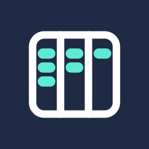

# Faz AI Kanban

> ⚠️ **O Faz AI está em fase alpha.**
>
> O projeto é novo e muda rápido: telas, comandos e o formato do board ainda podem mudar. Revise o
> que a IA fizer antes de aprovar. Se algo quebrar, [conte numa issue](https://github.com/euclidesgc/faz-ai/issues).

> **Obrigado a quem está baixando e testando.**
>
> Publiquei a extensão e, no dia seguinte, ela já tinha 160 downloads. A cada pessoa que deu uma
> chance a um projeto recém-nascido: muito obrigado. O Faz AI é **totalmente gratuito e open source**
> (licença MIT); contribuições são bem-vindas. — Euclides G Catunda

Gostou? ☕ [Apoie o projeto](https://buymeacoffee.com/euclidesca2), ⭐ dê uma estrela, 💬 avalie no
[Marketplace](https://marketplace.visualstudio.com/items?itemName=euclidesgc.faz-ai&ssr=false#review-details)
ou no [Open VSX](https://open-vsx.org/extension/euclidesgc/faz-ai/reviews) e 🐞
[abra uma issue](https://github.com/euclidesgc/faz-ai/issues/new/choose).

Um board kanban dentro do VS Code e do Cursor que conduz a IA pelas fases de cada história:
Discovery, PRD, Spec, Plan, Implementação e Revisão. Você descreve, aprova e pede ajustes; a IA
escreve os documentos e o código; o board cria a branch, abre a revisão e fecha as fases sozinho.

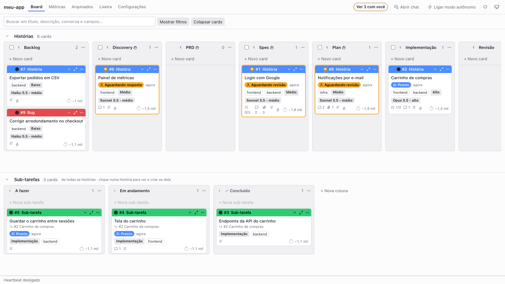

## Comece aqui

1. **Instale e abra.** Instale **Faz AI Kanban**, abra a pasta do projeto e clique no ícone
   **Faz AI** na barra lateral. Cada pasta ganha um board com as fases prontas.
2. **Conecte a IA.** Em **Configurações → Conectar agentes**, escolha o agente (Claude Code, Cursor,
   Kimi Code ou um agente ACP como Codex e Gemini CLI), entre na conta e clique em **Conectar**.
   **Verificar ambiente** mostra o que falta (Node.js 22+, a CLI) e como instalar.
3. **Crie o card.** Na coluna **Backlog**, clique em **+ Novo card**, escreva o título e dê Enter.
   Abra o card com dois cliques e descreva o que você quer: objetivo e critérios de aceite bastam.

   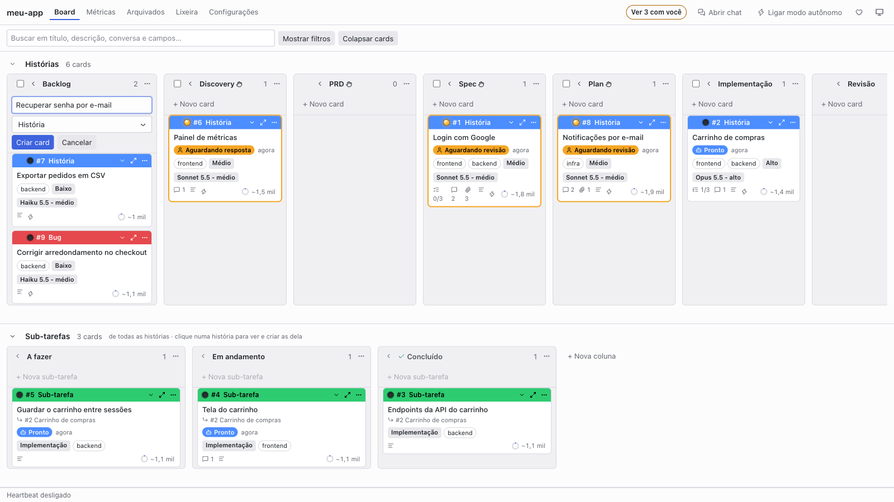

4. **Deixe a IA começar.** Arraste o card para **Discovery** e clique em **Trabalhar na fase**. A
   IA analisa o problema e o código e para em **Aguardando revisão** (ou **Aguardando resposta**,
   quando precisa de uma decisão sua).
5. **Aprove ou peça ajustes.** Leia o documento na aba **Anexos** e clique em **Aprovar** ou
   **Pedir ajustes**. A história segue por PRD, Spec e Plan do mesmo jeito; uma história pequena
   (esforço **Baixo** ou tipo **Bug**) vai do Discovery direto ao Plan.
6. **Veja o código nascer.** Na **Implementação**, o board cria a branch, executa as sub-tarefas do
   plano uma a uma e faz o commit de cada fase. Na **Revisão**, um agente independente revisa o
   diff. Na **Homologação**, a IA abre o pull request e você aprova o merge.

O botão **Ver N com você**, no topo do board, lista o que espera por você.

## O card por dentro

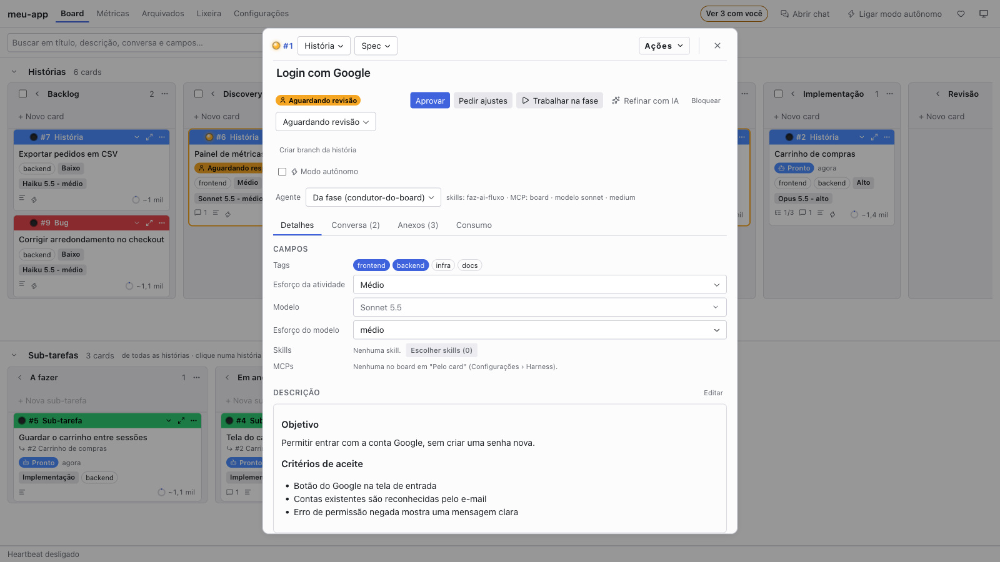

- **Cabeçalho.** O status diz com quem está a pendência; ao lado, os botões de aprovar, pedir
  ajustes, trabalhar, refinar e bloquear; abaixo, **Modo autônomo** e o **Agente** que vai rodar o
  card, com as skills, os MCPs e o modelo dele.
- **Detalhes.** Tags, esforço, modelo e skills (as regras sugerem o modelo pelo esforço), a
  descrição em Markdown, o checklist, as sub-tarefas e os vínculos com outros cards.
- **Conversa.** Tudo o que a IA fez e perguntou fica aqui. Para pedir um ajuste, escreva e clique em
  **Enviar**: a IA responde ou faz o que você pediu, sem trabalhar a fase além disso. **Resumir a
  conversa** condensa o histórico para a IA ler menos.

  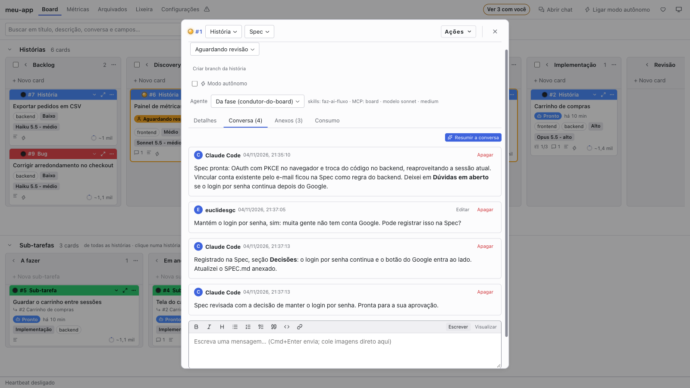

- **Perguntas com opções.** Quando a IA precisa de uma decisão, as alternativas chegam num
  carrossel, com a opção indicada e a consequência de cada uma. **Entender melhor esta opção**
  discute a alternativa no chat antes de responder.

  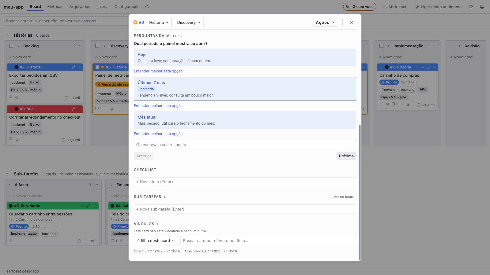

- **Anexos.** Os documentos das fases (DISCOVERY, PRD, SPEC e PLAN) e o que você colar ou
  arrastar. Imagens coladas na conversa também viram anexos, e a IA as recebe.

  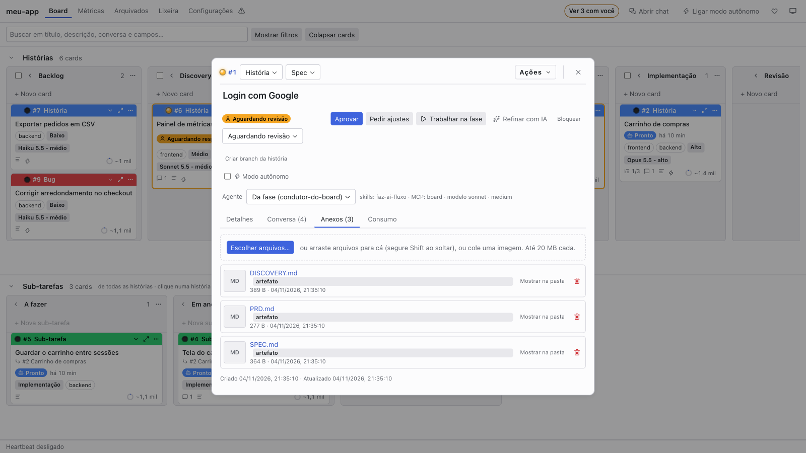

- **Consumo.** Tokens, custo, tempo de IA e retrabalho da história.
- **Refinar com IA.** Reescreve título e descrição, preenche os campos e completa o checklist, sem
  trabalhar a fase nem mexer em arquivos.
- **Ações.** Duplicar, arquivar ou mandar para a lixeira. O seletor de coluna move o card sem
  passar pela aprovação.

## Chat com a IA

Na barra lateral do editor (ou em **Abrir chat**, no navegador), peça em linguagem natural: "crie
uma história Login com Google" ou "o que está esperando por mim?".

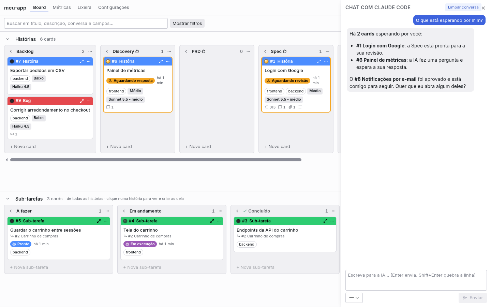

## Configurações e o harness do projeto

Toda a configuração fica no board, em **Configurações**; a extensão não grava nada no
`settings.json` do editor.

- **Workflows e colunas.** Renomeie, reordene e crie colunas; marque em quais a IA atua e quais
  exigem aprovação. Em **Fase**, cada coluna tem a instrução para a IA, o modelo do documento, o
  **modelo da fase** e o **agente** que roda os cards dela. **Checagens** rodam comandos (testes,
  lint) antes de o card avançar.

  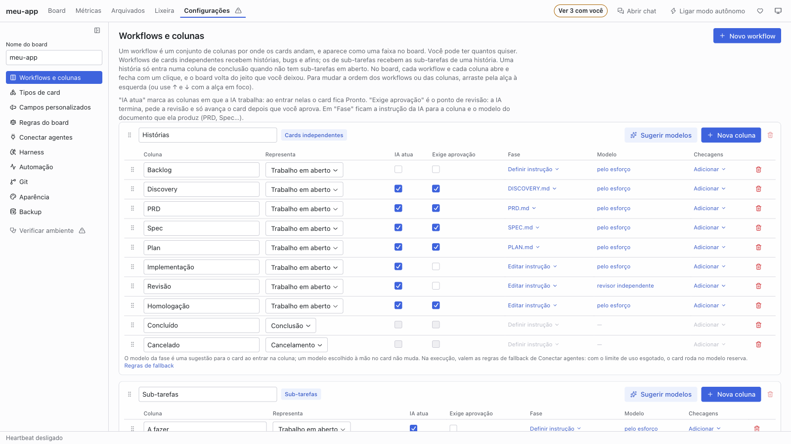

- **Conectar agentes.** Os agentes de IA, a conta de cada um, o modo (CLI, ACP ou API), os modelos,
  o teste rápido e as regras de sugestão e de fallback. Todo agente ligado roda cards ao mesmo
  tempo; o padrão roda os cards sem modelo.

  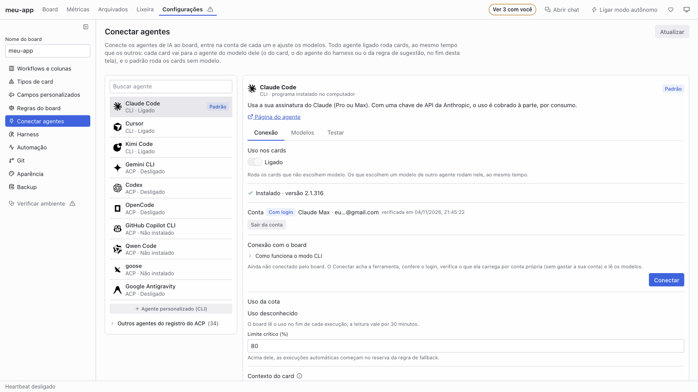

- **Harness.** A biblioteca do board: **Regras** (entram em toda execução), **Skills** (só nos
  cards que as indicam), **Agentes** (quem executa, com quais ferramentas, skills, MCPs e modelo) e
  **Servidores MCP**. O board vem com agentes de fábrica (condutor-do-board, backend-node,
  revisor-de-codigo…). Para montar o harness do seu projeto, use **Importar**: traz regras, skills
  e agentes de uma pasta ou repositório, da ferramenta instalada (`~/.claude`, `.cursor`…) ou de um
  arquivo de exportação, sempre para revisão; a cópia guarda a origem e avisa quando ela muda.
  **Criar com IA** escreve um artefato novo a partir de uma frase.

  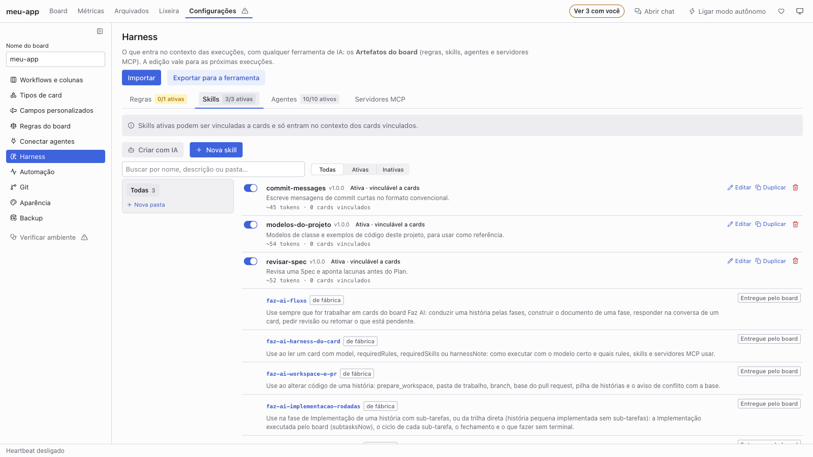

  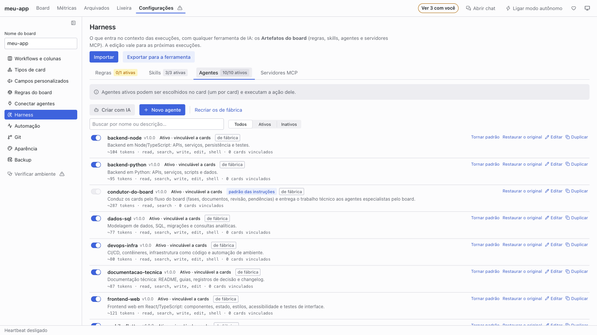

  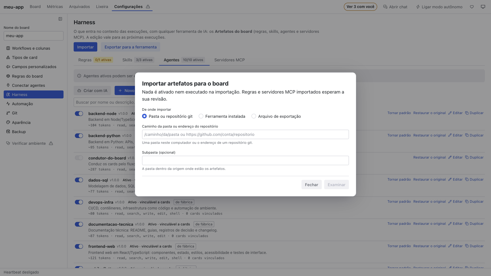

- **Automação.** O que a IA pode fazer (só o board, board e arquivos, sem restrições), tempo
  limite, heartbeat e execuções em paralelo.
- **Git.** Gitflow, prefixos de branch, worktree por história, merge automático e registros de
  decisão.
- **Tipos de card, Campos, Regras do board, Aparência e Backup.** Tipos com cor e padrões, campos
  personalizados, trilha curta e confirmações, idioma e tema, backup do board em `.fazai.json`.
- **Verificar ambiente.** O Diagnóstico confere Node, CLIs, login, credenciais e o MCP do board,
  com o comando oficial de instalação do que falta.

## Funcionalidades

| O que                                                                       | Detalhe                                         |
| --------------------------------------------------------------------------- | ----------------------------------------------- |
| Fases e aprovação, trilha curta, perguntas, Refinar, Resumir, vínculos      | [Fluxo da história](docs/fluxo.md)              |
| Harness (regras, skills, agentes, MCPs), importar e exportar, perfis de CLI | [Harness e agentes](docs/harness.md)            |
| Conectar agentes, modos CLI/ACP/API, modelos, sugestão e fallback           | [Configurações do board](docs/configuracoes.md) |
| Heartbeat, modo autônomo (YOLO), teto de consumo, watchdog                  | [Automação](docs/automacao.md)                  |
| Branch e worktree por história, gitflow, PR, merge automático, PRs empilhados | [Gitflow](docs/gitflow.md)                    |
| Contexto estimado, aba Consumo, painel Métricas, `get_metrics`              | [Métricas](docs/metricas.md)                    |
| Dados, backup, board no navegador e o comando `faz-ai`                      | [Dados e navegador](docs/dados.md)              |
| As ferramentas MCP que a IA usa no board                                    | [Ferramentas MCP](docs/mcp.md)                  |

## Requisitos

- **Node.js 22 ou mais novo**: o servidor do board roda com ele.
- **A CLI da ferramenta de IA** instalada e logada: Claude Code, Cursor (`cursor-agent`), Kimi Code
  ou um agente ACP.
- Opcionais: **Git** na pasta e **GitHub CLI** logado (merge automático e acompanhamento dos PRs).

## Problemas conhecidos

- **Cursor**: o MCP do board vai no `.cursor/mcp.json` do projeto. Na primeira vez, recarregue a
  janela e ligue o `faz-ai` em Cursor Settings → MCP.
- **Sub-tarefas em paralelo**: a configuração aceita de 1 a 6, mas o efetivo hoje é 1.
- **Claude Code como root** (contêineres, WSL) não roda com a permissão "Sem restrições".
- **Node instalado com o editor aberto**: o chat do editor só o encontra depois de reabrir o editor.
- **Mesma pasta em duas janelas**: a última a salvar vence; só a janela dona faz a manutenção.
- **Worktree por história** precisa das dependências instaladas em cada pasta de trabalho.
- **Registro antigo no projeto** (`.mcp.json`, `.kimi-code/mcp.json`) vale sobre o global: remova o
  `faz-ai` dele à mão.

## Licença

[MIT](LICENSE)
