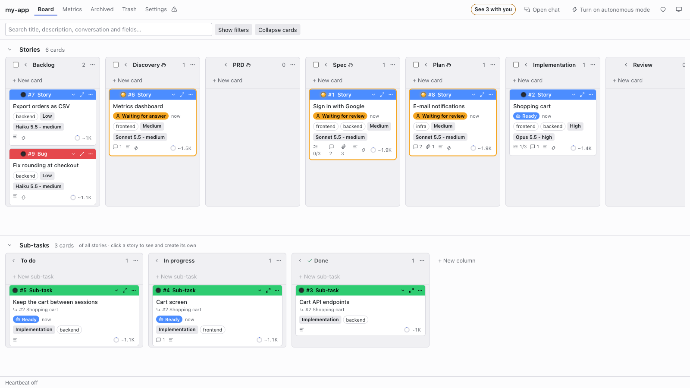
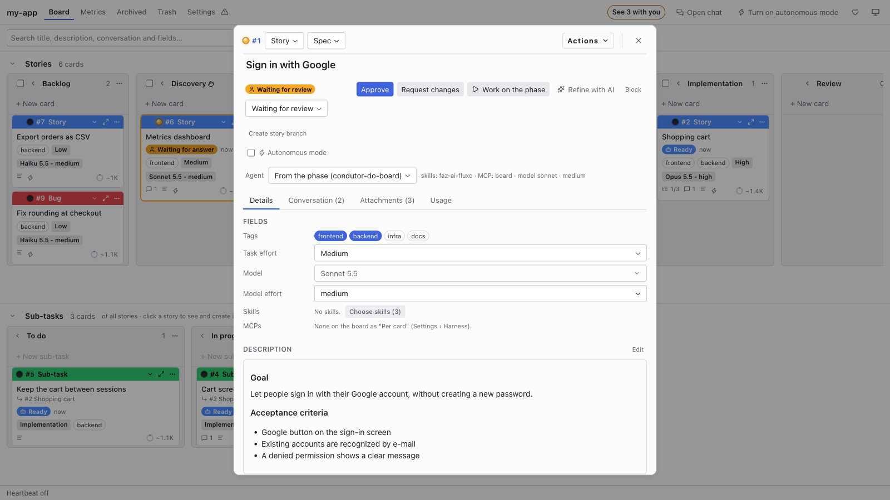
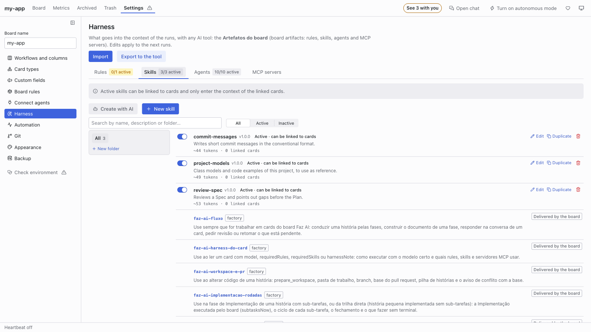
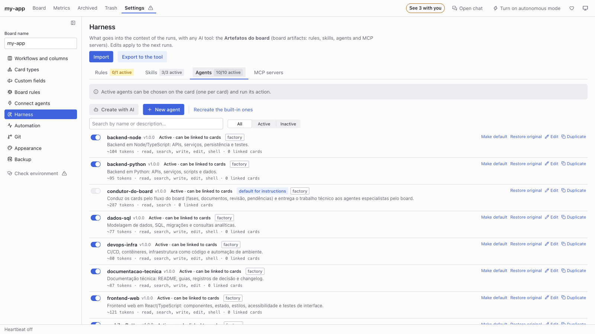
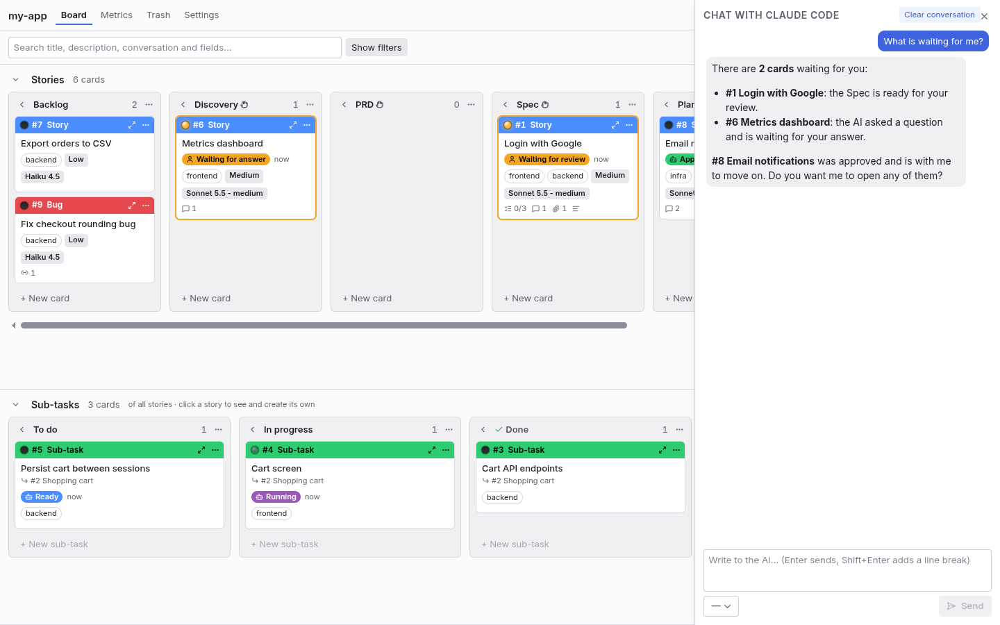
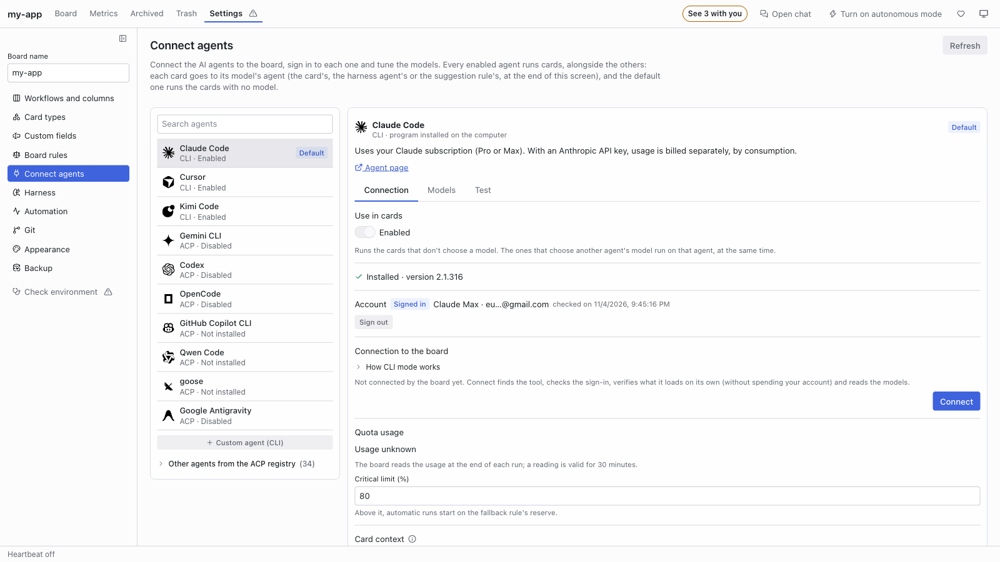

[🇧🇷 Português](README.md) · 🇺🇸 English

# Faz AI Kanban

> ⚠️ **Faz AI is in alpha.**
>
> The project is new and moves fast: screens, commands and the board format may still change. Review
> what the AI does before approving it. If something breaks, [tell me in an issue](https://github.com/euclidesgc/faz-ai/issues).

> **Thank you to everyone downloading and trying it out.**
>
> I published the extension and, the next day, it already had 160 downloads. To each person who gave
> a brand-new project a chance: thank you very much. Faz AI is **completely free and open source**
> (MIT license); contributions are welcome. — Euclides G Catunda

Enjoying it? Help Faz AI grow:

- ☕ **Support the project** at [buymeacoffee.com/euclidesca2](https://buymeacoffee.com/euclidesca2): it is
  what keeps Faz AI free and evolving.
- ⭐ **Star** the [GitHub repository](https://github.com/euclidesgc/faz-ai).
- 💬 **Rate the extension** on the [VS Code Marketplace](https://marketplace.visualstudio.com/items?itemName=euclidesgc.faz-ai&ssr=false#review-details)
  or on [Open VSX](https://open-vsx.org/extension/euclidesgc/faz-ai/reviews) (Cursor's store).
- 🐞 Bug or idea? [Open an issue](https://github.com/euclidesgc/faz-ai/issues/new?template=bug.yml)
  or [tell me a suggestion](https://github.com/euclidesgc/faz-ai/issues/new?template=sugestao.yml).

A kanban board inside your editor (VS Code and Cursor) to run Spec-Driven Development (SDD) with an
AI. You organize the work into stories and sub-tasks; the AI reads the board, produces the document of
each phase and moves the cards as it goes, always stopping for your approval.

The interface exists in Portuguese and English; names of screens and buttons appear here as they are
in the Portuguese interface.

## Getting started

1. **Install and open.** Install **Faz AI Kanban** in VS Code or Cursor, open your project folder and
   click the **Faz AI** icon in the sidebar. Each folder has its own board, already with the phases.
2. **Connect the AI to the board.** In **Configurações → Harness** (settings), choose the tool (Claude
   Code, Cursor or Kimi Code) and, in the **Projeto** tab, click **Instalar (padrão da ferramenta)**
   under **Servidores MCP**.
3. **Create the task.** In the **Backlog** column, click **+ Novo card** (new card), type the title
   and press Enter. Double-click the card to describe what you want.
4. **Let the AI start.** Drag the card to **Discovery** and click **Trabalhar na fase** (work on the
   phase). The AI analyzes the problem and talks to you in the **Conversa** tab; when it finishes, the
   status changes to **Aguardando revisão** (awaiting review).
5. **Review and move on.** Read the phase document and click **Aprovar** (approve) or **Pedir
   ajustes** (request changes). The story moves through **PRD**, **Spec**, **Plan** and
   **Implementação**, always with the AI producing and you approving.

## Features

- **Phases with approval.** Backlog, Discovery, PRD, Spec, Plan, Implementação, Revisão, Homologação and
  Concluído. In the review phases, the AI finishes, asks for your approval and stops. Small stories can
  take a short track. [Story flow](docs/fluxo_EN.md)
- **Status and "with you".** Each card shows whether the pending item is with the AI or with you; the
  **Com você** filter lists what is waiting for you. Questions with options arrive as a carousel on the
  card. Each option can be discussed in the chat before you answer.  [Story flow](docs/fluxo_EN.md)
- **Card search.** `#980` shows only card 980; `980` also shows the cards that mention it.
  [Story flow](docs/fluxo_EN.md)
- **Short sessions, controlled context.** Each run opens the card through the MCP, does the work and
  stops, without rules, skills or hooks you have not selected. [Harness](docs/harness_EN.md)
- **Board harness.** Rules, skills, agents and MCP servers live in a board library, each one active or
  inactive. Each card gets only what it allows.
   [Harness](docs/harness_EN.md)
- **Agents.** Each run goes through an agent, with the skills, MCP servers, tools and model it defines, and each column can set the phase model.
   [Harness](docs/harness_EN.md)
- **Cursor guarantee.** In board runs, a global hook registered by the board denies the MCP servers,
  subagents and tools the card does not allow. [Harness](docs/harness_EN.md)
- **Chat with the AI.** Ask in natural language to create, move and link cards, or ask what is waiting
  for you.  [Story flow](docs/fluxo_EN.md)
- **Heartbeat and autonomous mode (YOLO).** The heartbeat calls the AI for its pending items and takes
  care of pull requests. In autonomous mode, the AI takes a story from Backlog to the pull request
  without asking. [Automation](docs/automacao_EN.md)
- **Branch and pull request per story.** Each story gets its own branch and working folder, following
  gitflow. [Gitflow](docs/gitflow_EN.md)
- **Usage metrics.** Tokens, US$ cost, AI time and rework in the **Consumo** tab and the **Métricas**
  panel. [Metrics](docs/metricas_EN.md)
- **Connect agents.** One screen for Claude Code, Cursor, Kimi Code and ACP agents (such as Gemini CLI,
  Codex and OpenCode), with API keys kept only in this computer's vault.
   [Details](docs/configuracoes_EN.md#connect-agents)
- **Card context.** The board checks what actually reaches each agent: closed or open context.
  [Details](docs/configuracoes_EN.md#card-context-closed-or-open)
- **Gemini through the API or the CLI.** With the same key, the board calls Gemini directly or through
  the Gemini CLI, and measures usage in tokens. [Through the API](docs/harness_EN.md#gemini-through-the-api) ·
  [Through the CLI](docs/harness_EN.md#gemini-through-the-cli)
- **Gemini quota.** An exhausted quota pauses the Gemini profile until it renews.
  [Details](docs/automacao_EN.md#what-each-round-does)
- **Board in the browser.** Open the same board in a browser tab, or serve it without the editor with the
  `faz-ai` command. [Data and browser](docs/dados_EN.md)
- **MCP server.** Claude Code, Cursor or any MCP client can query and edit the board.
  [MCP tools (Portuguese)](docs/mcp.md)

## Requirements

- **Node.js 22 or newer**: the board server runs on it.
- **The AI tool's CLI** installed and logged in: Claude Code, Cursor (`cursor-agent`) or Kimi Code.
- Optional: **Git** with a repository in the folder, **GitHub CLI** logged in (automatic merge and PR
  tracking) and **Code Review Graph** (a code graph for the AI).

The **Environment Diagnostics** (**Configurações → Verificar ambiente**) checks each item and shows the
official install command; the board installs nothing. It also lists the old copies of the flow that
earlier versions left in the tool folders, for you to delete by hand.

## Settings

The extension adds no keys to the editor's `settings.json`: all configuration lives in the board itself,
under **Configurações** (workflows and columns, card types, fields, rules, Connect agents, Harness, Git,
appearance and backup). See [Board settings](docs/configuracoes_EN.md).

Command palette (`Ctrl+Shift+P`):

- **Faz AI: Open Board**: opens the folder's board.
- **Faz AI: Open board in the browser**: opens the same board in a browser tab.
- **Faz AI: Open Card**: opens a card by number.
- **Faz AI: Install the board MCP (global)**: registers the board server in the AI tool.
- **Faz AI: Run the heartbeat now**: starts a heartbeat round right away.
- **Faz AI: Stop the AI runs and autonomous mode**: interrupts what the board started.
- **Faz AI: Pause / Resume autonomous mode**: pauses or resumes the autopilot.
- **Faz AI: Open the Environment Diagnostics**: shows what the board needs and what is missing.
- **Faz AI: Open the board settings**: opens the Settings screen.
- **Faz AI: Update board to the current default**: brings new columns and texts without touching what you customized.
- **Faz AI: Export the board** / **Import a board**: backup and restore as `.fazai.json`.
- **Faz AI: Show the run log**: opens the **Output → Faz AI** panel.

## Where the data lives

The board and the attachments live in the extension storage, outside the repository: one database per
folder, with a readable copy of the library in `~/faz-ai-library/<project>/`. Updating the extension
updates the database; an older version refuses to open a board saved by a newer one.
**Configurações → Backup** exports and imports everything as a `.fazai.json`. See
[Where the data lives](docs/dados_EN.md).

## Known issues

- **Cursor**: the board's MCP server goes into the project's `.cursor/mcp.json`. The first time you need
  to reload the window and turn on `faz-ai` in Cursor Settings → MCP.
- **Parallel sub-tasks**: the setting accepts 1 to 6, but the effective value today is 1; sub-tasks run
  one after another.
- **Claude Code as root** (containers, WSL as root) does not run with the "Sem restrições" (unrestricted)
  permission.
- **Node installed while the editor is open**: the editor's chat only finds it after closing and
  reopening the editor.
- **Same folder in two windows**: the last one to save wins; only the owner window does maintenance.
- **Worktree per story** needs the dependencies installed in each working folder.
- **Old project registration** (`.mcp.json`, `.kimi-code/mcp.json`) takes precedence over the global one
  and is not migrated: remove `faz-ai` from it by hand.

## Version history

What changed in each version is in [CHANGELOG_EN.md](CHANGELOG_EN.md).

## License

[MIT](LICENSE)
