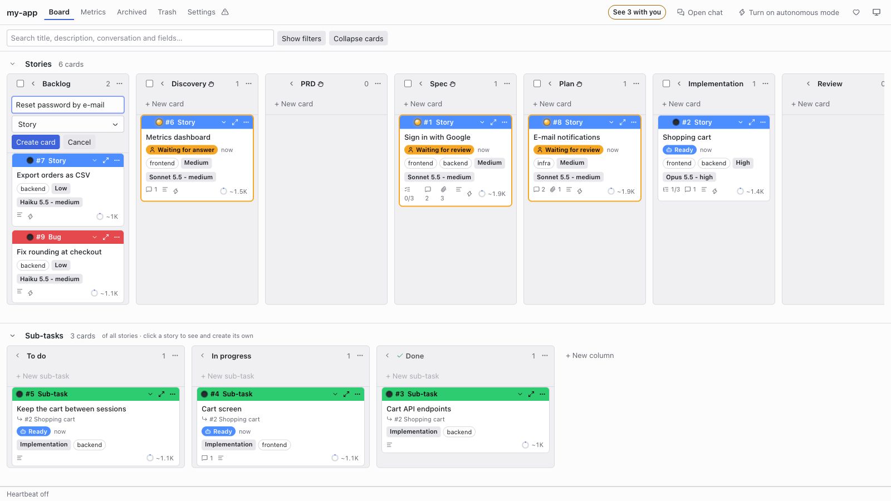
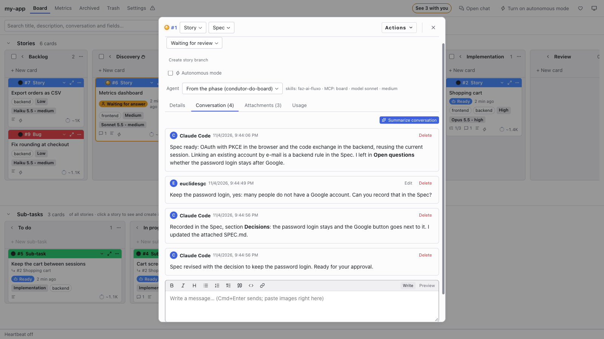
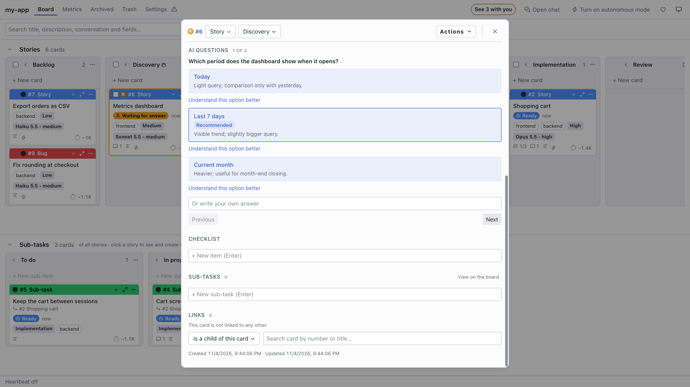
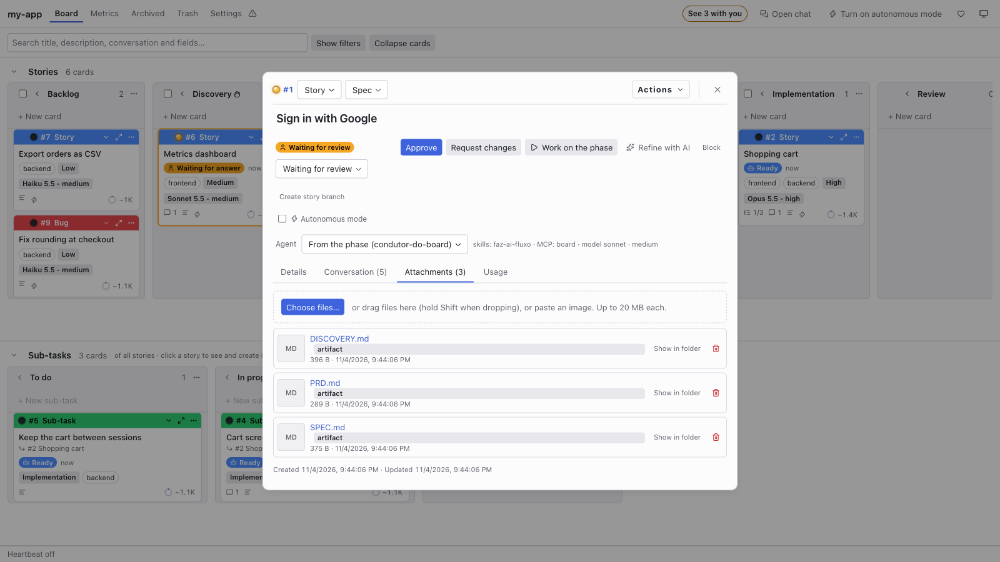
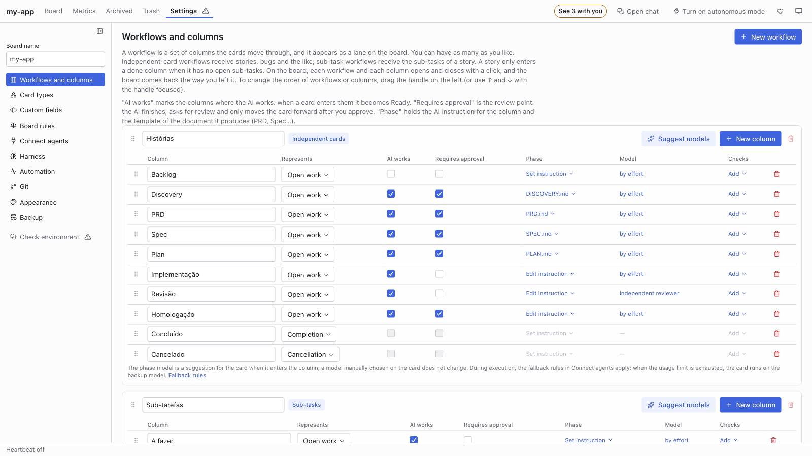
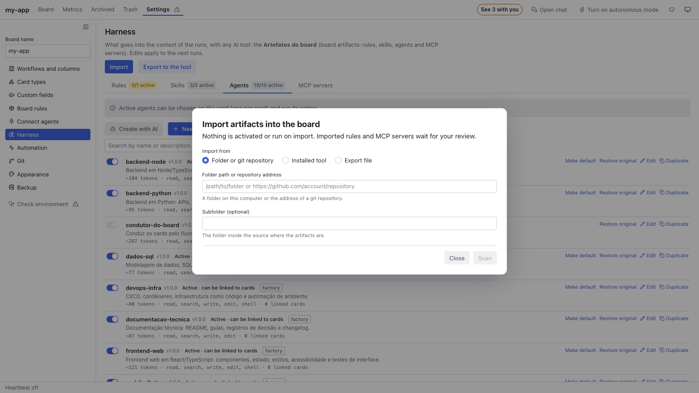

[🇧🇷 Português](README.md) · 🇺🇸 English

# Faz AI Kanban

> ⚠️ **Faz AI is in alpha.**
>
> The project is new and moves fast: screens, commands and the board format may still change. Review
> what the AI does before approving it. If something breaks, [tell me in an issue](https://github.com/euclidesgc/faz-ai/issues).

> **Thank you to everyone downloading and trying it out.**
>
> I published the extension and, the next day, it already had 160 downloads. To each person who gave
> a brand-new project a chance: thank you very much. Faz AI is **completely free and open source**
> (MIT license); contributions are welcome. — Euclides G Catunda

Enjoying it? ☕ [Support the project](https://buymeacoffee.com/euclidesca2), ⭐ star it, 💬 rate it on the
[Marketplace](https://marketplace.visualstudio.com/items?itemName=euclidesgc.faz-ai&ssr=false#review-details)
or on [Open VSX](https://open-vsx.org/extension/euclidesgc/faz-ai/reviews) and 🐞
[open an issue](https://github.com/euclidesgc/faz-ai/issues/new/choose).

A kanban board inside VS Code and Cursor that guides the AI through the phases of each story:
Discovery, PRD, Spec, Plan, Implementation and Review. You describe, approve and request changes; the
AI writes the documents and the code; the board creates the branch, opens the review and closes the
phases on its own.

## Start here

1. **Install and open.** Install **Faz AI Kanban**, open the project folder and click the **Faz AI**
   icon in the sidebar. Each folder gets a board with the phases ready.
2. **Connect the AI.** In **Settings → Connect agents**, choose the agent (Claude Code, Cursor, Kimi
   Code or an ACP agent such as Codex and Gemini CLI), sign in to its account and click **Connect**.
   **Check environment** shows what is missing (Node.js 22+, the CLI) and how to install it.
3. **Create the card.** In the **Backlog** column, click **+ New card**, type the title and press
   Enter. Double-click the card and describe what you want: a goal and acceptance criteria are enough.

   

4. **Let the AI start.** Drag the card to **Discovery** and click **Work on the phase**. The AI
   analyzes the problem and the code and stops at **Waiting for review** (or **Waiting for answer**,
   when it needs a decision from you).
5. **Approve or request changes.** Read the document in the **Attachments** tab and click
   **Approve** or **Request changes**. The story goes through PRD, Spec and Plan the same way; a
   small story (**Low** effort or **Bug** type) goes from Discovery straight to Plan.
6. **Watch the code appear.** In **Implementation**, the board creates the branch, runs the plan's
   sub-tasks one by one and commits each phase. In **Review**, an independent agent reviews the
   diff. In **Acceptance**, the AI opens the pull request and you approve the merge.

The **See N with you** button, at the top of the board, lists what is waiting for you.

## Inside the card

- **Header.** The status says who the ball is with; next to it, the buttons to approve, request
  changes, work, refine and block; below, **Autonomous mode** and the **Agent** that will run the
  card, with its skills, MCPs and model.
- **Details.** Tags, effort, model and skills (the rules suggest the model by effort), the Markdown
  description, the checklist, the sub-tasks and the links to other cards.
- **Conversation.** Everything the AI did and asked lives here. To request a change, write and click
  **Send**: the AI answers or does what you asked, without working the phase beyond that.
  **Summarize conversation** condenses the history so the AI reads less.

  

- **Questions with options.** When the AI needs a decision, the alternatives arrive in a carousel,
  with the recommended option and the consequence of each one. **Understand this option better**
  discusses the alternative in the chat before you answer.

  

- **Attachments.** The phase documents (DISCOVERY, PRD, SPEC and PLAN) and whatever you paste or
  drag. Images pasted in the conversation also become attachments, and the AI receives them.

  

- **Usage.** Tokens, cost, AI time and rework of the story.
- **Refine with AI.** Rewrites title and description, fills in the fields and completes the
  checklist, without working the phase or touching files.
- **Actions.** Duplicate, archive or move to trash. The column selector moves the card without going
  through approval.

## Chat with the AI

In the editor sidebar (or **Open chat**, in the browser), ask in plain language: "create a story
Sign in with Google" or "what is waiting for me?".

## Settings and the project harness

All configuration lives on the board, in **Settings**; the extension writes nothing to the editor's
`settings.json`.

- **Workflows and columns.** Rename, reorder and create columns; mark which ones the AI works in and
  which require approval. In **Phase**, each column has the instruction for the AI, the document
  template, the **phase model** and the **agent** that runs its cards. **Checks** run commands
  (tests, lint) before the card moves on.

  

- **Connect agents.** The AI agents, each one's account, the mode (CLI, ACP or API), the models, the
  quick test and the suggestion and fallback rules. Every enabled agent runs cards at the same time;
  the default one runs the cards without a model.

  

- **Harness.** The board library: **Rules** (enter every run), **Skills** (only in the cards that
  pick them), **Agents** (who runs, with which tools, skills, MCPs and model) and **MCP servers**.
  The board ships with factory agents (condutor-do-board, backend-node, revisor-de-codigo…). To
  assemble your project's harness, use **Import**: it brings rules, skills and agents from a folder
  or repository, from the installed tool (`~/.claude`, `.cursor`…) or from an export file, always
  for review; the copy remembers its source and warns when it changes. **Create with AI** writes a
  new artifact from a sentence.

  

  

  

- **Automation.** What the AI may do (board only, board and files, no restrictions), time limit,
  heartbeat and parallel runs.
- **Git.** Gitflow, branch prefixes, a worktree per story, automatic merge and decision records.
- **Card types, Fields, Board rules, Appearance and Backup.** Types with color and defaults, custom
  fields, short track and confirmations, language and theme, board backup as `.fazai.json`.
- **Check environment.** The diagnostic checks Node, CLIs, login, credentials and the board MCP,
  with the official install command for what is missing.

## Features

| What                                                                        | Detail                                          |
| --------------------------------------------------------------------------- | ----------------------------------------------- |
| Phases and approval, short track, questions, Refine, Summarize, links       | [Story flow](docs/fluxo_EN.md)                  |
| Harness (rules, skills, agents, MCPs), import and export, CLI profiles      | [Harness and agents](docs/harness_EN.md)        |
| Connect agents, CLI/ACP/API modes, models, suggestion and fallback          | [Board settings](docs/configuracoes_EN.md)      |
| Heartbeat, autonomous mode (YOLO), usage ceiling, watchdog                  | [Automation](docs/automacao_EN.md)              |
| Branch and worktree per story, gitflow, PR, automatic merge, stacked PRs    | [Gitflow](docs/gitflow_EN.md)                   |
| Estimated context, Usage tab, Metrics panel, `get_metrics`                  | [Metrics](docs/metricas_EN.md)                  |
| Data, backup, board in the browser and the `faz-ai` command                 | [Data and browser](docs/dados_EN.md)            |
| The MCP tools the AI uses on the board                                      | [MCP tools](docs/mcp.md)                        |

## Requirements

- **Node.js 22 or newer**: the board server runs on it.
- **The AI tool's CLI** installed and signed in: Claude Code, Cursor (`cursor-agent`), Kimi Code or
  an ACP agent.
- Optional: **Git** in the folder and **GitHub CLI** signed in (automatic merge and PR tracking).

## Known issues

- **Cursor**: the board MCP goes in the project's `.cursor/mcp.json`. The first time, reload the
  window and enable `faz-ai` in Cursor Settings → MCP.
- **Parallel sub-tasks**: the setting accepts 1 to 6, but the effective value today is 1.
- **Claude Code as root** (containers, WSL) does not run with the "No restrictions" permission.
- **Node installed with the editor open**: the editor chat only finds it after reopening the editor.
- **Same folder in two windows**: the last one to save wins; only the owner window does maintenance.
- **Worktree per story** needs the dependencies installed in each working folder.
- **Old project registration** (`.mcp.json`, `.kimi-code/mcp.json`) wins over the global one: remove
  `faz-ai` from it by hand.

## Changelog

What changed in each version is in [CHANGELOG_EN.md](CHANGELOG_EN.md).

## License

[MIT](LICENSE)
