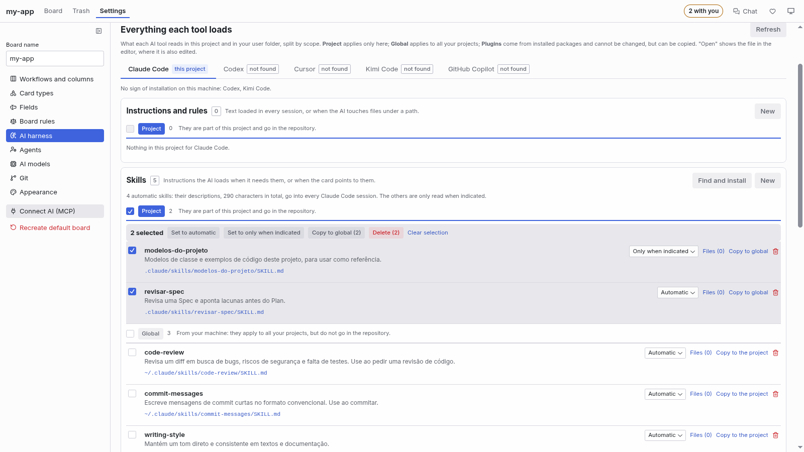

[🇧🇷 Português](README.md) · 🇺🇸 English

# Faz AI Kanban

> ⚠️ **Faz AI is in alpha.**
>
> The project is new and moves fast: screens, commands and the board format may still change. Review
> what the AI does before approving it. If something breaks, [tell me in an issue](https://github.com/euclidesgc/faz-ai/issues).

> **Thank you to everyone downloading and trying it out.**
>
> I published the extension and, the next day, it already had 160 downloads. To each person who gave
> a brand-new project a chance: thank you very much. Faz AI is **completely free and open source**
> (MIT license); contributions are welcome. — Euclides G Catunda

Enjoying it? Help Faz AI grow:

- ☕ **Support the project** at [buymeacoffee.com/euclidesca2](https://buymeacoffee.com/euclidesca2): it is
  what keeps Faz AI free and evolving.
- ⭐ **Star** the [GitHub repository](https://github.com/euclidesgc/faz-ai).
- 💬 **Rate the extension** on the [VS Code Marketplace](https://marketplace.visualstudio.com/items?itemName=euclidesgc.faz-ai&ssr=false#review-details)
  or on [Open VSX](https://open-vsx.org/extension/euclidesgc/faz-ai/reviews) (Cursor's store).
- 🐞 Bug or idea? [Open an issue](https://github.com/euclidesgc/faz-ai/issues/new?template=bug.yml)
  or [tell me a suggestion](https://github.com/euclidesgc/faz-ai/issues/new?template=sugestao.yml).

A kanban board inside your editor (VS Code and Cursor) to run Spec-Driven Development (SDD) with an
AI. You organize the work into stories and sub-tasks; the AI reads the board, produces the artifacts
of each phase and moves the cards as it goes, always stopping for your approval.

The interface exists in Portuguese and English; names of screens and buttons appear here as they are
in the Portuguese interface.

## Getting started

1. **Install and open.** Install **Faz AI Kanban** in VS Code or Cursor, open your project folder and
   click the **Faz AI** icon in the sidebar. Each folder has its own board, already with the phases.
2. **Connect the AI to the board.** In **Configurações → Harness** (settings), choose the tool (Claude
   Code, Cursor or Kimi Code) and, in the **Projeto** tab, click **Instalar (padrão da ferramenta)**
   under **Servidores MCP**.
3. **Create the task.** In the **Backlog** column, click **+ Novo card** (new card), type the title
   and press Enter. Double-click opens the card so you can describe what you want.
4. **Let the AI start.** Drag the card to **Discovery** and click **Trabalhar na fase** (work on the
   phase). The AI analyzes the problem and talks to you in the **Conversa** tab; when it finishes, the
   status changes to **Aguardando revisão** (awaiting review).
5. **Review and move on.** Read the phase document and click **Aprovar** (approve) or **Pedir
   ajustes** (request changes). The story moves through **PRD**, **Spec**, **Plan** and
   **Implementação**, always with the AI producing and you approving.

## Features

- **Flow phases with approval.** Backlog, Discovery, PRD, Spec, Plan, Implementação, Revisão,
  Homologação and Concluído, each with the instruction and document template the AI follows. In the
  review phases the AI finishes, asks for your approval and stops. Small stories can take a short
  track. [Story flow](docs/fluxo_EN.md)
- **Status and "with you".** Every card says whether the pending item is with the AI or with you; the
  **N com você** counter and the **Com você** filter show what is waiting for you. Questions with
  options arrive as a carousel on the card. [Story flow](docs/fluxo_EN.md)
- **Card search.** In the board search, `#980` shows only card 980, and `980` shows card 980 and the
  cards that mention it, in stories and sub-tasks. [Story flow](docs/fluxo_EN.md)
- **Highlighted selected card.** The selected card, the cards marked in multiple selection and the
  chosen row in lists get a shadow that sets them apart from the board, without removing the focus
  outline.
- **Short sessions, controlled context.** Each run opens the card through the MCP, does that work and
  stops; it starts without rules, skills, agents or hooks you have not selected, and reads the
  attached documents only when needed. [Harness](docs/harness_EN.md)
- **Board harness.** Rules, skills, agents and MCP servers live in a board library, in **Sempre**
  (always), **Pelo card** (per card) or **Desligado** (off) mode, with import and export to the tool.
  Every run goes through an agent, with the minimum it needs.
   [Harness](docs/harness_EN.md)
- **Chat with the AI.** Ask in natural language to create, move and link cards, or ask what is
  waiting for you.  [Story flow](docs/fluxo_EN.md)
- **Heartbeat and autonomous mode (YOLO).** The heartbeat calls the AI on its own for its pending
  items, summarizes long conversations and takes care of pull requests. In autonomous mode the AI
  takes the story from Backlog to the pull request without asking, and the autopilot queues the
  stories. [Automation](docs/automacao_EN.md)
- **Branch and pull request per story.** Each story gets its own branch and working folder, following
  gitflow; Homologação opens the PR with **Como testar** (how to test), and the board detects the
  merge, cleans up the branch and can record the decision in `docs/decisoes`.
  [Gitflow](docs/gitflow_EN.md)
- **Usage metrics.** A ring on the card estimates the context of the next run; the **Consumo** tab
  and the **Métricas** panel show tokens, AI time, rework and what the AI used. The AI queries the
  same with `get_metrics`. [Metrics](docs/metricas_EN.md)
- **Board in the browser.** Open the same board in a browser tab, in sync with the editor, or serve it
  without the editor with the `faz-ai` command. [Data and browser](docs/dados_EN.md)
- **MCP server.** Claude Code, Cursor or any MCP client can query and edit the board.
  [MCP tools](docs/mcp.md)

## Requirements

- **Node.js 22 or newer**: the board server runs on it.
- **The AI tool's CLI** installed and logged in: Claude Code, Cursor (`cursor-agent`) or Kimi Code.
- Optional: **Git** with a repository in the folder, **GitHub CLI** logged in (automatic merge and PR
  tracking) and **Code Review Graph** (a code graph for the AI).

The **Environment Diagnostics** (**Configurações → Verificar ambiente**) checks each item and shows
the official install command; the board installs nothing.

## Settings

The extension adds no keys to the editor's `settings.json`: all configuration lives in the board
itself, under **Configurações** (workflows and columns, card types, fields, rules, Harness, AI tools
and models, Git, appearance and backup). See [Board settings](docs/configuracoes_EN.md).

Command palette (`Ctrl+Shift+P`):

| Command                                           | What it does                                                      |
| ------------------------------------------------- | ----------------------------------------------------------------- |
| **Faz AI: Open Board**                            | Opens the folder's board                                          |
| **Faz AI: Open board in the browser**             | Opens the same board in a browser tab                             |
| **Faz AI: Open Card**                             | Opens a card by number                                            |
| **Faz AI: Install the board MCP (global)**        | Registers the board server in the AI tool                         |
| **Faz AI: Run the heartbeat now**                 | Starts a heartbeat round right away                               |
| **Faz AI: Stop the AI runs and autonomous mode**  | Interrupts what the board started                                 |
| **Faz AI: Pause / Resume autonomous mode**        | Pauses or resumes the autopilot                                   |
| **Faz AI: Open the Environment Diagnostics**      | Shows what the board needs and what is missing                    |
| **Faz AI: Open the board settings**               | Opens the Settings screen                                         |
| **Faz AI: Update board to the current default**   | Brings new columns and texts without touching what you customized |
| **Faz AI: Export the board** / **Import a board** | Backup and restore as `.fazai.json`                               |
| **Faz AI: Show the run log**                      | Opens the **Output → Faz AI** panel                               |
| **Faz AI: Verify the AI CLI isolation**           | Tests whether the CLI runs only with the board's context          |

## Where the data lives

The board and the attachments live in the extension storage, outside the repository: one database
per folder, with the Harness artifacts inside it and a readable copy in
`~/faz-ai-library/<project>/`. Updating the extension updates the database; an older version refuses
to open a board saved by a newer one. **Configurações → Backup** exports and imports everything as a
`.fazai.json`. See [Where the data lives](docs/dados_EN.md).

## Known issues

- **Cursor**: the board's MCP server goes into the project's `.cursor/mcp.json`. The first time you
  need to reload the window and turn on `faz-ai` in Cursor Settings → MCP.
- **Parallel sub-tasks**: the setting accepts 1 to 6, but the effective value today is 1; sub-tasks
  run one after another.
- **Claude Code as root** (containers, WSL as root) does not run with the "Sem restrições"
  (unrestricted) permission.
- **Node installed while the editor is open**: the editor's chat only finds it after closing and
  reopening the editor; the board writes the full path into the registrations it maintains.
- **Same folder in two windows**: the last one to save wins; only the owner window does maintenance.
- **Worktree per story** needs the dependencies installed in each working folder.
- **Old project registration** (`.mcp.json`, `.kimi-code/mcp.json`) takes precedence over the global
  one and is not migrated: remove `faz-ai` from it by hand.

## Version history

What changed in each version is in [CHANGELOG.md](CHANGELOG.md) ([English](CHANGELOG_EN.md)).

## License

[MIT](LICENSE)
