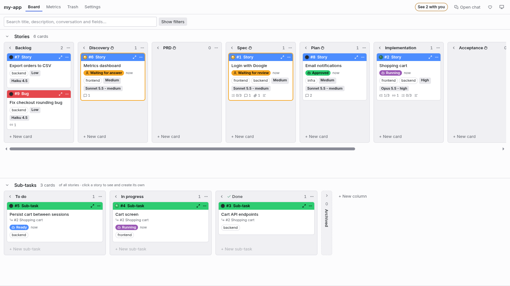
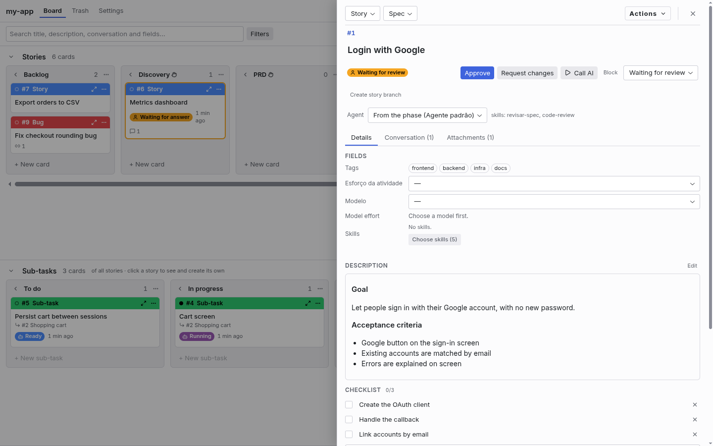
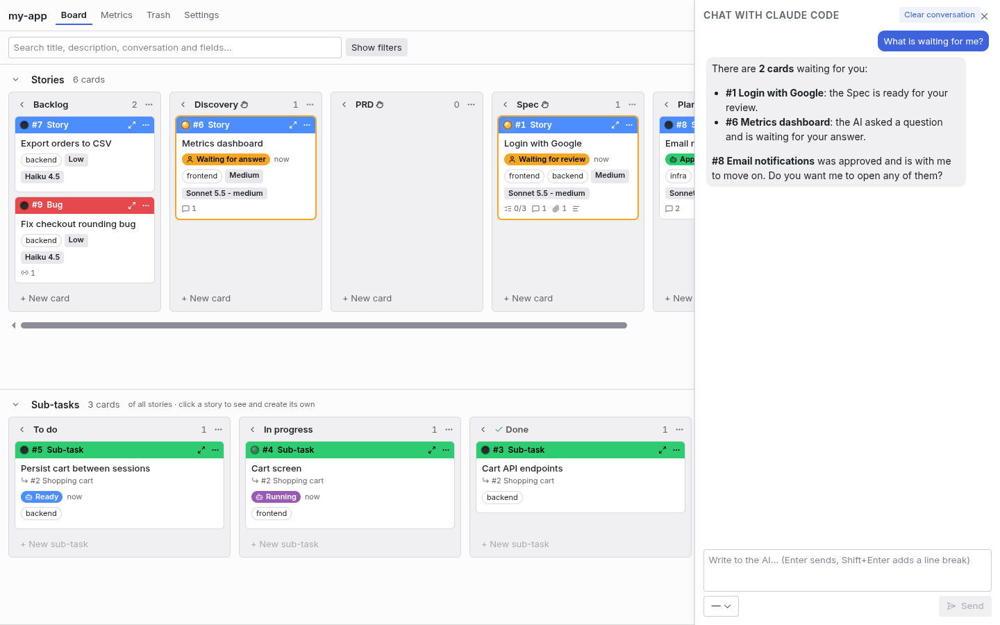
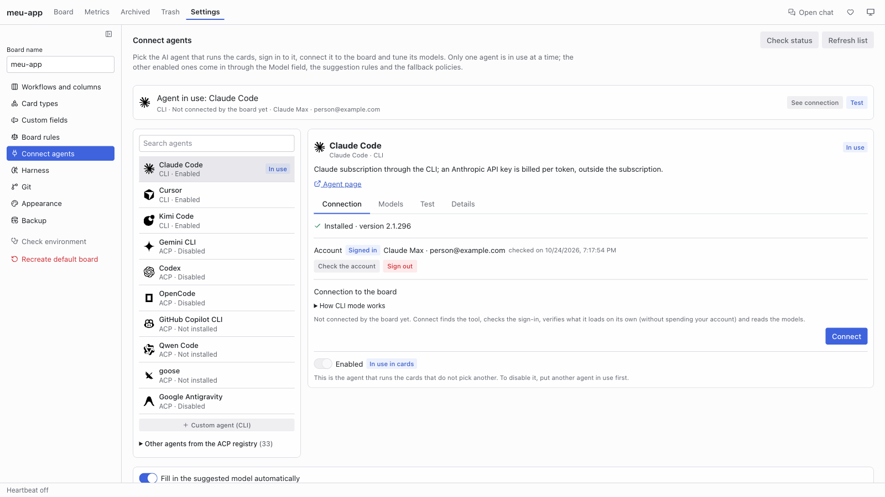

[🇧🇷 Português](README.md) · 🇺🇸 English


# Faz AI Kanban

> ⚠️ **Faz AI is in alpha.**
>
> The project is new and moves fast: a new version ships almost every week, and not everything has
> been tested on every AI tool and operating system. Bugs and unexpected behavior can happen, and
> screens, commands and the board format may still change from one version to the next.
>
> Use it freely, but with that in mind: review what the AI does before approving it, and do not rely
> on the board as the only record of something important. If something breaks or looks odd,
> [tell me in an issue](https://github.com/euclidesgc/faz-ai/issues): that is how it gets out of alpha.

> **Thank you to everyone downloading and trying it out.**
>
> I published the extension to the Cursor marketplace and went to sleep. When I woke up to install
> it on my work machine, it already had 160 downloads. I did not expect that, and it made my day.
>
> To each person who installed it, opened the board and gave a brand-new project a chance: thank
> you. You are the reason it keeps going.
>
> Faz AI is **completely free and open source** (MIT license), and contributions are welcome: tell
> me what worked and what did not, [open an issue](https://github.com/euclidesgc/faz-ai/issues) or
> [send a pull request](https://github.com/euclidesgc/faz-ai/pulls).
>
> Euclides G Catunda

> **Enjoying it? Help Faz AI grow.**
>
> A new project gets better with feedback from the people using it. If it has already saved you
> time, these one-minute gestures make a real difference:
>
> - ⭐ **Star the [GitHub repository](https://github.com/euclidesgc/faz-ai)**: it is the thing that
>   helps other people find the project the most.
> - 💬 **Rate the extension** in the store where you installed it, with stars and, if you can, a
>   couple of lines on what you thought: [VS Code Marketplace](https://marketplace.visualstudio.com/items?itemName=euclidesgc.faz-ai&ssr=false#review-details)
>   or [Open VSX](https://open-vsx.org/extension/euclidesgc/faz-ai/reviews) (Cursor's store).
> - 🐞 **Found a bug?** [Open an issue](https://github.com/euclidesgc/faz-ai/issues/new?template=bug.yml)
>   saying what you did, what you expected and what happened. The extension version and the editor
>   you use help a lot.
> - 💡 **Have an idea or a suggestion?** [Tell me in an issue](https://github.com/euclidesgc/faz-ai/issues/new?template=sugestao.yml):
>   missing flows, confusing screens and integrations you would like to see.
>
> Before opening one, take a look at the [existing issues](https://github.com/euclidesgc/faz-ai/issues):
> sometimes the idea is already there, and a 👍 on it helps decide what comes next.

A kanban board inside your editor (VS Code and Cursor), built to run Spec-Driven Development (SDD)
together with an AI. You organize the work into stories and sub-tasks; the AI reads the board,
produces the artifacts of each phase and moves the cards as it goes.

The extension speaks English and Portuguese (**Settings → Appearance → Language**, automatic by
default). This page keeps the Portuguese names you see in a Portuguese interface and gives the
English meaning next to them; in English, the default board's names (workflows, columns, card types,
fields and the default agent) are shown translated, and names you create or rename stay as you
wrote them.



## Getting started

In five minutes you have a task moving on the board, with the AI working on it.

1. **Install and open.** Install **Faz AI Kanban** in VS Code or Cursor (from the tool's own
   marketplace), open your project's folder and click the **Faz AI** icon in the sidebar. Each
   folder has its own board, already set up with the workflow phases.
2. **Connect the AI to the board.** In **Configurações → Harness** (Settings → Harness),
   pick the project's tool (Claude Code, Cursor or Kimi Code). In the **Projeto** (project) tab, click
   **Instalar (padrão da ferramenta)** (install, tool default) in the **Servidores MCP** (MCP servers)
   group and again in the **Skills** group, for the flow skill, which teaches the AI to drive the
   phases.
3. **Create the task.** In the **Backlog** column, click **+ Novo card** (new card), type the title
   (for example, "Login with Google") and press Enter. Double-click opens the card: describe what
   you want, in Markdown, and optionally pick the AI model and the skills it must read.
4. **Let the AI start.** Drag the card to **Discovery** and click **Trabalhar na fase** (work on the
   phase) on the card. The AI reads the card through the board, analyzes the problem and talks with you in the
   **Conversa** (conversation) tab. When it finishes, the status changes to **Aguardando
   revisão** (waiting for review): it is your turn. The same happens when the AI leaves something
   depending on you (a decision, an open point): the item shows up in the conversation as **Blocked
   on you** and the card stays with you. Whatever depends on your answer also goes in the
   **Perguntas para você** (questions for you) section of the phase document, with the alternatives,
   the AI's recommendation and an `R. >` slot for your answer.
5. **Review and move on.** Read the phase document, answer, or click **Aprovar** (approve) or
   **Pedir ajustes** (ask for changes). On approval the story moves on right away to **PRD**, **Spec**,
   **Plan** and **Implementação** (implementation), always with the AI producing and you approving.
   The implementation sub-tasks are born in the lower workflow and the AI completes them one by one.

For day to day: the **N com você** (N with you) counter at the top shows what is waiting for you,
the **Chat** lets you ask the AI, in natural language, to create and move cards, and the
**heartbeat** can call the AI by itself when something is pending with it.

### Why this saves context

The AI spends context on whatever it loads in every session. The board exists so it loads only what
is needed, at the right time:

- **Each card is a new, short session.** Instead of one long conversation that accumulates
  everything, the AI opens the card through the board (`get_card`), does that piece of work and
  stops. The history stays on the card, not in the context window.
- **Empty context by default.** Every run started by the board begins with no rule, skill, agent,
  hook or plugin from your machine or the project: only what you checked under **Harness**
  gets in. In Claude Code this is enforced by parameter (`--setting-sources ""`,
  `--disable-slash-commands` and an MCP servers file with the board's server only); in the other
  tools, whatever the command line accepts (see the [Agents](#agents) table).
- **Rules and skills checked, not discovered.** Each file has two check marks: **Incluir em todo
  contexto** (include in every context: goes into every run, by path) or **Usar quando fizer
  sentido** (use when it fits: becomes an option of the card's Rules and Skills fields, and Refine
  with AI picks it when the request calls for it). What is not checked does not exist for the run.
- **Agents with the minimum.** An agent allows only the MCP servers and tools it needs, carries its
  own skills and has short instructions; everything else stays out.
- **Documents as attachments.** PRD, Spec and Plan stay attached to the story; the AI reads them
  when the card needs it, instead of getting them pasted into every message.
- **Markdown attachments open formatted.** A `.md`/`.markdown` file opens like a page, with headings,
  lists, tables and code blocks formatted; a **Formatted**/**Code** selector shows the raw text when
  needed. Edit, Save and Copy content still operate on the Markdown.
- **The right model for each task.** Suggestion rules and the model per card or per agent avoid
  using the most expensive model where a lighter one is enough.

The context saving of on-demand skills is documented for Claude Code and Cursor; for the other
tools, the documentation only says the AI stops invoking the skill on its own. The board does not
promise a percentage: it shows, in the inventory, what is being loaded.

## What it is for

- **Plan in phases.** The story columns are the phases of the flow: Backlog, Discovery, PRD, Spec,
  Plan, Implementação (implementation), Revisão (review), Homologação (acceptance), Concluído (done) and Cancelado
  (cancelled). Each story breaks down into sub-tasks, which have their own flow: A fazer (to do),
  Em andamento (in progress), Concluído (done).
- **Tell the AI what to do in each phase.** Each column has an instruction for the AI and, if the
  phase produces a document (Discovery, PRD, Spec, Plan), the template for that document. In
  Discovery the AI analyzes the problem and talks to you before any requirement is written; in
  Homologação the story is only completed with your approval. Discovery records a **code map** (files, functions, patterns and tests), Spec completes it, and PRD, Spec and Plan start from it and read only what is missing; each Plan sub-task carries the files it will touch in its description.
- **Work with the AI on the same board.** The extension exposes the board over MCP. Claude Code,
  Cursor or any other MCP client can read and edit everything the
  interface allows, and the changes show up on the board right away.
- **Know who has each card.** Every card the AI works on has a status: Pronto (ready), Em execução
  (running), Aguardando resposta (waiting for an answer), Aguardando revisão (waiting for review),
  Aprovado (approved) or Bloqueado (blocked). It shows whether the next move is yours or the AI's.
- **Review before the AI moves on.** In columns that require approval (Discovery, PRD, Spec, Plan
  and Homologação by default), the AI finishes the work, asks for review and stops. It only moves
  the card after you approve.
- **See what is waiting for you.** The "Com você" (with you) filter, the counter on the sidebar icon
  and an editor notification show when the AI asks for a review, asks a question or hits a blocker.
  The AI, in turn, asks the board what is waiting for it.
- **Tell the AI how to run each card.** Each card can name the model, the effort level and the
  required skills. The model can be suggested by rules based on the size of the task.
- **Decide beforehand what the AI uses.** An agent sets the skills, MCP servers, tools and model for
  each phase or card, instead of letting the tool figure it out during the conversation. Every run
  started by the board goes through an agent.
- **See and configure the whole harness.** For each AI tool installed, the board shows what it
  loads (instructions, skills, subagents, commands, hooks, MCP servers, plugins and settings), split
  between the project, your user folder and plugins.

## How to use it

1. Open a folder in the editor and click the **Faz AI** icon in the sidebar. Each folder has its
   own board.
2. Create stories with **+ Novo card** (new card) and drag them between columns. While you drag, the
   other cards slide aside with a smooth animation and a dashed gap shows where the card will land;
   on drop it settles straight into place, without flicker. Clicking a story shows only its
   sub-tasks; double-click opens the details.
3. The card details hold the status, the description in Markdown, the fields, the checklist, the
   sub-tasks, the conversation and the attachments. The conversation is where you and the AI talk
   about the card. Phase documents (PRD, Spec, Plan…) are built in sub-tasks but stay attached to
   the story; in sub-tasks they appear as links.
4. Search by text or by ID (`#12`). The **Filtros** (filters) section of the sidebar filters by
   type, fields, dates and relationships.
5. Cards can be archived (card actions menu → **Arquivar**) or sent to the **Lixeira** (trash), from
   where they can be restored. Archived cards leave the board rows and live in the **Arquivados**
   (archived) tab, between Métricas and Lixeira, which preserves the history: one row per workflow,
   in board order, newest first. **Restaurar** (restore) sends the card back to the end of the first
   column of its workflow (Backlog / A fazer on the default board), inactive. Restoring a story also
   brings back all its archived sub-tasks and turns autonomous mode off; restoring a sub-task whose
   story is archived asks for confirmation and restores the whole story (a sub-task of an active
   story comes back on its own, with no confirmation).

Nothing happens silently: every action that goes to the board waits for confirmation and shows it
is working. A thin bar at the top lights up while any request is in progress; the card being moved,
archived or changing status or title fades and gets a spinner on its bar (on the board and in the
open card); the clicked button (create card, send message, approve, restore…) and the affected row
(checklist item, link, field) show the wait in place; and what replaces the whole board (recreate,
import a backup, empty the trash) sits behind a veil. A text field only clears when the host
confirms: if the action fails, the warning shows up and what you typed stays.



By default, a story is not completed and does not advance a phase while it has open sub-tasks of
that phase. These rules can be turned off in the settings. The sub-task's phase is the **Fase**
field, which the AI fills in when it creates the sub-task: on the open card it is read-only, and it
can't be a card type default.

At the top of the board, **N com você** (N with you) shows how many cards are waiting for your
review, answer or unblocking (one click filters to them), and an indicator appears while the AI is
working on a card.

Each card has a bar in its type's color, with the ID, the type and the open and actions buttons.
Below it come the title (in full in the tooltip when it doesn't fit), the status with an icon for
who the next step is waiting on (a robot for the AI, a person for you) and how long it has been
like that, the fields, the AI model (e.g. "Sonnet 5.5 - baixo", with the effort in Portuguese) and,
in the footer, the counters, the branch and the PR. Cards waiting on you get a border in the
status color, and the LED on the bar tells the card's state at a glance: green and blinking slowly while the AI is working on it (on a story, also when it works on one of its sub-tasks), yellow when it is waiting on you, red when it is blocked, and off when nothing is happening. On a story, the sub-task list shows the same LED on each one: green and blinking while running, red when blocked, yellow when waiting on you, and off when stopped.

**Collapsed cards.** You can collapse cards to fit more rows of a column in the same screen. A collapsed card keeps the type's colored strip (with the AI LED, the number, the type and the buttons) and shows the title in up to two lines, hiding the rest; the status border stays (if the card is waiting on you), so you can sweep the board at a glance and know what needs your attention. Collapse can be applied in four scopes: a single card (button on the card itself), all cards in a column (item in the column's action menu), all cards on the board (button in the filter bar) or just the selected cards (button in the multi-select bar). The state is remembered between sessions.

**Select all in a column.** The checkbox at the start of a story column's header, on the same line as the cards' checkboxes (or **Selecionar todos** in the ⋯ menu), selects the column's visible stories (the active filter applies); checked again, it clears the selection. In a column with no cards, the checkbox is hidden, but its space stays reserved. With the selection made, the same menu offers **Arquivar selecionados**, **Mover selecionados para...**, **Concluir selecionados** and **Mandar selecionados para a lixeira**, each with a single confirmation for the whole batch; **Limpar seleção** clears it. The selection applies to one column at a time: selecting a card in another column replaces the selection. In a batch, a story with an open sub-task is not concluded (the others go ahead), and moving to a cancellation column cancels open sub-tasks.

**Actions on selected cards.** The multi-select bar (two or more cards) and the column’s ⋯ menu offer the same actions: **Approve**, **Block**, **Unblock**, **Work on phase**, **Refine with AI**, **Stop AI**, autonomous mode, collapse/expand, archive, move, complete and trash. Unavailable actions stay visible and disabled, without displaying a reason; the menu also shows them with no selection. Each action affects only eligible, visible cards. Approve applies to cards waiting for review and uses the same automatic advance as individual approval; block requires a reason, recorded in each card’s conversation; unblock returns blocked cards to **Ready**. Work and refine respect the remaining parallel execution capacity: cards already running or exceeding the limit are left out. **Stop AI** only stops runs started by the board.


### Links between cards

Besides sub-tasks, any card can be linked to another one, in any workflow, under **Vínculos**
(links) in the open card (as in Kanbanize or Businessmap): **parent**, **child** or **related**.
Search the other card by number or title and pick the kind of link. The card footer on the board
shows the link and, when there are children, how many are already closed. A repeated link and one
that would close a cycle (the parent already being a child of the card) are refused.

A linked parent follows the rule in Configurações → Regras: when the last open child enters a
completion column, the board asks (or moves on its own, depending on the rule) whether the parent
should also go to completion. The AI uses the `link_cards` and `unlink_cards` tools, and `get_card`
returns the links.

The **Vínculos** section also shows, display-only, the sub-task relation: on a sub-task, a "Pai"
(parent) group with the story; on a story, the sub-task count with a shortcut to the
**Sub-tarefas** section. This relation is read-only (no remove button) and does not enter the
completion rule above, which still applies only to the manual parent/child link.

#### Dependencies and sub-tasks in parallel

A card can **depend** on another: in **Vínculos**, pick "precisa terminar antes deste card" (the
other one is a prerequisite) or "só começa depois deste card". The open card shows the groups
**Depende de** (depends on, with how many dependencies are still open) and **Libera** (unblocks).
The board refuses a dependency cycle.

The AI uses this to speed up Implementation. In Plan it declares the order between sub-tasks
(`create_card` with `depends_on`, or `link_cards` with `depends_on`): one depends on another when it
uses what the other produces or when both change the same files. In Implementation, the story's
`get_card` returns in `subtasksNow` what can run now (and in `subtasksNowNote`, how to run the
round), and the AI delegates **the sub-tasks with no
pending dependency to simultaneous subagents**, each with its card's model; at the end of the round
it verifies the whole, commits and moves on to the next round. `start_work` refuses a sub-task that
is still waiting for another. With no dependencies declared, all open sub-tasks are considered
independent. It depends on the AI tool having subagents (Claude Code does); without them, execution
goes one at a time, in dependency order. Projects that already had the flow skill installed keep its
old text (the board does not overwrite a skill you may have adjusted): delete it and install it
again in the settings to get the new instruction.

### The board in the browser, outside the editor

The board does not depend on the editor window:

- **Abrir no navegador** (open in browser, at the top of the board, or the command **Faz AI:
  Abrir board no navegador**) opens the same board in a browser tab. The editor stays open and
  keeps the board; both screens stay in sync.
- **Without the editor**: run `~/.faz-ai/bin/faz-ai` in the project folder (or `faz-ai <folder>`).
  It serves the board in the browser, with the MCP server, AI runs and the heartbeat, and keeps
  running until you stop it with Ctrl+C. The launcher is created by the extension and uses the same
  data; it needs Node.js on the PATH. To call just `faz-ai`, add `~/.faz-ai/bin` to your PATH.
  `faz-ai --help` lists the options (`--port`, `--data`, `--no-open`).

The page only answers on `127.0.0.1` and requires the secret in the link opened by the editor or
the terminal (it is then kept in a cookie, so the address can be bookmarked). The "Sistema" theme
follows VS Code's light or dark mode in the editor and the operating system's in the browser,
always with the board's own colors. In the browser, the filters open in the board's own bar. A
board is served from one place at a time: with the editor open on the folder, use **Abrir no
navegador**; the terminal `faz-ai` warns and does not start.

## Using it with AI

1. In Settings → **AI tools**, choose the project's default CLI profile. Claude Code, Cursor and
   Kimi Code are built in; you can also create copies and custom profiles. You can switch the active
   profile in **Harness → Tool and execution**.
2. In the **Projeto** (project) tab, in the **Servidores MCP** (MCP servers) group, click
   **Instalar (padrão da ferramenta)** (install, tool default). The board registers the `faz-ai` server in the global file the tool reads. This also happens on its own, silently, when the folder opens (and on every new extension version), always in the user scope; only a failure raises a notice.
3. In the **Skills** group of the same tab, click **Instalar (padrão da ferramenta)** for the
   flow skill (`faz-ai-fluxo`): it teaches the AI to take cards through the phases, write the
   documents, ask for review and pick up pending work. The button also installs the per-topic skills
   (card harness, working folder and PR, rounds, review and acceptance, autonomous mode). They can be edited.

**Global only.** The server and the flow skill live in the tool's global configuration, and none of
it goes into the project folder (which may be shared with people who do not have the extension):

| Item | Where it writes |
|---|---|
| MCP server | `~/.claude.json` (through `claude mcp add-json --scope user`) and `~/.kimi-code/mcp.json` |
| Flow skill | `~/.claude/skills`, `~/.cursor/skills`, `~/.kimi-code/skills` |

To keep a copy of the skill in the project, use **Copiar para o projeto** (copy to the project) in
the harness. When the extension updates, the board redoes the global registration on the tools that
already had it.

The global registration does not pin the project folder: Claude Code passes the folder in the
`CLAUDE_PROJECT_DIR` variable, and the board's bridge finds the board by walking up from the folder
the tool was opened in.

**In Cursor there is nothing to install.** Cursor's global scope is a single process for all windows
and cannot tell which board to serve, so the board writes the project's `.cursor/mcp.json` on its own
(outside git, through `.git/info/exclude`) as soon as the folder opens in Cursor. The first time in
each project, the banner asks you to **reload the window** (Cursor only reads project servers when
the window opens) and then to **turn on `faz-ai`** in Cursor Settings → MCP (Cursor keeps every new
project server off). Replacing a flow skill that already exists at the destination asks for
confirmation (changes made to it are lost). The **Faz AI: Install the board MCP (global)** palette
command does the install on the project's tool. An old project registration (`.mcp.json`,
`.kimi-code/mcp.json`) takes precedence over the global one and is not migrated: the requirements
banner offers **Corrigir o registro** (fix the registration), which removes it and redoes the global.
4. Open a new session of the tool in the project folder and ask, for example, "list the cards on
   the board", "take story #1 and write the PRD" or "check what is pending on the board and move it
   forward".

**Questions with options.** When the AI needs a decision between alternatives, it records the
questions on the card (`ask_questions`), each with short options and the recommended one, and
explains the details in the description. The card stays in **Aguardando resposta** (waiting for an
answer). Answers go into the **Perguntas e respostas** (Questions and answers) section of the
description; answering the same question again replaces the previous answer. In autonomous mode, the
board answers each question with the recommended option, records it in the same section and the AI
carries on. An open question, without options, is still `ask_question`.

Questions with options appear on the open card, below the description, in a carousel: one question at a
time, with the **{n} de {total}** counter (step n of total) and the recommended option marked with the
**Indicada** (Recommended) badge. Clicking an option records the answer and moves on; to write your own
answer, use the field of that question. **Anterior** (Previous) and **Próxima** (Next) go back and
forward. The last screen is the summary, with the unanswered questions; **Enviar respostas** (Send
answers) records everything in the **Perguntas e respostas** (Questions and answers) section and hands
the turn back to the AI.

While something is missing for the board to work with the tool, the **Configurações** (Settings) tab
and the **Verificar ambiente** (Check environment) button get a warning icon. Its hint sums up what is
missing, with each item's name, and each item's explanation and action are in the environment check.
The chat panel, which has no Settings, keeps a bar with the same items. The check looks at Node.js (the board's server runs on
it), the tool's command line, its sign-in (for Cursor, through `cursor-agent status`; for Claude
Code, through `claude auth status`; for Kimi Code, through its credentials folder), the board's
server registration in the file the tool reads (for Claude, the registration for your user from
`claude mcp add -s user` also counts), a registration pointing to a node or path that no longer
exists, to another folder or to the bridge of an earlier version, and the permission level. Each
item says what it affects and brings the action: the command to copy, **Instalar o MCP do board**
(install the board MCP, which opens the tool's MCP servers section), **Corrigir o registro** (fix the
registration: a broken one in the project file takes precedence over the global one; fixing removes
it from there and leaves the global one in effect), **Recarregar a janela** (reload the window) or
the shortcut to the Harness. The icon goes away on its own when the last item is solved. The
check runs when the board opens, when the tool or permission changes, after connecting, every 5
minutes and on **Verificar de novo** (check again), which also rereads the terminal PATH (a node
installed with the board open is found without reloading the window), and says when nothing
changed. Next to it, in the editor, **Recarregar a janela** (reload the window) restarts the
extension: that is what makes a freshly updated extension take effect. With the AI working on a
card, it asks first, because the run stops.

The board MCP and the flow skill (`faz-ai-fluxo`) count as requirements for every tool: even where
runs from the board carry the MCP on their own (Claude, Cursor), conversations in the editor chat or
the terminal depend on it, and the skill is what makes the AI follow the flow. A missing skill has
the **Install the skill** button in the environment check and in the chat bar. While the command line is missing or not signed in, the card's AI buttons are
disabled, with the reason in the tooltip.

**Expired login: error warning and automatic resume.** When the warning's reason is sign-in (missing,
or expired mid-run), the warning icon turns red instead of the usual yellow, and the item gains an
**Abrir no terminal** (open in terminal) button next to the command to copy: the board opens an editor
terminal and runs the command there, but you always do the actual sign-in. Before every AI call (the
card's button, the heartbeat and autonomous mode), the board checks the sign-in again; if it expired,
the run does not even start. When the login expires mid-run, the first failure that matches a known pattern ("OAuth session expired", "not
logged in", "401", etc.) does not block the card: it goes back to the status it had, with a short
comment, and the same error warning turns on — the heartbeat and autonomous
mode do not retry on their own while it is on. The warning goes away and the queue resumes on its
own once the sign-in is confirmed again (by the periodic check, within 10 seconds of signing in, or
via **Já entrei: verificar de novo** — I signed in, check again) or, when the check cannot tell, on
the first manual run that succeeds. The environment check shows the same warning in the
**Login na linha de comando** (command line sign-in) item.

**Environment check.** The first time the board opens on a machine, a list opens on its own with
everything the board needs and what it makes use of. After that, it opens from the **Verificar
ambiente** (Check environment) button in Settings (with the warning icon when something is missing). Each item has a ready or missing icon, and what depends
on another item shows inside it (the sign-in inside the command line, the graph inside Code Review
Graph). Hover over an item to see how the board uses it.

- **Required:** Node.js 22 or newer and the project's AI tool, with its command line, the sign-in
  (`claude auth login` or `cursor-agent login`), the board's MCP, the flow skill, the **harness
  definition** and the permission level. The harness definition is a recommendation, not a blocker:
  the board works without it, only without the context savings and precision. It points out, one
  child per gap, what the artifact bank lacks: no skill, agent or MCP server in Pelo card mode (use
  "Indicar artefatos"), no board agent, rules sent and still off, an artifact that vanished from its
  source and, in Cursor, project rules, servers or hooks that enter the context without going
  through the board. The same shows in the banner at the top of the board as a discreet
  recommendation line, with the shortcut to the Harness.
- **Optional:** the other AI tool, when it is on the machine (its command line on the PATH or, in
  Cursor, the editor itself). A project on Claude Code shows Cursor here, and vice versa. The list only
  shows the state: the board installs its MCP and skill there when it becomes the project's tool.
- **Recommended:** Git and a repository in the folder, the GitHub CLI and its sign-in (for automatic
  merge and PR tracking) and [Code Review Graph](https://github.com/tirth8205/code-review-graph), a
  graph of the code the AI queries instead of reading whole files, with the project graph, its MCP and
  semantic search. While it is missing, Code Review Graph shows inside [uv](https://docs.astral.sh/uv/),
  in install order: uv installs Code Review Graph (`uv tool install code-review-graph`) and downloads
  Python 3.10 or newer just for it, if missing.

The board installs nothing from third parties. Each program shows, in parentheses, the official site
where you find how to install it and, while it is missing, the official install command to copy, only
the neutral ones that work on any distribution: `curl` on Linux and macOS, PowerShell on Windows
(Node.js through `nvm`; on Windows, through `winget`). Git and the GitHub CLI have no such installer and
show the system's command: `xcode-select --install` and `brew install gh` on macOS, `apt`, `dnf` or
`pacman` on Linux (with the `sudo apt update` a new machine needs first) and `winget` on Windows; on an
unknown distribution, only the site. Sign-ins and actions in the project folder (`git init`, `gh auth login`,
`code-review-graph build`, `code-review-graph install --platform …`, `code-review-graph embed
--provider local`) also show the command with a copy button. Only what belongs to
the board has a button: installing the board's MCP and the flow skill, and opening the permission
level choice.

The editor chat starts the board's MCP with the PATH the editor opened with: Node installed later
(through `nvm`, for example) is not in it until the editor is closed and reopened. So, when Node shows
up, or through the **Corrigir o caminho** (Fix the path) button on the MCP item in the environment check, the board writes
the command's full path into the `faz-ai` and `code-review-graph` registrations the editor cannot
find. The path is found at that moment, on the machine where the extension runs, and the file stays
out of git (`.git/info/exclude`). If the project MCP file is versioned, the board does not write to it
and explains the options.

Suggested flow: the AI reads the story and the phase instruction, creates a sub-task to build the
phase document, attaches the document to the story and asks for review in the card's conversation.
You answer on the card itself:

- **Aprovar** (approve) takes the card to the next column right away (the status starts over there,
  Pronto for the AI). It only stays Aprovado, for the AI to move, when the board cannot: the approval
  that triggers the automatic merge concludes the card after the merge, and a conclusion refused
  because of an open sub-task leaves a notice in the conversation.
- **Pedir ajustes** (request changes) sends the card back to the AI with your text in the
  conversation.
- If the AI asks a question, the card waits for an answer; once you reply in the conversation, it
  goes back to the AI.
- **Bloquear** (block) records a blocker, with the reason.

### What each phase delivers

The instructions and document templates of the default board ask, in each phase, for what makes the
code review quick later:

- **Spec with the program design.** Besides the architecture, the Spec brings the new or changed
  types and signatures, the file of each one and who calls whom on the main path, with the feature
  flow in Mermaid diagrams. Discarded alternatives come with the reason for each one.
- **Plan with parts that are easy to review.** Each step is an understandable part of the delivery
  and says how to check it (test, typecheck, command or screen); splitting by layer is fine, as long
  as each part can be checked. The plan estimates the lines of code of the delivery: above about 400,
  the AI keeps the first part in the story and creates the next ones as **derived stories**, in order
  (`create_card` with `derived_from` pointing to the previous part). The branch of each derived story
  starts from the branch of the previous part and its pull request is stacked on top of that one; the
  card shows **Derivada de #N** (derived from #N). If the previous part has no branch yet, the derived
  story waits for it before creating its own.
- **Review before the pull request.** After Implementação, the **Revisão** (review) column runs the
  project's checks (typecheck, lint, tests and build, as the project defines them) and reviews the
  story's diff with independent eyes: it delegates to the `revisor-de-codigo` agent, in a new
  session, when that agent is among the board's agents. Besides defects, the review looks for code
  that only passes the test (a new test that already passed before the change, a test changed
  together with the code it covers, a try/catch that swallows errors, a forced cast, new coupling).
  What has a clear guideline is fixed right away; what is ambiguous or changes the agreed behavior
  becomes a question for you, and the AI stops. The column doesn't ask for approval: the result stays
  in the conversation and goes into the PR's **Como revisar** (how to review).
- **A pull request that explains the delivery.** In Homologação, the PR body brings the **Objetivo**
  (goal), **O que foi feito** (what was done), **Como revisar** (how to review: where to start reading,
  the order of the commits and the size of the diff), the **Decisões** (decisions: why the chosen path,
  the discarded alternatives and the deviations from the plan) and the **Como testar** (how to test)
  script.

**Short path for small stories.** Create the story straight in the column where it should start (the
**+** at the top of each column) or drag it there, for example to Plan. The AI starts from there:
without the documents of the earlier phases, it works from the description, the conversation and the
code, and `get_card` says which documents don't exist so it neither creates them nor blocks for lack
of them. In Implementação, a story without sub-tasks gets one from the description.

Boards created before get the new texts through **Atualizar board** (update board, in Settings), only
in the columns that still have the previous default text: what you customized stays as it is. The
installed flow skill doesn't change by itself; reinstall it (replacing) for it to teach the same.

### Chat with the AI



To give the board orders in natural language, use the **Chat**: in the editor's sidebar, the **Chat
com a IA** section (below Board and Filtros); in the browser, the **Chat** button in the top bar,
which opens a panel on the right. Write, for example, "create a Login with Google story and three
sub-tasks" or "what is waiting for me?". The project's AI answers and acts through the board tools:
it creates, moves and links cards, and queries what is on it. Below the field you pick the **model
and effort** for the next messages (the choice is remembered). Enter sends, Shift+Enter adds a line,
**Parar** (stop) interrupts and **Limpar** (clear) erases the conversation. The history is kept per
project.

The chat uses the same background run as the cards, so the limit under Configurações → Harness de
IA → "O que a IA pode fazer" applies (by default, the board only), and so does the time limit there.

### Work on the phase and Refine with AI

A card has two buttons that run the project's tool in the background. It is not a live chat: the
answer arrives as a message in the conversation when the run ends, and meanwhile the card shows "Em
execução" (with a **Parar** button to stop it). The buttons show an explanatory hint (with bold text and bullet points)
when you hover the mouse or focus with the keyboard; the hint opens on hover and on keyboard focus, closes with Esc,
and stays visible even when the button is blocked.

- **Trabalhar na fase** (work on the phase) does the work of the column the card is in, the same as
  the heartbeat would: in Discovery it analyzes the problem, in PRD it writes the PRD, in
  Implementação it writes the code (if the permission allows). It reads the conversation and answers
  it, and ends by handing over: asks for review, asks a question, blocks or moves the card. If Tags,
  Esforço da atividade, Modelo and Skills are all empty, it fills them first. It is in the card
  header and in the conversation (with text typed, **Enviar e trabalhar na fase** sends the message
  first).
- **Refinar com IA** (refine with AI) only makes the card clear and complete for whoever will work
  on it: rewrites the title and description (without inventing requirements; whatever is ambiguous
  becomes a "Dúvidas em aberto" list), reviews Tags, Esforço da atividade, Modelo and Skills even if
  they already have a value, and adds the missing steps to the checklist. It does not work on the
  phase, create sub-tasks, move the card or touch files: it runs with the board only. Before it
  rewrites the description, it saves the previous text, unchanged, as an attachment of the story
  (`descricao-anterior-AAAA-MM-DD-HHMM.md`, not an artifact); the conversation gets the name of the
  attachment, not the text. At the end it summarizes in the conversation what changed (citing the
  attachment, if it rewrote the description) and the card returns to the status it had, also when
  the run fails: the failure goes to the conversation, without blocking the card. A refine does not
  count as a run without progress for the autonomous mode.

Images pasted into the message or into the card description become card attachments and the AI receives them.

- **Resumir a conversa** (summarize the conversation), in the Conversa tab, shows up from 2
  messages on: it reads the whole conversation and writes a summary (Decisões, Observações,
  Pendências — decisions, notes, pending items) as a new AI message (`kind: "summary"`), without
  automatically deleting anything, without working on the phase, moving the card or changing its
  status — it runs with the board only, always at the "Alto" model tier (regardless of the card's
  Esforço). The summary **deactivates** the earlier messages: the AI then receives the conversation
  from the last summary on (`comments` in `get_card`), the summary is highlighted on screen and the
  earlier messages are dimmed. You review the summary the same way you review any message: agree by
  leaving it as is, or edit the text. Any message can be deleted by you; right below the summary, the
  **Apagar mensagens resumidas** (delete summarized messages) button deletes, with confirmation,
  every message before it; summarizing again creates a new record, it does not replace the previous
  one. It is also available as the MCP tool `generate_summary`, with the same result. The
  [heartbeat](#heartbeat) summarizes on its own a conversation that has grown.
- What the AI may do in these runs is set in Configurações → Harness → **Execução pela
  conversa**: only the board (default), the board and project files, or no restrictions. The level
  in use is shown next to the button, with a shortcut to change it. The AI is told about the limit:
  if the work needs more than the level allows, it blocks the card saying which option to choose.
- Cursor accepts all three levels: at "only the board" and "board and files" its session gets only the tools of
  that level (reading and MCP; reading, MCP and editing), with no terminal.
- The tool must be installed and signed in. Its CLI does not need to be on the PATH: the board also
  looks in the usual install folders and inside editor extensions (if you only use the Claude Code
  extension, you already have the executable). Cursor's CLI is `cursor-agent` (the
  `curl https://cursor.com/install -fsS | bash` installer also creates the `agent` shortcut); sign in
  once with `cursor-agent login`.
- With Claude Code, the board's server is passed on the command line of each run: it does not
  depend on installing the MCP or on approving `.mcp.json`. With Cursor, the board uses the global
  registration in `~/.cursor/mcp.json` when it leads to this board; without it (or in a worktree
  outside the project folder), it writes the server to `.cursor/mcp.json` before running (and adds
  the file to `.git/info/exclude` when it creates it). For the other tools, install first.
- When the story has its own working folder (worktree), the tool gets that folder along with the
  project's, Cursor included.
- Stop and the time limit end the tool and everything it started (MCP servers, tests, commands).
  Claude Code does not run "no restrictions" as root (containers, WSL as root): the board warns.
  Without Node.js on the PATH, the board server runs with the editor's own runtime.
- If the run fails or exceeds the time limit, the card becomes blocked, with the reason and the end
  of the tool's output. The full log is in the **Output → Faz AI** panel (or in the `faz-ai`
  terminal).

### Estimated context of each card

In the footer of each card on the board, a discreet ring shows how much of the context window the
card's run takes before the AI starts, with the total next to it (for example, `5.8K`). Clicking it
opens the breakdown, shaped like Claude Code's context window: the total over the window of the
card's model, a bar per group and each item, with how much it takes.

- **MCP servers.** In Claude Code, the session starts with only the tool names and each server's
  instructions (cut at 2,048 characters); the full definitions load when the AI looks up a tool and
  show up separately, as **sob demanda** (on demand), outside the total. The board measures its own
  server; the servers the agent allows show up as **não medido** (not measured), because the board
  does not open them.
- **Agents.** The instructions of the session's agent and, for a story in Claude Code, the name and
  description of each subagent (a subagent's instructions go into its own context, not the
  session's).
- **Rules and Skills.** The ones on the board in **Sempre** (always) mode and the ones the card or
  the agent asks for, by the size of the file the session reads.
- **Card.** Title and description, checklist, conversation, the phase's instructions and template,
  and the phase documents.

It is an estimate from text size (about 4 characters per token), meant to compare choices and find
what weighs before running: unmarking a skill, removing it from the card or switching the agent
changes the number right away. The estimate follows the card: in a column where the AI works, it
names the phase and adds its instructions, and the conversation and documents count as they grow.
Deleting messages only lowers the next runs; what was already spent does not come back. When it
opens, the breakdown rereads the harness files from disk: if something changed since the last read (a
global skill edited outside the board, for example), it says so and already shows the new numbers;
the **Reler arquivos** (reread files) button does the same on request. The AI tool's own prompt and built-in tools are not counted. The
window comes from the card's model (or the agent's): 1M for Fable 5.1, Opus 5.5 and Sonnet 5.5, and
200K for Haiku 4.5. Without a model, or with a model whose window is unknown (such as Cursor's), the
ring shows only the total. In Cursor, which does not enforce the empty context, what the tool loads on
its own is also left out, and the MCP tool definitions count in full. What the run actually spent
shows up afterwards, in the consumption of each run.

The **Run context** block under **Usage → Next run** shows the agent, native delegation candidates,
rules, skills and MCP servers with all their sources: card, agent, phase, story, default or Always.
A file selected by multiple sources appears once per identity (the board copy ID, when available).
The agent editors show the same block for the draft and Always items, without selections from a card.

The preview uses the current manifest and neither starts a run nor calls AI. It distinguishes
restrictions enforced by the executor from prompt advice, flags identical paragraphs in agent
instructions and explains that rule and skill contents are not compared. Unknown sizes remain
unmeasured; initial context size does not predict total task usage. This delivery makes current
behavior visible; configuration per action and new authorization boundaries are not active yet.

Persistence now separates **version 1** context contracts from legacy fields, with revisions and
selections keyed by action and phase ID. Inheritance and explicit empty selections are distinct.
New contracts are drafts and do not govern runtime execution yet.
The preview identifies legacy mode. Migration to schema 35 preserves original fields; its
compatibility view identifies agent skills as essential and card skills as selected, including
missing references. Legacy MCP selections do not become permissions in the new contract.
Export/import preserves drafts and versions without embedding MCP definitions in these contracts;
exports contain only local references to MCP configurations, without their values.

When editing a saved library subagent, **Edit context contract (draft)** opens the v1 contract: role, instructions, essential skills, suggested skills, allowed MCPs and tool restrictions. The contract has a separate save action, without AI and with optimistic revisions; it does not automatically copy legacy permissions. The preview shows essentials and Always items, keeps optional resources inactive and explains missing resources or incompatible MCPs. Missing references remain available for review.

The host–webview protocol and the `preview_context_draft` MCP tool preview saved drafts: they resolve inheritance, sources and conflicts without inference and return artifact metadata. Capability admission from #729 remains pending; previews do not authorize execution.

The **Execution plan** tab lets you review the agent, model, additional skills, active MCPs, input attachments and expected result for each action. Stories include rows for open phases; tasks have four independent actions (work, refinement, summary and conflict resolution). Under **Settings → Harness → Tool**, board and workflow defaults use the same editor, including conversation and assistants without a card. The preview shows sources and incompatibilities. The catalog shows short descriptions without opening specialists’ instruction bodies.

Changes remain drafts until **Compare changes** and **Apply reviewed drafts**, with differences, reasons and an estimate of the known context portion. Copying between activities also requires comparison. Criteria and dependencies reference the original card. Schema 37 stores reasons; the host saves the batch in one transaction and rejects stale revisions without partial writes. Failures preserve drafts, which also survive switching card tabs. This configuration prepares the plan; execution remains on the legacy path until E5 activation.

Transport that requires project MCP files (Cursor and Kimi) uses a lease coordinated by the real file path. A protected journal under `~/.faz-ai/mcp-leases` precedes mutation; format attempts reuse the same ownership. After confirmed termination, the previous configuration is restored while preserving servers added by the person. Conflicting changes to the `faz-ai` entry or invalid JSON are not overwritten. Without confirmation that the process tree has ended, the lease is retained and a new run on that file is refused. The launcher receives the CLI command only after its identity is journaled. On startup, a demonstrably dead owner allows recovery of preparations whose command was never released and recorded process groups with confirmed termination. Old or ambiguous journals remain retained. Windows does not yet provide process-tree confirmation in this transport; that case requires reconciliation. This does not prove CLI isolation or complete #729.

On the host, runner and chat publish selected library files under `run-artifacts/<boardId>/<runId>`, with revisions and SHA-256 hashes. Prompts and additional directories use that copy. Updating or deleting an artifact or its cache does not rewrite the snapshot; required materialization failures block process startup. Schema 38 adds monotonic artifact revisions. Published snapshots are preserved, including inconclusive runs; automatic cleanup is not implemented yet. This freezes prompt file references; managed MCP sessions also use the copy, as described below. External legacy sources and full v1 resolution have not been activated in E5.

The local orchestration foundation uses `ai_work` and `ai_work_attempts` (schema 39), with unit ownership, generations, token hashes, process identity and mutation counts. These tables are excluded from exports; imports do not create ownership and are refused while local work is running or being reconciled. Database flush synchronizes the file before atomic replacement and the directory on POSIX systems. A cross-process lock keyed by the real workspace path releases a writer only after process-group termination is confirmed; adopting a dead host’s reservation does not release it automatically. Pure rules calculate rounds, reconciliation and requested/effective limits. Trigger integration remains pending; this foundation does not change who executes subtasks or prove CLI isolation.

Managed runs now have per-attempt MCP identity: the host injects `FAZAI_RUN_TOKEN` only into the bridge environment, and the transport consumes its preface before the MCP protocol. Every call validates owner, generation and revocation; mutations are attributed to the authenticated run and counted. `get_skill`, `get_agent`, `get_board_artifact` and `read_rule_file` use the captured snapshot, and external forwarding freezes selected servers and operations. External sessions remain available but cannot take over a card reserved by the board. The runner accepts identity and guidance from the orchestrator without completing work solely on exit code zero. This API is not connected to triggers yet: automatic activation, persistence before CLI release and #824/#825 remain pending.

The gateway also accepts asynchronous identity recording (`beforeStart`): the launcher waits for it before receiving the command. Failure, cancellation or revocation while waiting prevents late release. The measured transport preserves process identity and termination confirmation for reconciliation. The Orchestrator described below connects this hook to flush and workspace ownership through an injected UnitStarter; production triggers remain pending.

The `Orchestrator` now provides `drive`, round continuation, startup reconciliation, sweeping and cancellation through an injected `UnitStarter`. It synchronizes preparation and process identity before releasing the CLI, confirms the process group and saves the result before releasing the lock. The workspace reference remains persisted until physical release is confirmed, including crashes in that interval; imports also respect that reservation. Tests using Node processes, the MCP bridge and an on-disk database cover three sequential children, one closing run, partial work, cancellation with a descendant and a real controller restart. Host creation and trigger integration remain pending, along with human return cycles and stable phase association. This does not activate the v1 plan or validate real AI CLIs yet.

The v1 gateway admission foundation distinguishes conversation, artifacts, permissions, MCP and delegation, requiring local receipts bound to the current configuration. Decisions are recorded in history (schema 36), and export/import does not turn them into authorization. An empty list means no tools; strict Claude mapping uses exact tools and MCP operations without bypassing permissions. This foundation still awaits the real CLI verifier and activation across E5 actions: current execution remains legacy, and no executor is verified automatically.

### Card Usage tab

The open card has the **Consumo** (usage) tab, which brings the two numbers together:

- **Próxima execução** (next run): the same estimate as the ring on the board, with the phase, the
  model and the breakdown by group.
- **Gasto até agora** (spent so far): what the tool measured at the end of each of the card's runs,
  one row per phase (Discovery, PRD, Spec…), with runs, time, input, output, cache read and cache write
  tokens, and the total. For a story, the sub-tasks' runs get a row of their own and count in the
  total. The phase is the column the card was in when the run happened.

What was spent is history and only grows: deleting conversation messages, unmarking a skill or
switching the agent lowers the next runs (the estimate), never what was already spent. A run without
measurement counts as a run and shows as **não medido** (not measured), never as zero; a run in
progress counts when it ends, and the tab updates on its own. Runs from months past the detail
retention stay only in the board's monthly totals, and the tab says up to when. As everywhere else on
the board, usage is in tokens, with no dollar cost.

### Consumption and inventory of each run

Every time the AI runs (from the conversation, the heartbeat or autonomous mode), the board records
in the database what the run consumed: input tokens, output tokens, cache read tokens and cache
creation tokens, the number of turns and the tool's session id. It also
records the **inventory** of what the AI used: native tools, MCP tools (with the server of each
one), subagents and skills, with the number of calls.

- **Usage is measured in tokens; the board does not show cost in dollars.** Both tools report the
  tokens: Claude Code reports input, output, cache read and cache creation, per model, subagents
  included; Cursor reports the same four counters. Only Claude Code also reports a dollar cost, and
  Cursor does not; a dollar total covering only part of the runs would confuse more than help, and a
  price table would go stale with every rate change. So, for now, the board shows only tokens. The
  dollar value Claude Code reports is still stored in the database, so it can come back later without
  losing history. Wherever you see "não medido" (not measured), this is why: missing measurement,
  never zero consumption.
- **Every run goes through a single door.** The card runner (manual, heartbeat and autonomous mode)
  and the board chat call the AI through the same point in the code (`AiGateway`), which opens the
  log row before running, closes it with the outcome and stores the consumption. Each tool has its
  own provider, which builds the command and reads the output. A third way to call the AI does not
  exist without going through it, and a test fails if any file tries. What stays out of the record,
  by nature, is whatever you run straight in the terminal or in the tool's own chat, without the board.
- **In the log channel** (**Output → Faz AI**), the tool's output appears as readable lines, and at
  the end of each run a summary line follows with input, output, cache read and cache creation, and
  turns, for example `Consumo: 1.250 entrada · 3.400 saída · 52.000 leitura de cache · 9.100 criação
  de cache · 8 turnos`. Turns are left out when the tool does not report them. The line is written in Portuguese, as the board's log channel is.
- **A run that fails before the first event is not repeated.** The board asks the tool for the
  structured output and only repeats the call in text mode, once and with the same restrictions, when
  the tool refuses one of those arguments before starting (an older CLI version). Any other failure
  before the first event (network, quota, login, crash, truncated output) ends as a failure, with
  usage "não medido" (not measured): the tool may have changed files or touched the board before
  failing, and repeating would duplicate the effect and the usage. The blocked card and the chat error
  say the run was not repeated, and the "Chamando…" line in the channel shows the attempt and the run
  id.
- **Questions in the board chat** are recorded too, with no card attached.
- **The detail of each run is kept for a window you configure**, from 1 to 24 months (the current
  month plus the earlier ones). The default is 6 months. After the window the detail is discarded,
  but the **monthly totals never expire**. It used to be 12 months; the shorter default keeps the
  database file within its size limit. Where to change it, and what happens when you lower it, is
  under **Metrics panel**, right below.

### Metrics panel

The **Métricas** (Metrics) button, the fourth in the top navigation (Board, Metrics, Trash,
Settings), shows what the board recorded about the work and the AI's usage. It works in the editor
and also in the board opened in the browser.

- **Filters.** The period can be Hoje (today), 7 dias, 30 dias, Este mês (this month), Últimos 12
  meses (last 12 months), Tudo (all) or a free range (start and end date). The **Workflow** filter
  limits the numbers to one workflow, and **Limpar filtros** (clear filters) goes back to the
  default. Below the controls the panel writes the period it queried.
- **Four totals.** Completed activities (cards that reached a completion column), AI runs, tokens
  and AI time. **AI time is the sum of each run's duration**: simultaneous runs add up, so the
  total can exceed the elapsed clock time. What was not measured shows as "não medido" (not
  measured), never as 0, and when only some of the runs were measured the note says how many were
  left out.
- **Tokens per month.** A bar chart with each month's tokens. The month in progress is hatched, because it has not ended yet; a month with no data at
  all is a gap marked "sem dado" (no data), not a zero-height bar. Below the chart a table has the
  same numbers and a notes column (partial, no data, monthly total only).
- **Where the usage happened** ("Onde o consumo aconteceu"). The period's usage split by **phase,
  card type, model, AI tool, effort or profile** (the **Recortar por** / break down by selector), as
  horizontal bars in the measure chosen in **Medida da barra** (bar measure): tokens, runs or AI
  time. The table with the three measures sits beside it. Categories past the limit add up in an
  "others" row. It reaches the whole series of the period, including months already archived.
- **How long a card stays in a phase** ("Quanto tempo o card fica na fase"). One row per phase with
  the permanences, the median, the mean, the unknown ones and how many cards are in it now. They are
  permanences, not cards: a card that returns to the phase counts twice. It is clock time, unlike the
  AI time of the phase breakdown.
- **Lead time.** From the card's creation to its **first** completion, for cards completed in the
  period: the median in front, the mean, how many were counted, how many are unknown and the
  sortable list per card. Unknown is a card whose creation date is not in the detail kept (the month
  was discarded or the card predates the log); the date is not estimated.
- **Rework** ("Retrabalho"). The quality signal that consumption and time don't show: how many reviews
  the AI asked for in each phase, how many the person approved **on the first try** (the first answer
  to a card in that phase was the approval) and how many came back with a **change request**, also by
  the model of the run that asked for the review, and how many stories done in the period already have
  a linked **Bug**. Only a person's answer counts: autonomous mode's automatic approval is not a review.
- **Most expensive phases and Most expensive cards** ("Fases mais caras" / "Cards mais caros"). Two
  rankings side by side, in tables you sort by tokens, runs or AI time by clicking the header
  (or with Enter/Space). The default is tokens when the period has measured tokens and AI time when
  it does not, and the screen writes the criterion in force. Phases reach the whole series; cards, only
  the detail kept, and each block says so.
- **What the AI used** ("O que a IA usou"). Tools, MCP tools (with the server in its own column),
  subagents and skills, with the number of runs and uses. "Not measured yet" (no run recorded an
  inventory) is different from "no records in the period".
- **Tokens.** Tokens count in every measured run, from Claude Code and from Cursor, and the note says
  how many runs were left without measurement. Before the board measures consumption, tokens and
  inventory show as "não medido" (not measured) and almost every lead time as
  unknown: that is the expected behavior, not a failure.
- **Detail kept** ("Detalhe guardado"). Shows the retention window for the runs' detail and how much
  space it takes. You can set it from 1 to 24 months (default 6). Raising it saves right away.
  **Lowering it asks for confirmation**, which says how many months lose their detail, and the
  discard only happens the next time the board opens. The monthly totals stay. The field saves when
  you press Enter or leave it. The times and the inventory read only the detail kept: a discarded
  month leaves those blocks.
- **Honesty notes**, always next to the number: since when the board's log exists (before that
  there is no data, the number is not small); the note that the requested period was cut at the
  start of the log; and the months that only have the monthly total (they enter the series, but with
  no breakdown by dimension and no detail per card). With a workflow filtered, a month consolidated
  before the log stored the workflow is left out of the numbers, and the note says so.

### Usage metrics with get_metrics

During a card's conversation, the AI can query aggregated statistics from the board's history — usage,
duration, and tokens of runs — without opening any panel. Call the `get_metrics` tool in natural language:
"how much AI time did card #72 use?", "which card type uses the most this month?", "which agent was
used most?". The tool replies with a compact table, optimized to save tokens.

- The aggregation can group by phase (`phase`), card type (`card_type`), AI tool (`tool`), model
  (`model`), effort (`effort`), profile (`profile`), card (`card`), agent (`agent`), skill (`skill`),
  used tool (`used_tool`), MCP tool (`mcp_tool`) or Bash command (`bash_command`). Omit to get only the period's total.
- `tool` and `used_tool` are not the same thing: `tool` is the AI tool that ran (claude, cursor);
  `used_tool` and `mcp_tool` are what the run used (Read, Bash, `get_card`). In `mcp_tool` the server
  comes in its own column, or "servidor não registrado" (server not recorded) when the name did not
  carry it. `bash_command` is the base command of each Bash call, without arguments (`npm test`,
  `git status`, `cat`), Claude Code only.
- Period filters (start and end date, in `YYYY-MM-DD`), card (e.g. `72` or `#72`), and dimensions
  (e.g. phase, model, card type).
- On the **agent**, **skill**, **used_tool**, **mcp_tool** and **bash_command** dimensions the table shows only the
  count of runs and uses (no tokens, which cannot be split among a run's components).
  `effort` and `profile` have tokens.
- Tokens count in every measured run, from Claude Code and from Cursor. The table has no dollar cost.
- The panel's times (permanence per phase and lead time) are not in `get_metrics`. Rework is: with
  `rework: true` (and, if you want, `start_date` and `end_date`), the answer brings the reviews, the
  first-try approvals and the change requests per phase and per model, and the done stories with a
  linked bug.
- Unmeasured values appear as "-" (never 0).
- Always tells you when the board's history started and which periods have only monthly totals
  (without per-run detail). Periods outside the retention window (6 months by default) have no detail and aggregate only
  the already-consolidated totals.

### Branch and working folder per story

Each story works on its own branch, created by the board (for example
`feature/12-login-com-google`). By default it comes with a worktree: a separate working folder,
next to the project, where the AI changes the code without touching your folder or your work in
progress. Sub-tasks commit to the story's branch.

- The branch is created when the AI starts the implementation (it calls `prepare_workspace`) or with
  the **Criar branch da história** (create the story's branch) button on the card.
- The card shows the branch and opens the working folder in a new window.
- The mode (worktree, branch in the same folder, or off), the branch name pattern, the worktrees
  folder, **drive stories in parallel** and automatic PR merge when approving acceptance live in the
  editor Settings, under **Faz AI › Git** (see [Settings in the editor
  Settings](#settings-in-the-editor-settings)); in the browser they stay on the Git tab and the
  parallel block in the Harness, as before.
- Each worktree is a working copy: dependencies have to be installed in it.

#### Gitflow

Branches follow gitflow, on by default (`fazai.git.gitflow`). The card type sets the branch kind, and
each kind starts from one place and goes back to another:

| Branch | Produced by | Starts from | The PR goes to |
| --- | --- | --- | --- |
| main (`main`, `master`...) | — | — | — |
| `develop` | — | the main branch | — |
| `feature/` | História and Débito técnico | `develop` | `develop` |
| `bugfix/` | Retrabalho | `develop` | `develop` |
| `hotfix/` | Bug | the main branch | the main branch |
| `release/` | no card type (prefix only) | `develop` | the main branch |

- The **main branch is detected on its own**, with no network: the `origin` HEAD; otherwise `main` or
  `master`; otherwise the current branch. The gitflow section on the Git tab shows which one and why.
- If `develop` doesn't exist, the board creates it from the main branch and pushes it to `origin`; if
  it can't push, it says so in the story's conversation, with the command to run by hand. It doesn't
  create it when `git fetch` failed (it may already exist on `origin`) or when the main branch came
  from the current branch: it refuses and says what to do (check the network, or run
  `git remote set-head origin -a`).
- Before creating the branch, the board runs `git fetch origin` (up to 20 s, no password prompt) and
  starts from `origin/<base>`, with no upstream (`--no-track`). With no `origin`, or if the fetch
  fails, it starts from the local refs and says so in the conversation.
- A deleted branch is recreated from the recorded base; if that base is gone too (the previous story
  in the stack was already merged), it comes back from the flow's base and the conversation says the
  PR changes target.
- The AI reads the PR base in `workspace.prBase` of `get_card` and opens the pull request with
  `--base`. In stacked stories (autonomous mode or derived ones) the base is the previous story's branch.
- A defect in a feature that is still only on `develop` is **Retrabalho** (rework), not Bug. Each card
  type's branch kind is chosen on the Git tab.
- The branch name uses `{fluxo}` (the kind's prefix: `feature/`, `bugfix/`, `hotfix/`). The old
  pattern `{tipo}/{numero}-{titulo}` is converted to `{fluxo}{numero}-{titulo}` when the setting is read.

Options under **Faz AI › Git** in the editor Settings:

| Option | Default | What it does |
| --- | --- | --- |
| `fazai.git.gitflow` | on | Off, every branch starts from the main branch and `{fluxo}` becomes `<type>/`. |
| `fazai.git.mainBranch` | empty | Pinned main branch; empty detects it (`origin` HEAD, `main` or `master`). |
| `fazai.git.developBranch` | `develop` | Integration branch. |
| `fazai.git.featurePrefix` | `feature/` | Prefix of feature branches. |
| `fazai.git.bugfixPrefix` | `bugfix/` | Prefix of bugfix branches. |
| `fazai.git.hotfixPrefix` | `hotfix/` | Prefix of hotfix branches. |
| `fazai.git.releasePrefix` | `release/` | Informational only: no card type produces a release. |

An empty prefix or name, or one git doesn't accept, goes back to the default. Branches and
worktrees left over after a story are covered in
[Orphan branches and worktrees](#orphan-branches-and-worktrees).

##### Renaming the main branch or `develop` on `origin`

Changing `fazai.git.mainBranch` or `fazai.git.developBranch` to a name that does not exist yet, with
the old branch existing, opens a notice in the editor (the change also applies to `origin`, and the
board does not do it on its own). The options are **Renomear** (Rename) and **Desfazer** (Undo); closing
the box keeps the request and the question comes back when the board is reopened.

- **Rename** acts in this order: the branch on GitHub through `gh` (`gh api .../branches/<old>/rename`);
  `git fetch --prune`; `git branch -m` in the clone (including a branch checked out in a worktree); the
  upstream (`origin/<new>`); and, on the main branch only, `origin/HEAD`. GitHub redirects open PRs and
  moves the default branch to the new name (per the API documentation, not tested with a real account).
- **Without `gh`, outside GitHub or without permission**: nothing runs. The notice shows the ready-made
  commands for this clone and for the others, with **Copiar comandos** (Copy commands).
- **Failure midway**: the message says what already changed and what is missing. Each step checks the
  state before acting, so repeating is safe. The remote comes first: if it fails, nothing local changes.
- **Undo** puts the previous name back in the setting and does not touch the repository.
- **Refused** while the AI is running a story (the message lists the numbers).
- **Not changed**: CI workflows, protection rules, GitHub's default branch (for `develop`) and other
  clones. The AI does not rename branches: no new MCP tool.

In the browser (outside the editor) the question is a board dialog, on any screen: **Renomear**
(Rename, initial focus), **Desfazer** (Undo) and **Fechar** (Close, or Esc, which sends nothing and does
not come back in the session). After Rename, the dialog shows the steps done, what is left, the error
and the ready-made commands, each with **Copiar comando** (Copy command); on a partial failure there is
**Renomear de novo** (Rename again). **Settings → Git** has the **Branch principal** (main branch; empty
= detected) and **Branch de integração** (integration branch) fields, saved on leaving the field, with
the explanation of what the rename does and what it doesn't change. In the **environment diagnostic**,
the **Nome da branch principal/develop** item (a recommendation, it doesn't block) stays pending while a
request is waiting, with the local clone command and the **Abrir a tela Git** (Open the Git screen)
button.

### Pull request and merge in Homologação

In Homologação the AI writes the **"Como testar"** (how to test) script — what was built, the steps
to verify it with the expected result, and what was left out — in the story's description, pushes
the branch, opens the pull request with the same script in its body, records its address on the
card and asks for your review. The card shows the PR link.

Automatic merge is optional and starts turned off (editor Settings, Faz AI › Git). With it on, when you
approve a story that is in the last column before completion:

1. the board merges the PR through the GitHub CLI (`gh`), with the configured method (squash, merge
   or rebase);
2. only after the merge the card goes to Concluído, and the story's working folder is removed;
3. if the merge fails (conflict, required checks, no access), the card becomes blocked with the
   error and stays in Homologação.

The merge does not happen if the story has no PR recorded or still has open sub-tasks. With
automatic merge off, approving takes the card to Concluído right away (or leaves it Aprovado, with a
notice in the conversation, if an open sub-task prevents the conclusion).

### Story completion with gitflow

With gitflow on, when a story is concluded with its PR merged, the board leaves nothing of it
behind. This holds for a merge done by the board and for a merge
[detected](#automatic-merge-detection) by it. In order:

1. removes the story's worktree (working folder);
2. deletes the local branch, even after a squash merge (the PR already confirmed the merge);
3. deletes the remote branch (`origin/<branch>`). If GitHub already deleted it, that is neither an
   error nor a warning;
4. updates the local `develop` **by fast-forward only**, without switching the project folder's
   branch and without touching its files.

The board only deletes the branch recorded on the card, and only after the merge is confirmed. When
the cleanup is not safe, it **does not delete what is at risk**, concludes the card anyway and says
why in a comment in the conversation, with the command to run by hand:

- the worktree has uncommitted changes: nothing is deleted (neither the worktree nor the branches),
  and the notice brings the path and the pending files;
- the local branch has commits that are not in the PR: nothing is deleted;
- the remote branch received commits after the PR: it stays;
- the project folder is on the story's branch: the local branch stays (the board never switches your
  folder's branch) and the remote one is deleted;
- the local `develop` has commits that are not on `origin`, or is checked out in some folder: it is
  not updated;
- any `git` or `gh` failure (no push permission, no network, no `gh`) also becomes a notice.

No cleanup failure prevents the card from being concluded. With gitflow off ("straight to the main
branch") nothing changes: the conclusion only removes the worktree, as before. There is no option to
turn the cleanup off separately from gitflow. Branches and worktrees left over from before are
covered in [Orphan branches and worktrees](#orphan-branches-and-worktrees).

#### Stack and hotfix

- **Stacked story.** If another story was created on top of the branch of the one just concluded, the
  board changes its base to `develop` (and its PR's base too) **before** deleting the remote branch.
  If the change fails, the remote branch stays and the conversation says so.
- **Merge commit into the main branch.** The PR that goes into the main branch (hotfix or release) is
  merged with a merge commit, whatever merge type is configured. That keeps the stories' merge commit
  in the tag, and archiving the published stories depends on it.
- **After a hotfix.** The board opens and merges a `main → develop` PR, also with a merge commit, so
  `develop` receives the fix. There is never a direct push. On conflict, the PR stays open and the
  card's conversation tells you to resolve it.

#### Orphan branches and worktrees

An orphan is a branch or worktree the board created whose story has finished (merged, done,
cancelled, archived or in the trash) or no longer exists on the board. The main branch, `develop`,
branches in use outside the worktrees folder and the bases of stories that are still active (the PR
stack) are never included. The board measures git on opening and on every heartbeat round (after
checking the merges) and gives each item a verdict:

- **Safe** (`Segura`): there is nothing to lose (a worktree with no changed files; a branch with no
  commits only it has, or already merged into the base). The board cleans it on its own: removes the
  worktree and deletes the **local** branch with `git branch -D`. The remote branch is not touched by
  this cleanup.
- **Needs a decision** (`Precisa de decisão`): it has uncommitted files, commits that exist only
  there, a story the board doesn't know, or a branch still in use by a worktree. Nothing is deleted
  on its own.

Under **Settings → Git → Branches e worktrees órfãs** (orphan branches and worktrees) each item shows
the story, the situation and the verdict. **Limpar** (Clear) removes one item; on a decision item it
opens a confirmation saying how many files and commits are lost, and only after you confirm does the
board remove it (checking the disk again first). **Limpar todas as seguras** (Clear all the safe
ones) acts on all the safe ones at once; **Verificar de novo** (Check again) measures again. When an
item could not be removed, its row shows "Não removido" (Not removed) with the reason, and the next
round tries again. While there are decision orphans, the top of the board shows the **N órfãs**
(N orphans) badge, which opens that section. With the heartbeat off, the board only measures on
opening and on **Verificar de novo**.

### Decision records

With **Faz AI › Git › Registros de decisão** (decision records, `fazai.git.decisionRecords`) pointing
to a folder of the repository, such as `docs/decisoes`, Homologação writes there, before opening the
pull request, the story's decision record: the context, the decision, the discarded alternatives (with
the reason for each one), the consequences and the program design diagrams, from the approved Spec.
The file is named `<story number>-<title>.md`, goes in a commit of the story's branch and is cited in
the PR body. That way the decision lives in the repository, next to the code, and not only in the
board's database. `get_card` brings the path in `phase.decisionRecord`. Empty, the default, turns it
off.

### Automatic merge detection

The board watches the pull request of every open story that has one (in any column, with or without
autonomous mode; only blocked and running stories are left out) and detects when it is merged,
concluding the story automatically. There is no setting of its own: the check happens on every
[heartbeat](#heartbeat) round, on the same interval, and also on **Rodar o heartbeat agora** (Run the
heartbeat now). With the heartbeat off, it only happens when you ask for a round. The GitHub queries
run in parallel, up to four at a time; each story's completion and cleanup run one at a time, in board
order. When the merge is detected:

1. the board records the merge commit on the card;
2. registers in the conversation that the story was completed;
3. moves the card to the done column ahead and removes the working folder. With gitflow on, it also does the rest
   of the [story completion with gitflow](#story-completion-with-gitflow): deletes the branches and
   updates the local `develop`.

If the pull request is closed without a merge, the board registers a warning in the conversation
once only. If it is open with conflicts, the board warns in the conversation once per conflict (the
notice quotes the PR commit) and, in the same round, calls the AI in a run just to resolve it, at the
front of the queue: it updates the branch by merging from the PR base (no rebase, no force push),
resolves the conflicts, runs the checks, pushes the branch and records what it did in the
conversation. This applies to any story, including autonomous and already delivered ones, except a
blocked one and one waiting for your answer. The run uses the phase's model and permission, follows
the limits of activities with a branch, shows on the card as "resolving conflict" and, at the end,
the card returns to the status it had. If the AI cannot do it, it blocks the card with the reason; if
it finishes and the PR is still in conflict at the same commit, the board blocks the card and the
resolution is yours (unblocking gives the AI one more try). The merge is still done by the person, manually or through automatic merge; the board
only observes. Failures in querying the PR state (no network, no authentication, no `gh`
installed) do not block anything — the warning appears in the log, and the board tries again on the next round.

In the same round, after looking at the pull requests, the board takes the last step of the cycle:
**when the version containing a concluded story is published, it records in the conversation which
version carried it (tag and release link) and archives the card**. That way the Concluído column
holds only what is merged and has not reached your users yet; what was already delivered goes to the
Arquivados tab, from which you can restore the story (with its archived sub-tasks) at any time. There is nothing to turn on:
the step comes along with merge detection, in the same heartbeat round.

A story counts as published when there is a tag that **contains** the merge commit **and** that has a
**published release** on GitHub — which is what this project's `npm run release` creates. A tag
without a release does not count, a draft release does not count, a prerelease does. The recorded
version is the oldest among those containing the commit, by publication date. The criterion is
deliberately conservative: archiving late fixes itself on the next round, archiving early hides a
card with nobody noticing.

Everything here is best effort. A project with no releases, outside GitHub or on a machine without
`gh` simply archives nothing: no card is blocked and the reason appears once in the log. The board
never publishes a version — it only reads what you published — and stories concluded before this
version, which have no merge commit recorded, stay yours to archive with one click.

### Heartbeat

With the heartbeat on (Configurações → Harness), the board calls the AI on its own at every
interval, while the editor is open in the project folder. The heartbeat itself does not depend on
the AI: it is a board clock that, on each round, first tidies the board and then decides what the AI
does. In each round it:

- **returns to the AI** the cards blocked by the tool's usage limit (the limit renews on its own),
  with a notice in the conversation, and **warns once** about a card that has been with you for two
  days or more;
- **checks the pull requests** of every story that has one ([automatic merge detection](#automatic-merge-detection))
  and cleans up leftover branches and worktrees ([orphan branches and worktrees](#orphan-branches-and-worktrees));
- **syncs the local branches** the board knows about (the main branch, `develop` and the branch of each
  open story) with origin, so the next task starts from the latest base and the AI finds the story
  branch up to date. **Fast-forward only**: a branch moves only when it is behind origin and has no
  commit that origin lacks. Nothing is merged with a commit, rewritten or forced. A branch is left as it is when an AI
  run is on its story (or in the folder where it is checked out), when that folder has changes or
  untracked files, or when the branch is ahead of origin or has diverged from it. Each updated branch,
  and each reason for skipping one (once per reason), shows up in the log with the `Branches:` prefix.
  Your personal branches are not touched. Without network or without origin, the sync waits for the
  next round;
- **checks for conflicts with the base before the PR**: for each story with a branch and no pull
  request yet, it asks git, read-only (`git merge-tree`, git 2.38 or newer; below that, the check is
  skipped with a line in the log), whether the branch conflicts with the current base on origin. If it
  does, it posts a notice in the conversation once per branch commit, with the files, for the AI to
  update the branch and resolve it before opening the PR. Nothing changes on the card or the branches;
- **summarizes the conversation** of stories with three or more messages since the last summary, or
  two that add up to a lot of text (at least one from the AI), before working on the phase; the AI then receives only the summary and
  what comes after it;
- **refines new Backlog cards** (**Refinar os cards novos do Backlog**, in the same settings; on by
  default): from the title, the AI improves the description, fills in model, skills, rules and
  checklist and leaves the card waiting for your review. Approving moves the card to the first phase;
- **works on ready cards** and answers pending messages, with one run per story. An approved card
  moves to the next column as "Pronto" (ready) right away, but the phase work starts on the next
  round, if there is a slot (with the heartbeat off, approving calls the AI immediately). When the
  phase is done, the AI leaves the card waiting for your review or your answer.

 Activities **without a
branch** (refine, summarize and the phases that only produce a document, such as Discovery, PRD,
Spec and Plan on the default board; the rule is any column with an artifact before the code phase)
run at the same time in any workspace mode, up to **Histórias ao mesmo tempo** (two by default, up to
six), even with **Tocar histórias em paralelo** off. Activities **with a branch** (Implementation
and Homologation) keep the previous limit: one at a time outside the worktree. In "Worktree por
história" mode, **Tocar histórias em paralelo** (drive stories in parallel; editor Settings, Faz AI
› Git; off by default) makes the heartbeat drive several branch stories at once, each in its own
working folder, up to the same **Histórias ao mesmo tempo**. The two caps (text and branch) are
counted separately; each counts every run in progress, including the ones called by hand. In
autonomous mode (whose stories are stacked), the queue order applies to stories that need a branch;
a story in a text phase starts as soon as there is a free slot, even with the previous one still
open. Outside the worktree, `prepare_workspace` called in a text phase while another story has a run
in progress is refused (folder in use): the branch is created in the code phase. With the "Sem
restrições" permission the AI can still switch branches by hand; the guard covers only the board's
path. The
description of each Git key in the Settings explains why in each mode: with a branch in the project
folder, two stories at once would switch the branch under each other and mix their changes; with
worktrees they are isolated, at the cost of one more copy of the files on disk per story (with
dependencies installed in each) and more memory and CPU while several AI sessions, tests and builds
run together. In the editor the Git tab and the parallel block in the Harness become a link to
the Settings; in the browser they stay as editable fields, as before.

- The round has a fixed order: tidying (usage limit, stalled cards); a single `git fetch`; the pull
  requests (a merged story loses its branch, so they come before the sync); the branch sync; orphans
  and published versions; and, last, the AI queue, which waits for the sync to finish so it starts
  from branches already up to date. The number of stories in the round is still reported right away.
  This maintenance (GitHub and git queries, no AI) runs up to **four** tasks in parallel. It is a fixed
  limit of the heartbeat's own, not **Tocar histórias em paralelo** (Work on stories in parallel) nor
  **Histórias ao mesmo tempo** (Stories at the same time): those still apply only to AI runs. With two
  windows on the same board, only the owner window does the maintenance.
- With nothing pending for the AI, nothing runs, and the log (Output → Faz AI) says why: expired login, story in autonomous mode, execution already running, with the person or waiting for another card.
- The round follows the board order: bugs first; then the rightmost story (the most advanced one
  finishes before a new one starts); within a column, top to bottom — what decides is the card's
  position, not its number nor what has already been approved.
- Cards that are with you (waiting for review or an answer, blocked) are not touched, unless you
  left an unanswered message in the conversation.
- **Rodar o heartbeat agora** (run the heartbeat now), in the settings or with the command **Faz AI: Rodar o heartbeat
  agora**, starts a round right away, even with the heartbeat off. **Faz AI: Parar as execuções da
  IA** stops everything.
- The activity bar at the bottom of the board (visible on every view) shows what the AI is doing
  right now: with one run, "IA em #12 (Discovery, há 3 min)", with the card reference clickable to
  open it; with several, "IA em N cards: #12 Discovery · #15 refinando · …" and the full list in
  the tooltip. With no run at all, it shows the reason: the autopilot's note (why the queue
  stopped), the heartbeat's state ("Heartbeat desligado", "Heartbeat parado: motivo", "Próxima
  rodada às HH:MM") or, finally, "IA parada".
- The **heart** at the top right of the board shows the heartbeat: red and beating while it is
  running; grey and still when it is off or cannot run (no connection to Faz AI, or no tool).
  Clicking it turns the heartbeat on and off.
- Runs use the same permission and time limit as the "Trabalhar na fase" button.

Which columns require approval, and in which ones the AI works, is set in Configurações → Workflows
e colunas. You can always move any card yourself without approval.

### Autonomous mode (YOLO)

A **story** can be marked **YOLO**: in the card panel, turn on **Modo autônomo**, or click the
mode's icon in the card footer, without opening the card (for several at once, select the stories
and use the selection bar). The board asks for confirmation, because the mode gives up every
approval; check **Não avisar novamente** (don't warn again) in the warning to turn it on directly
next time. Turning a story off asks for no confirmation. From then on the AI drives the
story by itself, **without asking for authorization or confirmation on anything**:

- **Até onde** (up to): the warning to turn it on brings the **Até onde** selector, with the phases the
  AI works in from the story's current column on; the default is the last one, **Homologação (abre o
  pull request)** (opens the pull request), which is the full mode described below. Pick an earlier
  phase, such as Plan, and the AI goes on by itself up to it: it does that phase's work, asks for your
  review and the mode turns off, with a note in the conversation. For it to go on by itself from
  there, turn the mode on again. With the mode on, the card bar shows **Modo autônomo até [phase]**
  (autonomous mode up to), and changing the phase there asks for no confirmation. The selector starts
  at the last phase you chose, and with **Não avisar novamente** checked the mode turns on straight up
  to it. In the selection bar, the selector only offers the phases that apply to every selected story.
  The AI reads the stop in `autonomousUntil` in `get_card`, and in the stop phase
  `phase.requiresApproval` comes as true.

- From **Backlog** to the last column the AI works in (Homologação, on the default board): it does
  Discovery, PRD, Spec and Plan, creates the sub-tasks, implements them one by one, reviews and, in that
  last column, opens the pull request, records it with `set_pull_request` and stops there — the
  story waits for your review. Columns that require approval stop holding the card, and the AI's
  review request becomes an approval right away, with its summary recorded in the conversation.
  Nothing holds the story before the chosen column: neither a pending item (`request_review` with
  `pending`, which is recorded in the conversation while the AI is told to decide) nor the story
  being core.
- **No questions**: the AI does not use `ask_question`; faced with a doubt it decides and records
  the decision and the reason in the conversation. The phase document's questions are still written
  in the **Perguntas para você** section, with alternatives and a recommendation, and the AI itself
  answers them in the `R. >` slot, marking that it decided in autonomous mode. Only a real impediment
  (access, environment, a failure it cannot fix) blocks the card.
- **Conversation summarized between phases**: when the story moves to another column with three or
  more messages since the last summary (or two that add up to a lot of text; at least one from the AI), the autopilot runs **Resumir a
  conversa** (summarize the conversation) before the new phase: the messages before the summary stay
  in the conversation but are deactivated (the AI receives only the summary and what comes after),
  so each run's context does not carry the whole conversation. One summary per column; if the AI
  does not write the summary, the conversation stays and the phase goes on.
- **By the project's patterns**: since nobody reviews the decisions along the way, the AI follows the
  project's patterns and architecture rules (`CLAUDE.md`, `AGENTS.md`, `DESIGN.md` and the similar
  code that already exists) and, among the paths that follow them, picks the least complex one.
- **No merge**: the AI stops at the last column it works in, with the pull request open; merging and
  moving the card on to Concluído stay with you. Concluído means merged.
- **No restrictions**: in the mode's runs the AI uses the "Sem restrições" permission (edits files
  and runs commands), because it needs git and `gh`. Turning the mode on accepts this for the story.
- **Queued and stacked**: the **autopilot** drives autonomous stories one at a time, in board
  order — bugs first, then the rightmost, and within a column top to bottom — corrected by
  precedence: a story that depends on another in the queue (**depends on** link, including through
  a sub-task) or derives from it comes after it, however high it sits on the board. With the mode
  on, each story waiting for its turn shows the **Fila N** (queue N) badge on the card (1 = next);
  the number disappears when the AI starts on the story, when it passes to you and when it is
  concluded, and pausing the mode clears them all. The autopilot moves on to the next story in the queue as soon as
  the current one is delivered (stopped at the AI's last column, with the pull request recorded),
  without waiting for your review or the heartbeat interval. No impediment holds up the queue: a
  story that is blocked, waiting for your answer, waiting for another card to finish (a
  dependency), or stuck in a cycle (open, but with nothing pending with the AI) is skipped, and the
  turn goes to the next story in the queue that can advance — run, or move to another column when
  the AI does not work in it. A story that depends on another keeps waiting for that one to finish,
  even while stories further down the queue run ahead of it; it goes back into contention once the
  dependency leaves open. Only when no story in the queue can advance does the autopilot show the
  impediment warning, with the reason of the first story that is stuck. Each story's branch starts from the
  most recently created branch among the other autonomous-mode stories still open — the same order
  the queue runs in, even after dragging cards — and its pull request is opened with `--base` on it,
  forming a stack of PRs; with no other open story ahead of it, the branch starts from the main
  branch. A story whose predecessor in the stack already had its pull request merged also starts
  from the main branch, since its code is already there.
- **Splitting a large request**: the AI can create the following stories from an autonomous story
  (`create_card` with `autonomous_from`). They are born autonomous, join the queue, and get a
  **related** link to the origin story (skipped silently if any link already exists between the
  two). It never turns the mode on for a story you did not turn on.
- **Brakes**: the autopilot keeps to **one story at a time**: an unblocked story goes back to its
  position on the board and waits for the one currently running to finish. A run that fails leaves
  the card Bloqueado, with the reason, and the circuit breaker blocks the story after 3 consecutive
  runs with no progress; blocking a story frees the queue to move on to the next one, instead of
  locking it up — a story that keeps getting stuck can spend up to 3 runs each, across the whole
  queue. Once you unblock the card it carries on by itself.

The **autonomous mode button** at the top of the board exists whenever there is an open story and
says what the click does: **Ligar modo autônomo** (turn on; no story in the mode: after the
confirmation with "Até onde", it puts every unfinished story in the mode — or only the selected
ones, when there is a selection — and they join the queue and are driven one at a time, respecting
the parallel-run limits), **Pausar modo autônomo** (pause; lit, with the autopilot driving; pausing
interrupts the AI) or **Retomar modo autônomo** (resume; dimmed, paused; with open stories still
outside the mode, it also puts them in the mode before resuming, with the same confirmation). From the editor: **Faz AI: Pausar o modo autônomo (YOLO)**, **Faz AI: Retomar o modo
autônomo (YOLO)** and **Faz AI: Parar as execuções da IA e o modo autônomo**. When the editor
opens, the autopilot starts by itself whenever there is a pending autonomous-mode story, unless
you paused it: the pause is recorded on the board (it survives reopening the editor), and
"Retomar" (resume), or turning the mode on for a story, clears it; closing the editor does not count
as a pause. After a failure to start the AI tool, the autopilot does not start itself again until
you resume it. With the tool's login expired, the autopilot and the heartbeat wait for the sign-in
to come back, without spending runs. The heartbeat does not drive autonomous stories; they belong
to the autopilot.

**Card stuck in "Em execução" (running).** A card is "Em execução" only while an AI session is on
it. If the session that marked it ended without passing the turn (the editor window closed with the
AI running, the story session finished with a sub-task marked by `start_work`, a session outside
the board crashed), the board sends it back to Pronto (ready): when the board opens, the cards of
runs the previous session left open (and their sub-tasks); when a story's session ends, its
sub-tasks; and every minute, any card "Em execução" with no board run for longer than one run's
time limit (Settings → Harness → maximum time), with the explanation in the conversation.


### Agents

Subagents are **Board library** artifacts with instructions, description, optional model, tool
categories and dependencies on skills and MCPs. Creating or editing through the Harness writes to
the board and its reading copies, without creating files in tool folders. Existing native agent
files can be imported. Once copied, an agent does not depend on its original file: editing or deleting the file in the tool folder does not change the board. Agents created by earlier versions in `~/.claude/agents` stay there, but the board no longer writes to that folder; editing one in the tool folder does not update the board's copy, and to update it, remove the agent from the library and send it again.

Runs select the card's agent, otherwise the phase's agent, then the default from **Harness →
Tool and execution**. With no available agents, the built-in agent adds no instructions. Removing an
agent releases card and phase selections that used it. Factory agents are created inside each board, in its database; one you deleted does not come back unless you ask to recreate them.

The **Sub-agents** tab offers **Create**, **Guided assistant** and **Generate from project**.
Its creation and editing form opens in a modal with a dimmed background, separated from the existing agent list. Clicking outside keeps the draft open; use Cancel to leave.
The editor reviews instructions, selects skills and MCPs from the library, and sets Read, Edit,
Commands, Network and Subagents categories. An empty model follows the card or session; models
from other tools are not imposed when switching executors.

The board translates categories into native tools where documented support exists. Instructions
also carry the scope, because Cursor and some Kimi tools have no equivalent parameter restriction.
Claude Code can receive inline agents, tool restrictions and models; other executors receive part
of the profile as prompt guidance. The MCP bridge enforces Always/Per card/Off server usage
independently of the executor.

Through MCP, `get_board` lists available agents, `set_card_profile` selects a card's agent, and
`get_board_artifact`/`save_board_artifact` read and edit the library. `create_agent`, `update_agent`, `get_agent` and `delete_agent` also act on the board's agents: they do not write to `~/.claude/agents` or `.cursor/agents`, `get_agent` reads the board's copy, and `delete_agent` does not delete the original file.

## Harness

The board manages a **private library**, independent of the AI tool. Under **Settings → Harness**,
**Board library** provides CRUD for **Rules**, **Skills**, **Sub-agents** and **MCPs**. **Tool and
execution** selects AI, models, permissions, default agent and heartbeat, and connects the selected
tool to the board MCP server. Switching tools preserves artifacts and selections.

Executions use only the copies stored in the board database. An item marked in **Settings → Harness** that exists only in the tool's folder and was never copied appears as missing and does not enter executions. Deleting or moving the original file after it was copied changes nothing on the board. An execution's MCP servers come only from the definitions stored on the board; if an agent or card cites a server that is not there, the execution does not start, and the error asks you to send it to the board in **Settings → Harness**.

Each artifact notice has an outlined button below the text on the right to dismiss it and keep it hidden. The information icon shows the notice again.

**Import artifacts** accepts a project or collection. Choose a folder or enter its
path on the computer running the board. The preview groups all four types with counts and
checkboxes; **Import selected** copies each item into its tab. It recognizes native tool formats
and neutral collections: `AGENTS.md`, `rules/`, `agents/`, and skills containing `SKILL.md`, including
nested folders. `mcp.json` and `.mcp.json` use `mcpServers`. The preview has four tabs, including
empty ones, with independent filters. Selections persist across tabs and filters. Duplicate names
within a type are skipped while other items are imported; the summary groups conflicts and offers
an explicit confirmation before overwriting them.

In **Skills**, select items individually or all visible items and apply **Always**, **Per card** or **Off** in bulk. Selections persist across searches; **Clear selection** clears them. **Delete selected** requires confirmation and preserves source files. Subagents also support bulk selection and deletion or making them available on the board; MCPs support bulk usage changes and deletion. Skills, subagents and MCPs do not offer Update from source. The rules form only has Name and Content.

Each tab offers **Create**, search, counts and actions to **Edit**, change usage, update from source
and remove with confirmation. Rules, skills and subagents also offer a **Guided assistant**
(steps by section, hints, placeholders, editable examples and review before saving) and **Generate from project** (AI uses the
detected project profile and existing artifacts, saves to the library and reports in board chat).
The rules assistant proposes `AGENTS.md`, covering project, code map, commands and validation, conventions, non-negotiable rules and limits; subagents can select tool categories, skills and MCPs
from the library. Agents act as runner profiles and delegation guidance in external conversations;
native subagent support still depends on the tool.

The **Sub-agents** editor separates Instructions, Model, Permissions, Skills, MCPs and Review. Instructions cover responsibility, scope, method and delivery, with examples and **Get AI help** for each part. Models come from the tool catalog; an empty value inherits the card or session model. Every permission has an explanation. Skills and MCPs show descriptions, search and **Get AI recommendations**; **Select recommended** applies justified recommendations. **Review and save** requests analysis of the complete definition before writing: apply content improvements or save as is. Changes after review require a new analysis. If AI is unavailable, the draft is preserved and saving without review is an explicit choice.

- **Always**: included in every board run.
- **Per card**: available to planning and the Skills, Rules and MCPs fields; included when selected
  by the card or its agent.
- **Off**: kept in the library but excluded from execution. New rules start off for review.

**Library folder** shows the destination, defaulting to
`~/faz-ai-library/<project>/`, outside the repository. Existing libraries keep their destination.
The field accepts any other name and path; **Select folder** helps choose the location. **Open folder** opens the file
manager; **Save folder** accepts an empty folder, recreates copies there and preserves the previous
folder. Pasted skills and their support files are recognized when returning to the screen or using
**Refresh list**. Private and unknown files are preserved. Each skill accepts 512 KB per file,
100 support files and 5 MB total; skipped files are reported. Private skills, including
`board-harness/`, are not bundled with the extension. Editing the library does not change the source;
In Rules, **Update from source** replaces the copy only after confirmation.

**MCPs** display their saved functional description ahead of command or URL. Import reuses descriptions from configuration when available; use **Edit** to explain missing ones. The list does not automatically connect to servers to discover descriptions.

**MCPs** can be created with a form (`command` and `args` for stdio, URL for HTTP) or **Edit JSON
directly**, including a single definition wrapped in `mcpServers`. The entire definition, including command, arguments, URL, `env` and `headers`, is encrypted in the local host vault; the database, exports, interface and APIs receive only references and status. You can edit the description without reading saved values; **Replace saved configuration** requires a new definition. Imported MCPs remain pending and cannot run until this human review, even when their reference exists on this machine. The **faz-ai** MCP bridge provides `list_board_mcp_tools` and
`call_board_mcp_tool`: any MCP client connected to the board can discover schemas and call tools
from registered servers without copying their settings to each AI tool. Disabled servers are
rejected; Per card requests must include a card selecting that server directly or through its
agent. The bridge supports stdio, Streamable HTTP and explicit SSE with static credentials; it does
not handle OAuth login. This version forwards tools, not MCP resources or prompts, and opens and
closes a connection per operation.

Schema 40 migrates library MCP configurations only after confirming the secret on disk. The `.credentials` vault beside the databases stores its key and encrypted files with restricted local permissions; it is excluded from exports. This does not replace operating system isolation against processes of the same user. CLI profiles and legacy native-file paths still require the complete #728 review.

The `get_project_profile`, `get_board_artifact` and `save_board_artifact` MCP tools let assistants
work in the library. Legacy tool-specific file APIs remain for compatibility, but agents created or edited on the board are kept in the database; native hooks,
commands and settings are still managed by their respective tool.

## Settings



| Section | What it adjusts |
| --- | --- |
| Workflows e colunas | As many workflows as you want (independent cards or sub-tasks), with editable names and a position you change by dragging; **Nova coluna** (new column) on each one; names, order (drag) and meaning of the columns; where the AI works and which ones require approval; each column's phase (AI instruction and document template). Opening and closing workflows and columns happens on the board itself and is remembered |
| Tipos de card | Story, Bug, Sub-task…, with color and default field values per type |
| Campos personalizados | The fields you create (text, select, date, link…) and where they appear; select options that are technologies (Flutter, React, Python…) get their logo. The board fields (Fase, Tags, Modelo, Skills, Rules, MCPs and Esforço da atividade) stay out: the rules, the triage and the AI depend on them, so they can't be deleted or renamed, and a new field can't take their names. On the open card, the custom fields get their own section |
| Regras do board | Completion and phase-advance blocks, confirmations, filling in the suggested model |
| Harness | A single library of rules, skills, subagents and MCPs, with typed imports, CRUD and assistants; tool, permissions, default agent and heartbeat (see [Harness](#harness) and [Agents](#agents)) |
| Ferramentas de IA | CLI profiles: enable, set a default, duplicate, create and test |
| Modelos de IA | Models and effort levels by profile; rules that suggest each card's model |
| Git | Only the Git tab in browser mode; in the editor, points to the Settings (Faz AI › Git) |
| Aparência | **Language** (automatic, Português (Brasil) or English; in the editor Settings along with theme, font and size); statuses (name and color, in the Workflows tab; here only in browser mode) |
| Backup | In the editor, export and import through the command palette (`fazai.exportBoard`, `fazai.importBoard`); in browser mode, through the Settings tab (see [Board backup](#board-backup)) |

A **CLI profile** identifies a tool the board can select for a run. The builtin profiles are Claude Code, Cursor and Kimi Code. A **copy** uses its source tool's model catalog and usage measurement, but keeps its own command, credentials and verification. A **custom** profile accepts another text-output CLI; tokens and cost remain unknown. In **Settings → AI Tools**, enable a reviewed profile and choose the default. Only this screen creates, edits, duplicates and tests profiles. Imports stay disabled until local review. Saved configuration and credentials are not returned to the screen or included in a board export.

To create a custom profile, enter the command and one argument per line. The markers `{prompt}`, `{model}`, `{effort}`, `{mcpConfig}` and `{addDir}` insert the request, model, effort, MCP file and an additional directory when available. Choose **Prompt input** (argument or stdin) and **Board server** (CLI, project file or none). In a card's **Model** field, **Other model…** accepts a free-form identifier for that profile without adding it to the catalog. **Test** runs a short request using your subscription; an OK response does not prove isolation, permissions or MCP restrictions. Capabilities without evidence remain unknown and may prevent a run.

### Settings in the editor Settings

In `Ctrl+,` (the VS Code or Cursor Settings), searching **Faz AI** shows the Faz AI category, with
four sections, in this order:

| Section | What it has today |
| --- | --- |
| Installation | A short text and the **Open the Environment Diagnostics** link, which opens the board on the environment check screen |
| Appearance | **Language** (`fazai.appearance.language`), **Theme** (`fazai.appearance.theme`), **Font** (`fazai.appearance.font`) and **Size** (`fazai.appearance.fontSize`), all with User scope — apply to all this person's projects. Statuses (name and color of each status) stay on the board, now in the Workflows tab |
| Git | The eight `fazai.git.*` keys, all with **Resource** scope (the User value is the default for every project; Workspace or Folder overrides it only for that project or folder): `fazai.git.mode` (where the AI works on the code: `worktree`, `branch` or `off`), `fazai.git.branchPattern` (branch name pattern), `fazai.git.worktreeDir` (worktrees folder), `fazai.git.parallel` and `fazai.git.parallelStories` ("Tocar histórias em paralelo", 2 to 6; the "Histórias ao mesmo tempo" cap also applies, in any mode, to text-only phases), `fazai.git.autoMerge` and `fazai.git.mergeMethod` (automatic PR merge and its type: squash, merge or rebase) and `fazai.git.decisionRecords` (the folder of the [decision records](#decision-records); empty = off). In the editor, the Git tab and the parallel block in the Harness become a link to these keys; in the browser they stay as editable fields |
| Backup | Two action links: **Export the board now** and **Import a board**, which trigger the palette commands |

Three new commands in the palette (`Ctrl+Shift+P`): **Faz AI: Open the Environment Diagnostics**,
**Faz AI: Open the Faz AI settings in the editor Settings** (the Settings already filtered on Faz AI)
and **Faz AI: Open the board settings** (the board's Configurações screen). In the board's
Configurações, the **Abrir no Settings do editor** (open in the editor Settings) button goes the other
way; in browser mode (`faz-ai` in the terminal) it does not appear, because there is no editor.

Who wins: inside the editor, the Settings is the source and the board database (SQLite) is the copy,
kept equal on every change so browser mode and the MCP server keep seeing the same value; outside
the editor, SQLite is the only source, and a write made there (through MCP or the browser) is carried
to the User Settings while the editor is open. On the four Appearance keys (language, theme, font,
size): on a board's first opening, if the editor Settings has no explicit value yet and the board
has a non-default value, it is copied to the Settings (and then applies to all projects); if the
Settings already has an explicit value, it wins and the board adopts that value. With multiple
different boards opened for the first time after an update, the value from the first board to open
is what goes to the Settings, and subsequent boards inherit that value — until the person changes
the Settings, at which point everyone sees the new value.

About models: **Detectar modelos** (detect models) reads the tool's list (for Cursor, the models of your account, through the `cursor-agent models`
command, read when the board opens with the CLI signed in, and the first list read replaces the built-in one
only once; for Claude Code, a built-in list you can
edit). For Cursor, the list has one line per
level of each model (`claude-opus-5-5-low`, `-medium`, `-high`…); the board groups the variants into
one model with its levels. The fast versions (`-fast`, they answer sooner and charge more for the
same tokens) stay out until you turn on **Incluir os modos rápidos** (include fast modes) on the
Cursor card: then each one enters as a separate model ("Claude Opus 5.5 1M Fast"), only for the
models in the catalog; turning it off removes them from the catalog. Through MCP, it is the `includeFastModels` rule
of `update_rules`. On Cursor's free plan only **Auto**
runs: the other models are refused before starting (the blocked card explains how to pick Auto),
which is why Cursor's suggestion rules all start
at Auto. Suggestion rules combine
conditions with AND and OR, for example `Esforço da atividade = Alto E Tags = backend`. The result
is always a suggestion: on the card, the model and the effort can be changed at any time.

Imported CLI profiles stay disabled until local review. Commands, arguments, environment and credentials remain in the local vault: exports, the screen and MCP expose only references and status. Copies do not inherit isolation evidence, and a custom profile without a verified mapping cannot run. Version/login probes and **Test** do not prove capabilities. See [Settings](#settings) to create and select profiles.

The new **execution and fallback policy** foundation separates versioned definitions, local human review and history (schema 41). Target resolution does not replace an invalid explicit choice with a default or redirect a prefix to a default copied profile. Evaluation and simulation share one function with explained rejections, ordered targets, accumulated limits and reconciliation for partial or unknown work. Imported policies remain pending review; edits do not change earlier snapshots. Under **Settings → Harness → Tool and execution → Manage policies**, the manual editor supports conditions, ordered targets, limits, duplication, removal and paginated history. A complete comparison precedes explicit human review; saving as pending grants no execution authority. Revision conflicts preserve the draft and let the user reload the base before reviewing again. The host simulator uses the same evaluator without AI, identifying credential/admission settings as scenario assumptions. Changes to saved policies or context invalidate the displayed result. This foundation is not yet connected to the runner, chat or assistants; the description below covers the legacy fallback model, which will migrate to a disabled proposal during integration.

Each rule can have a **fallback model** (optional). When a card's execution fails because the primary model hit the plan's usage limit, and that model came from a rule with a fallback configured, the system automatically retries the execution with the fallback model, once only. If the fallback also fails or is not configured, the card is blocked as usual. The automatic switch appears as a comment in the card's conversation ("The `<primary model>` hit the usage limit; execution continues with `<fallback model>`"), and the card's Model field keeps showing the primary model — the next execution will try the primary again.

**Dependency warnings between settings and cross-linked navigation.** Some configuration options only work because of another. The board shows a discreet line under dependent options (for example, "Depends on **a model suggestion rule** (now: none)" below "Fill in the suggested model automatically", or "Depends on **agents marked as available**" below "Default agent"); the option stays disabled when the dependency is not met. Links let you navigate: click one to go to the matching board section, which scrolls and highlights for 2 seconds, or click a link in the Settings to open the board at the right section. In browser mode, links to the Settings appear as text only. **"Fill in the suggested model automatically"** moved from Rules to Models, where it makes more sense — a simple notice in Rules indicates the move. The Heartbeat interval field stays disabled when the heartbeat is off, with no additional dependency component. New headers in Models, Agents, Rules and Skills show "Showing the X of [tool] · switch tool", letting you change the tool from any of these board screens.

When a new version of the extension changes the default board, the board asks whether you want to
update it (or use **Faz AI: Atualizar board para o padrão atual**). The update only adds what is
missing: no card leaves its place and what you customized is kept. A copy of the database is saved
first.

## Where the data lives

The board and the attachments live in the extension's storage, outside the repository. Each folder
has its own database file (`boards/<folder key>.db`), so windows on different projects do not
interfere with each other. The first time, the board starts from a copy of the single database of
earlier versions (`fazai.db`), which is left untouched. Rules and skills are files in the project
folder and go into git as usual. Agents, skills, rules and MCP definitions are stored in the board database (the credentials of MCP definitions stay in the local vault); the library folder holds a readable copy, and each execution gets its own snapshot under `run-artifacts/`. Avoid opening the same folder in two editor windows at the same
time: the last one to save wins (the extension warns when that happens).

**Updating the extension updates the database.** When the board opens, the extension applies by
itself, in order, the format changes the database is missing, each in a transaction: if one fails,
the database stays as it was. This works from any earlier version, on any machine. The reverse path
does not exist: an earlier version of the extension (for example, after trying a newer build, the
store going back to the previous one) refuses to open a board saved by a newer version, without
touching it, and asks you to update the extension. If the database refuses a write on open, the full
error, with the statement that failed, is in **Output → Faz AI**.

### Board backup

To take the board to another machine or keep a copy:

**In the editor (VS Code or Cursor):** use the command palette (`Ctrl+Shift+P`):

- **Faz AI: Export the board** opens the native save dialog with the suggested name in the pattern
  `<board name>-<date>.fazai.json`. It creates a file with everything on the board: columns, types,
  fields, rules, models, agents, cards (including archived and trashed ones), conversations,
  checklists, links, history and the embedded attachments. Only the current folder's board goes into
  the file. It contains the conversations and attachments: keep it safe. When done, the extension
  shows the "Board exported in …" notification with an **Open folder** button.
- **Faz AI: Import a board** opens the native file picker. Once you choose a file, it shows a summary
  modal (board name, number of cards and attachments, size, version) with a warning that the current
  board will be replaced and a backup copy (`.bak`) will be made first. On confirmation, it replaces
  the board and shows a notification with the import result.

The commands work with the board closed (without the panel open): they open the database for the
current workspace folder on demand. In a workspace with multiple folders, the commands use the first
folder (same limitation that already exists in the extension); there is no folder selector.

**In browser mode** (running `~/.faz-ai/bin/faz-ai` in the terminal): use **Configurações →
Backup** (Settings → Backup):

- **Exportar board** (export board) creates a `.fazai.json` file on your computer (download).
- **Importar de um arquivo…** (import from a file) opens the native file picker of the page.

**In both modes,** the imported file:

- Shows a summary (name, cards, attachments, size, version) and, after confirmation, writes a copy
  of the database (`<file>.bak`, next to it or in the data folder), moves the current board's
  attachments to a backup folder (`<attachments>.bak-<date>`), deletes the current board and
  replaces it with the one from the file, keeping the card numbers. The imported board becomes this
  folder's board. Nothing changes in the database if the file is invalid or something fails midway.
  The confirmation says the attachments went to backup.
- A file exported by an earlier version of the extension is upgraded on import; a file from a newer
  version is refused with the required version. Importing while the AI is running on a card is not
  allowed: wait for the run to finish. An import file with a card id or attachment name containing a
  path (`../`) is refused.

Known limits: the monthly consolidated log history does not go into the file, and the stories'
branches and working folders are imported as they were on the source machine (recreate the folder
from the card's button).

## Development

```sh
npm install
npm run build
npm test
npm run typecheck
```

`npm run test:cli-real` separately checks the provider contract with **installed Claude Code**, using temporary project/configuration directories and local test API and MCP servers. It requires no login and calls no remote model; the API controls responses so forbidden attempts do not depend on model behavior. Positive controls load project, user, ancestor and additional-directory sentinels, plus a skill, agent, hook and external MCP; the strict path must exclude them. The test also reproduces the inherited additional-memory regression. A missing CLI or Windows platform fails explicitly. The seven tests use the real gateway and measured transport with disposable on-disk SQLite; they also check cancellation, forced termination, failure before release, no retry and private file cleanup. They do not enable a production profile: managed policies, the real authentication/API environment, Cursor/Kimi and accepted-task consumption still need validation.

New features are integrated into `develop`. The **Unreleased** changelog section includes only
changes already integrated into that branch; work still in progress stays on its branches and
cards. At release time, this section takes the published version and describes the code included
in that release. Integrating into `develop` does not publish the extension.

`npm test` also runs the linter and checks formatting; `npm run format` formats everything. To make
`git blame` skip the formatting-only commit: `git config blame.ignoreRevsFile .git-blame-ignore-revs`.

Press `F5` to open the Extension Development Host. The code is in `src/extension` (host and MCP
server), `src/webview` (React interface), `src/shared` (model, protocol and the board rules used by
both host and interface), `src/mcp-bridge` (the stdio bridge used by AI clients) and `src/cli` (the
board outside the editor).

To try the interface without the editor, `node dist/cli.js <folder> --data <test data folder>`
serves the board in the browser. The tests cover the extension's activation (with a fake editor in
`test/fakes/vscode.ts`) and the page server (`test/webServer.test.ts`).

### End-to-end test on a freshly installed machine (Cursor)

`npm run e2e:cursor` opens Cursor inside a Docker container with a clean Ubuntu 24.04: no Node, git,
gh, uv, Code Review Graph or Cursor CLI. It is the computer's own Cursor, mounted read-only and
without any of your settings (on macOS, a Cursor downloaded into the image), and it comes with the
extension packaged from the current branch, in the `meu-app` test project. Links (sign-in, **Learn more**)
open in the computer's browser. Use it to see the environment check and each item's installation as
on a new machine. Inside it, the `dev` user has passwordless `sudo`. Sign-ins are yours, done by
you.

| Command | What it does |
|---|---|
| `npm run e2e:cursor` | from scratch: a new container, with the extension from the current branch |
| `npm run e2e:cursor -- continuar` | the same container (sign-ins and installs stay), with the updated extension |
| `npm run e2e:cursor -- parar` | closes Cursor and stops the container |
| `npm run e2e:cursor -- remover` | deletes the container, the image and the cache (`~/.cache/faz-ai-e2e`) |

It needs Docker without `sudo`. There are two modes, picked on their own:

- **Linux with a Wayland session and Cursor in `/usr/share/cursor`** (`.deb` package): the container
  uses the computer's Cursor, and the window opens on your screen.
- **macOS, or Linux without Wayland:** the image downloads Cursor for Linux from the official site (in
  the computer's architecture, ARM64 on an Apple Silicon Mac), and its screen opens in a browser tab,
  at `http://localhost:6080`, through noVNC. The first start downloads Cursor and takes a few minutes.
  The machine has the `python3` noVNC uses, like a freshly installed Ubuntu desktop.
  `FAZAI_E2E_MODO=novnc` forces this mode on a Linux with Wayland.

The files are in `scripts/e2e-cursor/`.

### End-to-end test on a freshly installed machine (Kimi Code)

`npm run e2e:kimi` starts a Docker container with a clean Ubuntu 24.04 (no git, gh, uv, Code Review
Graph or `kimi` CLI; only the Node that runs the board and `socat`) and opens the Faz AI board of the
current branch in it, through `src/cli` (there is no editor in the container), on the `meu-app` test
project. The Kimi Code CLI is not in the image: you install it inside the container and run
`kimi login`, following the [script](scripts/e2e-kimi/ROTEIRO.md). Links (sign-in) open in your
computer's browser. Inside, the `dev` user has passwordless `sudo`. The result of the script is kept in
`docs/decisoes/`.

| Command | What it does |
|---|---|
| `npm run e2e:kimi` | from scratch: a new container, with the board from the current branch |
| `npm run e2e:kimi -- continuar` | the same container (sign-in and installs stay), with the updated board |
| `npm run e2e:kimi -- parar` | stops the container |
| `npm run e2e:kimi -- remover` | deletes the container and the image |

The board opens at `http://localhost:7878` (`FAZAI_E2E_PORTA` changes the port, published only on
`127.0.0.1`). Needs Docker without `sudo` and a Kimi Code account for the sign-in.

### Setting up the development environment

The repository has all the code, but a few items live outside git. On a fresh clone (another
machine, for example), they must be set up again:

| Item | What it is for | How to get it |
|---|---|---|
| Node.js 22+ and git | build, tests and the `faz-ai` command | regular install |
| `.mcp.json` and `.claude/settings.local.json` | connect the AI to the board; hold machine paths | the board no longer creates them (only Cursor's `.cursor/mcp.json`); an old one goes away with **Corrigir o registro** (fix the registration) in the requirements banner |
| Board and attachments | live in the extension's storage, not in the repository | the folder's board starts empty on the other machine |
| `.env.release` with `OVSX_PAT` | publishing to Open VSX | token at https://open-vsx.org/user-settings/tokens |
| Azure CLI login | publishing to the VS Code Marketplace | `az login --allow-no-subscriptions`, with the account that owns the publisher |
| Authenticated `gh` | creating the GitHub Release | `gh auth login` |
| `.claude/skills/publicar-extensao/` | the publishing walkthrough for the AI | copy the folder from the original machine |

The last three are only needed to publish. `main` only accepts changes through pull requests, and
the script already deals with that. With gitflow, the release starts from the branch you are on:

- on `develop`: `npm run release -- <patch|minor|major>` requires an up-to-date, clean `develop`,
  runs the tests, creates the `release/vX.Y.Z` branch and, on it, sets the version and the
  CHANGELOGs ("Unreleased" becomes the version), commits and packages;
- on a `hotfix/...`: the version commit goes on the fix's own branch, and its PR, if already open,
  is reused;
- on any other branch the script refuses and says where to run it from (the `--allow-branch`
  option no longer exists).

It then publishes to both stores, pushes the branch and opens the PR to main, which goes in with a
**merge commit** (never squash, so the stories' merge commit stays in the tag); the branch is not
deleted by that merge. The tag and the GitHub Release with the `.vsix` are created on `origin/main`,
without switching your folder's branch. Finally main goes back to `develop` through a PR, also with
a merge commit. If anything stops after publishing, `npm run release -- finish` picks up where it
left off: each step checks whether it was already done (PR, tag, release, main contained in
`develop`, branches) and does not publish again. If the way back to `develop` conflicts, resolve it
in the open PR and run `finish`. `--dry-run` rehearses without publishing. The options are at the
top of `scripts/release.mjs`.

For a hotfix (a Bug card, `hotfix/...` branch), run `npm run release` in the `hotfix/` worktree
**before** approving the card. Approved first, the PR goes into main without a version and the fix
only ships in the next release from `develop`.

Between packaging and publishing, the release opens the `.vsix` and checks the four showcase files
(`README.md`, `README_EN.md`, `CHANGELOG.md`, `CHANGELOG_EN.md`): the changelog needs the version
being released as its top heading, with no leftover "Não lançado"/"Unreleased" anywhere, and the
README needs the alpha-notice and thank-you blocks. If anything fails, the release refuses before
publishing to any store. Renaming "Não lançado"/"Unreleased" to the version happens in every mode, including
`--dry-run`; when the release doesn't get to commit (dry-run or `--no-git`), the renamed CHANGELOGs
are restored to their original content at the end. With no "Não lançado"/"Unreleased" section to
rename, use `--allow-no-notes` — it's only required when that section is missing **and** the
CHANGELOG's first section isn't the version being released.

Two things to watch for:

- if you rewrite the text of a README notice block, update the `SHOWCASE` table in
  `scripts/releaseCheck.mjs` with the new text; otherwise the release refuses to publish a correct
  README, by design (false positive).
- a Ctrl+C in the middle of a release can leave the CHANGELOGs with the renamed heading on disk;
  undo with `git checkout CHANGELOG.md CHANGELOG_EN.md`.

## Version history

What changed in each version is in [CHANGELOG_EN.md](CHANGELOG_EN.md).

## License

[MIT](LICENSE)
