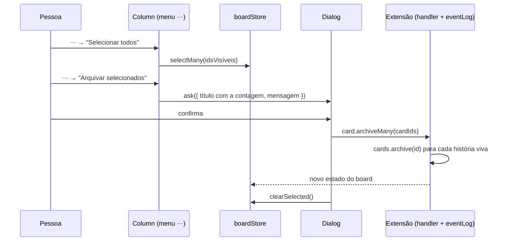
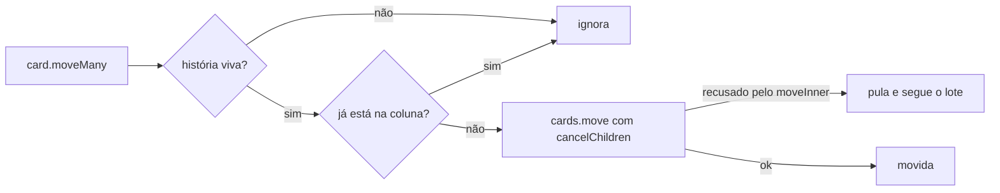

# #436 Selecionar todos os cards de uma coluna para ações em massa

## Contexto

A seleção múltipla de histórias já existia (caixa de marcação por card, #324; barra de seleção com
modo autônomo e colapsar, #326/#349), mas não havia atalho para marcar uma coluna inteira nem ações
em massa de ciclo de vida. Arquivar, mover, excluir ou concluir exigia repetir a ação card por card.

A pessoa respondeu as dúvidas do card:

- as ações em massa são arquivar, mover para outra coluna, mandar para a lixeira e concluir;
- a seleção vale só para os cards visíveis na coluna;
- o acionamento fica no próprio menu ⋯ da coluna, com desabilitadas as opções que não fazem sentido
  para uma seleção;
- toda ação em massa pede confirmação;
- a seleção vale para uma coluna por vez.

## Decisão

- O menu ⋯ de uma coluna do workflow de Histórias ganha "Selecionar todos". Ele marca as histórias
  vivas e visíveis da coluna (depois do filtro) e fica desabilitado quando não há nenhuma.
- Com uma ou mais histórias marcadas e visíveis na coluna, o mesmo menu mostra "Limpar seleção",
  "Arquivar selecionados", "Mover selecionados para...", "Concluir selecionados" e "Mandar
  selecionados para a lixeira". Renomear, colapsar, categoria, mover e excluir a coluna ficam
  desabilitados enquanto houver seleção nela.
- `selectedIds` continua sendo a única fonte da seleção; `toggleSelected` passa a trocar a seleção
  quando o card clicado é de outra coluna, e `selectMany` substitui a seleção inteira.
- Cada ação abre um diálogo único para o lote (`ask`), sempre, sem consultar `confirmArchive` nem
  `confirmTrash`. Mover escolhe a coluna de destino no próprio diálogo; Concluir usa a primeira coluna
  de conclusão do workflow.
- No host entram três mensagens, `card.archiveMany`, `card.trashMany` e `card.moveMany`, no molde de
  `card.yolo.setMany`. Cada uma itera as histórias vivas do lote e chama o mesmo método do card
  único. `moveMany` passa `cancelChildren: true`, então mover para uma coluna de cancelamento cancela as
  sub-tarefas em aberto sem uma segunda pergunta.
- Quem o `moveInner` recusa (sub-tarefa em aberto indo para conclusão, avanço de fase bloqueado) fica
  de fora e o lote segue. O diálogo de Concluir e o de Mover dizem isso antes da confirmação.
- O lote do menu é a interseção entre o que está marcado e o que está visível na coluna: se um filtro
  passou a esconder um card marcado, ele não entra.

## Alternativas descartadas

- **Reaproveitar a `SelectionBar` para as quatro ações.** O Discovery inicial, escrito antes das
  respostas, fazia isso. A pessoa pediu o menu ⋯; manter a barra para modo autônomo e colapsar e
  abrir um segundo ponto de ação em lote criaria dois lugares com ações parecidas.
- **Dois conceitos de seleção** (um cross-coluna para a `SelectionBar`, outro restrito para as ações
  novas). Duas caixas de marcação por card e duas fontes de verdade, só para preservar um
  comportamento que a pessoa decidiu restringir.
- **Confirmar só quando `confirmArchive`/`confirmTrash` mandam**, como no card único. A pessoa pediu
  confirmação sempre, e mover e concluir não têm regra equivalente; criar regras novas custaria mais
  do que "o lote sempre confirma".
- **Perguntar história a história quando o `moveInner` recusa.** Quebra a ideia de um diálogo só por
  lote. Escolhi pular a recusada, com o aviso no diálogo.
- **Lançar um erro no fim do lote com as recusadas.** O roteador só grava e avisa a tela quando o
  handler retorna; uma exceção deixaria as histórias já movidas sem gravar nem aparecer.
- **Calcular a posição de cada card movido.** `Number.MAX_SAFE_INTEGER` (fim da coluna) é o que o
  host já usa em movimentos programáticos; não há ganho em calcular.
- **Usar a coluna do primeiro id selecionado para decidir o lote** (primeira versão da Implementação).
  Trocada na Revisão pela interseção marcado ∩ visível, porque um filtro aplicado depois da seleção
  deixaria arquivar ou excluir cards fora da vista.

## Consequências

- A seleção múltipla já em produção passa a valer para uma coluna por vez: marcar um card de outra
  coluna troca a seleção em vez de somá-la.
- Concluir ou mover um lote não informa, depois, quais histórias ficaram de fora. A pessoa vê pelo
  card que permaneceu na coluna. Um aviso com a lista exigiria um canal de aviso do host que ainda
  não existe.
- Mover para uma coluna de cancelamento cancela as sub-tarefas em aberto sem a segunda pergunta do
  fluxo de um card.
- Sem migração de banco, sem mudança no MCP: a IA continua com as ferramentas de card único.
- Fica um risco herdado, fora desta história: 8 testes (`dialog`, `selection` e `yolo`) falham por
  causa do commit 9e93148 (#416), base desta pilha. O conserto cabe ao PR do #416.
