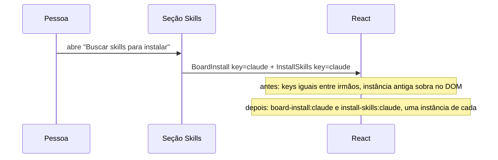

# #437: card "Skill do fluxo" se duplica no Harness

## Contexto

Em Configurações → Harness, abrir "Buscar skills para instalar" empilhava cópias do card
"Skill do fluxo" (`BoardInstall`), e o mesmo ocorria com o "Servidor do board" ao abrir o formulário
de novo servidor. A seção renderiza, como irmãos do mesmo pai, o `BoardInstall` e os painéis que
abrem ao lado dele (`InstallSkills`, `NewItem`, `NewHook`, `NewMcpServer`, `NewPermission`), todos
com `key={tool}`. O React casa filhos pela `key` entre todos os irmãos, não só dentro de um `.map()`;
com a colisão, ao montar/desmontar um painel ele deixava o `BoardInstall` anterior no DOM.

## Decisão

Dar a cada painel irmão uma key própria, `<papel>:<tool>` (`board-install`, `install-skills`,
`new-item`, `new-hook`, `new-mcp`, `new-permission`). Manter o `tool` na key preserva o remonte do
painel ao trocar de ferramenta. Nenhum tipo, dado ou texto de interface muda.

A história nasceu sobre uma base em que o código ainda estava em `KindSection.tsx`; na main ele foi
movido para `HarnessGroupCard.tsx`, e é lá que a correção entrou (os mesmos seis valores de `key`).

## Alternativas descartadas

- **Tirar as keys:** perde o remonte ao trocar de ferramenta (o estado local do painel vazaria de
  uma ferramenta para outra).
- **Mover a key para o pai:** mais invasivo, mexe na estrutura da seção sem necessidade.
- **Tornar o `BoardInstall` idempotente:** trata o sintoma; a key repetida seguiria valendo para os
  outros painéis.

## Consequências

- O card aparece uma vez, independente de quantas vezes o painel ao lado abre e fecha.
- Teste de interface em `test/ui/harnessSettings.test.tsx` falha se a key voltar a colidir (checa a
  contagem de cards e o aviso do React).
- Fora do escopo: o aviso de key repetida em `SelectionTable`, que já existe e aparece em outro teste.
