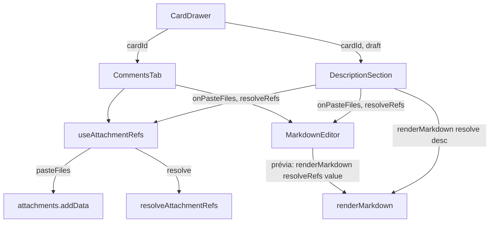
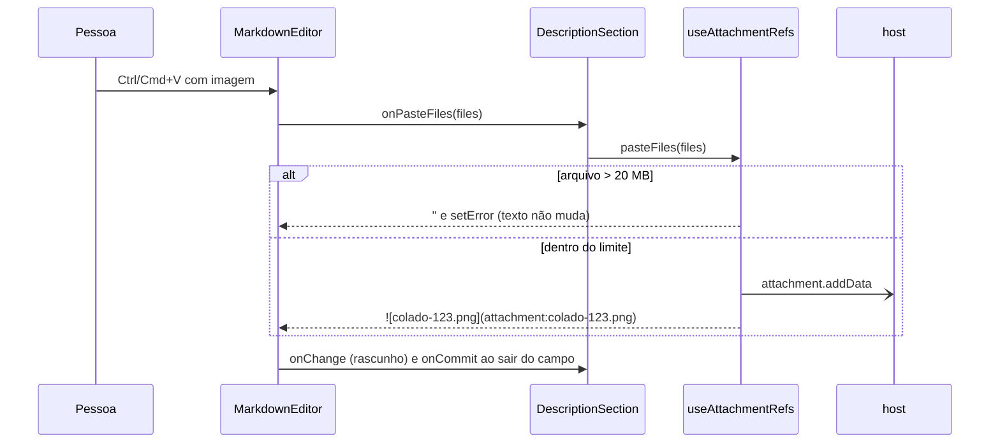

# #440: colar imagem como anexo na descrição do card

## Contexto

A conversa do card já transforma uma imagem colada em anexo do card e a refere no texto como
``, resolvida para o endereço real na hora de renderizar. Essa lógica estava
dentro de `CommentsTab.tsx`. A caixa de descrição não tinha o comportamento: `DescriptionSection`
não passava `onPasteFiles` ao `MarkdownEditor` e renderizava `renderMarkdown(desc)` sem resolver
`attachment:`. A prévia do próprio editor (aba "Visualizar" e modo expandido) também não resolvia a
referência, então a imagem aparecia quebrada ali, na descrição e na caixa de mensagem.

## Decisão

- Extrair o que a conversa já fazia para `src/webview/components/card/attachmentRefs.ts`: a função
  pura `resolveAttachmentRefs` e o hook `useAttachmentRefs(cardId)` (`pasteFiles` e `resolve`).
  `CommentsTab` e `DescriptionSection` usam o mesmo hook; o corpo foi movido sem mudar comportamento
  (limite de 20 MB, nome `colado-<ts>`, mensagem de erro, regex).
- `DescriptionSection` recebe `cardId`, passa `onPasteFiles` ao editor e renderiza a leitura com
  `renderMarkdown(resolve(desc))`.
- `MarkdownEditor` ganha a prop opcional `resolveRefs`, aplicada só à prévia. Ele continua sem
  conhecer a store (também é usado em `PhaseEditor`, que não tem card).
- A referência fica só no texto da descrição; nada é escrito na conversa quando se cola na descrição.
- Sem migração, sem mensagem nova webview↔host (`attachment.addData` já existia), sem dependência nova.
- A nota que ensina a IA (`MCP_INSTRUCTIONS`), `docs/mcp.md`, os READMEs e os CHANGELOGs passam a
  dizer "numa mensagem ou na descrição".

## Alternativas descartadas

- **Duplicar `pasteFiles`/`resolve` em `DescriptionSection`:** o caminho mais curto, mas a conversa e
  a descrição divergiriam na próxima mudança (ex.: o limite). O helper custa um arquivo e mantém o
  comportamento num lugar só.
- **Resolver os links dentro do `MarkdownEditor` (lendo a store):** acoplaria o editor genérico a
  anexos de card.
- **Tratar `attachment:` dentro de `renderMarkdown`:** é uma função pura e global; passar contexto
  por ela obrigaria a mudar todas as chamadas. A troca por regex antes de renderizar é o padrão atual.
- **Deixar a prévia do editor sem resolver:** a pessoa veria um ícone quebrado ao clicar em
  "Visualizar".
- **Deixar um rastro na conversa ao colar na descrição:** duplicaria o que a aba Anexos já mostra e
  geraria uma mensagem por paste.
- **Apagar o anexo órfão ao descartar o rascunho:** exigiria rastrear a origem do anexo e um comando
  no descarte; custo alto para um caso raro e reversível à mão.
- **Salvar a descrição logo após o paste:** mudaria o fluxo de rascunho/blur de `useDescriptionDraft`.

## Consequências

- Colar uma imagem na descrição envia o arquivo, insere a referência e mostra a imagem na leitura e
  na prévia; a conversa continua igual e ganhou a prévia com a imagem.
- Aceitos, como na conversa: anexo órfão se o rascunho for descartado; imagem quebrada por instantes
  logo após o paste (o anexo ainda não chegou ao estado); referência sem destino se o envio falhar.
- Desvio do plano: a nota para a IA estava prevista em `src/extension/mcp/tools/query.ts`, mas o texto
  vive em `MCP_INSTRUCTIONS` (`src/extension/mcp/server.ts`); a mudança foi feita lá, com teste em
  `test/flowSkillRounds.test.ts`.
- Falhas que já existiam na base (#436, `src/webview/store/actions.ts`) e não são desta história:
  `test/i18n.test.ts`, `test/ui/dialog.test.tsx`, `test/ui/selection.test.tsx`,
  `test/ui/yolo.test.tsx` e `prettier --check` em `actions.ts`.
