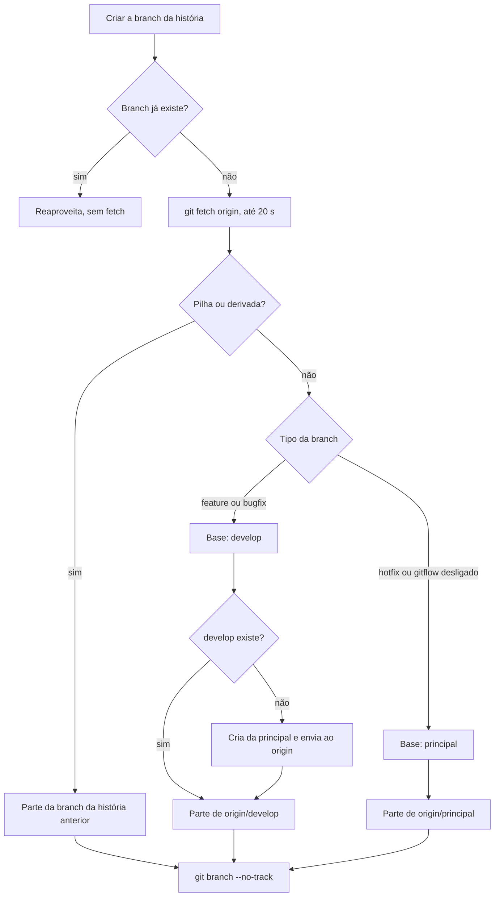

# #462: gitflow nas branches e worktrees criadas pelo board

## Contexto

Até a 0.39.0 toda branch de história saía de `origin/<principal>` (função `baseBranch()` de
`src/extension/git.ts`), com o nome `{tipo}/{numero}-{titulo}`, e o pull request ia para a principal.
Não havia `develop`, nem prefixos por tipo de trabalho, nem como a IA saber para onde abrir o PR: ela
presumia a principal. Além disso, a branch nascia rastreando `origin/main`, e a base era a ref local,
que podia estar atrasada em relação ao `origin`.

A história pediu o gitflow padrão (`main`, `develop`, `feature/`, `bugfix/`, `hotfix/`, `release/`) em
tudo que o board cria, a principal detectada sozinha e os nomes configuráveis. O pedido foi dividido
em quatro entregas empilhadas. Esta é a primeira (configuração, criação das branches e tela). A
conclusão limpa e a release (#464), a limpeza de órfãs (#465) e o renomear da principal no `origin`
(#466) ficam para as seguintes.

## Decisão

- **Tipo de branch no banco.** A coluna `card_types.branch_kind` (migração 30; `feature`, `bugfix` ou
  `hotfix`) diz o que cada tipo de card gera. O padrão é `feature`; Retrabalho vira `bugfix` e Bug vira
  `hotfix`. Edita-se na aba Git, não no card nem pelo MCP. As regras do card Bug continuam valendo.
- **`{fluxo}` no padrão do nome.** O padrão passou a `{fluxo}{numero}-{titulo}`; `{fluxo}` recebe o
  prefixo do tipo de branch (`feature/`, `bugfix/`, `hotfix/`) e, com o gitflow desligado, `<tipo>/`,
  que reproduz o nome de antes. O padrão antigo `{tipo}/{numero}-{titulo}` é indistinguível de uma
  escolha deliberada, então é sempre convertido ao ler a configuração (`parseGit`).
- **Base e ponto de partida.** `feature/` e `bugfix/` partem da `develop`; `hotfix/` parte da
  principal; gitflow desligado parte da principal. Na pilha do modo autônomo e nas histórias
  derivadas vale a branch da história anterior. A branch nasce de `origin/<base>` quando existe, senão
  da ref local.
- **`git fetch origin` síncrono, com limite de 20 s.** O fetch roda uma vez, na criação da branch,
  com `GIT_TERMINAL_PROMPT=0`. O host espera, e a interface pode congelar por até 20 s. Sem `origin`
  ou com o fetch falhando, a branch parte das refs locais e a conversa recebe um aviso.
- **`--no-track`.** A branch (e a worktree) é criada sem upstream. Com `push.default=upstream`, um
  `git push` sem argumentos iria para a `develop` ou para a principal em vez de uma branch própria.
- **`develop` criada quando falta.** Sem ela local nem no `origin`, o board a cria da principal e roda
  `git push -u origin <develop>`, sem força. É a única coisa que a entrega cria no `origin`; nada é
  apagado, renomeado nem reescrito. Se o envio falha, ou se a `develop` existe só na máquina, o aviso
  traz o comando `git push -u origin <develop>`.
- **Principal detectada sem rede.** `detectMainBranch` usa o HEAD do `origin`; senão `main` ou
  `master` (local ou já baixada); senão a branch atual. Ela fica em cache no contexto do board e no
  snapshot, e a tela Git a detecta de novo ao abrir.
- **O que a IA lê.** `get_card` traz `workspace.baseBranch`, `prBase` e `prNote`, e `prepare_workspace`
  devolve a `prBase`. A skill, as instruções do MCP, a nota do modo autônomo e o texto padrão da
  Homologação mandam usar `--base <prBase>`. O template do board foi para a versão 10 (a 9 já
  saiu na 0.39.0); o texto anterior da Homologação continua em `HOMOLOGATION_INSTRUCTION_V9`, para o
  **Atualizar board** reconhecer o padrão antigo sem tocar no que a pessoa personalizou.
- **Avisos em português, traduzidos na tela.** Sem `origin`, fetch que falhou, `develop` criada,
  `develop` não enviada e `develop` só local viram um comentário do autor "Faz AI" na história. O texto
  é escrito em português por `gitNoticeText` (`src/shared/gitflow.ts`); a tela traduz os comentários
  desse autor quando a interface está em inglês.
- **Regras puras num módulo só.** Tipo da branch, prefixo, base, base do PR, linhas da tabela e texto
  dos avisos ficam em `src/shared/gitflow.ts`, usados pelo handler, pelo `get_card` e pela tela, que
  assim não divergem.
- **Seis opções novas**, em `package.json` e no Settings do editor: `fazai.git.gitflow`,
  `developBranch`, `featurePrefix`, `bugfixPrefix`, `hotfixPrefix` e `releasePrefix`. Esta última é
  informativa: nenhum tipo de card gera `release/` nesta entrega.

## Alternativas descartadas

- **Guardar o tipo de branch no nome do tipo de card (Hotfix, Release como tipos novos).** Pediria
  tipos de card que o usuário não quis; as regras do Bug seguem valendo. A coluna `branch_kind` evita
  isso e permite mudar o mapeamento por tipo.
- **Configurar o tipo de branch no card.** Mudaria a branch no meio da história. Por tipo de card, a
  escolha fica estável e visível na aba Git.
- **Manter o padrão `{tipo}/{numero}-{titulo}` como estava.** Daria `historia/12-...` e `bug/12-...`,
  sem relação com os prefixos do gitflow. Um segundo placeholder, `{fluxo}`, deixa `{tipo}` intacto
  para quem o personalizou.
- **Converter o padrão antigo só quando ele for o de fábrica.** Não há como distinguir o de fábrica
  de uma escolha igual feita à mão.
- **Partir da ref local, sem fetch.** É o que o board fazia: a branch nascia de uma principal
  atrasada. Foi descartado mesmo com o custo de até 20 s.
- **Fetch assíncrono.** Exigiria criar a branch depois, com a IA já esperando por ela. O síncrono é
  mais simples e o limite cobre a rede travada.
- **Deixar o upstream como o git decidir.** Seria seguro só com `push.default=simple`, que não dá para
  presumir na máquina da pessoa.
- **Perguntar a branch principal ou ler de uma opção.** A detecção sem rede cobre `main`, `master` e
  outros nomes pelo HEAD do `origin`; o campo editável fica para a #466, junto do renomear no origin.
- **Detectar a principal com `git ls-remote`.** Exigiria rede toda vez que a tela abre; a detecção
  só com refs locais não depende dela.
- **Enviar sozinho uma `develop` que existe só local.** Seria uma escrita no `origin` que a pessoa não
  pediu; o aviso com o comando basta.

## Consequências

- Todo board, inclusive os já existentes, passa a criar `feature/...`, `bugfix/...` e `hotfix/...`
  com o PR para a `develop`; quem não quer desliga `fazai.git.gitflow`.
- Criar uma branch pode travar a interface por até 20 s com a rede ruim.
- Branches e worktrees antigas não são renomeadas nem limpas aqui (#464, #465, #466).
- O nome da `develop` pode mudar na configuração, mas isso não renomeia nada no `origin`.
- Um Bug de uma funcionalidade que só está na `develop` não pode sair da principal; o card certo é
  Retrabalho, e a tela Git diz isso num aviso.
- Release e hotfix devem entrar na principal com merge commit, não squash, para o `ReleaseWatcher`
  seguir arquivando as histórias publicadas; isso é tratado na #464.
- Não validados: o limite do fetch numa rede travada, o Windows e a aparência da tela no editor e no
  navegador.
