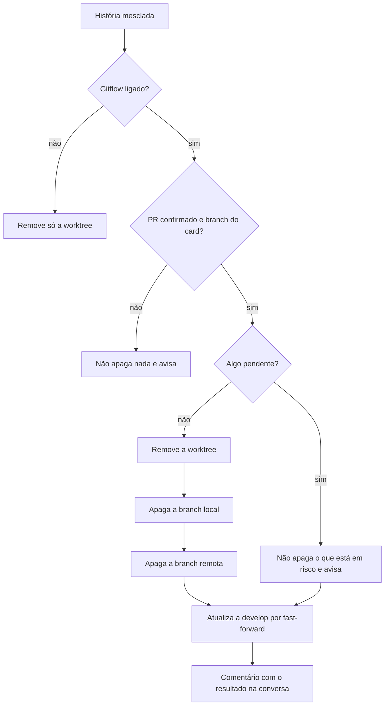

# #464: gitflow, conclusão limpa da história e release do repositório

## Contexto

Depois do merge de uma história, o board deixava quase tudo para trás: `concludeStory` removia só a
worktree, e só no modo worktree. A branch local e a remota ficavam; uma worktree com mudanças
pendentes não era removida e o motivo ia só para o log; a `develop` local não era atualizada (com a
#462, as histórias novas partem dela); e, na pilha do modo autônomo, a história seguinte continuava
apontando para a branch da anterior.

O release deste repositório (`npm run release`) parte da `main` e faz squash. No gitflow as histórias
estão na `develop`, então um release a partir da `main` não as publica, e com squash a tag não contém
o commit de merge delas: o `ReleaseWatcher` deixaria de arquivar as histórias publicadas.

Esta é a segunda das entregas do gitflow (a primeira é a #462). A história foi dividida em três PRs
empilhados: **#464** (conclusão limpa e documentação), **#480** (pilha, hotfix pelo board e merge
commit para a principal) e **#481** (`scripts/release.mjs`). Este registro cobre as decisões das três
partes; cada PR traz só o que é dele.

## Decisão

- **Limpeza só com o gitflow ligado e sem opção para desligar.** Com o gitflow desligado ("direto na
  principal"), a conclusão faz o que sempre fez: remove a worktree. Uma opção só para a limpeza ficou
  de fora do escopo.
- **Ordem e condições (D2).** Merge confirmado, branch do PR igual à registrada no card, nada
  pendente: então remove a worktree, apaga a branch local e a remota e atualiza a `develop`. Qualquer
  coisa pendente (arquivo não commitado, commit fora do PR, remota que recebeu commits, branch aberta
  na pasta do projeto) impede só o que está em risco, e a conversa do card recebe um comentário com o
  resultado e o comando. A conclusão do card nunca é impedida.
- **Branch local com `git branch -D` (D3).** Com squash, `-d` recusa a branch; o estado do PR já
  confirmou o merge, e é o mesmo que o `release.mjs` faz.
- **Branch remota com `git push origin --delete`, nunca `gh pr merge --delete-branch`.** O
  `--delete-branch` só vale para o merge feito pelo board, não para o merge detectado, e ainda tenta
  apagar a branch local e trocar a branch da pasta do projeto. Branch remota que já não existe não é
  erro.
- **`develop` só por fast-forward e nunca na pasta aberta (D5).** `git fetch origin develop:develop`
  sem trocar a branch da pasta do projeto. Se a `develop` está aberta em alguma pasta ou tem commits
  que não estão no `origin`, o board não força: avisa com o comando. O Discovery propunha
  `pull --ff-only` quando a pasta estava limpa; o PRD aprovado proíbe mexer nos arquivos da pasta da
  pessoa, então ele foi descartado.
- **Pilha (D7 do PRD).** As histórias empilhadas passam a ter como base a base da concluída, e o PR
  delas também, antes de apagar a remota. Se a troca falha, a remota não é apagada.
- **Merge commit para a principal.** O PR de hotfix e o do release entram na principal com merge
  commit, seja qual for o tipo configurado, e a principal volta para a `develop` por PR com merge
  commit. O motivo: o commit de merge das histórias fica na tag (o arquivamento depende disso) e a
  `develop` passa a conter a história da principal. Foi conferido que o repositório aceita merge
  commit (`allow_merge_commit: true`) e que a `main` não exige histórico linear.
- **Volta da principal por PR, não por push direto.** Funciona com branch protegida e segue a regra
  de não fazer push direto. Em conflito, o PR fica aberto e o board avisa em vez de resolver.
- **`release.mjs` pela branch atual.** Na `develop`, faz o release normal; numa `hotfix/...`, publica
  a correção; em qualquer outra, recusa. Evita uma opção nova de linha de comando.
- **Hotfix reconhecido pela base real do PR (D3, parte 2 / #480).** O board trata a história como
  hotfix pela base do PR (a principal), não pelo tipo do card nem pelo nome da branch: é a base que
  decide se a principal precisa voltar para a `develop`.
- **Troca da base da pilha antes de apagar a remota (#480).** A base da história seguinte e a do PR
  dela mudam para a `develop` antes do `push --delete`. Se a troca falha, a remota é mantida e a
  conversa avisa; apagá-la fecharia o PR dependente.
- **Volta da principal sempre por PR com merge commit (#480).** Depois do hotfix o board abre e
  mescla `main → develop` por PR, nunca por push direto. Em conflito, o PR fica aberto e a conversa
  avisa.
- **Avisos em pt e en**, conforme o idioma do board, num único comentário por conclusão.
- **Sem migração de banco**: a troca da base usa a coluna `base_branch` que já existe, e o resultado
  da limpeza só vira comentário.

## Alternativas descartadas

- **`gh pr merge --delete-branch` para apagar a remota.** Não vale no merge detectado e mexe na branch
  da pasta do projeto.
- **Confiar no GitHub para trocar a base dos PRs empilhados.** Comportamento não validado; o GitHub
  pode fechar o PR dependente. A troca explícita não depende dele.
- **Rebase das seguintes sobre a `develop`.** Exigiria push forçado, que o projeto proíbe.
- **Atualizar a `develop` aberta na pasta da pessoa com `pull --ff-only`.** Altera arquivos da pasta
  do projeto, o que o PRD proíbe.
- **Voltar a principal para a `develop` com `git merge` e push direto.** Não funciona com branch
  protegida e contraria a regra do projeto.
- **Opção para desligar a limpeza.** Fora do escopo; o gitflow desligado já mantém o comportamento
  antigo.
- **Flag `--hotfix` no `release.mjs`.** Detectar pela branch atual é mais simples e não erra a
  combinação.
- **Uma entrega só.** A soma passa de algumas centenas de linhas e toca o Núcleo; três PRs
  empilhados são mais fáceis de revisar.

## Consequências

- Concluir uma história pelo board deixa de acumular worktrees e branches; o `git worktree list` e o
  `git branch` mostram só o que está em andamento.
- Uma worktree suja deixada pela limpeza será descartada depois pela limpeza de órfãs (#465); por
  isso o aviso diz isso à pessoa.
- Branches e worktrees que já sobraram, e as de histórias concluídas fora do board (merge manual e
  card movido à mão), não passam por aqui: ficam para a #465. O renomear da principal no `origin` é
  da #466.
- Um hotfix aprovado com o merge automático antes de rodar `npm run release` na branch dele entra na
  principal sem versão e sai no próximo release da `develop`.
- A limpeza usa rede (fetch e push) e roda em série na rodada do heartbeat; uma limpeza lenta atrasa
  as outras histórias da mesma rodada.
- Não validados aqui: a troca de base dos PRs e o merge de `main` para `develop` num repositório real,
  e o release completo no fluxo novo (será conferido no primeiro release).

## Desvios do plano e revisão

- **Estado do PR depois do `gh pr merge`.** Na revisão, achou-se que o `AutoMerger` consultava o PR
  antes do `gh pr merge` (estado `OPEN`), e a limpeza pulava tudo. Correção: quando o `gh pr merge`
  sai sem erro, a limpeza recebe `state: 'MERGED'`. O teste agora responde `OPEN` antes do merge, como
  o gh real.
- **`ls-remote` com `refs/heads/<branch>`.** Só o nome da branch casaria também outra branch com o
  mesmo sufixo.
- **Sugestões da revisão não aplicadas**, por mudarem o combinado no SPEC: `--force-with-lease` ao
  apagar a remota; falha qualquer do `git remote get-url origin` tratada como "sem origin"; `NaN` do
  `rev-list --count`; pasta da worktree apagada à mão continua no card.
