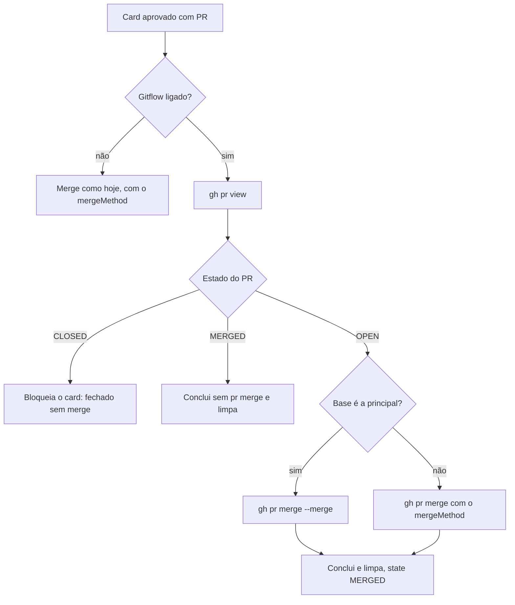

# #480: gitflow (parte 2 da #464), pilha e hotfix na conclusão da história

## Contexto

A #464 fez a conclusão limpa da história: remove a worktree e as branches, e atualiza a `develop`. Faltavam três coisas, que esta história entrega (RF11 a RF16 e RF29 do SPEC da #464):

- Uma história empilhada sobre a concluída continuava com a branch dela como base, no card e no PR. Apagar a remota fecharia o PR dependente.
- O PR que entra na principal (hotfix) era mesclado com o `mergeMethod` configurado, normalmente squash, e o `AutoMerger` tentava mesclar até PR já `MERGED`.
- Depois de um hotfix a principal ficava à frente da `develop`, e nada a trazia de volta.

O registro da #464 ([0464](0464-gitflow-conclusao-limpa-da-historia-bran.md)) cobre as três partes em linhas gerais; este traz as decisões da parte 2.

## Decisão

- **Hotfix pela base real do PR.** `pr.baseRefName === principal` decide, não o tipo do card. Cobre também PRs antigos para a `main`.
- **Volta `main → develop` sempre por PR com merge commit**, nunca por push direto: a branch é protegida e o projeto não faz push direto. São 3 tentativas de `gh pr merge --merge`, nunca `--delete-branch`. Em conflito, o PR fica aberto e a conversa avisa. Reaproveita o PR já aberto.
- **Base da pilha trocada antes de apagar a remota**, e mesmo com pendência na worktree. Se `gh pr edit --base` falha, a remota é mantida (`cleanup.remoteStillBase`) para o GitHub não fechar o PR dependente, e a história seguinte recebe `stack.prFailed`.
- **`restackFollowers` só com conclusão segura (`safe`)**: PR mesclado, head do PR igual à branch do card, branch diferente da principal e da `develop`.
- **`gh pr edit --base` só em PR aberto** (`gh pr view --json state`). PR já mesclado, fechado ou que o `pr view` não leu troca só a base no card, sem aviso.
- **`stackNote` do `get_card` só quando a base é a branch de outra história viva** (sem pai, status aberto). O filtro fica em `format.ts`; `prBaseOf` continua só decidindo a base. `workspace.baseBranch` segue sempre exposto.
- **`card.baseBranch.set` é mensagem interna, não ferramenta MCP.** Grava a coluna `cards.base_branch`, que já existe: sem migração e sem `BOARD_TEMPLATE_VERSION`.
- **`backMergeMain` recebe `pr` como parâmetro**: o corpo do PR de volta cita a URL do hotfix, e `story.prUrl` pode estar vazio. Falha no `git fetch` reaproveita `back.createFailed`, sem chave nova.
- **`AutoMerger` aproveita o `gh pr view` que a #464 já fazia**, sem consulta extra. Com o gitflow ligado: base principal usa `--merge`; `MERGED` conclui sem `pr merge`; `CLOSED` bloqueia o card.
- **Avisos `stack.*`, `back.*` e `cleanup.remoteStillBase`** em pt e en, no mesmo comentário único da conclusão.

### Conclusão com gitflow

```mermaid
sequenceDiagram
  participant M as AutoMerger
  participant C as cleanUpStory
  participant R as restackFollowers
  participant G as git/gh
  participant B as backMergeMain
  M->>C: PR mesclado (state MERGED)
  C->>C: pendências (worktree, commits fora do PR, remota)
  C->>R: conclusão segura (safe)
  R->>G: gh pr view --json state (cada seguinte)
  R->>G: gh pr edit --base (só PR aberto)
  R-->>C: base nova no card; keepRemote se o edit falhou
  C->>G: remove worktree, apaga branch local
  C->>G: push --delete (pula se keepRemote)
  C->>G: updateDevelop (fetch origin develop:develop, ff)
  alt pr.baseRefName == principal
    C->>B: backMergeMain(main, develop, story, pr)
    B->>G: reaproveita ou abre PR main para develop
    B->>G: gh pr merge --merge (3 tentativas)
    B-->>C: back.* (mesclado, conflito ou falha)
  end
  C-->>M: comentário único com os avisos
```

### AutoMerger



## Alternativas descartadas

- **Tipo Bug como hotfix.** Não cobre PRs antigos para a `main` nem bug que vai para a `develop`.
- **Push direto de `main` para `develop`.** Falha com branch protegida e contraria a regra do projeto.
- **Deixar o GitHub trocar a base ao apagar a remota.** Comportamento não validado; pode fechar o PR dependente.
- **Apagar a remota mesmo com `pr edit` falhando.** Fecharia o PR da história seguinte.
- **Restack sob `merged && branch` apenas.** Uma história com branch `develop` re-basearia todas as features em aberto.
- **Ferramenta MCP para trocar a base.** A troca é do board, na conclusão; a IA só lê o resultado.
- **Coluna ou migração nova para a base.** `cards.base_branch` já serve.
- **Consulta extra do estado do PR no `AutoMerger`.** O `gh pr view` da #464 já traz o estado e a base.
- **Mexer em `prBaseOf` para filtrar o `stackNote`.** Ele só decide a base; o filtro de "história viva" é do formato do `get_card`.

## Consequências

- Concluir A deixa B com a base `develop` (normalmente) no card e no PR; a remota de A só some se a troca deu certo.
- O PR para a principal entra sempre com merge commit, seja qual for o `mergeMethod`; o commit de merge da história fica na tag.
- Depois de um hotfix a `develop` recebe a principal por PR; em conflito a pessoa resolve no PR aberto.
- PR fechado sem merge bloqueia o card e nada é apagado.
- Não validado: `gh pr edit --base` e o merge commit com `gh` real; os testes usam um `gh` falso.
- O commit de merge de `main → develop` pode ser tentado de novo até 3 vezes; erro definitivo (login, proteção) também é retentado, por cerca de 10 s.

## Desvios do plano e revisão

A revisão (`c041c15`) corrigiu duas coisas:

1. **Bloqueante:** `restackFollowers` rodava sob `merged && branch`. Passou a rodar sob `safe`, que não depende de a worktree estar limpa. O teste RF8 ganhou uma segunda história com base `develop` que não muda.
2. **`gh pr edit --base` só em PR aberto**, conforme o Caminho 2 do SPEC. PR não aberto troca só a base no card, sem `keepRemote` nem `stack.prFailed`.

O CHANGELOG também perdeu a instrução de desenvolvimento (`npm run release` na `hotfix/`), que fica no README e no registro da #464.

Sugestões da revisão não aplicadas, por serem ambíguas ou mudarem o combinado:

- O critério "seguinte viva" está duplicado em `storyCleanup.ts` e `format.ts`; um helper em `gitflow.ts` evitaria divergência.
- Com o PR já `MERGED` a conversa diz "Merge de <url> feito.", embora o board não tenha mesclado.
- `test/merge.test.ts` usa `(merger as any).deps.mainBranch`; seria mais limpo passar `mainBranch` nas deps do `AutoMerger`.
- Com worktree suja e `pr edit` falhando, o relatório traz `cleanup.dirty` e `cleanup.remoteStillBase` juntos (redundante).
- `backMergeMain` retenta erros definitivos.
