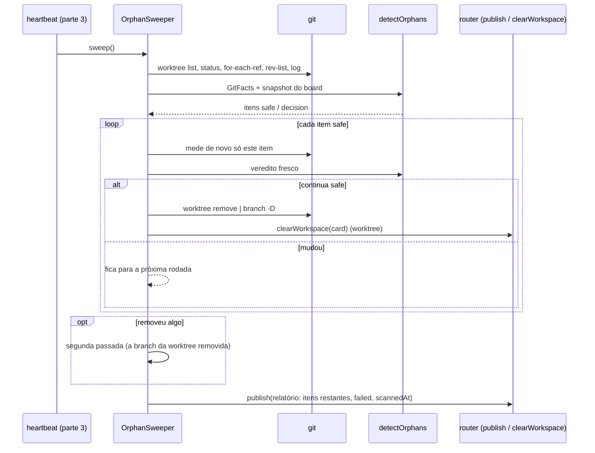
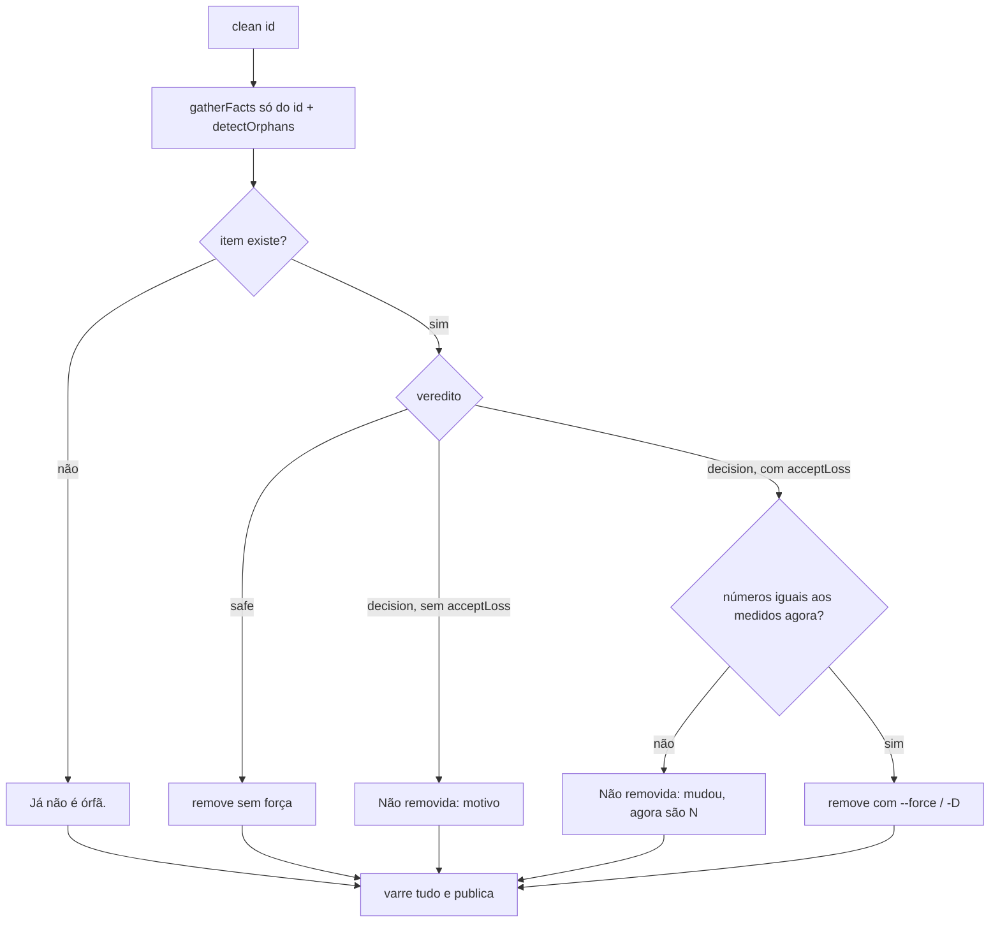

# #489: gitflow, varredor de órfãs no host (coleta git e remoção)

## Contexto

A #465 quer que o board limpe as branches e worktrees que ele mesmo criou e cuja história já terminou (mesclada, cancelada, arquivada, apagada) sem apagar trabalho de ninguém. A parte 1 (#465) entregou a regra pura `detectOrphans` em `src/shared/orphans.ts`: recebe os fatos do git (`GitFacts`) e devolve, para cada branch e worktree, o veredito `safe` ou `decision`, com a prova ou os bloqueios. Faltava o lado do host: medir esses fatos num repositório real e remover o que é seguro. É o que esta parte 2 entrega. A ligação ao roteador, ao `boardHost` e ao heartbeat é a parte 3 (#492); a tela e a documentação, a parte 4 (#494).

## Decisão

- **Um módulo só, `OrphanSweeper` em `src/extension/orphans.ts`**, com `sweep` (varre, remove o `safe`, publica), `scan` (só varre e publica), `clean(id, acceptLoss?)` (um item pedido pela tela) e `cleanSafe` (todos os `safe`). Nenhum veredito nasce no host: ele mede e entrega a `detectOrphans`.
- **Dependências por função, não pelo `MessageRouter`** (`OrphanDeps`: `cwd`, `log`, `git`, `removeWorktree`, `deleteBranch`, `snapshot`, `publish`, `clearWorkspace`, `now`). O roteador não muda nesta parte; a #492 monta as deps a partir dele. O teste injeta `publish` e lê o relatório direto.
- **Coleta** (`gatherFacts`): `git worktree list --porcelain` (só as worktrees dentro de `worktreeRoot`, filtradas por `isInside` nas duas formas do caminho, real e literal); `status --porcelain` por worktree para `dirtyFiles`; `for-each-ref refs/heads` filtrado por `candidateBranches`; `rev-list --count refs/heads/<b> --not --exclude=<b> --branches --remotes` para os commits exclusivos; prova de merge só quando o dono tem `mergeCommit`: ele está na história da principal (`rev-list --count <oid> --not <base>` = 0) e a ponta da branch não é mais nova que ele.
- **Revalidação antes de cada remoção.** `removeSafe` e `clean` medem de novo só o item pedido (`gatherFacts(only)`) e só removem se o veredito fresco continuar `safe`. Item `decision` sai apenas com `acceptLoss` igual aos números recém-medidos; números diferentes recusam citando os novos. O que não foi medido entra como pendente (`dirtyFiles`/`uniqueCommits` = 1): um número neutro nunca significa "pode apagar".
- **Segunda passada na mesma rodada**: se a primeira removeu algo, a varredura repete uma vez, para a branch de uma worktree recém-removida (que deixou de estar `in-use`) sair sem esperar o próximo heartbeat.
- **Remoção pelas funções de `git.ts`**: `removeWorktree(projectDir, path, force)` ganhou o `--force` (só depois de a pessoa aceitar a perda); `deleteBranch` usa `-D` porque `-d` compara com o HEAD da pasta principal e recusaria squash. Worktree removida limpa o `worktreePath` do card (`clearWorkspace`); a branch fica registrada no card como histórico. Worktree nunca apaga branch.
- **Falhas conservadoras**: comando de um item falha → item pendente, sem prova; listagem geral falha → relatório anterior mantido e uma linha de log por mensagem; falha de remoção → `failed[id]` e uma linha de log por `(id, mensagem)`. `sweep`/`scan` nunca rejeitam; uma varredura em curso é devolvida a quem chamar de novo; tudo passa por uma fila de uma operação por vez. Modo `off` publica relatório vazio sem chamar o git.
- **`worktreeRoot` sai de `handlers/workspace.ts` para `git.ts`**, para o host e o handler calcularem a mesma pasta.

### Uma rodada de `sweep`

### `clean(id, acceptLoss?)`

## Alternativas descartadas

- **Passar o `MessageRouter` inteiro ao varredor (como a SPEC escreveu).** Exigiria `setOrphans` no roteador já nesta parte, tocando `messageRouter.ts` em dois PRs, e o teste precisaria de um roteador real. As funções nas deps mantêm o comportamento e o módulo testável sozinho.
- **Fallback por `for-each-ref` para os commits exclusivos.** A sintaxe `rev-list --not --exclude --branches --remotes` foi confirmada com git real (2.43) e virou teste; o fallback dobraria o código sem caso que o exija.
- **Reaproveitar `listWorktrees` de `storyCleanup.ts`.** A assinatura difere (`branch: ''` contra `null` com HEAD destacado); o parser tem 10 linhas e foi repetido com o motivo no comentário.
- **Números neutros (0) para o que não foi medido.** `detectOrphans` leria como seguro; um uso futuro da lista inteira poderia apagar sem medir. Trocado por pendente na revisão.
- **`git branch -d`.** Recusa qualquer squash e compara com um HEAD arbitrário; a prova de que nada se perde já vem de `detectOrphans`.
- **Remover sem revalidar, confiando na listagem.** Um arquivo criado entre a listagem e o clique seria perdido.

## Consequências

- O host nunca apaga sem medir de novo; o custo é um punhado de comandos `git` a mais por remoção.
- A prova de merge é só contra a branch principal: com gitflow, uma história mesclada na `develop` com commits próprios fica em `decision` até a release. Conservador; mudar a base da prova é decisão da pessoa para as partes 3/4.
- `mergeCommit` que não existe no repositório local (squash no GitHub sem `fetch`) não prova nada: o item fica em `decision`.
- `removeWorktree` e `deleteBranch` em `git.ts` são chamadas sem `force` pelo código já existente (`merge.ts`, `storyCleanup.ts`): comportamento inalterado.
- Até a parte 3 nada roda: o módulo existe, tem teste e não é chamado.

## Desvios do plano e revisão

Sem desvio do PLAN.md: três sub-tarefas em série (#532 `git.ts`, #533 `orphans.ts`, #534 `test/orphansGit.test.ts`, 17 testes com repositório git temporário e board em memória). A pergunta P1 do plano (router inteiro ou funções) foi decidida pela alternativa B no modo autônomo.

A revisão corrigiu três pontos em `orphans.ts`: item não medido passou a entrar como pendente; `acceptLoss!` virou variável checada; comentário explicando a duplicação do parser de `worktree list`. Ficou de fora, por mudar o combinado, usar a `develop` (ou a base da pilha) como base da prova de merge com gitflow.
