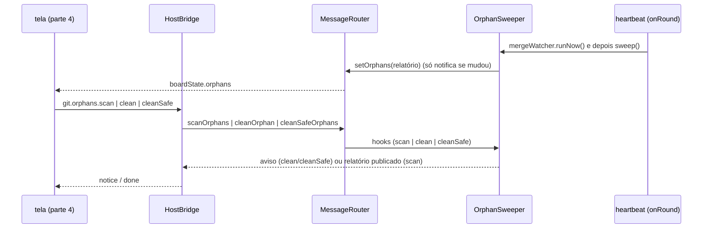

# #492: gitflow, ligar o varredor de órfãs ao board (roteador, ponte e heartbeat)

## Contexto

A #465 limpa as branches e worktrees que o board criou e cuja história terminou. A parte 1 (#465) entregou a regra pura `detectOrphans`; a parte 2 (#489), o `OrphanSweeper` do host (mede o git e remove). Faltava ligá-lo ao board: guardar o relatório no estado, receber os três pedidos da tela e rodar sozinho na rodada do heartbeat e na abertura. Esta parte 3 faz isso. A tela, o selo no board e a documentação são a parte 4 (#494).

## Decisão

- **O relatório é estado do board.** `MessageRouter` guarda `orphans` (`EMPTY_ORPHANS` no início) e o publica em `BoardState.orphans`. `setOrphans` só notifica quando o JSON muda, como `setHeartbeat`: o varredor publica a cada rodada e a tela não pode redesenhar por nada.
- **O roteador só repassa, não decide.** `onOrphans(hooks)` recebe `scan`/`clean`/`cleanSafe`; `scanOrphans`, `cleanOrphan` e `cleanSafeOrphans` delegam. Sem hooks ligados, `clean` e `cleanSafe` devolvem o aviso "não está disponível" em vez de lançar. Nenhuma regra de veredito ou de remoção fica fora de `detectOrphans`/`OrphanSweeper`.
- **`scan` só publica** (P1 = A do plano): devolve `Promise<void>` e a tela lê o relatório do `boardState`, o mesmo caminho de `requirements`; sem resposta com `requestId`.
- **As três mensagens `git.orphans.scan|clean|cleanSafe` são `viaBridge`** (padrão de `requirements.check`), com um `case` cada na `HostBridge`. `clean` e `cleanSafe` respondem com `notice`; o `done` do `scan` só sai quando a varredura termina.
- **`boardHost` monta o `OrphanSweeper` com funções** (`OrphanDeps`, opção B do plano da #489) a partir do roteador: `snapshot`, `publish` (`setOrphans`) e `clearWorkspace` (`card.workspace.clear`).
- **Sem timer novo.** `sweep()` entra em `onRound` do heartbeat, encadeado depois do `MergeWatcher.runNow()` (uma história recém-mesclada ainda seria "decisão" antes de concluída), e roda uma vez na abertura. Só a janela dona (`ownsBoard`) varre sozinha; o botão da tela age onde foi clicado.

## Alternativas descartadas

- **`scan` devolver o relatório com `requestId`.** Daria duas formas de obter a mesma lista (resposta e estado), contra a SPEC; o estado publicado já tem padrão.
- **Timer próprio para a varredura.** O heartbeat já existe, fica desligado quando a pessoa o desliga e já tem a guarda de `ownsBoard`; um timer novo duplicaria a política.
- **`sweep()` em paralelo ao `MergeWatcher`.** A história recém-mesclada apareceria como órfã de decisão antes do `concludeStory`; encadear na promessa custa uma linha.

## Consequências

- O relatório vive em `BoardState`: a tela da parte 4 só lê `orphans` e dispara as três mensagens.
- Sem heartbeat ligado, o board varre só na abertura e no "Verificar de novo".
- Sem efeito visível ainda, por isso sem CHANGELOG/README nesta parte; entram na #494.
