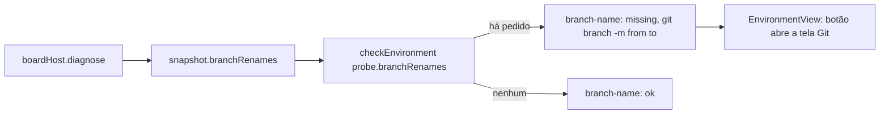

# #498: gitflow, renomear a principal e a develop (parte 2): aviso no navegador, tela Git e Diagnóstico

## Contexto

A #466 (parte 1) guarda o pedido de renomeação da principal ou da `develop` e o resolve com
Renomear / Desfazer, mas o aviso só existia no editor (modal da #495). Quem usa o board no navegador
mudava o nome e não via nada, e o repositório seguia com o nome antigo. Esta parte leva o aviso para
o navegador, dá o campo da principal à tela Git e lista a pendência no Diagnóstico do ambiente.

## Decisão

- **Diálogo só no navegador** (`BranchRenameDialog`, montado em `App.tsx`): no editor segue o modal
  da #495, para não haver dois avisos para o mesmo pedido. Lê `state.branchRenames` e
  `state.branchRenameResult` do snapshot e envia `git.rename.resolve` com `confirm`, `undo` ou
  `dismiss`; nada novo no host nem no store.
- **Fechar a pergunta não envia nada**: o pedido continua e o Diagnóstico segue avisando. Fechar o
  resultado envia `dismiss`, para o aviso do editor não repeti-lo. O estado de "fechado" é local,
  por `${kind}:${from}>${to}`.
- **Modal no padrão `.modal-backdrop`/`.modal`** do board (o do `Dialog`), não Radix: é o único
  padrão de modal do projeto e dá menos código.
- **Campo da principal na tela Git**, gravando no blur como os outros, com um Callout que explica o
  que a renomeação faz (GitHub, local, upstream, `origin/HEAD`) e o que não muda (CI, proteções,
  clones de outras pessoas).
- **Diagnóstico**: novo `EnvCheckId` `branch-name`, nível `recommended` (não bloqueia a IA), pendente
  enquanto houver `branchRenames`; mostra o `git branch -m` do clone local e o botão que abre a tela
  Git. `EnvironmentProbe.branchRenames` é opcional.
- **Sem banco, migração nem MCP**: fora do Núcleo.

## Alternativas descartadas

- **Banner permanente no topo do board**: mais ruído para algo que o diálogo ao abrir e o Diagnóstico
  já cobrem.
- **Diálogo também no editor**: duplicaria o modal da #495 para a mesma pendência.
- **Diálogo Radix**: dependência de padrão que o projeto não usa para modais.
- **Montar os comandos de git na interface**: o resultado da parte 1 já traz `commands` e
  `otherClones`; duplicar a lógica a espalharia.
- **Nomes da Spec** (`board.branchRename`, `git.rename.confirm|undo|result`): a Spec foi escrita
  antes do código da parte 1; o real é `branchRenames`, `branchRenameResult` e `git.rename.resolve`.
  A implementação segue o código (desvio do plano).

## Não validado

- O endpoint "Rename a branch" do GitHub (herdado da #466) não foi exercitado numa conta real.

## Consequências

- No navegador, mudar a principal ou a `develop` abre a pergunta; o resultado traz os comandos prontos
  para copiar.
- O Diagnóstico passa a ter um item que pode ficar pendente até o clone seguir o nome novo.

## Diagramas

```mermaid
sequenceDiagram
  participant Pessoa
  participant Git as GitSettings (navegador)
  participant Host as router (#466)
  participant Store as boardStore
  participant Dlg as BranchRenameDialog
  Pessoa->>Git: edita mainBranch e sai do campo (blur)
  Git->>Host: settings.board.update { git: { mainBranch } }
  Host-->>Store: estado com branchRenames
  Store-->>Dlg: pedido pendente (isWeb)
  Dlg-->>Pessoa: o que vai acontecer, [Renomear] [Desfazer]
  alt Renomear
    Pessoa->>Dlg: Renomear
    Dlg->>Host: git.rename.resolve confirm
    Host-->>Store: branchRenameResult
    Store-->>Dlg: passos, o que falta, comandos com copiar
  else Desfazer
    Pessoa->>Dlg: Desfazer
    Dlg->>Host: git.rename.resolve undo
  else Fechar ou Esc
    Note over Dlg,Host: nada é enviado; o pedido continua
  end
```


