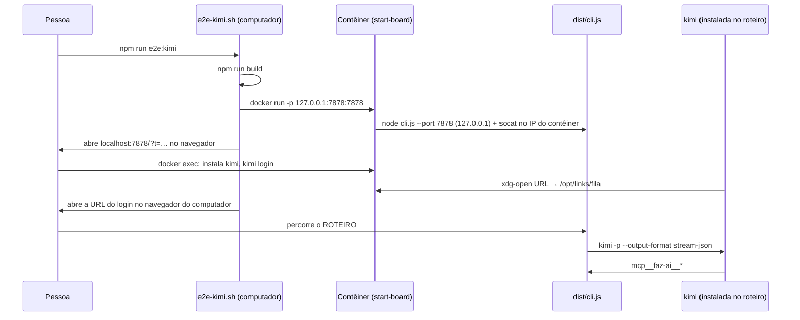

# #540: e2e real com a CLI kimi (`npm run e2e:kimi`)

## Contexto

O Faz AI trata o Kimi Code como terceira ferramenta de IA (PR #249), mas nada exercitava a CLI real: o que a integração assume (instalação, login, `-p --output-format stream-json`, `kimi provider list --json`, `.kimi-code/mcp.json`, ferramentas `mcp__faz-ai__*`) foi conferido só por documentação. O Cursor tem `npm run e2e:cursor`, numa máquina limpa; o Kimi não tinha equivalente.

## Decisão

- **Script `scripts/e2e-kimi/`** no modelo do `e2e-cursor`, mais curto (sem Wayland nem noVNC): `novo`, `continuar`, `parar`, `remover`.
- **Board pelo `src/cli`** (`node dist/cli.js --port 7878 --no-open`), com `dist/` e `media/` da branch montados somente leitura. O Kimi não é um editor, então não há VS Code/Cursor no contêiner.
- **Imagem** Ubuntu 24.04 com Node 22 (o bundle é alvo `node22`; o do `apt` é o 18, instalado pelo `setup_22.x` da NodeSource), `socat`, `curl` e `sudo`; sem git, gh, uv nem a `kimi`, para o Diagnóstico acusar o que falta. A CLI é instalada pelo roteiro, como uma pessoa faria.
- **Acesso ao board sem mexer no produto:** o servidor escuta só em `127.0.0.1` e confere o `Host`. O `socat` repete a porta no IP do contêiner (`hostname -i`, o que o Docker publica) e a porta é publicada como `127.0.0.1:7878:7878`, a mesma dos dois lados, então o `Host` é `localhost:7878`. O `socat` **não** pode usar `0.0.0.0`: ele toma a porta do board, que cai numa porta aleatória (descoberto ao testar a imagem).
- **Login por `kimi login`** (device code, sem TUI), com a URL na fila de links (`open-on-host.sh`, mesma do Cursor). `KIMI_MODEL_NAME`/`KIMI_MODEL_API_KEY` ficam como alternativa anotada, sem navegador.
- **URL do instalador** numa variável: `https://code.kimi.com/kimi-code/install.sh` (página de visão geral da documentação, 2026-10-14); a descrição do card citava `https://code.kimi.com/install.sh`, e o board orienta `npm install -g @moonshot-ai/kimi-code`. O roteiro registra a que funcionou.
- **Roteiro versionado** em `scripts/e2e-kimi/ROTEIRO.md`, com os pontos que o Discovery da #531 deixou "não validados" (lista de ferramentas do agente, `subagents`, `[[hooks]]` na 2.1.1, custo/tokens no stream-json).

## Alternativas descartadas

- **`--network host`:** dispensa o `socat`, mas não existe no Docker do macOS por padrão.
- **Opção `--host 0.0.0.0` no `src/cli`:** muda o produto e expõe o board na rede.
- **VS Code/Cursor com a `.vsix` no contêiner:** mais fiel ao uso, mas traz tela virtual e muito código; o Cursor já cobre esse caminho.
- **`/login` dentro da sessão:** exige TUI; `kimi login` é direto e valida a pasta `credentials/` que o Diagnóstico lê.
- **CLI na imagem:** esconderia o passo de instalação, que é parte do que se valida.
- **Fundir com o `e2e-cursor.sh`:** acopla dois fluxos com pouco em comum (fila de links e cache).

## Consequências

- Nada em `src/`: bug achado no e2e vira card próprio.
- A conta Kimi Code é de quem roda o roteiro; o script não guarda credencial fora do contêiner.
- O cache `~/.cache/faz-ai-e2e` é compartilhado com o e2e do Cursor; `remover` apaga só `links/`.
- Sem teste Vitest para `scripts/`: verificação por `bash -n`, `docker build` e subida do board.

## Fluxo

## Resultado do roteiro

Versão da CLI: —. URL do instalador que funcionou: —.

A execução desta história foi autônoma, sem conta Kimi Code nem a CLI. O que **rodou**: `bash -n` nos scripts, `docker build` da imagem (sem `kimi`, git nem gh; com Node 22 e `socat`) e a subida do board no contêiner, alcançado em `http://localhost:7878/?t=…` pelo computador. O resto **não rodou**:

| Passo do roteiro | Estado |
| --- | --- |
| Subir o board e abrir no navegador do computador | rodou (subida e acesso conferidos por `curl`; o `abrir` não foi exercitado) |
| Instalar a CLI pelo instalador oficial | não rodado: sem conta nem acesso ao instalador nesta execução |
| `kimi login` com a URL na fila de links | não rodado: sem conta Kimi |
| Diagnóstico enxerga `kimi` e o login | não rodado |
| Modelos de `kimi provider list --json` no catálogo | não rodado |
| Conectar IA grava `.kimi-code/mcp.json`; `/mcp` lista | não rodado |
| `kimi -p --output-format stream-json` pelo board termina um card; `mcp__faz-ai__*` respondem | não rodado |
| Hooks e agentes de fábrica da #531 em `~/.kimi-code/` | não rodado (também depende da #531) |
| Lista `tools` do agente Kimi (`mcp__*`) | não rodado: segue "não validado" |
| `subagents: "*"` | não rodado: segue "não validado" |
| `[[hooks]]` na 2.1.1 | não rodado: segue "não validado" |
| Custo/tokens no stream-json da 2.1.1 | não rodado: segue "não validado" |
