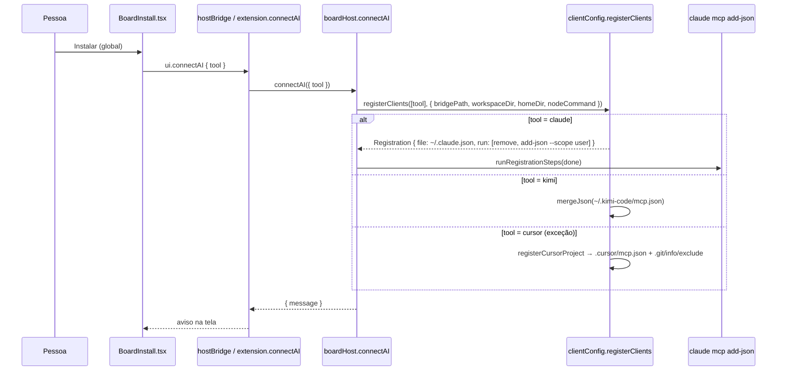
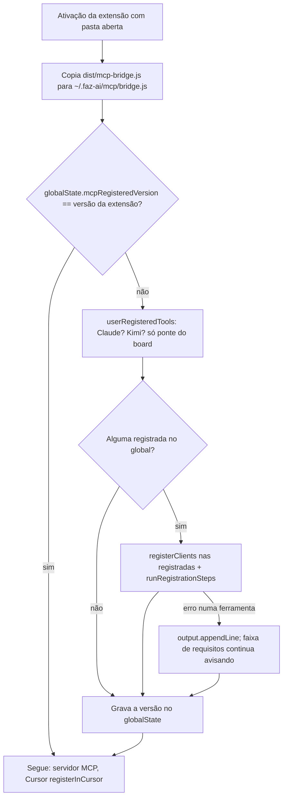

# #563 MCP do board: só no global, refeito ao atualizar, e skill com frontmatter YAML válido

## Contexto

O servidor MCP do board podia ser instalado "neste projeto" (`.mcp.json` do Claude Code,
`.kimi-code/mcp.json` do Kimi Code), o que levava caminhos desta máquina para uma pasta que pode ser
compartilhada com quem não tem a extensão. Ao atualizar a extensão, o registro global não era refeito:
se a ponte ou o comando mudassem, a faixa de requisitos só avisava depois. E a skill `faz-ai-fluxo`
gerada por `skillTemplate` gravava a `description` sem aspas; como ela contém `: `, o parser YAML do
Cursor recusava o `SKILL.md` ("Error parsing skill") e a skill não era usada. O pedido fixa a regra:
todo artefato padrão do board (MCP, skill, agentes) vai para o escopo do usuário, nunca para o projeto.

## Decisão

Três mudanças independentes, numa história e um pull request só:

1. **MCP sempre no global.** `registerClients` (`src/extension/mcp/clientConfig.ts`) perde
   `RegisterOptions.scope` e grava só o global: Claude Code por `claude mcp add-json --scope user`,
   Kimi Code em `~/.kimi-code/mcp.json`. O Cursor continua na exceção documentada
   (`.cursor/mcp.json` do projeto, fora do git por `.git/info/exclude`), porque o global dele é um
   processo só para todas as janelas. Saem a opção **Instalar neste projeto** (MCP e skill do fluxo, na
   tela `BoardInstall.tsx` e na ferramenta `install_flow_skill`), o parâmetro `scope` de
   `ui.connectAI`, `harness.flowSkill.install` e `install_flow_skill`, e o aviso/botão
   **Adicionar ao .gitignore** (`toIgnore`, `addToGitignore`).
2. **Reinstalação na atualização.** Módulo novo `src/extension/mcp/reinstall.ts` com
   `runRegistrationSteps` (extraído de `boardHost.connectAI`), `userRegisteredTools` e
   `reinstallUserServers`. Na ativação, `extension.ts` compara a versão da extensão com
   `fazai.mcpRegisteredVersion` em `context.globalState`; se mudou, refaz o registro global nas
   ferramentas em que o board já está (só entradas `faz-ai` que apontam para uma ponte do board,
   `isBoardBridge`), em segundo plano e uma vez por ativação. A falha de uma ferramenta vai para Saída →
   Faz AI; a versão é gravada mesmo assim e a faixa de requisitos continua apontando o registro velho.
3. **Frontmatter YAML válido.** `skillTemplate` (`harness.ts`) e o `template` de regras `.mdc`
   (`harnessOps.ts`) serializam a `description` com `JSON.stringify`, o padrão de `renderAgentFile` e
   `renderSkill`; `frontmatterValue` desfaz a serialização ao ler e mantém os formatos antigos (sem
   aspas, aspas simples, bloco `>`/`|`).

Nada muda no banco, no board padrão nem na ponte (`~/.faz-ai/mcp/bridge.js`, já recopiada a cada
ativação).

### Instalação pela tela

### Reinstalação na ativação

## Alternativas descartadas

- **Aspas simples na `description`** (sugestão do pedido): resolveria o Cursor, mas exige escapar `'`
  interno como `''` e cria um terceiro formato; `JSON.stringify` já é o padrão de `renderAgentFile` e
  `renderSkill`.
- **Manter "Instalar neste projeto" como escolha explícita** (do MCP ou só da skill): contraria o
  pedido ("nunca no contexto do projeto") e deixa o caminho que contamina repositórios compartilhados.
  Quem precisar de uma cópia da skill no projeto usa **Copiar para o projeto** no Harness.
- **Reinstalar o MCP a cada ativação, sem comparar versão:** mais simples, mas roda
  `claude mcp remove/add-json` toda vez que o editor abre e reescreve `~/.claude.json` sem necessidade.
- **Guardar a versão num arquivo em `~/.faz-ai` em vez do `globalState`:** valeria para VS Code e
  Cursor juntos, mas é um formato de arquivo novo para ler, gravar e testar; o `globalState` já é o
  padrão de `fazai.upgradeDismissed`, e refazer uma vez por editor custa nada.
- **Migrar os registros de projeto antigos do Claude/Kimi na ativação:** mexeria em arquivos do projeto
  da pessoa sem ela pedir; **Corrigir o registro** na faixa de requisitos já faz isso quando o registro
  está quebrado.
- **Aviso na faixa de requisitos para a skill do fluxo instalada sem aspas:** checagem nova para um caso
  transitório; **Reinstalar** na tela resolve e o CHANGELOG orienta.
- **Manter `toIgnore`/`addToGitignore` com valor sempre vazio:** código morto.
- **Reinstalação com `await` na ativação** (como na Spec): a CLI do Claude pode levar segundos e o
  servidor MCP não depende dela; roda em segundo plano (`void` + try/catch).
- **Reinstalação por pasta do workspace:** num workspace multi-raiz duas CLIs escreveriam
  `~/.claude.json` ao mesmo tempo; roda uma vez por ativação (flag de módulo).

## Consequências

- Nenhum artefato padrão do board entra mais na pasta do projeto no Claude Code e no Kimi Code; o
  Cursor continua com o `.cursor/mcp.json` fora do git.
- `install_flow_skill` recusa chamadas com `scope` (quebra de contrato pequena, no CHANGELOG);
  `ui.connectAI` e `harness.flowSkill.install` perdem `scope`.
- Quem já tinha a skill `faz-ai-fluxo` instalada continua com a `description` sem aspas até clicar em
  **Reinstalar** no Harness.
- O registro no escopo *local* do Claude Code (`projects[<pasta>].mcpServers` em `~/.claude.json`)
  continua classificado como global pela sonda `registeredServer`: a reinstalação refaz o `--scope user`
  e deixa o local como está (comportamento herdado, fora do pedido).
- A versão é gravada mesmo quando uma ferramenta falha: a extensão não roda a CLI a cada ativação; a
  detecção reativa (`mcp-stale`/`mcp-outdated`) cobre o caso com o botão de reinstalar.
- A release pedida no card sai depois do merge, pelo `npm run release` (gitflow); a IA não faz o merge.
