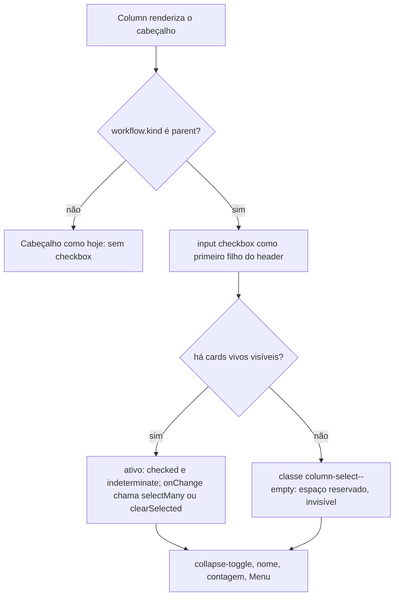
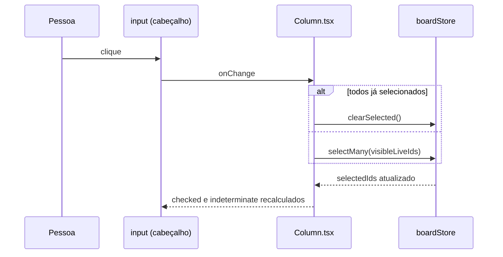

# #579 Alinhar à esquerda o checkbox "selecionar todos" da coluna e o checkbox dos cards

## Contexto
No cabeçalho de cada coluna de histórias, o checkbox que seleciona todas as histórias visíveis ficava à
direita, ao lado da contagem. O checkbox de cada card fica à esquerda. As duas caixas não formavam uma
linha vertical, e o controle de seleção da coluna parecia solto no cabeçalho.

## Decisão
O checkbox "selecionar todos" vira o primeiro controle do cabeçalho, antes do botão de recolher, e a
margem à esquerda dele (`calc(var(--sp-8) + 1px)`) leva a caixa para a mesma borda do checkbox dos cards
(17px da borda esquerda da coluna nos dois lados). A lógica de seleção, o menu da coluna e o card não
mudam. Numa coluna sem cards visíveis, a caixa fica oculta (`visibility: hidden`, classe
`column-select--empty`) e continua no DOM, para o nome do cabeçalho não mudar de posição. Só valem as
colunas expandidas do workflow pai.

## Alternativas descartadas
- **Reordenar só com `order` no CSS:** o DOM continuaria com o checkbox depois da contagem. Ordem visual e
  ordem de foco ficariam diferentes, e leitor de tela e teclado ouviriam uma coisa e veriam outra.
- **Margem negativa no `.card`, para encostar no cabeçalho:** mexe no componente do card, que é
  compartilhado e tem mais casos (overlay, prévia, sub-tarefas), sem relação com o pedido.
- **`display: none` em coluna vazia:** o nome do cabeçalho se deslocaria a cada card que entra ou sai da
  coluna.
- **Span vazio de mesma largura no lugar do checkbox oculto:** mesmo resultado visual de
  `visibility: hidden`, mas com um elemento a mais sem ganho.
- **Mover também o botão de recolher para a direita:** fora do escopo do pedido.

## Desvios do plano aprovado
- **Sem `disabled` na caixa oculta.** A Spec previa `disabled` e a classe `idle` em coluna sem cards
  visíveis. A implementação usa só `visibility: hidden` (classe `column-select--empty`): a caixa oculta
  não recebe clique nem foco, então o `disabled` não mudaria o comportamento e um atributo a mais não
  traria ganho. O teste confere a classe, não o atributo.
- **Alinhamento não medido no navegador.** A conta de 17px vem da leitura do CSS. A conferência visual
  (checklist, item 2) fica para a Homologação, junto com o roteiro "Como testar".

## Consequências
- A caixa de selecionar todos fica na mesma linha vertical dos checkboxes dos cards.
- Cabeçalho de coluna vazia fica 14px mais largo, com o espaço da caixa reservado.
- O título longo perde espaço para a caixa; o `.column-name` já trunca com reticências.
- O primeiro foco do cabeçalho passa a ser a caixa, pela própria ordem do DOM.
