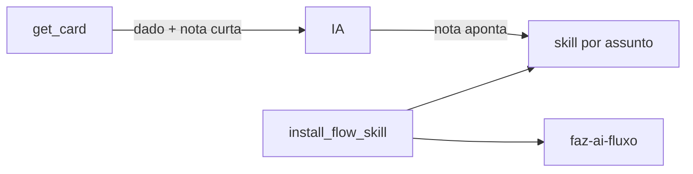

# 0588 — Notas fixas do `get_card` saem da resposta e vão para skills por assunto

## Contexto

Cada `get_card` repetia instruções estáveis (harness, rules e skills obrigatórias, rodadas da Implementação, modelo, pasta de trabalho, base do PR, modo autônomo). A IA lê o card várias vezes por sessão, então o texto entrava no contexto a cada chamada.

## Decisão

- As instruções completas vão para cinco skills por assunto, instaladas em conjunto (`FLOW_SKILLS`) junto com a `faz-ai-fluxo`: `faz-ai-harness-do-card`, `faz-ai-workspace-e-pr`, `faz-ai-implementacao-rodadas`, `faz-ai-revisao-e-homologacao`, `faz-ai-modo-autonomo`.
- O `get_card` traz só notas de uma frase, condicionais ao estado do card, apontando a skill.
- O "instalado" segue checando só a `faz-ai-fluxo`. Sem mudança de schema.
- Medição: resposta de 4.573 para 3.232 caracteres (−29%); só as notas, de 2.515 para ~1.400 (−44%). A meta de −40% no total não foi atingida porque o restante é dado do card, que não foi cortado.

## Alternativas descartadas

- **Uma única skill ampliada:** só desloca o gasto de contexto, pois é carregada inteira em toda conversa.
- **Mexer em AGENTS.md/CLAUDE.md:** a pessoa pediu para não tocar.
- **Cortar dados para atingir −40%:** perderia informação do card.

## Consequências

- Quem já tem a `faz-ai-fluxo` instalada precisa reinstalar para receber as skills por assunto.
- Mudar uma instrução exige editar a skill certa e o teste dela.

## Diagramas

