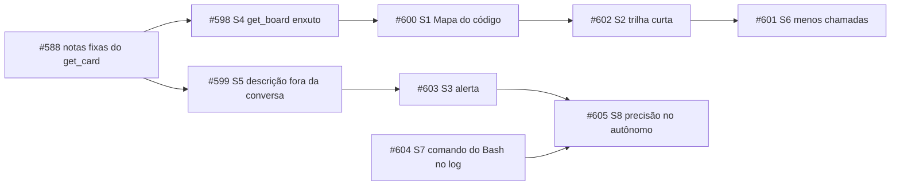

# #589 Leitura do projeto pela IA: menos contexto fixo, mesma orientação

## Contexto
O custo de cada execução do board não vem do card. Vem de quanto contexto a sessão arrasta e de quantas
vezes ela o relê. A história pediu uma análise: medir o que entra hoje numa execução e decidir o que
mudar para gastar menos sem tirar da IA o que ela precisa.

A medição usou o log do board (`ai_runs` e `ai_run_usage`, de 04/10 a 16/10/2026, com 343 execuções
medidas e US$ 451 estimados pelo Claude Code):

- **95,2% dos tokens são leitura de cache.** É o contexto relido a cada turno: o custo cresce com o
  tamanho do contexto vezes o número de turnos.
- **As fases de documento são 52% do custo.** Cada uma (Discovery, PRD, Spec e Plan) faz de 20 a 27
  leituras do código antes de escrever, porque não parte do que a fase anterior já leu.
- **A cauda pesada:** 6% das execuções (mais de 10 M de leitura de cache) somam 37% do custo.
- **Respostas repetidas:**
  - `get_board` traz os agentes três vezes, e `appearance` vem junto;
  - o Refinar copia a descrição anterior inteira na conversa;
  - `create_card` devolve o card completo.
- **História pequena passa pela trilha inteira:** a #579, de esforço Baixo, teve 11 execuções.

As notas fixas do `get_card` e a divisão da skill do fluxo já estavam na #588 e ficaram fora desta
análise. O relatório completo, com as consultas reproduzíveis, é o anexo DISCOVERY.md da #589.

## Decisão
A #589 entrega a análise e oito histórias derivadas, uma por mudança, sem código nela. Cada derivada
tem o próprio Discovery, o próprio pull request a partir da `develop` e mede o próprio ganho com as
consultas do Apêndice do DISCOVERY.md.

| Sugestão | História | Mudança |
|---|---|---|
| S4 | #598 | `get_board` enxuto: uma lista de agentes, sem `appearance` nem inventário repetido |
| S5 | #599 | o Refinar não cola a descrição anterior inteira na conversa |
| S1 | #600 | "Mapa do código" no Discovery, que as fases seguintes completam e de onde partem |
| S2 | #602 | trilha curta: esforço Baixo ou tipo Bug pula o PRD e a Spec, configurável no board |
| S6 | #601 | ciclo do card em menos chamadas do MCP, com respostas resumidas |
| S3 | #603 | alerta de execução longa no painel de métricas e na conversa, sem teto |
| S7 | #604 | o log registra o comando de cada chamada de Bash |
| S8 | #605 | precisão medida também no modo autônomo |

A ordem vem dos arquivos que cada uma altera e está nos vínculos de dependência do board.

O code-review-graph entra só por configuração: **Sempre** no Harness deste board. Os textos do board
padrão falam de forma genérica em "ferramentas de índice de código do Harness". Manter o grafo
atualizado fica com a pessoa.

## Alternativas descartadas
- **Aviso no Harness para um item Sempre grande:** só o `CLAUDE.md` (2,9 KB) e a `faz-ai-fluxo` estão
  em Sempre, e a #588 já divide a skill. O ganho hoje seria quase nulo. Fica adiado.
- **Listar só os nomes dos `files` das skills no `get_card`:** nenhuma skill do board tem arquivos de
  apoio, então o ganho é zero.
- **`storyArtifacts` só com o PLAN nas sub-tarefas:** a lista leva só o nome e o caminho, não o
  conteúdo. Dizer o que ler entra na S1.
- **Retomar a sessão entre as fases (`--resume`):** o contexto se acumularia de uma fase para a outra,
  e cada fase pode ter outro modelo.
- **Teto por execução (`--max-budget-usd`):** cortaria o trabalho no meio. A S3 é só um alerta (P4).
- **Atualizar o grafo pelo board antes de cada execução:** é mais uma peça no produto para uma
  ferramenta que é deste projeto (P3).
- **Manter a #589 aberta até as oito derivadas entrarem, para um relatório único de antes e depois**
  (P5, alternativa B): a história ficaria parada por semanas e passaria por PRD, Spec e Plan sem
  código.
- **Uma história de referência única para o antes e o depois:** o custo varia muito de uma história
  para outra. A comparação é feita pela média por fase no log, numa janela antes e outra depois de cada
  derivada entrar.

## Desvios do plano aprovado
- **A #589 foi do PRD direto para a Homologação, sem PRD, Spec e Plan.** Foi a P5 = A, decidida pela IA
  no modo autônomo pela recomendação do Discovery. Não há Spec aprovada: este registro sai do
  DISCOVERY.md.
- **As derivadas não usam `derived_from`.** Cada uma sai da `develop` com o próprio pull request, para
  não empilhar oito PRs.

## Consequências
- Nenhum comportamento do produto muda neste pull request: ele só leva este registro.
- **O ganho de cada mudança é medido na história dela.** Não haverá um relatório único de antes e
  depois do conjunto. Ele pode ser montado depois a partir das medições de cada derivada.
- **No Cursor, o code-review-graph não chega às execuções.** Pela documentação oficial
  (cursor.com/docs/context/mcp e cursor.com/docs/cli/mcp, conferida em 16/10/2026), o Cursor lê os
  servidores de `.cursor/mcp.json` e de `~/.cursor/mcp.json`, e a CLI usa a mesma configuração do
  editor. O board grava ali só o servidor dele. Para o grafo chegar, ele teria de estar também num
  desses arquivos. O ponto fica para o Discovery da #600, que já trata o grafo como opcional.
