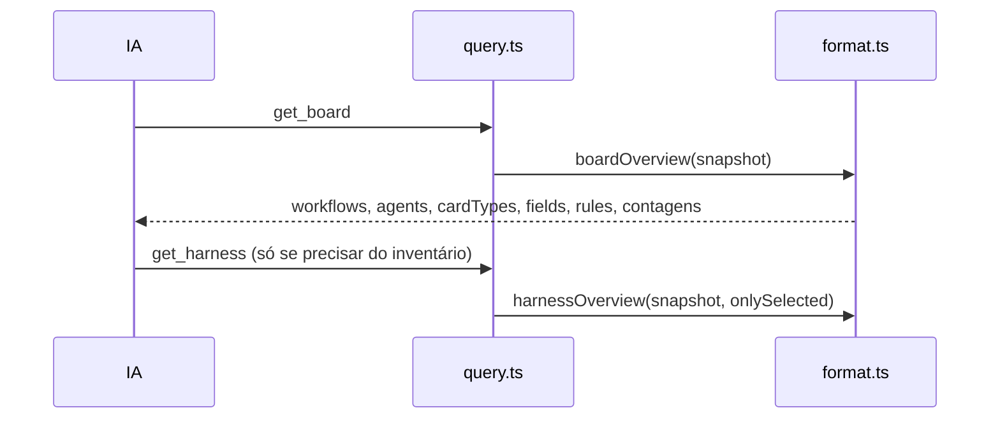

# 0598 — `get_board` enxuto: uma lista de agentes, sem aparência nem inventário repetido

## Contexto

O `get_board` tinha cerca de 18 mil caracteres no relato da #589 e aparecia em 151 de 343 execuções medidas. Os agentes vinham três vezes (`agents`, `harness.agents`, `harness.inventory`), e a resposta trazia `appearance` e o inventário do Harness, que a IA não usa para conduzir cards e que o `get_harness` já entrega.

## Decisão

- `boardOverview` (`src/extension/mcp/format.ts`) deixa de devolver `appearance` e o bloco `harness` inteiro; fica só o `agents` do topo (com `default`).
- `harnessOverview` e o `get_harness` não mudam.
- A descrição do `get_board`, as instruções do servidor MCP, o prompt do refinar e a skill do fluxo passam a pedir o `get_board` só no Plan, no refinar e ao editar o board; nas demais fases, `get_card` basta.
- Medição num board de teste: 5.052 → 3.805 caracteres. Não medido no board real.

## Alternativas descartadas

- **Manter `harness.agents` e tirar `agents` do topo:** o do topo já tem `default` e é o que `set_card_profile` e as colunas citam; o do harness traria `usage` e `path`, que a IA não usa.
- **Manter `harness.skills` e `harness.ruleFiles`:** repetem o inventário do `get_harness`; custo de tokens sem uso na condução.
- **Parâmetro opcional `include` no `get_board`:** mais superfície e testes; o `get_harness` já cobre.

## Consequências

- Menos contexto por chamada do `get_board`.
- Clientes que liam `get_board.harness` ou `appearance` passam a usar `get_harness` e `set_appearance`.
- A skill do fluxo instalada em outras máquinas precisa ser reinstalada para receber a frase nova.

