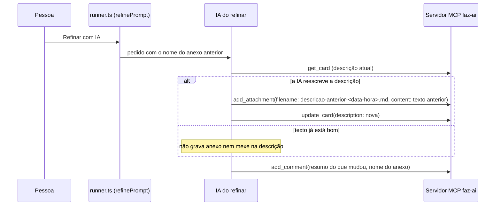

# 0599 — Refinar não cola a descrição anterior inteira na conversa

## Contexto

O pedido do refinar mandava a IA terminar com um comentário que incluía o texto anterior da descrição quando ela era reescrita. A IA colava a descrição inteira mesmo quando só acrescentava trechos. A conversa é relida a cada `get_card` até o próximo resumo, então a descrição aparecia duas vezes em toda consulta de uma história refinada (relato da #589).

## Decisão

- O texto anterior vai para um anexo não-artefato da própria história, com nome `descricao-anterior-AAAA-MM-DD-HHMM.md`, gravado com `add_attachment` **antes** do `update_card` da descrição. Se a gravação falhar, a descrição não é trocada.
- O nome é calculado no disparo (`nomeDoAnexoAnterior(new Date())`, em `src/extension/runner.ts`) e entregue ao pedido: a IA não tem relógio confiável, e o teste fica determinístico.
- O comentário final resume o que mudou e cita o anexo, sem colar o texto.
- O passo 5 do pedido só libera o anexo do passo 1 (antes proibia anexos de forma absoluta).
- Sem mudança de banco, de `get_card` nem da skill do fluxo: o `get_card` já devolve anexos só como metadado.

## Alternativas descartadas

- **Citar o texto anterior só quando a descrição mudou de fato:** mantém o texto inteiro em toda consulta até um resumo; não resolve o problema do card.
- **Nome fixo (`descricao-anterior.md`):** duas gravações deixariam dois anexos com o mesmo nome e sem ordem entre eles.
- **Comparar o texto antigo e o novo antes de gravar:** exige a IA comparar textos sem ferramenta própria; mais frágil para um ganho que a regra "reescreveu = mudou" já dá.
- **Histórico de descrições no banco:** exige migração e mudança de modelo, fora do escopo.
- **Data e hora calculadas pela IA:** descartada em favor do parâmetro do disparo.
- **Anexo como artefato:** um artefato de mesmo nome substitui o anterior, o que apagaria a versão de um refinar para o outro.

## Consequências

- A conversa deixa de crescer com a descrição inteira a cada refinar; a descrição anterior continua recuperável pelo anexo.
- Cada refinar que reescreve acrescenta um anexo à história, sem custo na conversa.
- O pedido do refinar é a única barreira: a IA pode ignorar o passo. A conferência fica na Homologação.
- Dois refinares no mesmo minuto geram o mesmo nome; nada se perde, pois anexo sem `artifact` não sobrescreve.

## Desvios do plano

Nenhum. A estimativa de caracteres (cerca de 1 mil no #599) e a medição antes/depois do `get_card` de uma história refinada não foram feitas nesta execução; ficam no roteiro de testes.

