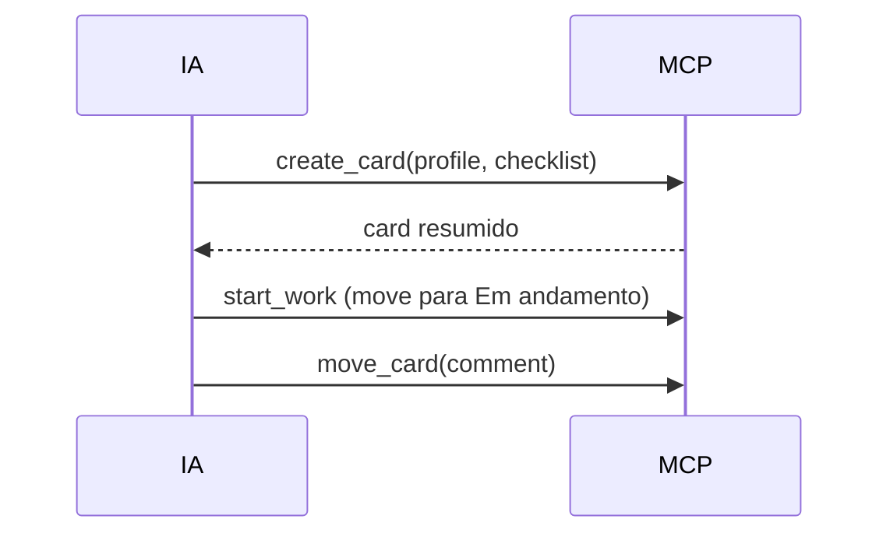

# #601 — Ciclo do card em menos chamadas do MCP, com respostas resumidas

## Contexto

Cada chamada de ferramenta é um turno a mais de contexto relido. No Plan, `create_card` (6,0 chamadas por execução) devolvia o card completo (~4,7 mil caracteres) e `add_checklist_item` (6,2) levava um item por chamada. Vem da sugestão S6 da #589.

## Decisão

- `start_work` numa sub-tarefa a move para "Em andamento", quando a coluna seguinte não exige aprovação e o card não está arquivado.
- `move_card` aceita `comment` (qualquer coluna); se o movimento é recusado, o comentário não é gravado.
- `create_card` aceita `profile` e `checklist` (perfil inválido é recusado antes de criar) e devolve só o card resumido (185 caracteres; 449 com 3 itens).
- `add_checklist_item` aceita uma lista; `set_card_profile` devolve o card resumido.
- Skill do fluxo e `MCP_INSTRUCTIONS` (limite de 2.048 caracteres) usam o ciclo novo.
- As chamadas antigas continuam funcionando.

## Alternativas descartadas

- Mudar `phaseDefaults.ts` agora: conflitaria com a #602; fica para uma história pequena.
- Comentário só na conclusão de sub-tarefa: regra extra sem ganho; vale em qualquer coluna.
- Manter as notas na resposta do `create_card`: é o que pesa; `get_card` traz o detalhe quando precisa.

## Consequências

Cada sub-tarefa criada cai de 4 para 2 chamadas e a resposta encolhe ~96%. A medição "depois" via `get_metrics` fica fora do PR.

## Diagramas

