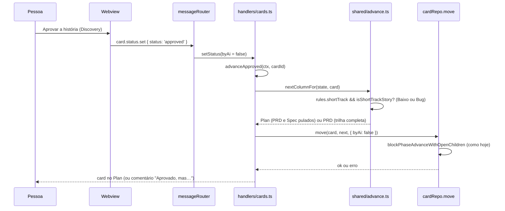
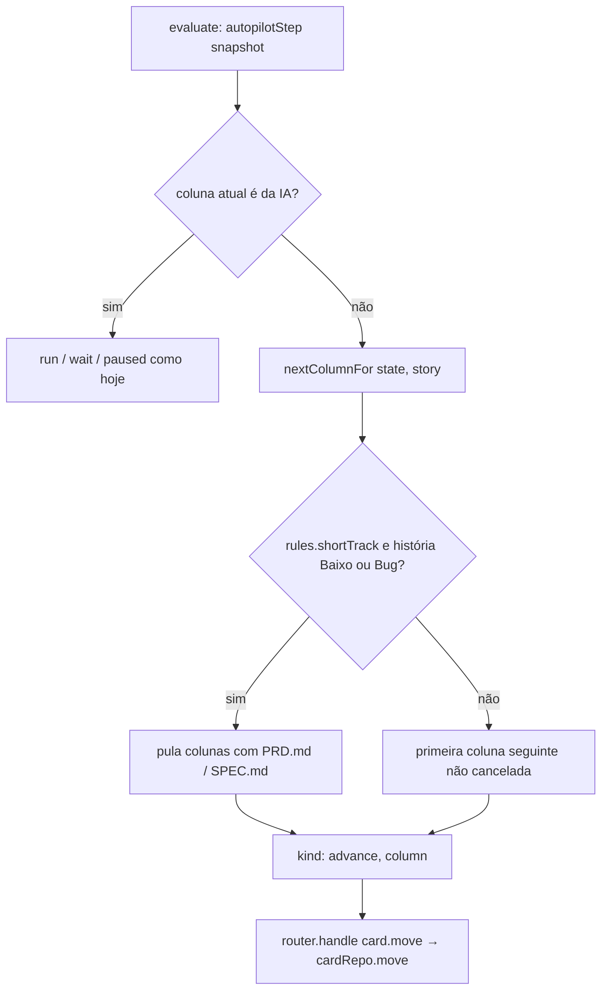
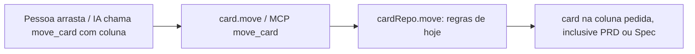
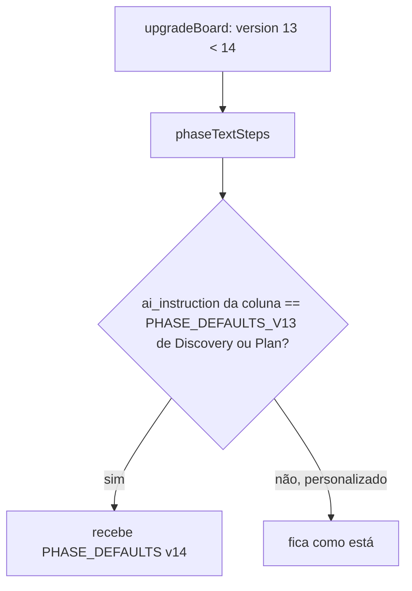

# 0602 — Trilha curta: história de esforço Baixo ou do tipo Bug pula o PRD e a Spec

## Contexto

As fases de documento (Discovery, PRD, Spec e Plan) eram 52% do custo do board (#589). Uma história pequena
passava pela trilha inteira: a #579 (alinhar um checkbox, esforço Baixo) teve 11 execuções e cinco
documentos. No "antes" medido (04/10 a 20/10/2026), 35 histórias elegíveis custaram 225 execuções e
US$ 165,25; só PRD + Spec foram 63 execuções e US$ 44,06 (~27%). A sugestão S2 da #589 (aprovada): uma
história de esforço **Baixo** ou do tipo **Bug** segue Discovery → Plan → Implementação quando o board
liga a trilha curta.

## Decisão

- Regra `shortTrack: boolean` em `BoardRules` (`src/shared/rules.ts`), **desligada** em `DEFAULT_RULES`;
  JSON antigo sem a chave é completado por `parseRules`, sem migração. Ligada neste board pelo
  `update_rules` depois do release; o board padrão dos outros projetos fica desligado.
- Configuração só liga/desliga, com critérios fixos: tipo Bug **ou** "Esforço da atividade" = Baixo
  (Baixo vale para qualquer tipo; Retrabalho e Débito técnico só entram se forem Baixo); pula as colunas
  cujo documento é `PRD.md` ou `SPEC.md`, reconhecidas pelo `artifactName` (sobrevive a renomeação);
  esforço e tipo pelo nome normalizado. Board personalizado que não casa cai na trilha completa.
- Helper puro `src/shared/advance.ts` (`nextColumnFor`, `isShortTrackStory`, `isSkippedOnShortTrack`)
  substitui a expressão duplicada de "próxima coluna" em `advanceApproved` (`panel/handlers/cards.ts`)
  e em `storyStep` (`autopilot.ts`). Sub-tarefa nunca pula: a trilha é da história.
- O pulo vale só no **avanço calculado** (aprovação pela tela ou pelo MCP e autopiloto). O movimento
  explícito (arrastar, `move_card` com a coluna) continua livre e é o jeito de forçar a trilha completa;
  uma história levada à mão ao PRD pula só a Spec na aprovação seguinte, sem estado novo.
- A regra lê o esforço e o tipo atuais a cada avanço: o Discovery pode devolver a história à trilha
  completa subindo o esforço com `update_card`.
- Cartão "Trilha curta para histórias pequenas" em Configurações → Regras (`RulesSettings.tsx`), com
  tradução em `i18n/en/settings.ts`.
- Textos lidos pela IA: fases Discovery e Plan do board padrão explicam a trilha curta (o Plan parte do
  DISCOVERY.md quando não há PRD/SPEC); `BOARD_TEMPLATE_VERSION` sobe para **14** (a base já tinha a v13
  pela #956), com os textos v13 em `PHASE_HISTORY` e a atualização só nas colunas com texto padrão; a
  skill do fluxo (`flowSkill.ts`) ganha a frase da trilha curta; `docs/mcp.md` ganha uma frase. Nenhuma
  ferramenta MCP nova.
- O "depois" é medido após ~2 semanas de uso ou 5 histórias na trilha curta e registrado na conversa.

## Alternativas descartadas

- **Aplicar o pulo em `cardRepo.move`** (como `blockPhaseAdvanceWithOpenChildren`): cobriria MCP,
  autopiloto e tela num ponto só, mas redirecionaria movimentos explícitos (contra a decisão de deixar o
  movimento à mão livre) e exigiria distinguir "avanço calculado" de "destino pedido" dentro do
  repositório, mais SQL para esforço e tipo; o helper em `src/shared` cobre os dois pontos de cálculo com
  menos código e sem tocar o núcleo mais sensível.
- **Critérios e colunas configuráveis pela pessoa** (escolher quais colunas pular e por quais campos):
  mais tela, mais estado e mais casos de erro para um ganho que a #589 não pediu; os critérios fixos
  atendem o caso medido.
- **Reconhecer PRD e Spec pelo nome da coluna**: quebraria com coluna renomeada; o documento da coluna é
  estável.
- **Estado novo no card para "forçar a trilha completa"**: o movimento explícito já faz esse papel sem
  campo nem migração.
- **Ligar a trilha neste projeto pelo passo de atualização do board**: o código não distingue "o board
  deste projeto" dos outros; ligar pelo `update_rules` é explícito e reversível.
- **Reutilizar a v13 do board padrão**: já ocupada pela #956 na base da pilha.

## Consequências

- Com a regra ligada, história Baixo ou Bug vai do Discovery ao Plan na aprovação e no autopiloto; o
  Plan dessas histórias parte do DISCOVERY.md.
- Regra desligada por padrão: nenhum board existente muda de comportamento ao atualizar.
- Boards na v13 com textos padrão de Discovery e Plan recebem a v14; textos personalizados ficam intactos.
- Dois pontos de cálculo de próxima coluna passam a compartilhar um helper testado
  (`test/advance.test.ts`, `test/approveAdvance.test.ts`, `test/autopilot.test.ts`).
- Desvio do plano: `delegates: []` sobrando em `src/extension/ai/admission.ts` (herdado da base #990)
  foi removido para o typecheck passar; avisar na revisão do PR da #990.

## Diagramas

### Aprovação da pessoa (tela ou MCP)

### Autopiloto

### Movimento explícito (sem mudança)

### Atualização do board padrão

