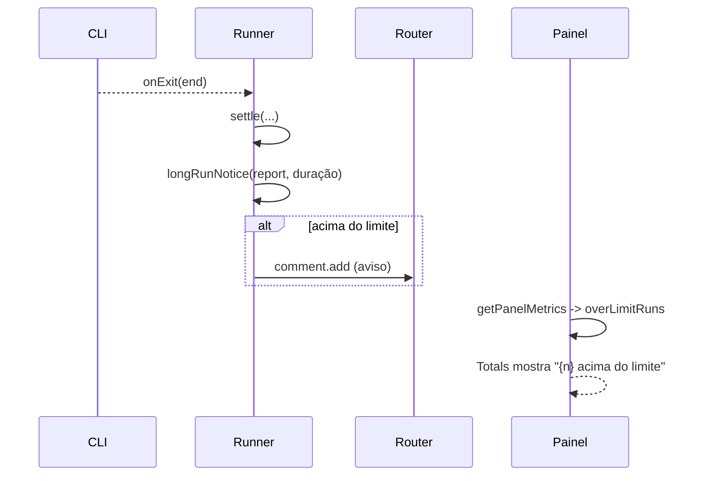

# #603 — Alerta de execução longa no painel de métricas e na conversa do card

## Contexto
Na análise da #589, 20 execuções (6%) com mais de 10 M de leitura de cache somaram 37% do custo medido. Nada avisava a pessoa. Decisão prévia (#589, P4 = A): só alerta, sem interromper a execução.

## Decisão
- Medida: leitura de cache em tokens. Limite fixo `RUN_CACHE_READ_LIMIT` = 10 M em `src/shared/runLimit.ts`; `exceedsRunLimit` é estrito (> limite) e `null`/`undefined` não passam.
- Runner: depois do `settle`, sem retentativa e dentro de try/catch, `longRunNotice` gera o comentário com consumo e duração (minutos, mínimo 1) na conversa do card.
- Painel: `overLimitRuns` opcional em `MetricsMonth`, somado na consulta de `ai_runs`; `Totals` mostra "{n} acima do limite de consumo" em "Execuções de IA" quando > 0.
- Cursor (sem tokens) não tem aviso nem marca.

## Alternativas descartadas
- Lista de execuções com marca por linha: exigiria uma tela nova e bem maior.
- Flag gravada no banco: migração para algo derivável de `cache_read_tokens`.
- Limite configurável: complexidade sem demanda.
- Medir por custo ou duração: o Cursor não tem tokens/custo e a duração não indica o gasto.

## Consequências
- Meses arquivados não contam (sem detalhe por execução), então o total pode subestimar.
- Se o limite mudar, o tooltip ("10 milhões") deve mudar junto.
- Falha ao gravar o aviso é ignorada de propósito.

## Diagramas

