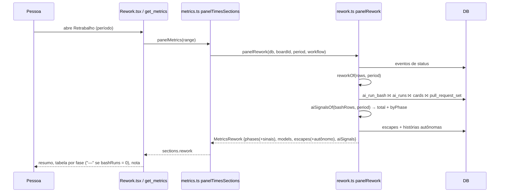

# 0605 — Precisão medida também no modo autônomo

## Contexto

A métrica de retrabalho do painel e do `get_metrics` só conta respostas de uma pessoa: pedidos de
ajuste e aprovações. Na análise da #589, 81% do custo medido (282 de 395 execuções) estava em modo
autônomo, em que ninguém responde, então a precisão dessas execuções não aparecia em nenhuma métrica.
Como as outras mudanças da #589 reduzem exploração e fases, faltava um jeito de ver se a economia
piora o resultado. O que já existia no banco: `ai_runs` (fase, `autonomous`, `started_at` por
execução), `ai_run_bash` (comandos-base de Bash por execução, #604), `card_events` com
`pull_request_set` e os vínculos de Bug com a história.

## Decisão

O bloco Retrabalho (`MetricsRework`) ganha `aiSignals`, com sinais medidos do lado da IA, cada um com
total e parte autônoma (`MetricsAiSignal`: `count`, `runs`, `autonomousCount`, `autonomousRuns`):

- **correções na Revisão**: commits (`git commit`) em execuções cuja fase normalizada é `revisao`;
- **`npm test` com falha**: chamadas de `npm test` que voltaram com `tool_result` `is_error`, gravadas
  na coluna nova `ai_run_bash.failed` (migração 45), preenchida pelo leitor do Claude Code;
- **commits depois do pull request**: commits de execuções iniciadas depois do primeiro
  `pull_request_set` da história (no total conta histórias; por fase, execuções);
- **bugs depois da conclusão**: o `escapes` existente ganha a parte autônoma (história autônoma = teve
  alguma execução com `autonomous = 1`).

As contas ficam numa função pura, `aiSignalsOf(rows, period)`, e as consultas em `panelRework`,
seguindo o padrão `reworkOf`/`panelRework` do módulo. A base medida é `bashRuns` (execuções do período
com algum comando de Bash registrado): com `bashRuns = 0` o sinal é "não medido", nunca zero. O painel
mostra três linhas no resumo, três colunas por fase e uma nota; o `formatRework` do MCP, o mesmo em
texto.

## Alternativas descartadas

- **Reconstruir o modo autônomo pelos eventos `yolo_changed`**: mais consultas e casos de borda;
  `ai_runs.autonomous` já está congelado por execução.
- **Falha de `npm test` por "chamado mais de uma vez"**: não mede falha, mede repetição.
- **Tabela por chamada de Bash (`ai_run_bash_call`) com ordem e resultado**: permitiria saber se a
  falha foi a última da rodada, mas dobra o volume e muda o contrato do `group_by: bash_command`; a
  coluna agregada `failed` atende ao requisito (número de falhas).
- **Identificar a Revisão por uma categoria de coluna nova**: `ColumnCategory` é só
  open/done/cancelled; criar `review` exigiria migração, board padrão e telas. O nome normalizado é
  o mesmo critério que `escapes` usa para o tipo "Bug". Custo: renomear a coluna zera o sinal.
- **Duplicar cada fase por modo (uma linha autônoma e uma acompanhada)**: quebraria a tabela atual;
  `autonomousCount` ao lado mantém uma linha por fase.
- **Calcular os sinais no `getPanelMetrics` via `runsWhere`**: o período do retrabalho é inclusivo em
  ms, diferente do `started_at <` do consumo; os números não bateriam com `escapes`.
- **Migração 45 (como na Spec)**: a branch partiu da `develop` na 43 e a coluna nasceu como 44; ao
  trazer a `develop` de novo, a #895 já ocupava a 44 (`cards.questions_json`), então a coluna passou
  para a 45.

## Consequências

- Sinais são aproximações: commit ≈ correção (commit de formatação conta), `is_error` cobre qualquer
  erro do Bash (timeout, permissão), e valem só para o Claude Code, desde o registro de comandos de
  Bash. A nota do painel, o README e o CHANGELOG avisam.
- `failed` só existe a partir da versão 45 do banco: registros anteriores ficam com 0, e o painel não
  distingue "não falhou" de "não medido" nessas execuções (a base `bashRuns` as conta).
- Uma consulta a mais em `panelRework` (só no detalhe; meses consolidados em `log_months` não têm
  sinais, como o inventário).
- Leitor do Claude Code guarda em memória `tool_use_id` → termos do comando; nunca a saída.
- Mensagens host↔webview não mudam: `sections.rework` já viaja inteiro.

## Desenho do programa

```mermaid
sequenceDiagram
  participant CLI as Claude Code (stream-json)
  participant Leitor as claudeReader
  participant Repo as AiRunRepo
  participant DB as ai_run_bash
  CLI->>Leitor: assistant tool_use Bash {id, command: "npm test"}
  Leitor->>Leitor: bashCounts['npm test']++ ; bashTerms[id] = ['npm test']
  CLI->>Leitor: user tool_result {tool_use_id: id, is_error: true}
  Leitor->>Leitor: bashFailed['npm test']++
  CLI->>Leitor: result
  Leitor-->>Repo: report().bashCommands [{command: 'npm test', calls: 1, failed: 1}]
  Repo->>DB: INSERT (run_id, 'npm test', 1, 1)
```


