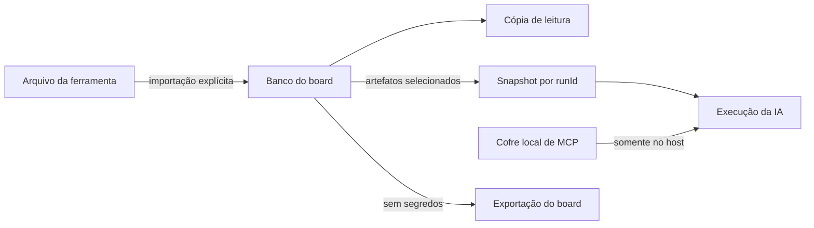

# 0615 — Board independente de ferramenta (1/9): banco de artefatos próprio do board

## Contexto

A [decisão anterior](revisao-do-harness-por-ferramenta.md) fazia o board guardar caminhos de regras,
skills, agentes e servidores MCP das ferramentas de IA. Uma edição ou exclusão no arquivo de origem
mudava o contexto de um card sem uma ação no board. A mesma seleção também dependia dos formatos e
pastas de cada ferramenta, o que impedia trocar o executor preservando o contexto escolhido.

## Decisão

O board guarda sua própria cópia de regras, skills com arquivos de apoio, agentes e definições de
servidores MCP. Os artefatos têm identidade, modo de uso e revisão no banco do board; o caminho e a
ferramenta de origem servem para rastrear a importação, não para ler conteúdo durante a execução.
Enviar um artefato ao board faz uma cópia. Atualizar a partir da origem é uma ação explícita; editar
ou apagar a origem depois disso não altera a cópia.

As configurações e credenciais de MCP ficam em um cofre local referenciado pelo banco. O arquivo de
exportação leva os artefatos e os arquivos de apoio, mas nunca leva esses valores secretos. Um MCP
importado em outra máquina precisa de configuração e revisão locais antes de ser executado.

Para a leitura por uma IA, o host materializa regras, skills e agentes em uma pasta de cache fora do
projeto. Antes de iniciar cada execução, publica uma cópia imutável por `runId`, com manifesto,
revisões e hashes dos arquivos efetivamente selecionados. Falha ao publicar um artefato obrigatório
impede o início do processo. Edições e exclusões posteriores, inclusive do cache compartilhado,
não mudam o snapshot de uma execução já iniciada.

## Alternativas descartadas

- **Continuar referenciando os arquivos da ferramenta:** mantém a sincronização automática, mas
  deixa a execução dependente do formato e do estado atual de outra pasta. Também permite que um
  arquivo alterado fora do board mude silenciosamente o contexto de um card.
- **Guardar os artefatos em `.faz-ai/` no repositório:** facilitaria o versionamento com Git, mas
  exigiria arquivos de configuração do board em cada projeto, levaria cópias locais ao repositório
  e criaria mais um lugar para tratar credenciais. O banco e o cofre locais já são o limite de
  persistência e exportação do board.

## Consequências

- Cada board pode ter uma versão diferente do mesmo artefato. Atualizações na origem precisam ser
  importadas de novo; isso custa uma ação explícita, mas torna a mudança observável.
- A pasta materializada pode ser recriada a partir do banco. Ela não é a fonte da verdade, e sua
  exclusão não invalida snapshots publicados.
- O export e o import preservam os artefatos sem transportar credenciais MCP. Na outra máquina, os
  servidores precisam ser configurados e revisados antes do uso.
- A migração dos boards antigos copia o que estava marcado quando o board abre. Uma origem ausente
  fica registrada como ausente, sem apagar a seleção do card.
- A versão anterior da extensão não abre o banco após a migração. O código legado de descoberta de
  arquivos e a tela por ferramenta serão removidos nas entregas seguintes desta iniciativa.

## Desenho

