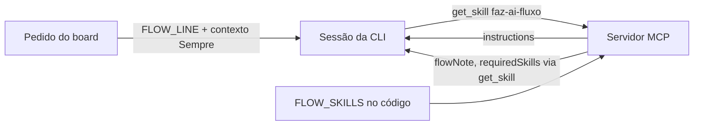

# Fluxo do board servido pelo MCP e pedido igual em toda ferramenta (#617)

## Contexto

A skill do fluxo (`faz-ai-fluxo`) era instalada na pasta de skills da ferramenta em uso e o
Diagnóstico a cobrava como requisito; o pedido do runner mudava conforme a ferramenta (agente
inline só no Claude Code, caminhos de arquivo para skills e regras). Isso prende o board a uma CLI e
deixa arquivo do board fora do banco. A revisão arquitetural v2 pede ainda textos neutros, sem
promessa incondicional de contexto vazio e sem novo caminho de inferência fora do gateway.

## Decisão

- O `get_skill` serve as skills do fluxo a partir de `FLOW_SKILLS` (código), com prioridade sobre
  arquivo de mesmo nome; a skill do fluxo deixa de ser requisito (`requirements.ts`, `boardHost.ts`).
- O fluxo chega à sessão por três caminhos, para não depender de a CLI ler as `instructions` do MCP:
  a linha fixa `FLOW_LINE` em todo pedido, as instruções do servidor (até 2.048 caracteres) e o
  `flowNote` em `get_card` e `get_pending_work`. Em `requiredSkills` as skills do fluxo vêm sem
  `path` e com `via: "get_skill"`.
- O pedido é igual em toda ferramenta; o que a CLI impõe por parâmetro (agente inline) é decidido
  pelo perfil (`how.agent`) e é só reforço. O contexto "Sempre" vale também para o "Indicar
  artefatos".
- O resumo da execução marca a origem de cada item: pelo pedido, pelo MCP ou imposto pela CLI.
- Descrições do MCP e textos lidos pela IA sem nome de ferramenta nem pasta dela, com teste.

## Alternativas descartadas

- Guardar o texto do fluxo no banco: depende da decisão da #615; só a leitura do `get_skill`
  mudaria, então fica para depois.
- Avisar para apagar a cópia instalada: o board a ignora, o que é mais simples e sem texto novo.
- Depender só das `instructions` do MCP: Cursor e Kimi Code podem não lê-las; por isso a linha no
  pedido e a nota nas respostas.
- Remover já `install_flow_skill`, o botão e o item do Diagnóstico: conflitaria com a #616; ficam
  para as entregas 8 e 9.

## Consequências

- Nenhum arquivo do board é necessário na pasta de skills de nenhuma ferramenta.
- Regime exclusivo e admissão da execução são da #619; o bloqueio da delegação nativa é da #621. Os
  textos aqui não prometem isolamento.
- Falta validar manualmente se Cursor e Kimi Code leem as `instructions` do servidor MCP.

## Diagramas

