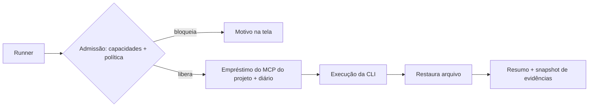
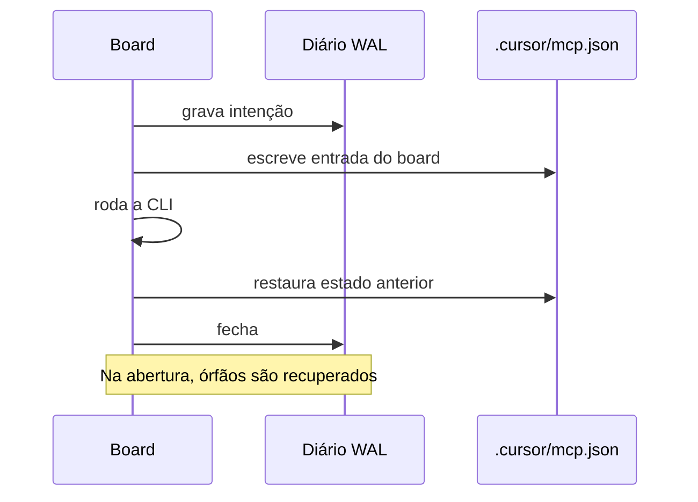

# 0619 — Execução com o mínimo de interferência da ferramenta (isolamento por perfil de CLI)

## Contexto
O Claude Code roda com contexto vazio por flags; Cursor e Kimi leem `AGENTS.md` e as pastas próprias e só recebem MCP pelo arquivo do projeto. O board gravava esse arquivo e não desfazia. A revisão arquitetural v2 (16/10/2026) exigiu admissão por capacidades verificadas, não por lista de vazamentos vazia.

## Decisão
- Perfil de CLI ganha o campo `isolation` (argumentos + itens que a CLI carrega por conta própria). Perfil novo ou desconhecido vale como desconhecido e a admissão bloqueia com motivo.
- Regime exclusivo do board é o padrão; compatibilidade com artefatos externos só por opção explícita da pessoa.
- Arquivo de MCP do projeto: empréstimo com diário write-ahead (`projectServerLease`), coordenado entre processos, com recuperação de órfão ao abrir o board. Cobre sucesso, falha, cancelamento e queda do editor, e execuções simultâneas.
- Resumo da execução, orientação do pedido e `ai_runs.clean` seguem a decisão real; execuções antigas mantêm o valor gravado. `execution.cliLoads` no `get_card` e `cliLoads` no `get_harness`.
- Diagnóstico: problema `isolation` no lugar de `cursor`; telas mostram isolamento no perfil e "Próxima execução".
- Testes reais: `npm run test:cli-real`, fora do `npm test`; CLI ausente é "não validada".

## Alternativas descartadas
- Contador de execuções ativas: não resiste a queda nem a duas janelas; o diário resolve.
- `contextEnforced = loads.length === 0`: lista vazia não prova isolamento.
- Dividir em história "5b": a #620 já deriva desta e bifurcaria a pilha.
- Teste Vitest com CLI real: depende de login e cota; ficou em script separado.

## Consequências
- Nenhum perfil mostra "Contexto vazio" ainda: faltam coletor/verificador de produção (#1000). Cursor e Kimi não validados; Windows não validado.
- O `catch {}` de `AiProfileRepo.isolationOf` esconde o motivo da falha (conservador: bloqueia).

## Diagramas

