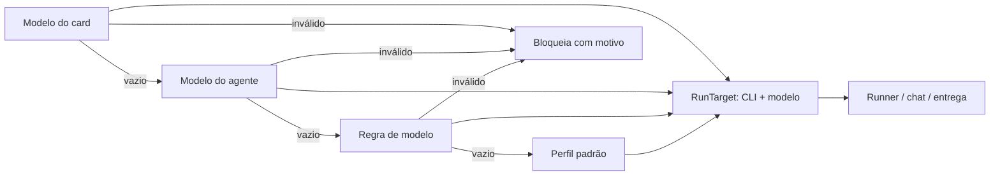
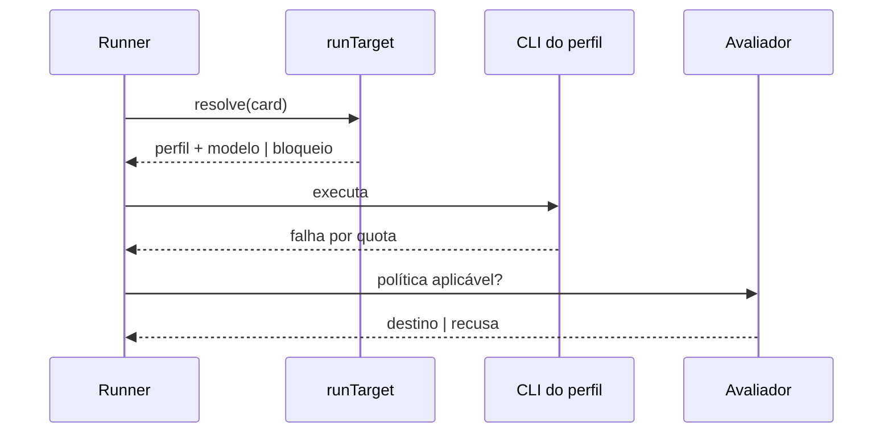

# 0620 — O modelo escolhido decide a CLI (6/9)

## Contexto
O valor do campo Modelo (`<perfil>:<modelo>@<esforço>`) já carrega a ferramenta, mas a execução usava `board.aiTool`, e o catálogo era filtrado por ela. Um login vencido ou CLI ausente travava o board inteiro. A revisão arquitetural v2 (16/10/2026) exige que escolha explícita inválida não caia em outro nível e que trocas de modelo/CLI venham só de política explícita.

## Decisão
- `src/shared/runTarget.ts` resolve o alvo (`RunTarget`: perfil de CLI + modelo) na ordem Modelo do card → agente → regra de modelo → perfil padrão (`board.aiTool` renomeado). O primeiro nível preenchido é definitivo; escolha inválida bloqueia com motivo.
- Runner, chat, entrega, resumo e manifesto (`ExecManifest.target`) usam o perfil do alvo; sub-tarefas e a reserva podem rodar em CLIs diferentes.
- Login/CLI são problemas por perfil (`authExpired` como lista); só os cards do perfil são bloqueados.
- Catálogo de todos os perfis ligados, agrupado por perfil (campo Modelo, chat, editor de regras). "Sugerir regras" troca só as faixas do perfil sugerido.
- Métricas gravam o perfil em `ai_runs.tool` (sem migração).
- Políticas de execução e fallback versionadas (#730–#735), com avaliador único e simulação sem spawn; reserva legada vira proposta desativada.
- Merge com a base (#619): a imposição (`enforcementOf`) e o isolamento passam a seguir o perfil do alvo do card, não o padrão do board.

## Alternativas descartadas
- Campo novo de modelo na coluna: o modelo da coluna é o do agente da coluna; campo novo aumentaria o escopo.
- Cair para o próximo nível em escolha inválida: troca silenciosa de CLI/modelo, contra a revisão v2.
- Coluna nova em `ai_runs`: `tool` já guarda o id do perfil.
- Dividir a história: criaria garfo na pilha de PRs.

## Consequências
- Mudança de comportamento: a regra de modelo vale mesmo com o preenchimento automático desligado; nenhuma troca automática ocorre sem política ligada.
- Pendentes: admissão/registro do alvo no gateway central, `orchestrator.ts:196` (entrega 7), botões de ordenação das políticas, subagentes no perfil do destino, `docs/mcp.md` só em pt. Nada validado com CLI real.

## Diagramas

