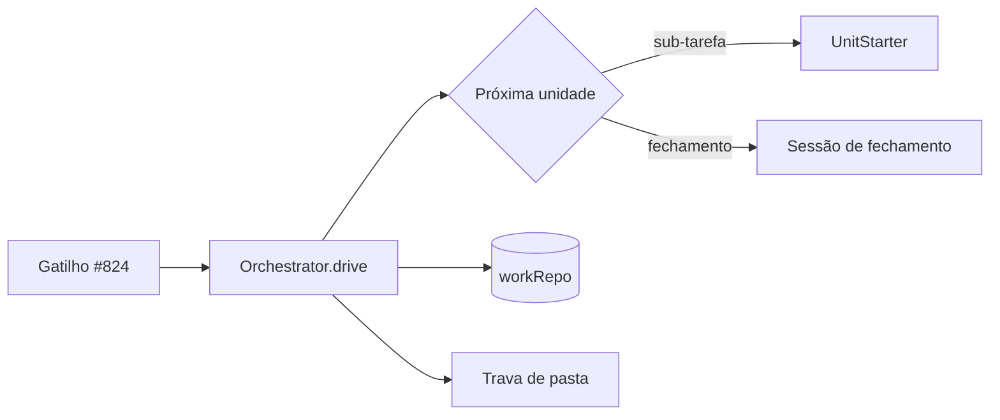
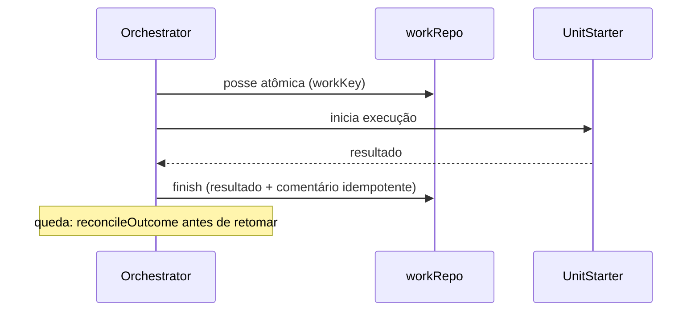

# #621 Orquestrador do board: agentes como execuções separadas (parte 1, fundação)

## Contexto

Hoje a sessão da história delega as sub-tarefas pela ferramenta `Agent` da CLI, o que só existe no
Claude Code. A revisão arquitetural v2 (16/10/2026) pede que o board seja o orquestrador, com posse
persistida, exclusão por pasta real e cancelamento da árvore de processos. O Plan dividiu a entrega
em 4 partes empilhadas; esta é a parte 1, a fundação, sem ligar aos gatilhos.

## Decisão

- Regras puras (`storyPlan`, `workKey`, `reconcileOutcome`), migração `ai_work`/`ai_work_attempts` com
  `workRepo`, trava por pasta real (um escritor efetivo por pasta), identidade e encerramento
  confirmado da árvore de processos, e `Orchestrator` com `UnitStarter` injetado.
- A fundação foi entregue pelo plano de contexto mínimo (#990) em `integracao/contexto-minimo`; nesta
  história a branch só incorporou a integração e foi verificada (typecheck e 3.512 testes).
- Gatilhos, textos da IA, remoção da delegação nativa e a tela do limite ficam em #824 e #825.

## Alternativas descartadas

- Paralelismo de escrita na mesma pasta: `depends_on` não protege arquivos nem lockfiles; fica para
  uma entrega com worktree por sub-tarefa.
- Dividir em 6 partes: obrigaria a recriar as sub-tarefas #736–#738, que não mudam de história.
- Retentativa automática de sub-tarefa que falha: fim ambíguo bloqueia para a pessoa.

## Consequências

- O orquestrador existe e é testado, mas não é acionado por nenhum gatilho até a #824.
- Pendências: confirmação da árvore no Windows, ciclos de devolução pela pessoa, matriz de quedas.

## Diagramas

