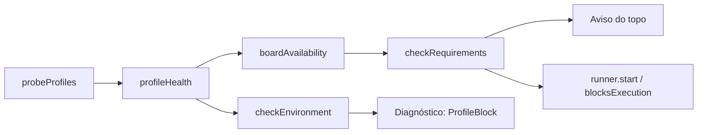

# #622 — Diagnóstico do ambiente por perfil de CLI (parte 1)

## Contexto
O Diagnóstico e o aviso do topo giravam em torno da ferramenta do projeto (CLI, login, MCP, skill, harness e permissão na ferramenta). O board passa a ser dono do contexto e as CLIs são perfis executores, então o Diagnóstico precisa conferir o que o board exige por perfil.

## Decisão
- Regras puras em `src/shared/profileHealth.ts` (`profileHealth`, `profileProblem`, `boardAvailability`); probes locais em `src/extension/profileProbe.ts` (perfil pendente de revisão não executa nada).
- `checkRequirements`/`checkEnvironment` passam a ter um bloco por perfil; saem os itens mcp, skill, harness da ferramenta, permission e `crg-mcp`; o banco de artefatos perde o caso `cursor`.
- `blocksExecution` bloqueia sem perfil (`no-profile`) ou com login vencido do perfil padrão. Login vencido de outro perfil vira aviso dele.
- `runner.start` bloqueia pelo requisito `profile`/`signin` do perfil do board, exceto `expired` (válvula da execução manual).
- "Não validado" é informação, sem selo e sem bloqueio (`validationRequired` falso). A exigência e o Testar ficam na #880.
- Probes dos perfis desligados só rodam no Diagnóstico.

## Alternativas descartadas
- Corte menor da Spec (só host): não compila, pois `RequirementId`, `requirementTexts` e `EnvironmentReport` são usados pela tela.
- Exigir validação real já: bloquearia o board sem saída, pois não há verificador nem Testar na base.
- Probes de todos os perfis no ciclo de 5 min: gasto sem necessidade.

## Consequências
- Um login vencido deixa de travar o board inteiro.
- A #880 acrescenta capacidades/admissão, Testar, próxima execução e limites.

## Diagramas

