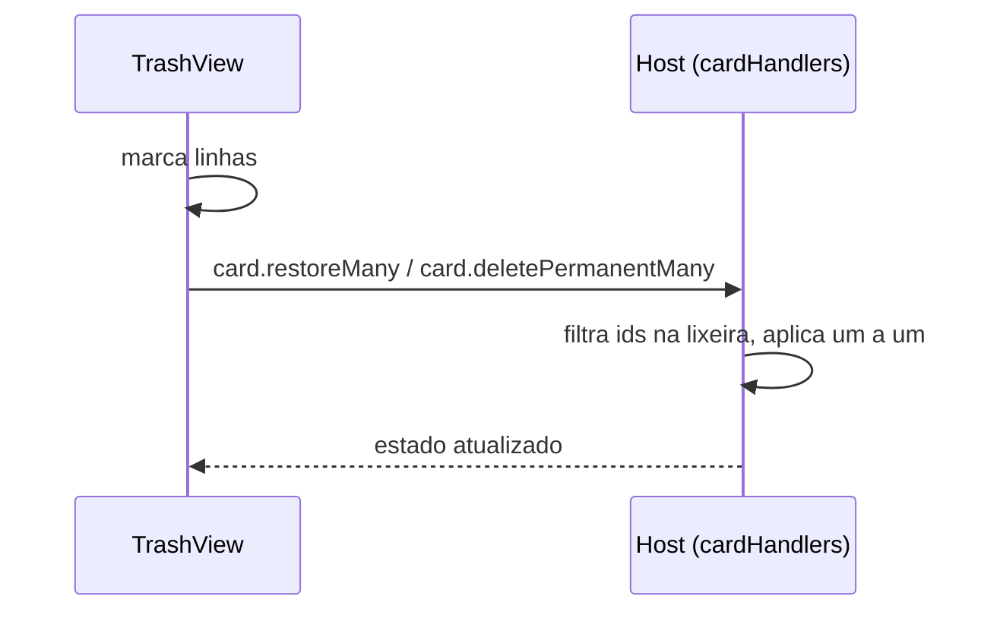

# 0721 - Seleção múltipla e ações em massa na lixeira

## Contexto
A lixeira só permitia restaurar ou apagar um card por vez. O board principal já tem seleção múltipla com ações em lote (`card.trashMany`).

## Decisão
- Seleção local ao `TrashView` (o `selectedIds` do board poda só cards vivos), com "Selecionar todos" no cabeçalho.
- Duas ações em massa: Restaurar (sem confirmação, nada se perde) e Apagar de vez (uma confirmação para o lote). "Esvaziar lixeira" fica como está.
- Novas mensagens `card.restoreMany` e `card.deletePermanentMany`, no padrão de `card.trashMany`; os handlers ignoram ids fora da lixeira e não interrompem o lote se um item falha.
- A barra reaproveita `.selectionbar` e aparece com 1 ou mais itens (no board é 2 ou mais).

## Alternativas descartadas
- Reaproveitar o `selectedIds` do board: poda cards não vivos, quebraria a seleção na lixeira.
- Confirmar também o restaurar: nada se perde, só acrescentaria um clique.
- Enviar uma mensagem por card: N viagens ao host e N estados intermediários.

## Consequências
- Dois novos tipos de mensagem e eventos de log com a família de cada card.
- Barra com 1 item difere do board (2+); aceito para evitar estado morto.
