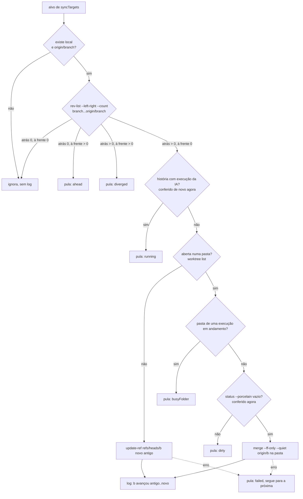

# 0722 — Heartbeat sincroniza as branches locais, numa ordem fixa e com paralelismo próprio

Entrega 1 da #722. A resolução de conflitos dos PRs abertos pela IA ficou na entrega 2, a #747, que é
empilhada sobre esta.

## Contexto

A pessoa queria que cada rodada do heartbeat mantivesse as branches locais atualizadas, para a tarefa
nova partir da base mais recente e a IA encontrar a branch da história em dia. Também pediu que o
heartbeat organizasse as tarefas numa ordem e rodasse em paralelo o que fosse independente, com um
limite próprio, diferente do paralelismo do board.

O Discovery mostrou como o heartbeat funcionava antes desta entrega:

- **Sincronização de branches locais: não existia.**
  - O `prepareWorkspace` fazia `git fetch origin` só ao criar a branch de uma história.
  - O `updateDevelop` só avançava a `develop` local na conclusão de uma história mesclada.
  - A branch de uma história em andamento nunca era atualizada.
- **A ordem da rodada estava espalhada:**
  - a arrumação rodava no `Heartbeat`;
  - os merges eram disparados sem espera pelo `onRound` do `boardHost`;
  - as versões publicadas iam pelo `afterRound` do `MergeWatcher`;
  - as órfãs iam num `.then`.
  - A fila da IA partia junto com tudo isso.
- **As consultas `gh pr view` iam uma por vez, em série.**

## Decisão

- **A rodada tem uma ordem fixa:**
  1. arrumação (limite de uso, cards parados);
  2. um só `git fetch --quiet --prune origin`;
  3. merges;
  4. sincronização das branches;
  5. órfãs e versões publicadas, juntas;
  6. a fila da IA.
- **A ordem fica num módulo novo, `src/extension/maintenance.ts`** (classe `Maintenance`). Ela roda uma
  manutenção por vez e registra a falha do fetch no log uma vez por motivo. Sai o `afterRound` do
  `MergeWatcher`.
- **A fila da IA espera só até a sincronização.** O `onRound` do `Heartbeat` pode devolver uma promessa,
  e enquanto ela não termina (`holding`) o `pump` não inicia nada. O número de histórias da rodada
  continua saindo na hora, e uma promessa que rejeita também libera a fila. Órfãs e versões seguem em
  segundo plano, porque não mexem nas branches das histórias vivas.
- **A manutenção tem um teto próprio e fixo:** `MAINTENANCE_LIMIT = 4`, aplicado pelo `mapLimit`, em
  `src/extension/concurrency.ts`. Ele não depende de `parallel` nem de `parallelStories`. As execuções da
  IA continuam nos tetos do board.
- **O `MergeWatcher` consulta o `gh` em paralelo e aplica em série.** As consultas vão até quatro por
  vez. As conclusões e as limpezas seguem a ordem dos alvos (consulta tudo, depois aplica na ordem).
- **A sincronização (`src/extension/branchSync.ts`) só avança uma branch por fast-forward.** Ela cobre a
  principal, a `develop` (com o gitflow ligado) e a branch de cada história viva. A branch só anda quando:
  - a local está atrás de `origin/<branch>` e não tem nenhum commit à frente (`rev-list --left-right`);
  - nenhuma execução da IA está na história;
  - a pasta em que a branch está aberta não é de uma execução e está limpa.

  O board e as worktrees são lidos de novo logo antes de cada escrita. As medições rodam em paralelo e
  as escritas, em série. A branch fechada anda com `git update-ref` com o valor antigo; a aberta, com
  `git merge --ff-only` na pasta dela. Cada branch atualizada e cada motivo de pulo (uma vez por motivo)
  vão para o log com o prefixo `Branches:`.
- **Só a janela dona do board faz a manutenção.**
- **O git das rotinas de fundo roda com `GIT_TERMINAL_PROMPT=0`.** Sem terminal, um pedido de senha
  falha na hora em vez de prender o comando até o tempo-limite.
- **Sem mudança de banco, de mensagens host↔webview, de ferramentas MCP ou de settings.** A história é
  de Periferia: nenhum arquivo do núcleo do CLAUDE.md muda.

## Alternativas descartadas

- **`git fetch origin b:b` para a branch fechada** (o padrão do `updateDevelop`): faz uma ida à rede por
  branch, contra o "um fetch por rodada" do PRD. O `update-ref` com o valor antigo é atômico, não usa a
  rede e recusa se a ref mudou.
- **`git pull --ff-only` na pasta aberta:** faz outro fetch. O `merge --ff-only origin/<b>` usa a ref que
  o fetch único acabou de trazer.
- **Rebase ou merge da base na branch da história:** fora do escopo desta entrega, porque cria commits ou
  reescreve o histórico sem a IA. A atualização com conflito é tratada na #747.
- **Escritas de ref em paralelo:** os locks do git (`index.lock`, `packed-refs.lock`) colidem, e a falha
  vira um aviso falso. Ficaram paralelas só as leituras.
- **Aplicar cada merge assim que a consulta chega:** ganha pouco tempo e deixa a ordem do log depender da
  rede.
- **Montar a fila da IA só depois da manutenção:** o "Rodar o heartbeat agora" perderia o número
  imediato, ou o comando teria de virar assíncrono no `extension.ts` e no CLI.
- **A fila da IA esperar também as órfãs e as versões:** atrasa a IA sem proteger nada.
- **Teto configurável por setting:** confunde com o paralelismo do board (Discovery, P1).
- **Ordem da rodada no `boardHost`, num encadeamento de `.then`:** a ordem não teria teste sem montar o
  host inteiro.
- **Um gancho novo `HeartbeatDeps.maintain` além do `onRound`:** seriam dois ganchos para o mesmo ponto
  da rodada.
- **`GIT_TERMINAL_PROMPT=0` só no fetch da manutenção:** exige um parâmetro novo de ambiente no `run`
  do `boardHost`, e nenhuma rotina de fundo tem terminal para responder.
- **Dividir esta entrega de novo** (ordem e paralelismo numa história, sincronização em outra): a primeira
  seria uma refatoração sem efeito visível, e a pilha ficaria mais longa (Plan, P1).

## Consequências

- **A tarefa nova parte da base local em dia, e a branch de uma história parada é atualizada.** Isso só
  acontece quando é seguro. Uma branch suja, à frente do origin, divergente ou com execução fica como
  está, e o motivo vai para o log.
- **Mudança de comportamento:** a IA da rodada começa depois do fetch e das consultas `gh`, em vez de
  junto com elas. Com a rede travada, a espera pode chegar ao tempo-limite dos comandos (120 s no fetch,
  mais as consultas).
- **O `--prune` remove do repositório local as refs do origin que não existem mais.** A limpeza do merge
  usa o `headRefOid` do PR, e o `prepareWorkspace` prefere a branch local na pilha. Os testes de órfãs e
  de limpeza continuam passando.
- **Um repositório que dependia de pedir senha no terminal passa a falhar na hora** nas rotinas de fundo.
  O motivo vai para o log.
- **Fechar o board espera a manutenção da rodada terminar.** Os merges e as versões gravam no board, então
  o `dispose` não pode fechar o banco antes disso.
- **O recorte `query`/`apply` do `MergeWatcher` prepara a #747,** que vai mexer no `apply` e no
  `announceConflict`.

## Desvios do plano

- **Na Revisão:** o `dispose` do `boardHost` passou a esperar `maintenance.idle()` antes do
  `orphanSweeper.idle()`, no commit 22f9386. O plano não previa esse passo. Sem ele, um merge ou uma
  versão publicada poderia gravar no board depois de o banco fechar.
- **Na Implementação:** as seis sub-tarefas saíram em três commits de rodada (e0215db, 5cc0a06 e f389a9f),
  como o plano previa.
- **Não medido:** a meta de tempo do PRD (até 10 PRs ≈ fetch + 2 consultas) não foi medida.
- **Não rodado:** a suíte completa (`npm test`) não rodou, porque só roda no release.

## Diagramas

### A rodada

```mermaid
sequenceDiagram
  participant Timer as Timer / "Rodar o heartbeat agora"
  participant HB as Heartbeat
  participant M as Maintenance
  participant Git as git (assíncrono)
  participant MW as MergeWatcher
  participant BS as BranchSyncer
  participant OR as OrphanSweeper + ReleaseWatcher
  participant R as Runner (IA)

  Timer->>HB: tick() / runNow()
  HB->>HB: tidy() (limite de uso, cards parados)
  HB->>HB: queue = heartbeatQueue(snapshot); log da rodada
  HB-->>Timer: count (na hora)
  HB->>M: onRound() → maintenance.run() (só janela dona)
  Note over HB: holding = true: pump() não inicia nada
  M->>Git: fetch --quiet --prune origin (uma vez)
  M->>MW: runNow()
  MW->>MW: mapLimit(alvos, 4, query): gh pr view em paralelo
  MW->>MW: apply() em série, na ordem dos alvos (concluir, limpar)
  M->>BS: sync() (pulado se o fetch falhou)
  BS->>Git: medições em paralelo (mapLimit, 4)
  BS->>Git: escritas em série (update-ref / merge --ff-only)
  M->>OR: orphans() e releases() juntas, sem esperar
  M-->>HB: resolve
  HB->>HB: holding = false; pump()
  HB->>R: start(história, 'heartbeat', modo) nas vagas do board (limitOf)
```

### A decisão de cada branch


