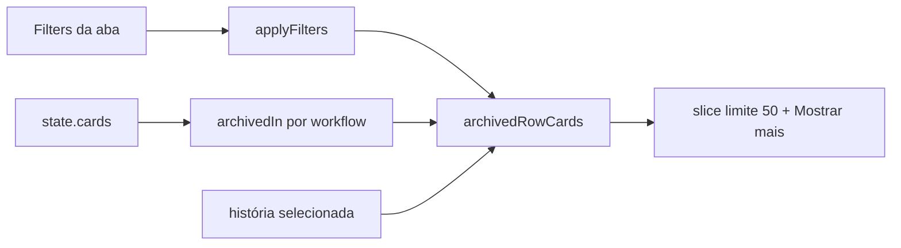

# #724 Aba de Arquivados: filtros, paginação e filhos da história

## Contexto

A aba Arquivados desenhava todos os cards arquivados de uma vez (557 no board do projeto), sem busca
nem filtro, e clicar numa história arquivada não mostrava suas sub-tarefas: elas só apareciam no card
aberto. A seleção de vários cards e as ações em massa foram separadas para a história #775.

## Decisão

- Tudo acontece na webview: `ArchivedView` guarda o estado da aba (`useState` local: filtros, limite
  por linha e história selecionada). Nada muda no host, no banco, no MCP nem no snapshot, e não há
  migração. Sair da aba e voltar a abre limpa.
- Filtros: `applyFilters` aceita `dateField = 'archivedAt'`. A aba reaproveita o `FilterPanel` com as
  props opcionais `filters`, `setFilters` e `scope: 'archived'`, que tira Pendência e Relacionamentos e
  limita o campo de data a "Arquivado em". Sem as props o painel funciona como no board.
- Paginação: "Mostrar mais", 50 por vez (`ARCHIVED_PAGE`) em cada linha de workflow, com "Mostrando X
  de Y". Mudar o filtro volta cada linha à primeira página.
- Filhos: clicar (ou Espaço) numa história arquivada a seleciona, e a linha de Sub-tarefas mostra todas
  as arquivadas dela, mesmo as fora do filtro, com o aviso "Sub-tarefas de #N" e "Limpar seleção". A
  seleção é derivada do estado: história restaurada ou na lixeira deixa de valer. `CardView` ganha
  `selected` e `onSelect` opcionais, sem mexer na seleção do board.
- A montagem das linhas é a função pura `archivedRowCards` em `src/shared/archived.ts`.

## Alternativas descartadas

- Paginação no host: mexeria em seletores, métricas e filtros do board inteiro, e o peso está em
  desenhar os cards, não em carregá-los.
- Painel de filtros novo: duplicaria o `FilterPanel`; as props opcionais bastam.
- Estado da aba na store: nada fora da aba precisa dele.
- Pôr o PR sobre `feature/901-...`, como o board indicava: essa branch não tem commit além de
  `integracao/contexto-minimo`, então o PR usa esta como base.

## Consequências

- O card aberto continua listando todas as sub-tarefas; só a linha da aba filtra por história.
- A #775 (seleção em massa) parte desta branch e precisará de mensagens novas no host.
