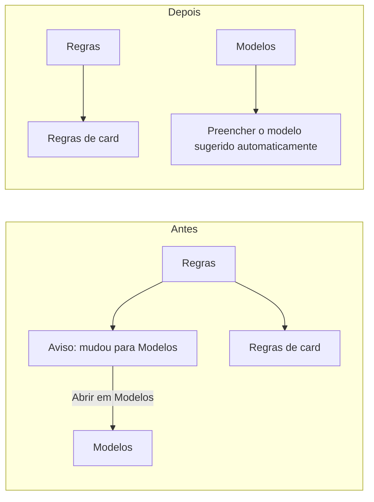

# 0725 — Remover o aviso sobre a aba Modelos da aba Regras

Entrega única da #725. Mudança de tela sem efeito de dados ou de comportamento.

## Contexto

A aba Regras de Configurações mostrava um bloco que dizia que "Preencher o modelo sugerido
automaticamente" tinha mudado para a aba Modelos, com um botão "Abrir em Modelos". A opção já está na
aba Modelos e o aviso só repetia isso. A descrição da história pede a remoção e, se o bloco ficar vazio,
que ele saia também.

## Decisão

- **O bloco inteiro sai de `RulesSettings.tsx`**, com o texto e o botão. Não sobra container vazio.
- **Saem de `i18n/en/settings.ts` só as chaves que o bloco usava**: o texto do aviso e "Abrir em Modelos".
- **A chave `Preencher o modelo sugerido` fica**, porque `ModelsSettings.tsx` a usa como rótulo do cartão
  da opção na aba Modelos.
- **Os testes passam a verificar a ausência** do aviso e do botão (`test/ui/rules.test.tsx`,
  `test/render.test.tsx`).
- **CHANGELOG e README** ganham o item na seção não lançada e na seção de configurações, em português e
  inglês.

## Alternativas descartadas

- **Manter o bloco e só trocar o texto por um link:** o aviso não tem mais função, pois a opção não se
  mudou de lugar para a pessoa encontrar. Mais código para o mesmo resultado.
- **Remover também a chave `Preencher o modelo sugerido`:** ela ainda é usada na aba Modelos. Tirá-la
  quebraria o rótulo do cartão e o teste de i18n.
- **Esconder o aviso por uma configuração:** cria um controle novo para algo que deve simplesmente sair.

## Consequências

- A aba Regras fica sem o aviso. A aba Modelos e a opção "Preencher o modelo sugerido automaticamente"
  seguem sem mudança.
- Nenhuma mudança de banco, de mensagens host↔webview ou de ferramentas MCP.

## Diagramas

Desenho da tela de Configurações, antes e depois da mudança:

