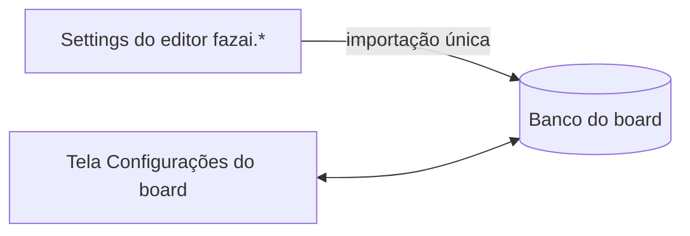

# #726 — Configurações do board de volta para a tela do próprio board

## Contexto
Aparência, Git, Instalação e Backup tinham sido movidos para o Settings do editor (`contributes.configuration`). Isso dividia a edição em dois lugares.

## Decisão
- A tela de Configurações do board (webview) edita tudo, em grupos: Aparência, Git (inclui gitflow, worktrees, paralelismo, merge, registros de decisão), Instalação e Backup.
- `importIdeSettingsOnce` copia uma única vez os valores já salvos em `fazai.*` para o banco do board, sem sobrescrever valor igual e registrando em log valores inválidos.
- Saem `contributes.configuration`, o comando `fazai.openIdeSettings` e a mensagem `ui.openIdeSettings`.

## Alternativas descartadas
- Manter as duas telas sincronizadas: duplicidade e conflito de fonte.
- Migrar continuamente a cada abertura: sobrescreveria edições feitas no board.
- Dividir a entrega em duas histórias: deixaria dois lugares de edição ao mesmo tempo.

## Consequências
- Uma única fonte de edição; valores antigos preservados pela importação única.
- Chaves `fazai.*` não declaradas no manifesto são lidas por `inspect`; validar no editor real.

