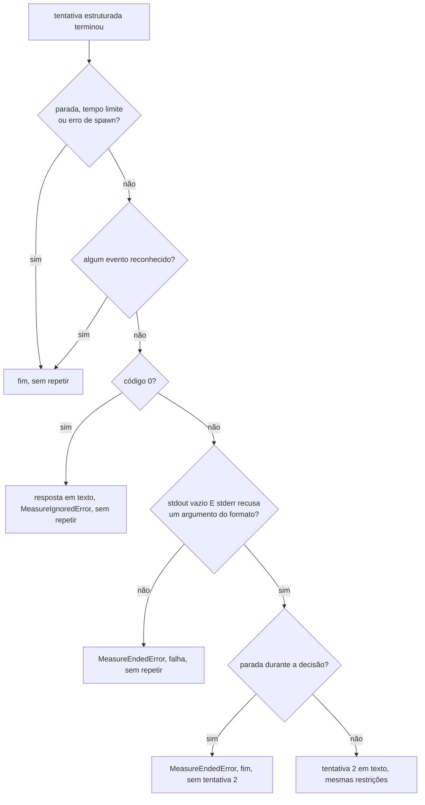
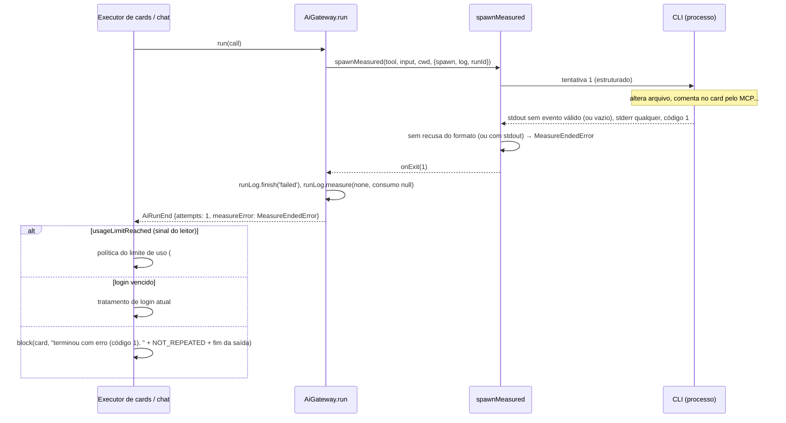
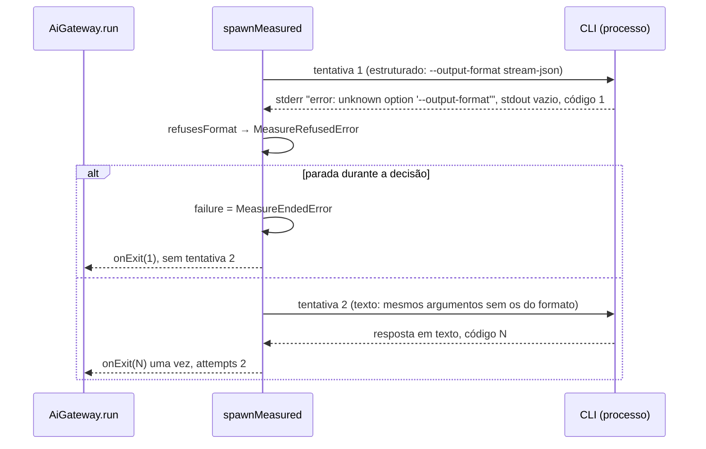

# 0739 — Evitar retentativa duplicada quando a CLI falha sem eventos reconhecidos

## Contexto

O transporte medido (`src/extension/aiOutput/measured.ts`, `spawnMeasured`) pede a saída
estruturada à CLI e, quando a primeira tentativa morria sem um único evento reconhecido, repetia o
pedido em modo texto. A premissa era "morreu sem evento = recusou o argumento, nada aconteceu,
repetir é de graça". Ela não vale: a CLI pode alterar arquivos, comentar ou mover cards pelo MCP e
gastar tokens antes de cair (rede, cota, login, queda, saída truncada ou desconhecida). A segunda
chamada duplicava o efeito e o consumo, e o relatório tratava o caso como se nada tivesse rodado.

A volta para texto continua necessária para a CLI antiga que recusa o argumento da saída
estruturada antes de começar (aceite 2 da história).

## Decisão

- **Repetir em texto só com a recusa comprovada do formato.** A tentativa estruturada precisa ter
  saído sozinha (`!killed`), sem erro de spawn, com código ≠ 0, sem evento reconhecido, **sem
  nenhum byte no `stdout`** e com uma linha do `stderr` que casa `REFUSAL` **e** cita um dos
  argumentos que só o modo estruturado acrescenta.
- **Os argumentos do formato saem da diferença entre os dois comandos do provider**
  (`formatArgs(tool, input)`: no Claude Code, `output-format`, `stream-json`, `verbose`). Uma
  ferramenta nova não precisa de lista própria, e a segunda tentativa é o mesmo comando sem esses
  argumentos: permissão, ferramentas e servidores vão iguais.
- **Qualquer outra falha sem evento termina na primeira tentativa** com `MeasureEndedError`
  (consumo desconhecido: `measure: 'none'`, tokens `null`, nunca zero).
- **Guarda antes da segunda tentativa:** se a execução foi parada enquanto a decisão era registrada,
  a tentativa 2 não começa e o motivo vira `MeasureEndedError` (o relatório não afirma uma repetição
  que não aconteceu).
- **O motivo chega a quem chamou pela classe:** `Measured.failure()` e `AiRunEnd.measureError`. O
  executor de cards (`runner.ts`, `settle`) e o chat acrescentam `NOT_REPEATED` à mensagem de erro
  quando `measureError instanceof MeasureEndedError`. A ordem parada → login → limite de uso (#620)
  → falha não muda.
- **A linha "Chamando…" do canal ganha o sufixo** `(tentativa N da execução <runId>)`, ou
  `(tentativa N)` sem `runId`; o começo da linha fica como estava.
- Sem migração, sem tela nova, sem mudança nos providers, leitores, MCP ou skill do fluxo.

## Alternativas descartadas

- **Tirar a volta para texto de vez:** a mais simples, mas a CLI antiga que não aceita a saída
  estruturada deixaria de rodar (aceite 2).
- **Lista de frases de recusa por ferramenta no provider:** mais precisa, mas é uma tabela a manter
  a cada versão de cada CLI e contraria o "independente da ferramenta". A recusa genérica que cita o
  argumento cobre o caso.
- **Sondar a CLI antes (`--help` ou versão):** um processo a mais em toda execução, mais latência e
  uma frase de ajuda que também muda com a versão.
- **O runner deduzir o caso por `attempts`, `format` e `measure`:** duplica a regra do transporte
  em outro arquivo e erra quando o leitor viu evento sem consumo. A classe do erro segue o padrão de
  erro de domínio do projeto.
- **Gravar tentativa e motivo em colunas novas de `ai_runs`:** exige migração e antecipa o modelo da
  #737; o `runId` e a tentativa vão só para o canal de log.
- **Tempo de execução como sinal de "não trabalhou":** número arbitrário, instável em máquina lenta.
- **Passar o `stderr` pelo leitor para reconhecer o limite de uso do Kimi Code ali:** é detecção
  nova de limite, fora do escopo.

## Consequências

- Falhas antes do primeiro evento que antes "se resolviam" na segunda chamada passam a bloquear o
  card (ou dar erro no chat) com o motivo e o aviso de que a execução não foi repetida. Está no
  CHANGELOG como mudança de comportamento.
- Sem repetição, o leitor da tentativa estruturada continua sendo o do relatório: o
  `usageLimitReached` que ele reconheceu no `stdout` (ex.: Kimi Code) chega ao runner, que segue a
  política do limite de uso (#620). Antes a repetição trocava o leitor e perdia esse sinal.
- Se a frase de recusa real de alguma CLI não citar o argumento, o board não volta para texto e a
  execução falha com o motivo: falso negativo seguro. **Não validado com as CLIs reais**; fica para
  a #717.
- O fim único (`finish`, `onExit` uma vez, arquivos temporários apagados por tentativa) é o contrato
  para o empréstimo e o snapshot da #619.

## Desvios do plano

- **Tamanho:** a estimativa era de cerca de 60 linhas de código; a entrega tem cerca de 110 linhas
  de código alteradas (inclui o comentário do topo de `measured.ts` reescrito), 280 de teste e 17 de
  documentação. Continua uma entrega só.
- **O recado da medição saiu do fim da saída do card e do chat** (não estava na Spec): com o
  `NOT_REPEATED` na mensagem, a frase de `MeasureEndedError` (que o transporte escreve no canal)
  apareceria duas vezes. Ela continua no canal de log; no runner a comparação usa o mesmo
  `cut(…, TAIL_CHARS)` do fim da saída.
- **Revisão:** o comentário de `REFUSAL` ainda descrevia a regra antiga e foi corrigido.

## Diagramas

