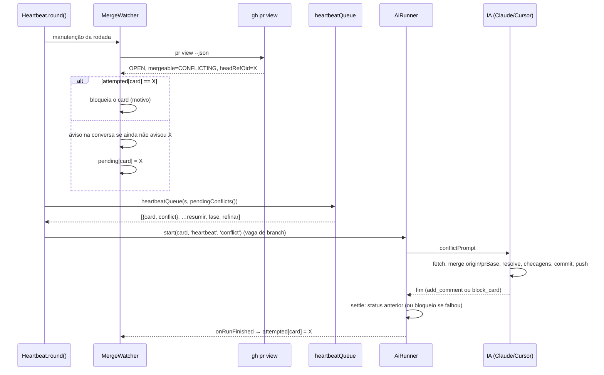
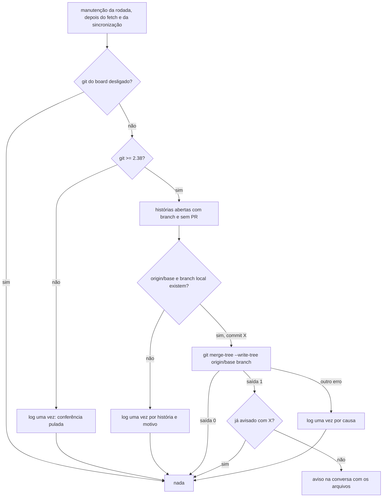

# 0747 — Heartbeat: IA resolve conflitos dos PRs abertos e confere conflito com a base antes do PR

## Contexto

Entrega 2 da #722. O `MergeWatcher` (`src/extension/merge.ts`) detectava o pull request aberto com
conflito (`CONFLICTING`), avisava na conversa e, só se a história estava "Aguardando revisão", devolvia
o card para "Pronto". A IA recebia o pedido normal da fase e precisava deduzir pela conversa que devia
atualizar a branch. Havia ainda um defeito: o "já avisei" conferia só a URL e a frase do aviso, então um
segundo conflito no mesmo PR, depois de o primeiro ser resolvido, nunca era avisado. Numa história
autônoma já entregue, voltar para "Pronto" faria o autopiloto rodar a Homologação de novo. E nada
avisava que a branch de uma história ainda sem PR já conflitava com a base.

## Decisão

- **Modo de execução novo `conflict`** (`AiRunMode`). O runner manda um pedido próprio
  (`conflictPrompt`): na pasta da história, `git fetch origin` e `git merge origin/<prBase>`, resolver os
  conflitos, rodar as checagens, commit e `git push` sem força, registrar na conversa; se não conseguir,
  `git merge --abort` e `block_card`. Proíbe rebase, push forçado, mover o card e trabalhar a fase. Usa
  a permissão, o modelo e o esforço da fase. No `settle()`, o fim bem-sucedido devolve o card ao status
  anterior, sem passar pela entrega; uma falha da ferramenta bloqueia. Conta como atividade de
  **branch** (`activityKindOf`/`runningKindOf`), seguindo os tetos do board. Fica fora do disjuntor de
  "sem progresso" do autopiloto.
- **Um aviso por conflito**: o aviso cita o commit da branch do PR (`headRefOid`, 7 caracteres) e o "já
  avisei" confere URL + frase + commit. O aviso não muda mais o status do card.
- **Estado em memória no `MergeWatcher`**: `pending` (história → commit em conflito ainda sem
  tentativa) e `attempted` (commit em que a IA já tentou). `MERGEABLE`, mesclado ou fechado limpam os
  dois; `UNKNOWN` não mexe em nada. A tentativa conta no fim da execução (`onRunFinished`), salvo quando
  o limite de uso a interrompeu. Se o PR continua em conflito no mesmo commit depois da tentativa, o
  board bloqueia o card com o motivo; desbloquear vale como "tente de novo" (uma vez).
- **Fila do heartbeat com prioridade**: `heartbeatQueue` recebe os pendentes e os põe no começo como
  itens `conflict`, para histórias em qualquer modo (inclusive autônomas e já entregues), menos
  bloqueadas, aguardando resposta ou em execução.
- **Conferência antes do PR** (`src/extension/baseConflict.ts`, novo): para cada história aberta com
  branch e sem PR, `git merge-tree --write-tree --name-only --no-messages origin/<base> <branch>`, só
  leitura. Saída 1 é conflito: aviso na conversa uma vez por commit da branch, com os arquivos (até 10).
  Git abaixo de 2.38, `origin/<base>` ou branch local ausente, ou outro erro: pula com uma linha no log,
  uma vez por motivo. Roda na etapa de manutenção da #722, depois da sincronização das branches e antes
  da fila da IA, com o mesmo limite de paralelismo.
- **`CommandError`** (`src/extension/git.ts`): o `run()` dos comandos de fundo do `boardHost` rejeita
  com ele, carregando o código de saída e a saída padrão, para distinguir "conflito" de "o comando
  falhou" sem ler a mensagem.
- **Textos que a IA lê**: o pedido do modo `conflict`, os dois avisos e um parágrafo na skill
  `faz-ai-workspace-e-pr` (`flowSkill.ts`). Rótulo "resolvendo conflito" ("resolving conflict") no card
  em execução.
- Sem migração (`SCHEMA_VERSION` e `BOARD_TEMPLATE_VERSION` iguais), sem mudança no MCP (`docs/mcp.md`
  igual), sem tela nova.

## Alternativas descartadas

- **Disparar a execução de conflito pelo autopiloto nas histórias autônomas** (como pedia a descrição):
  a história autônoma já entregue fica fora da fila do autopiloto; a fila do heartbeat alcança todas.
- **Devolver o card para "Pronto" e deixar a IA deduzir pela conversa**: o pedido da fase não é sobre o
  conflito, e na história autônoma entregue reabriria a Homologação.
- **Montar a fila de conflito a partir da conversa**: a conversa não sabe se o PR ainda está em
  conflito; precisaria de outro `gh pr view` na hora de montar a fila.
- **O `MergeWatcher` chamar o runner direto**: pularia os tetos e a reserva de vaga que o `pump` do
  heartbeat já faz.
- **Marcar a tentativa no início da execução**: uma execução cortada pelo limite de uso contaria como
  tentativa e o card seria bloqueado sem a IA ter tentado.
- **Coluna `mode` em `ai_runs`**: pede migração para um dado que o log e o rótulo do card já dão.
- **`git merge --no-commit` numa worktree temporária para conferir antes do PR**: cria pasta, mexe em
  índice e é lento; `merge-tree --write-tree` é só leitura.
- **Inferir o conflito pela mensagem do erro, ou rodar um git próprio em `baseConflict.ts`**: frágil, ou
  duplicaria o tratamento de PATH, tempo-limite e mensagem do `run()` do `boardHost`.
- **Instrução nos textos padrão das fases**: subiria a versão do board e não chegaria a quem
  personalizou; ficou na skill e no texto do aviso.
- **Consultar também o card bloqueado** (P1 da Spec): mudaria a detecção de merges; o bloqueado já está
  com a pessoa.

## Consequências

- Um PR aberto em conflito é tratado na mesma rodada do heartbeat em que é detectado, por uma execução
  com pedido próprio, sem mudar a fase nem o status do card.
- Cada conflito novo (outro commit) ganha aviso; avisos antigos, sem commit no texto, geram um aviso
  novo uma única vez para um conflito ainda aberto.
- No máximo uma tentativa por commit em conflito a cada abertura do board (o estado é em memória:
  reabrir o editor dá mais uma). Parar a execução à mão conta como tentativa.
- A conferência antes do PR também roda enquanto a IA trabalha na história: com a branch em conflito,
  cada commit novo gera um aviso novo.
- A IA pode resolver mal; o pedido exige as checagens antes do push e o PR continua com a revisão da
  pessoa.

## Desvios do plano

- A execução de conflito das histórias autônomas sai da fila do heartbeat, não do autopiloto (decidido
  no Discovery, P2).
- O ouvinte `runner.onDidFinish` do `boardHost` segue o padrão dos outros ouvintes: o descarte dele não
  é guardado.

## Diagramas

### PR aberto entra em conflito

### Conferência antes do PR

