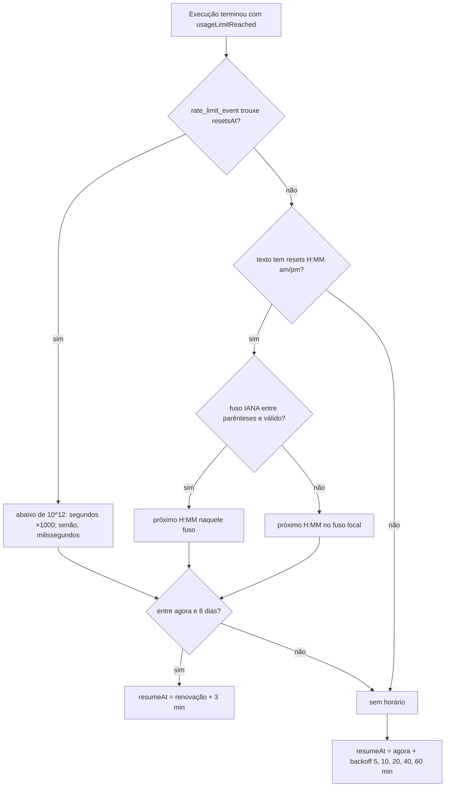

# 0800 — Autopiloto bloqueia cards quando a execução falha por limite de uso do plano

## Contexto

Quando a ferramenta de IA esgota o limite de uso do plano ("You've hit your session limit · resets
1:50pm (America/Sao_Paulo)"), o runner já reconhecia o caso (`usageLimitReached`) e guardava só um
booleano em memória (`AiRunner.usageLimited`). O autopiloto não o lia: contava cada execução que
falhou como "execução sem avanço", disparava de novo na hora e, na terceira, bloqueava o card.

No incidente de referência, as execuções de #615 a #623 falharam por limite por volta das 13:45; o
autopiloto repetiu às 13:49:40, 13:49:58 e 13:50:25 e bloqueou os 9 cards às 13:50:29, sem
impedimento real. A tentativa das 13:50:25 falhou 25 s depois do horário anunciado: a renovação não é
pontual, e é preciso uma folga. O horário de renovação não era guardado, embora o
`rate_limit_event` do Claude Code traga `resetsAt` e o texto traga o fuso IANA. A mensagem na
conversa ("repetida pelo heartbeat") também enganava na história autônoma e com o heartbeat
desligado. O leitor do Cursor nunca marcava a falha como limite.

Respostas da pessoa no refinamento: horário no fuso local quando o texto não diz o fuso; folga de
3 min; pausa **por ferramenta**, **gravada no banco**; aviso **no topo do board e nos cards**;
reconhecer o limite em **todas** as ferramentas que o board executa (Claude Code, Kimi Code, Cursor).

## Decisão

- **Uma pausa por limite de uso com hora para acabar substitui o booleano.** `UsageLimitPause`
  (`tool`, `resumeAt`, `source: 'reset' | 'backoff'`, `attempts`) fica no `MessageRouter`, como o
  `authExpired`, e é publicada no `snapshot()` em `BoardState.usageLimit` (com `probe`, a execução de
  teste em curso, só em memória).
- **Gravada na tabela `meta`**, chave `usage_limit_pause`, em JSON. Sem migração e sem subir
  `SCHEMA_VERSION`: a tabela já existe em todas as versões e uma versão anterior ignora a chave.
  `parsePause` lê qualquer coisa inválida como `null` (nunca segura a fila).
- **Regras puras em `src/shared/usageLimit.ts`**, usadas pelo host e pela webview: `resetAtOf`
  (ordem: `resetsAt` do evento → texto com fuso → texto no fuso local; `resetsAt` abaixo de 10¹² é
  segundo), `parseResetText`, `nextWallTime` (só `Intl.DateTimeFormat`, sem biblioteca nova; horário
  já passado vale para o dia seguinte), `backoffMs` (5, 10, 20, 40, 60 min, teto 60), `nextPause`,
  `limitHolds`, `canDispatch`, `limitWaitingCards`. Folga de 3 min (`LIMIT_SLACK_MS`); horário mais de
  8 dias à frente é ilegível e cai no backoff.
- **Os leitores de saída só devolvem a dica crua** (`RunReport.usageLimitReset`): Claude Code guarda
  o `resetsAt` do `rate_limit_event` esgotado e o texto do `result` de erro; Kimi Code guarda a linha
  de limite (sem horário: backoff); Cursor passa a reconhecer "You've hit your usage limit" só no
  stderr ou em linha que não é JSON.
- **O runner registra e encerra a pausa.** No fim por limite sem modelo reserva (o reserva continua
  sendo tentado antes), `recordUsageLimit`; no fim bem-sucedido, `clearUsageLimit`. A ferramenta é a
  que a execução usou, guardada no `Run` ao começar. O primeiro `start` depois do vencimento marca a
  execução de teste (`setLimitProbe`). A mensagem na conversa diz quem repete a execução e a partir
  de quando: o autopiloto (história autônoma), o heartbeat (ligado) ou a pessoa (heartbeat
  desligado). `onDidFinish` passa `{ usageLimit }` aos ouvintes.
- **O autopiloto não conta o fim por limite no disjuntor**; as falhas comuns continuam contando, com
  a mesma mensagem. Enquanto `canDispatch` é falso, não inicia histórias nem resumos e publica uma só
  nota da pausa. `autopilot.tick()` roda no relógio de 1 minuto que já existia (extensão e CLI) e,
  vencida a pausa, solta uma execução de teste antes das outras.
- **O heartbeat consulta a pausa** (`canDispatch` no lugar de `usageLimited`), registra no log a
  rodada durante a pausa com a ferramenta e a hora, **guarda a fila** e a retoma no `tick()` com uma
  execução de teste.
- **Tela:** `UsageLimitBanner` abaixo da barra superior ("Limite de uso do {tool}: a fila retoma às
  {time}." ou "…: nova tentativa às {time}.") e a etiqueta "Aguardando o limite de uso até {time}" nos
  cards da fila da IA. As mensagens do runner entram no dicionário de avisos traduzidos na tela
  (`translateGitNotice` vira `translateBoardNotice`).
- A execução pedida à mão continua liberada durante a pausa; terminando bem, encerra a pausa.

## Alternativas descartadas

- **Coluna ou tabela nova (migração):** subiria `SCHEMA_VERSION`, e uma versão anterior recusaria o
  board. A `meta` já guarda estado parecido (`branch_rename_pending`).
- **Gravar em `board.runner` (como `autopilotPaused`):** é configuração editada pela pessoa; a pausa é
  estado de execução, mudaria a cada falha e passaria pelo log de eventos do board.
- **Pausa só em memória** (recomendação do Discovery): a pessoa pediu que sobreviva a reabrir.
- **Timer próprio (`setTimeout`) até o `resumeAt`:** mais um recurso a criar e descartar no
  autopiloto, no heartbeat e na CLI, com relógio falso nos testes. O relógio de 1 minuto existente
  retoma entre 3 e 4 minutos depois da renovação, que basta.
- **Recusar a execução no `runner.start` durante a pausa:** barraria a execução à mão, e o runner não
  sabe quem chama.
- **O leitor calcular o horário:** os leitores não têm relógio nem fuso; o cálculo fica num só lugar,
  testável com `now`.
- **Ler o horário só do texto, no fuso local:** erra com a conta noutro fuso e ignora o `resetsAt`
  estruturado, que não depende de idioma.
- **Pausa por ferramenta + modelo:** a pessoa escolheu por ferramenta.
- **Gravar o `probe`:** uma extensão fechada no meio do teste deixaria a fila presa num teste que não
  existe mais.
- **Tirar o Cursor desta história até confirmar a mensagem numa execução real:** a pessoa pediu
  todas; o reconhecimento é restrito ao stderr, e errar o texto só deixa o Cursor como estava.
- **Dividir a tela numa história derivada:** as partes não funcionam sozinhas e o aviso é critério de
  aceite.
- **Desfazer sozinho os bloqueios que o disjuntor já fez no incidente:** fora do escopo.

## Consequências

- Falha por limite deixa de bloquear cards; a fila da ferramenta para até a renovação + 3 min (ou o
  backoff) e volta com uma execução de teste. Se o teste esbarrar de novo, a pausa recomeça (uma
  falha de segundos por retomada).
- Mudança de comportamento: durante a pausa, o heartbeat guarda a fila em vez de descartá-la (o teste
  #551 foi ajustado e passou a conferir também a retomada).
- A pausa só vale para a ferramenta ativa do board; com outra ativa, é ignorada (volta a valer se a
  pessoa voltar antes da hora).
- Formato novo de mensagem cai no backoff: seguro, mas a fila pode voltar até 60 min depois da
  renovação. O limite mensal do Cursor (só data, sem hora) testa de hora em hora.
- **Não validado:** a unidade do `resetsAt` (a heurística aceita segundos e milissegundos), a
  mensagem de limite do Cursor (vinda de um relato no fórum) e se a CLI 2.1.296 emitiu o
  `rate_limit_event` no caso real.

## Desvios do plano

- **Tamanho:** o Plan estimava ~465 linhas de produção; a entrega tem ~705 linhas de código alteradas
  (incluindo traduções e estilos), ~930 de teste e ~22 de documentação. Continuou uma história só.
- **Heartbeat guarda a fila** durante a pausa em vez de descartá-la (decidido na Implementação, para
  a retomada não perder os cards aprovados).
- **Laço de notas do autopiloto corrigido** na Implementação: com a fila segurada pelo limite, só a
  nota da pausa é publicada (antes alternava `null` e a nota a cada `evaluate`).
- **Revisão:** a pausa passou a ser gravada e apagada com a ferramenta que a execução usou (antes,
  `recordLimit` usava a ferramenta atual do board e `clearUsageLimit`, a do início); sobras de outras
  histórias que vieram pela base antiga saíram do diff.
- O comentário `(#800)` em `styles.css` virou `(história 800)`, porque `test/tokens.test.ts` o lia
  como cor hex.

## Diagramas

### A execução esbarra no limite

```mermaid
sequenceDiagram
  participant CLI as CLI da ferramenta
  participant Leitor as Leitor de saída (aiOutput)
  participant Runner as AiRunner (runner.ts)
  participant Router as MessageRouter
  participant Banco as meta (banco do board)
  participant Auto as Autopilot
  participant HB as Heartbeat
  CLI->>Leitor: rate_limit_event {status: rejected, resetsAt} / "resets 1:50pm (America/Sao_Paulo)"
  Leitor-->>Runner: RunReport {usageLimitReached: true, usageLimitReset}
  Runner->>Runner: settle(): há modelo reserva?
  alt há reserva
    Runner->>Runner: start(cardId, ..., reserva): sem pausa
  else sem reserva
    Runner->>Router: recordUsageLimit(run.tool, resetAtOf(dica, agora), agora)
    Router->>Banco: setMeta('usage_limit_pause', {tool, resumeAt, source, attempts})
    Runner->>Router: comentário "…o autopiloto repete a execução a partir das 13:53"
    Runner->>Auto: onDidFinish(cardId, mode, {usageLimit: true})
    Auto->>Auto: não conta no disjuntor; nota "a fila retoma às 13:53"
    Runner->>HB: onDidFinish(cardId)
    HB->>HB: guarda a fila e registra no log
  end
```

### A pausa vence e a fila retoma

```mermaid
sequenceDiagram
  participant Relogio as Relógio de 60 s (extension.ts / cli.ts)
  participant Auto as Autopilot
  participant HB as Heartbeat
  participant Router as MessageRouter
  participant Runner as AiRunner
  Relogio->>HB: tick()
  HB->>HB: pausa vencida e fila guardada → rodada / pump()
  Relogio->>Auto: tick()
  Auto->>Router: canDispatch? (vencida e sem teste em curso)
  Auto->>Runner: start(história A)
  Runner->>Router: setLimitProbe(A)
  Auto->>Router: canDispatch? → false: não inicia B
  alt A termina bem
    Runner->>Router: clearUsageLimit(tool), setLimitProbe(null)
    Auto->>Runner: start(B), start(C)… nas vagas livres
  else A esbarra no limite de novo
    Runner->>Router: recordUsageLimit → nova pausa; setLimitProbe(null)
  else A falha por outro motivo
    Runner->>Router: setLimitProbe(null); a próxima execução é outro teste
  end
```

### De onde vem o horário


