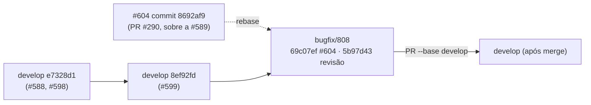

# 0808 — Levar as entregas da #589 e da #604 para a develop

## Contexto

As histórias #589 (leitura do projeto pela IA, PR #289) e #604 (comando de Bash registrado no log, PR #290) estavam em Concluído, mas o código delas não chegou à `develop`. Os dois PRs foram empilhados e mergeados nas branches anteriores da pilha, e não na `develop`. A #588 já tinha entrado na `develop` (PR #287) antes desses merges, então as mudanças da #589 e da #604 ficaram fora da próxima release.

## Decisão

- A branch parte da `develop` atual (`8ef92fd`, com a #599) e leva o commit da #604 (`8692af9`, PR #290) e a revisão dela, rebaseados sobre a `develop`. O rebase não teve conflito.
- A #589 não tem código a trazer: o único commit dela que não está na `develop` era o registro de decisão `docs/decisoes/0589-…`, e a #588 já o levou para a `develop` (`e7c46cc`). Sem efeito visível, a #589 não ganha entrada de CHANGELOG nem seção de README.
- A entrada da #604 já está na seção "Não lançado" / "Unreleased" dos dois CHANGELOGs e no README e no `docs/mcp.md`. Nada novo foi escrito nesses arquivos.
- O teste `test/mcpReinstall.test.ts` › "a falha numa ferramenta vai para o log e não derruba as outras" não é tocado por esta entrega. Ele supõe que a CLI `claude` não está no PATH; na máquina onde a história roda, ela está em `/opt/homebrew/bin/claude`, e o teste falha. A correção fica fora desta história.

## Alternativas descartadas

- **Corrigir o teste `mcpReinstall` nesta história:** a falha não nasce da entrega e a correção (isolar o PATH do teste) muda um arquivo que nenhuma das duas histórias toca. Mistura escopo e deixa o PR com um assunto a mais para revisar. Fica como pendência à parte.
- **Entregar a partir de `e7328d1`, sem rebase:** o PR nasceria atrasado em relação à `develop` e pediria um merge de conflitos depois. O rebase foi limpo, então o custo foi zero.
- **Cherry-pick dos commits da branch `feature/589…` inteira:** traria de novo os commits da #588 já na `develop`. Partir da `develop` e trazer só o commit da #604 evita isso.
- **Entrada de CHANGELOG para a #589:** descreveria uma mudança que não existe no código entregue (só um registro de decisão já publicado).

## Consequências

- A `develop` passa a ter o comando de Bash no log (`ai_run_bash`, migração 33) e `get_metrics` com `group_by: "bash_command"`, que estavam fora da release.
- O PR entra com um teste que já falhava na `develop` e não é causado por esta entrega. Quem revisa deve ignorá-lo ou resolvê-lo à parte.
- A revisão da #604 corrigiu o filtro do subcomando `node` (agora só entra verbo de minúsculas e hífen), o que muda o que o log grava para `node arquivo.js`: deixa de gravar o nome do arquivo.

## Desvios do plano

- O card previa "Conferir que as entradas da #589 e da #604 estão ... no CHANGELOG e no README". A #589 não tem entrada, pelo motivo da decisão acima.
- A base da branch mudou (`e7328d1` → `8ef92fd`) antes do push: o rebase foi feito, como previsto em "Partir da develop atual".

