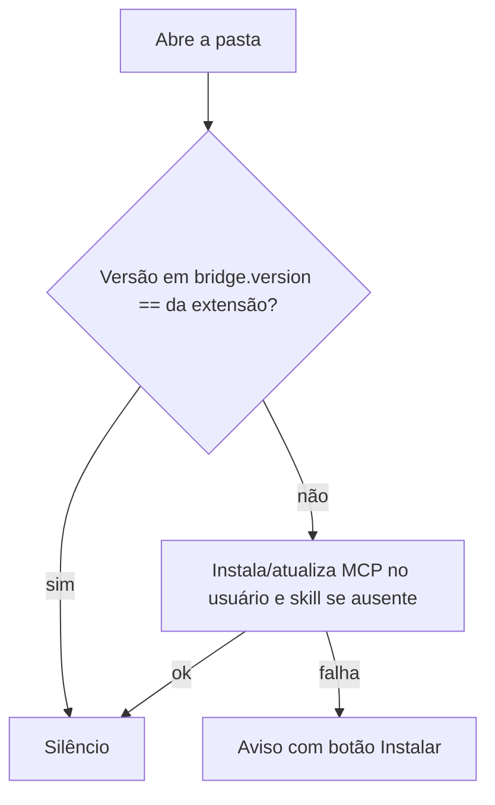

# #809 — MCP e skill do board no contexto do usuário, com aviso de desatualização só quando real

## Contexto
O aviso `mcp-outdated` era decidido pelo caminho da ponte, não pela versão, gerando falsos positivos. A atualização automática só rodava em ferramentas já registradas, e a skill só era atualizada por botão.

## Decisão
- O MCP do board é instalado sempre no escopo do usuário (Claude Code: `~/.claude.json`, servidores de escopo user). Registro de projeto existente é ignorado (não remove, não migra, não sinaliza). O Cursor mantém o registro de projeto, por limitação documentada.
- A versão da ponte é gravada em `bridge.version`, ao lado da ponte; `mcp-outdated` compara versão.
- MCP e skill são instalados/atualizados em silêncio ao abrir a pasta; só a falha gera aviso, com botão Instalar (um clique). A skill só é instalada quando ausente.
- `mcp-elsewhere` e `mcp-stale` de registro de projeto foram mantidos, pois indicam quebra real.

## Alternativas descartadas
- Migrar/remover registros de projeto: arriscado e fora do pedido.
- Sobrescrever sempre a skill: apagaria edições da pessoa.
- Instalar em todas as ferramentas: só a do board aberto e as já registradas, para não mexer em ferramentas não usadas.

## Consequências
Sem avisos falsos; se a CLI da ferramenta falhar, o aviso volta a cada ativação até a instalação.

## Diagramas

