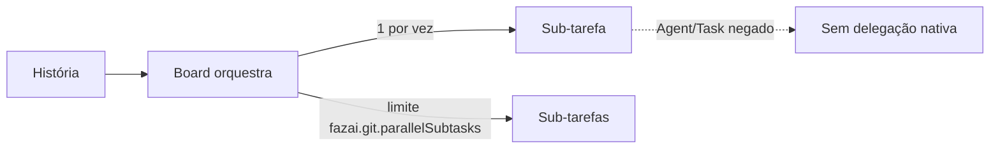

# #825 — Sem delegação nativa e limite de sub-tarefas na tela

## Contexto
Parte 4 de 4 da #621. O board passou a orquestrar as sub-tarefas como execuções separadas (#824), então a delegação nativa da CLI (subagentes) deixou de ser necessária e podia ocultar trabalho fora do controle do board.

## Decisão
- Removidos `delegates`/`ExecDelegate`/`delegatesOf`, a linha de subagentes da estimativa de contexto, o `--agents` com outros agentes e o aviso "não couberam". `MAX_AGENT_ARG` vale só para o agente da própria execução.
- No Claude Code, a ferramenta de subagente (`Agent`/`Task`) entra nas ferramentas negadas de toda execução do board.
- Cursor e Kimi: capacidade "desconhecida" (sem mecanismo comprovado); a admissão da #619 decide.
- Nova configuração `fazai.git.parallelSubtasks` (1 a 6) e controle "Sub-tarefas em paralelo por história" em Configurações → Harness de IA, mostrando pedido e efetivo (1: mesma pasta, uma por vez).
- A barra de atividade já mostrava o motivo `paused`; sem mudança.

## Alternativas descartadas
- Prometer bloqueio em Cursor/Kimi: a CLI não o impõe; seria promessa falsa.
- Manter delegação opcional: duas formas de executar sub-tarefas, mais complexidade e contexto fora do board.

## Consequências
- Toda sub-tarefa é uma execução visível no board.
- O nome `Agent`/`Task` não foi conferido na documentação oficial (sem rede) e `test:cli-real` não rodou: CLI real "não validada".

## Diagramas

