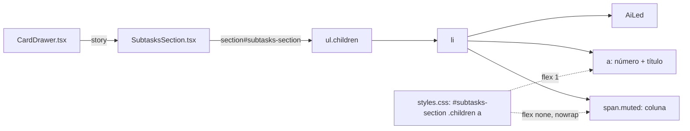

# #844 Ajustar o alinhamento das sub-tarefas no card aberto

## Contexto

Na seção "Sub-tarefas" do card aberto, a lista aparecia desalinhada: a linha é um flex com
`justify-content: space-between` e três filhos (LED, o link com número e título, e o status da
coluna). Como o link não cresce, o `space-between` o centraliza entre o LED e o status, e o título
fica deslocado em relação às outras seções do card.

As dúvidas do Discovery foram respondidas pela IA no modo autônomo (registradas no DISCOVERY.md e no
SPEC.md): a correção vale só para a seção de sub-tarefas (P1-A), e o título ocupa o espaço restante,
com o texto à esquerda e o status à direita (P2-A).

## Decisão

- Duas regras de CSS em `src/webview/styles.css`, com escopo em `#subtasks-section`, logo após
  `.children li .ai-led`:
  - `#subtasks-section .children a` com `flex: 1`, `min-width: 0` e `overflow-wrap: anywhere`, para
    o título ocupar o espaço entre o LED e o status e quebrar quando não houver espaço;
  - `#subtasks-section .children li .muted` com `flex: none` e `white-space: nowrap`, para o status
    ficar na borda direita e não ser espremido.
- `SubtasksSection.tsx`, `LinksSection.tsx` e `tokens.css` não mudam.

## Alternativas descartadas

- **Aplicar a correção a toda a classe `.children`**: alteraria também vínculos e "Filhos", sem
  pedido, e ampliaria a validação visual. Descartada.
- **Grade com colunas de largura fixa (LED | número | título | status)**: alinharia com exatidão,
  mas introduz estrutura e CSS novos para manter. Descartada, porque a causa é só o `<a>` sem
  crescimento.
- **`justify-content: flex-start` com `margin-left: auto` no status**: funciona, mas mexe no
  alinhamento de todos os filhos da lista. Descartada.

## Consequências

- Mudança restrita à lista de sub-tarefas; sem dado, texto, chave de tradução, banco ou
  comportamento de clique alterados.
- A causa foi diagnosticada pelo código; o alinhamento visual nos temas claro e escuro (RF1 a RF7 do
  PRD) ainda precisa ser conferido em tela.
