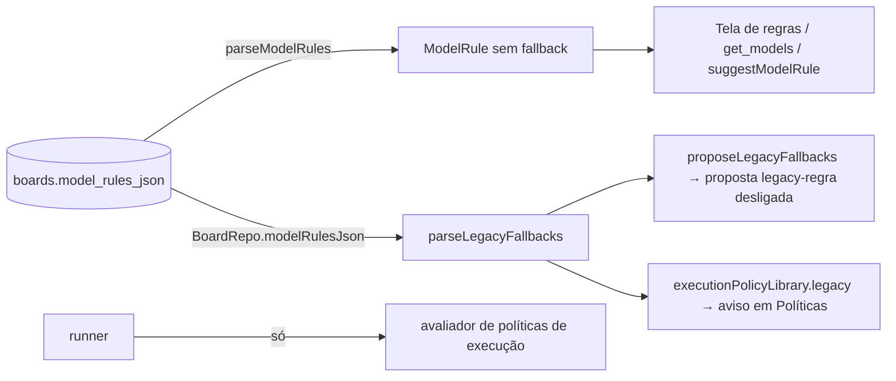
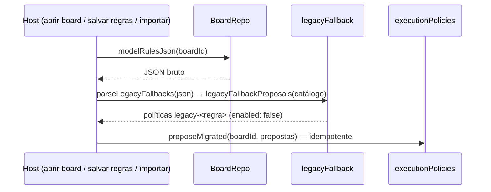

# #853 Remover o motor legado de modelo reserva (9/9, parte 3)

## Contexto

A #620 passou a decidir a troca de alvo de uma execução só pelas políticas de execução e fallback e
converte o "modelo reserva" das regras de modelo em proposta de política desligada. O rastro do motor
antigo continuava em quatro camadas: o campo `fallback` em `ModelRule`, o parâmetro e os campos de
reserva no MCP (`set_model_rules`, `get_models`), o campo "Fallback" no editor de regras e a
documentação. A revisão arquitetural v2 pede uma única fonte para alvo e fallback.

## Decisão

- `ModelRule` perde `fallback`; `parseModelRules` ignora a chave do JSON antigo. Sem migração de banco
  (`SCHEMA_VERSION` 44): o valor gravado em `boards.model_rules_json` fica e é lido só pela conversão,
  por `parseLegacyFallbacks(BoardRepo.modelRulesJson(boardId))` (mesmo padrão de `gitJson`), em
  `proposeLegacyFallbacks` (abertura, salvar regras, importar) e no aviso de `executionPolicyLibrary`.
- `set_model_rules` sem o parâmetro `fallback`: a chave é ignorada pelo Zod como qualquer outra fora
  do schema, e a regra é salva sem reserva. `get_models` nunca devolve `fallbackSuggest`/`fallbackValue`.
- `ModelRulesEditor` sem campo, botão e linha de reserva; cinco traduções órfãs removidas. O aviso de
  migração fica só em Políticas → Gerenciar políticas.
- `fallbackTargetOf` (`src/shared/runTarget.ts`) removida: código morto do motor antigo.

## Alternativas descartadas

- Manter `fallback` no tipo como `@deprecated`: deixaria o conceito em `ModelRule`, em
  `suggestModelRule` e na mensagem host↔webview, contra o objetivo.
- Migração de banco que converte e apaga o campo: sobe o schema, repete o que `proposeMigrated` já
  faz de forma idempotente e perde o aviso de reserva sem conversão.
- Levar o JSON bruto no `BoardState`: evitaria o acessor, mas o dado legado viajaria no snapshot para
  a webview e para todos os consumidores do estado, só para dois leitores do host.
- Manter o parâmetro declarado e recusado no MCP (como previa a Spec): tornar o schema `strict` mudaria
  o tratamento de chaves desconhecidas em todas as ferramentas; a IA leria a descrição de um conceito
  "descontinuado". Desvio do plano: a chave é ignorada, não recusada, e a doc diz isso.
- Preservar o valor legado ao regravar regras (merge do JSON antigo com as regras novas): lógica de
  merge num `UPDATE` simples para manter só um aviso de reserva inconvertível, que não tem destino.

## Consequências

- Uma única fonte decide alvo e fallback: o avaliador de políticas. Nenhum caminho lê `rule.fallback`.
- A primeira regravação das regras apaga o valor legado do JSON; a proposta `legacy-<regra>` já criada
  permanece, e só o aviso de migração some (risco aceito na Spec, coberto por teste).
- Métricas, tentativas e logs antigos não mudam de formato e continuam legíveis.
- O teste de conversão grava o JSON bruto direto no banco e reabre o board: é o único jeito de simular
  um board antigo sem o campo no tipo.

## Diagramas

