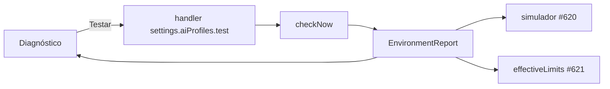

# 0880 — Diagnóstico com capacidades, Testar, próxima execução e limites

## Contexto
Parte 2 da #622: o Diagnóstico por perfil de CLI precisava mostrar capacidades e admissão, oferecer o Testar, e exibir a próxima execução e os limites efetivos, sem recalcular regra na tela.

## Decisão
- `EnvironmentReport` ganha `regime`, `nextRun` (simulador da #620) e `limits` (`effectiveLimits` da #621); ausentes na base viram `null` e a tela mostra "Indisponível nesta versão".
- `profilesInUse(board)` em `src/shared/profileHealth.ts` lista os perfis usados pelo board.
- O handler do Testar chama `checkNow()` ao fim, com trava por perfil (segundo clique recusado).
- `ProfileBlock` mostra capacidades (texto do estado), admissão e, no regime compatível, "Pode carregar por conta própria".
- Seção `NextRunSection` no Diagnóstico.
- Teste RF28: o que a IA lê não cita o Diagnóstico como requisito de MCP, skill ou permissão.
- CHANGELOG e README em pt/en.

## Alternativas descartadas
- **Dividir a história de novo:** as partes são interdependentes e o total é ~400 linhas.
- **Extrair `verifyProfile`:** a base não tem verificador de capacidades que grave evidência; inventar "Verificada" violaria o critério de aceite.
- **Calcular regime/limites na tela:** duplicaria regra; vêm do host.

## Consequências
- Regime fixo em `exclusive` no relatório até o host preparar execuções compatíveis.
- Evidência sem o cenário, pois o dado não existe na base.
- `capabilities`, `admission` e `evidence` ficam vazios até haver verificador que grave evidência.
- O diff contra `develop` é grande porque inclui a integração unificada.

## Diagramas

