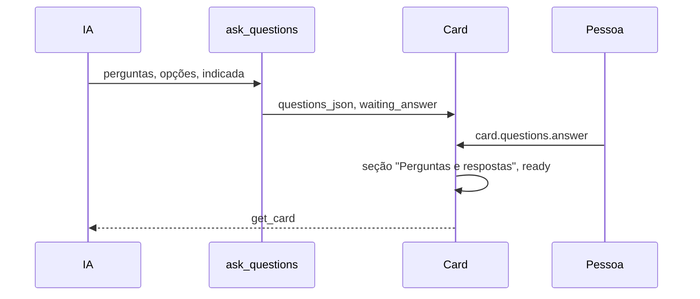

# Perguntas com opções no card (carrossel), parte 1: o host

## Contexto

A IA pergunta em texto livre (`ask_question`) ou deixa pontos no `pending` do `request_review`. A
pessoa precisa achar as perguntas, escrever a resposta à mão e não sabe qual opção a IA recomenda.
A história #895 foi dividida em três entregas empilhadas: o host (esta), o carrossel na tela (#955)
e os textos da IA com o board padrão v12 (#956).

## Decisão

- A IA registra uma rodada com a ferramenta MCP `ask_questions`: cada pergunta tem opções curtas e
  a indicada (texto exato de uma das opções). O detalhe fica na descrição do card.
- As perguntas pendentes ficam em `cards.questions_json` (migração 44), expostas em
  `Card.questions` e em `pendingQuestions` no `get_card`; o card passa a "waiting_answer".
- A pessoa envia as respostas por `card.questions.answer`: o host grava a seção "Perguntas e
  respostas" da descrição, esvazia as pendentes e devolve o card para "ready". Pergunta sem
  resposta vira "não respondida" e não trava o fluxo.
- Mesma pergunta numa nova rodada substitui a resposta; pergunta nova acumula na seção.
- No modo autônomo o board responde com a indicada e registra a decisão, sem passar a vez.
- `ask_question` continua para perguntas abertas, sem opções.

## Alternativas descartadas

- Estender o `ask_question`: misturaria texto livre e perguntas estruturadas num contrato só.
- Guardar as respostas como mensagens da conversa: o pedido é que virem parte da descrição.
- Tabela própria para as perguntas: o conjunto é pequeno, efêmero e sempre lido junto do card.

## Consequências

- Uma coluna JSON nova e `Card.questions` obrigatório nas fixtures de teste.
- Sem a tela (#955) e os textos da IA (#956), a ferramenta existe mas ainda não é induzida.

## Desenho

