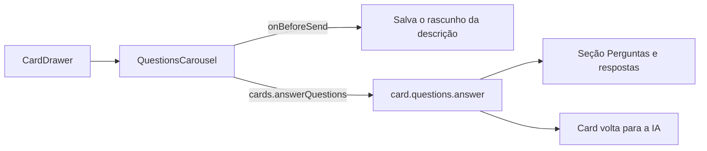

# Perguntas com opções no card (carrossel), parte 2: a tela

## Contexto

A parte 1 (#895) entregou o host: `Card.questions`, `card.questions.answer` e `ask_questions`. Falta a
tela em que a pessoa responde. Esta história (#955) a entrega no card aberto; os textos que a IA lê e
o board padrão v12 ficam na parte 3 (#956).

## Decisão

- `QuestionsCarousel` fica logo abaixo da descrição, só com perguntas pendentes e card vivo. Mostra uma
  pergunta por vez, com "{n} de {total}" e o selo "Indicada" na opção recomendada.
- Clicar numa opção grava e avança; a resposta própria é de uma linha (quebras viram espaço). As
  respostas ficam só no estado da tela até o envio; "Enviar respostas" manda o conjunto de uma vez por
  `cards.answerQuestions`, depois de salvar o rascunho da descrição (`onBeforeSend`), para o host não
  sobrescrevê-lo.
- A última tela é o resumo, com "não respondida" e o aviso de perguntas sem resposta; enviar assim é
  permitido, como no host.
- O pai usa `key` pelos ids das perguntas: uma nova rodada recomeça o carrossel.
- Estilos `.questions-*` só com tokens semânticos (DESIGN.md); textos em `i18n/en/card.ts`; o foco vai
  para o título a cada passo, para o leitor de tela anunciar a pergunta.

## Alternativas descartadas

- Gravar cada resposta no host a cada clique: várias mensagens e a vez voltaria para a IA antes de a
  pessoa terminar.
- Lista com todas as perguntas de uma vez: perde a indicada em destaque e o ritmo uma a uma pedido.
- Bloquear o envio com perguntas sem resposta: contradiz o host, em que a pergunta vira "não respondida".

## Consequências

- O envio é tudo ou nada por rodada; fechar o card antes de enviar descarta as respostas digitadas.
- A base mudou durante a história (a #895 foi mesclada): a branch recebeu `integracao/contexto-minimo`
  por merge, e o PR abre contra ela.

