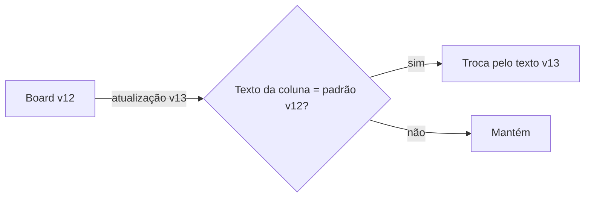

# 0956 — Textos da IA e board padrão para as perguntas com opções

## Contexto
Parte 3 da #895 (carrossel de perguntas). A ferramenta `ask_questions` (#895) e o carrossel (#955) já existem; faltava alinhar tudo o que a IA lê (descrições MCP, `MCP_INSTRUCTIONS`, `FLOW_SKILL`, `REVISAO_BODY`, `AUTONOMO_BODY`, runner e modelos das fases) para que nunca se contradigam.

## Decisão
- Descrições de `ask_question`, `request_review` (`pending` só para o que não é pergunta com opções), `add_comment` e o `next` de `start_work` citam `ask_questions`.
- `MCP_INSTRUCTIONS` cita `ask_questions` e foi enxugado para ficar abaixo de 2.048 caracteres.
- Skill, revisão, autônomo e runner usam "ask_questions (com opções) ou ask_question (pergunta aberta)".
- Modelos de Discovery, PRD, Spec e Plan perdem a seção "Perguntas para você".
- O board padrão já estava na v12 (Mapa do código, #617); esta mudança é a **v13**. Os textos v12 foram para `PHASE_HISTORY`; a atualização só troca a coluna que ainda tem o texto padrão anterior.

## Alternativas descartadas
- Manter a seção "Perguntas para você" nos documentos: duplicaria as perguntas, que agora vivem no carrossel.
- Sobrescrever todas as colunas na atualização: apagaria textos personalizados pela pessoa.
- Reutilizar a v12: já ocupada pela #617.

## Consequências
- Um único vocabulário de perguntas em todos os textos lidos pela IA.
- Boards na v12 com textos padrão recebem a atualização v13; os personalizados ficam intactos.
- O orçamento de 2.048 caracteres de `MCP_INSTRUCTIONS` fica mais apertado.

## Diagramas

