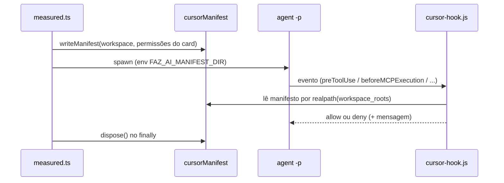
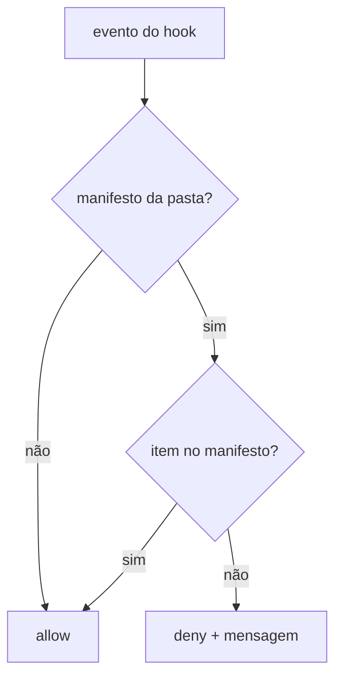

# 0965: Garantia do harness no Cursor por hooks

## Contexto
O board quer que cada execução use só os artefatos do card. No Claude Code a CLI garante isso por flags. No Cursor, o `agent -p` carrega tudo o que encontra (MCPs do `mcp.json`, skills e subagentes das pastas conhecidas) e não há flag para escolher por execução; o Cursor ficava só "orientado". O spike #966 com a CLI real confirmou que os hooks rodam no `agent -p`, herdam o ambiente, recebem `workspace_roots` e o deny é obedecido.

## Decisão
- O board grava, por execução, um **manifesto** (servidores MCP, subagentes, ferramentas e skills permitidos) em um diretório do board, indexado por `sha1(realpath(pasta de trabalho))`, e o apaga no fim (sucesso, falha ou cancelamento; o `dispose` só apaga o manifesto do próprio `runId`).
- Um **hook global** único (`dist/cursor-hook.js`), instalado de forma idempotente no `~/.cursor/hooks.json`, decide por evento com a função pura `decide`. Sem manifesto, entrada inválida ou erro: libera (o uso normal do Cursor não muda). Com manifesto: nega o que não está nele.
- Eventos: `beforeMCPExecution` (servidor), `preToolUse` (ferramenta e subagente via `Task`; chamadas `MCP:*` passam, pois o servidor é conferido no evento próprio), `subagentStart` (caso dispare) e `beforeReadFile` (SKILL.md de skill não escolhida).
- Nomes de ferramenta do Claude são traduzidos para os do Cursor (Bash→Shell, Edit/MultiEdit/NotebookEdit→Write, Agent→Task). Sem equivalente, `tools` fica vazio e vale só a orientação (log "parcial").
- `EXEC_ENFORCEMENT.cursor`: `mcp` e `tools` passam a `enforced`; `skills` e `agent` seguem `advised`.

## Alternativas descartadas
- **ACP**: também lê `.cursor/mcp.json` e descobre skills e subagentes sozinho; não resolve.
- **Hook de projeto (`.cursor/hooks.json`)**: escreveria no projeto, fora do escopo.
- **Manifesto só por variável de ambiente**: perde o vínculo com `workspace_roots`; o env fica só como complemento (diretório do manifesto).
- **Negar subagente só em `subagentStart`**: não dispara no `-p`; o caminho principal é `preToolUse`/`Task`.

## Consequências
- Servidor MCP, subagente e ferramenta fora do card são negados na hora do uso, com a mensagem "Faz AI: …" no registro da execução.
- Skills ficam no "o mais perto possível" (leitura por outro caminho não é barrada).
- O hook global afeta o Cursor da pessoa, mas libera tudo sem manifesto; há testes.
- `hooks.json` inválido não é sobrescrito; hook ausente ou desatualizado vira "garantia parcial" no log.
- Mudança de payload da CLI: `decide` ignora campos desconhecidos; o teste real (`npm run test:cli-real`) fixa a versão testada.

## Diagramas

